# Extend ESS My Profile and Leave Request

## Introduction

The Employee Self Service (ESS) application includes My Profile and Leave Request form pages. In this lab, you will extend these pages so an employee can update contact details, upload a profile photo, and attach a supporting document to a leave request.

Estimated Lab Time: 15 minutes

### Objectives

In this lab, you will:

- Add employee contact, profile-photo, and leave-request attachment columns.
- Load sample profile photos and leave-request attachments.
- Configure Page 4: My Profile so an employee can update their own profile.
- Add a supporting-attachment upload to Page 5: Leave Request.

### Prerequisites

- An Oracle APEX 26.1 workspace with the ESS application from the earlier modules.
- ESS **Page 4: My Profile** and **Page 5: Leave Request**.
- An employee test account whose APEX username matches the email address of exactly one employee in **TMS\_EMPLOYEES**, ignoring letter case.

*Note: These instructions use Page 4 and Page 5. If your application uses different page numbers, replace the page number and item prefix in the instructions. For example, use your My Profile page prefix in place of **P4\_**.*

### Downloads

Stuck or missed out on completing the previous labs? Don't worry! You can download the following application:

- **<a href="../introduction/files/ess-export6.sql" download="ess-export6.sql">Employee Self-Service Portal</a>**

Import it into your workspace. In **App Builder**, select **Import**, upload `ess-export6.sql`, and follow the steps in the **Import Application** wizard.

> **Note:** Supporting objects are already loaded in the workspace.
>
> **AI Configuration:** Configure a Generative AI Service in the workspace and select it under **Shared Components > AI Attributes** for the application. See **Module 1, Lab 2: Configure Generative AI Service**.

| File | Purpose |
| --- | --- |
| [ESS sample profile and attachment data](files/tms_candidates_images.sql) | Load sample employee contact details, profile photos, and leave-request attachments after the new columns are added |

## Task 1: Add the Profile and Attachment Columns

In this task, you will add the contact and attachment columns, then load sample values into the new columns. The **PHOTO\_BLOB** column already exists in **TMS\_EMPLOYEES**.

1. From the workspace home page, navigate to **SQL Workshop** > **SQL Commands**.

    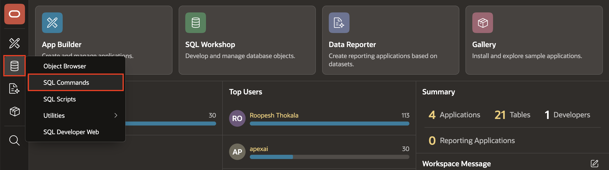

2. Run these statements one at a time. If you have already added any listed columns, remove those column definitions from that table's `ADD` clause before running its statement. If all of a table's listed columns already exist, skip that statement.

    ```sql
    <copy>
    ALTER TABLE tms_employees ADD (
        phone                    VARCHAR2(40),
        emergency_contact_name   VARCHAR2(160),
        emergency_contact_phone  VARCHAR2(40),
        photo_mime_type          VARCHAR2(255),
        photo_filename           VARCHAR2(255)
    );

    ALTER TABLE tms_leave_requests ADD (
        attachment_blob          BLOB,
        attachment_mime_type     VARCHAR2(255),
        attachment_filename      VARCHAR2(255)
    );
    </copy>
    ```

    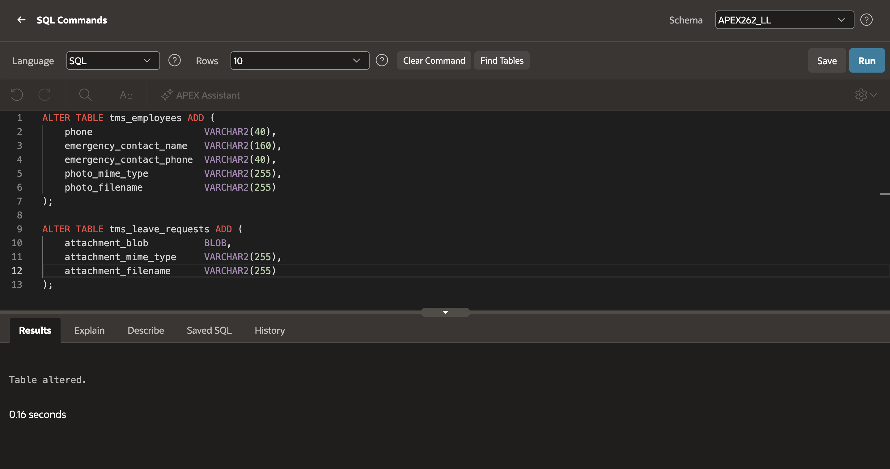

3. After the `ALTER TABLE` statements complete successfully, navigate to **SQL Workshop** > **SQL Scripts**.


4. Download the [ESS sample profile and attachment script](files/tms_candidates_images.sql).

    The script updates sample employee contact details and profile photos, then adds PDF attachments to existing leave requests. Each update commits separately. If the script stops before finishing, run it again to apply any remaining sample values.

5. Click **Upload**.

    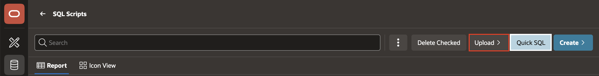

6. In the Upload Script dialog, click **Choose File**, select **tms\_candidates\_images.sql**, and click **Upload**.

7. In the report, select **tms\_candidates\_images.sql** and click **Run**.

    *Note: The following SQL Scripts captures show the earlier script name **tms\_ess\_images.sql**. Use **tms\_candidates\_images.sql**, the current file supplied with this lab.*

    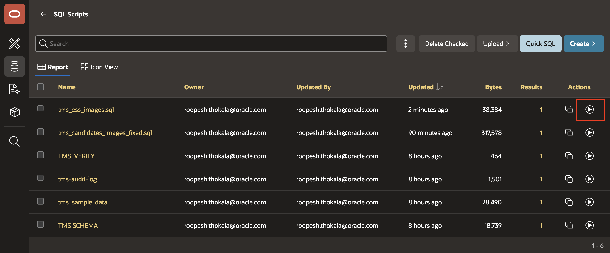

8. Review the script details and click **Run** to confirm. Verify that the statements complete successfully.

    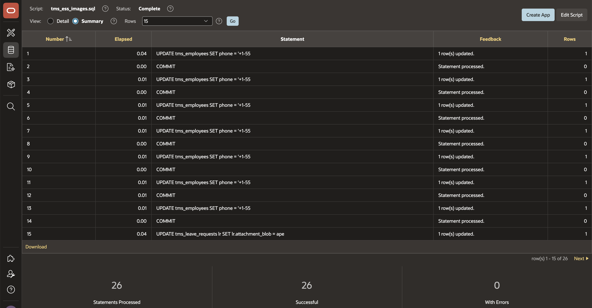

## Task 2: Identify the Employee Record on My Profile

In this task, you will use the Employee Details form region and set its primary-key item before the form loads. The process uses the signed-in user's email address to find the matching employee record.

1. Click **App Builder** and open the **Employee Self-Service Portal** application.

    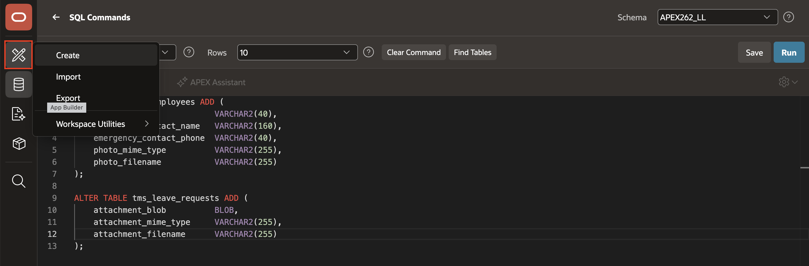

    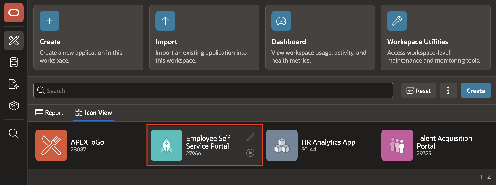

2. Open **Page 4: My Profile** in Page Designer.

    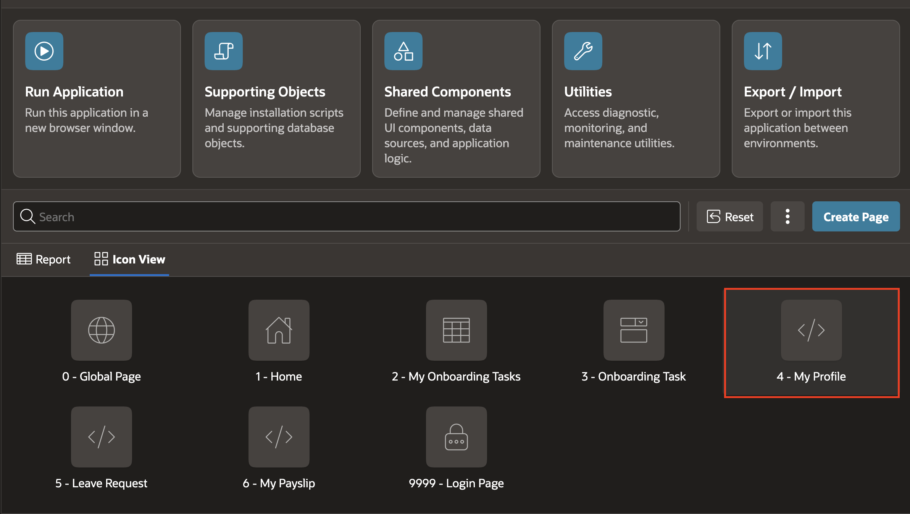

3. In the Rendering tree, check whether an **Employee Details** form region exists.

    - If it exists, select it and confirm that **Source > Table Name** is **TMS\_EMPLOYEES**.
    - If it does not exist, right-click **Body**, select **Create Region**, and create a **Form** region named **Employee Details** with **TMS\_EMPLOYEES** as its table.

    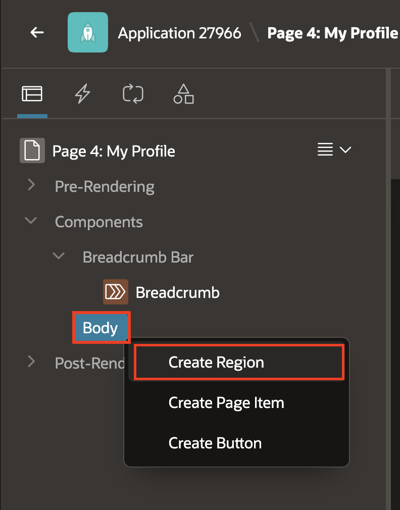

4. Select the **Employee Details** region and confirm that **EMPLOYEE\_ID** is its primary key. The associated page item is **P4\_EMPLOYEE\_ID**.

5. In the Processing tree, right-click **Before Header** under Pre-Rendering and select **Create Process**.

6. Select the new process. In the Property Editor, enter or select:

    - Under Identification:
        - Name: **Set Logged-in Employee**
        - Type: **Execute Code**
    - Under Execution:
        - Point: **Before Header**
    - Under Source:
        - PL/SQL Code: Copy and paste the following:

            ```plsql
            <copy>
            BEGIN
                SELECT employee_id
                  INTO :P4_EMPLOYEE_ID
                  FROM tms_employees
                 WHERE UPPER(email) = UPPER(:APP_USER);
            EXCEPTION
                WHEN NO_DATA_FOUND THEN
                    :P4_EMPLOYEE_ID := NULL;
            END;
            </copy>
            ```

    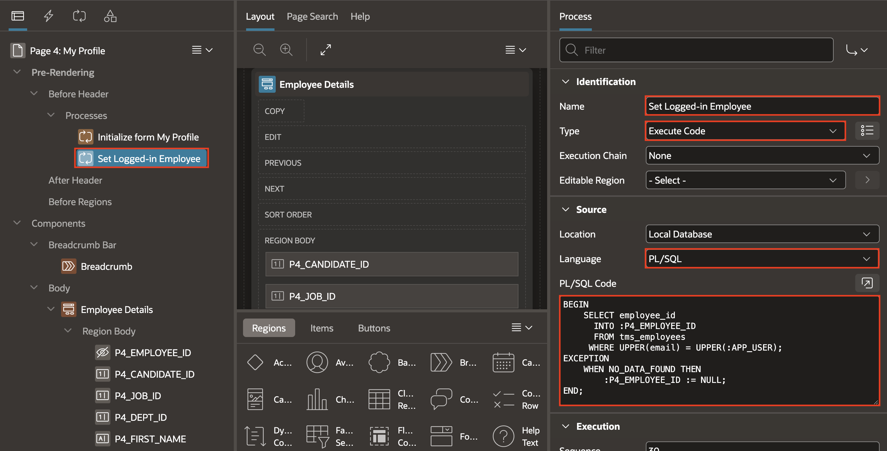

7. In the Processing tree, move **Set Logged-in Employee** above **Initialize My Profile**. The employee ID must be set before the form is initialized.

    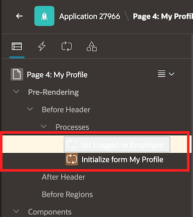

8. Click **Save**.

## Task 3: Configure the Profile Photo and Contact Regions

In this task, you will synchronize the new page items, organize the Employee Details form into three regions, and choose which values employees can edit.

1. In the Rendering tree, right-click **Employee Details** and select **Synchronize Page Items**. Confirm the synchronization to create items for the columns added in Task 1.

2. Select **P4\_PHOTO\_BLOB**. In the Property Editor, enter or select:

    - Under Identification:
        - Type: **Image Upload**
    - Under Label:
        - Label: **Change Profile Photo**
    - Under Display:
        - Preview Size: **Extra Large**
    - Under Storage:
        - Type: **BLOB column specified in Item Source**
        - MIME Type Column: **PHOTO\_MIME\_TYPE**
        - Filename Column: **PHOTO\_FILENAME**

    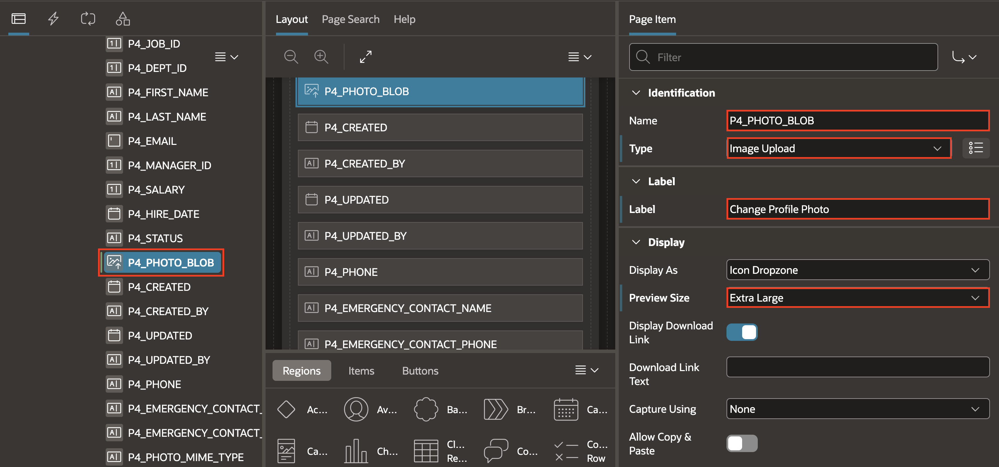

    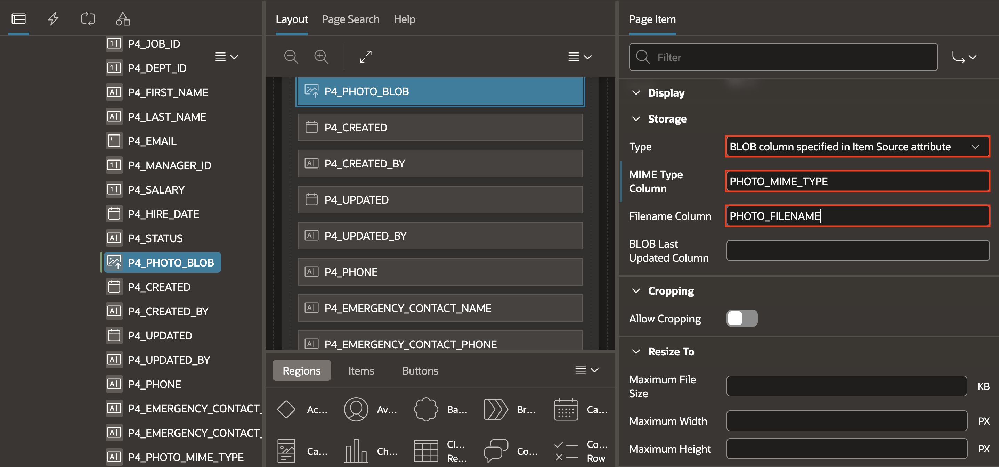

3. Right-click **Employee Details** and select **Create Sub Region**. Create a **Static Content** sub-region named **Personal**.

    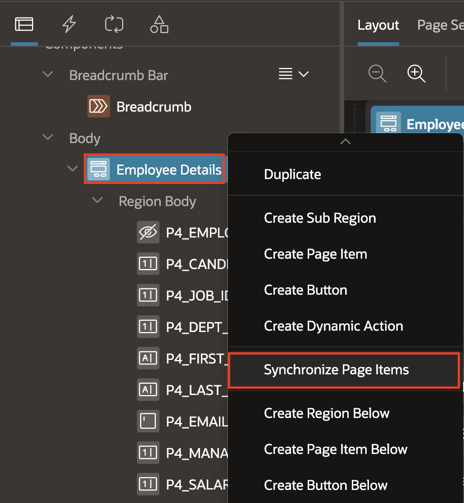

    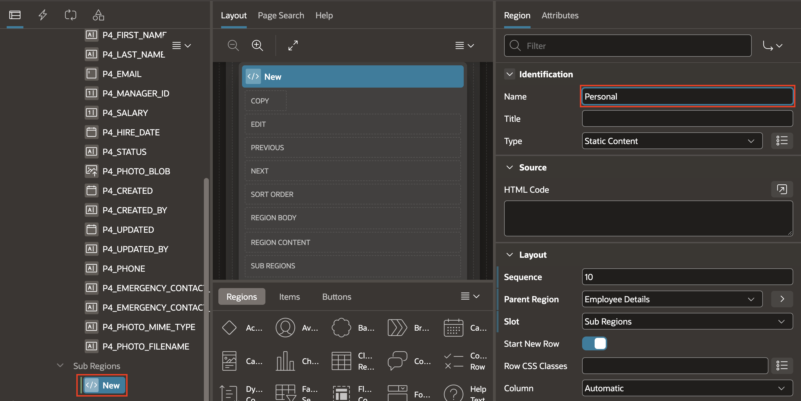

4. Repeat the sub-region creation action to add **Emergency Contact** and **Employment Details** as **Static Content** sub-regions under **Employee Details**.

    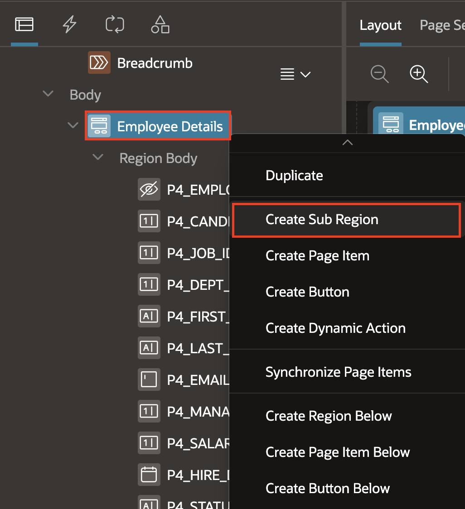

    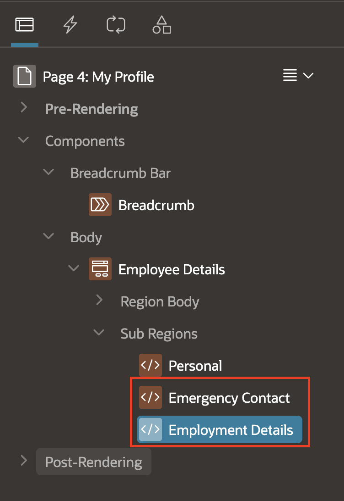

5. Expand **Employee Details** in the Rendering tree. Select **P4\_PHOTO\_BLOB**, **P4\_FIRST\_NAME**, **P4\_LAST\_NAME**, **P4\_EMAIL**, and **P4\_PHONE**. For each item, set **Layout > Region** to **Personal**.

    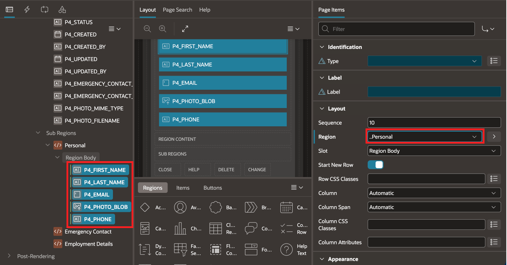

    Then configure the personal details:

    - For **P4\_FIRST\_NAME**, **P4\_LAST\_NAME**, and **P4\_EMAIL**, set:
        - Identification > Type: **Display Only**
        - Source > Query Only: **Toggle ON**

    The first name, last name, and email are shown for reference. The phone number remains editable.

    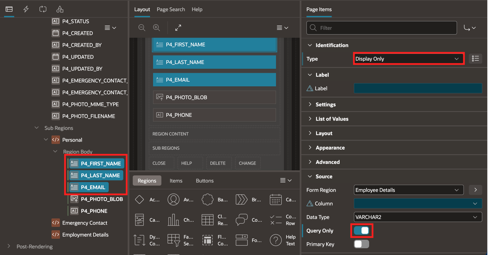

6. Select **P4\_EMERGENCY\_CONTACT\_NAME** and **P4\_EMERGENCY\_CONTACT\_PHONE**. In the Property Editor, set:

    - Under Layout:
        - Region: **Emergency Contact**

    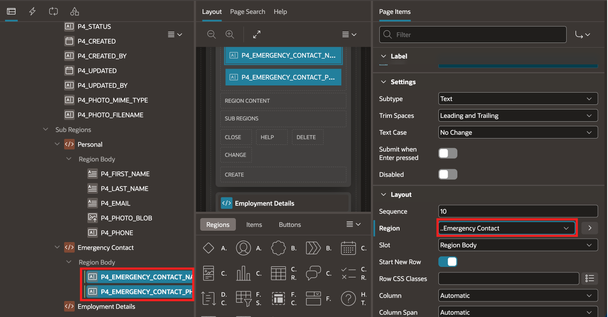

7. Select **P4\_EMERGENCY\_CONTACT\_PHONE** and set **Layout > Start New Row** to **Toggle OFF**.

    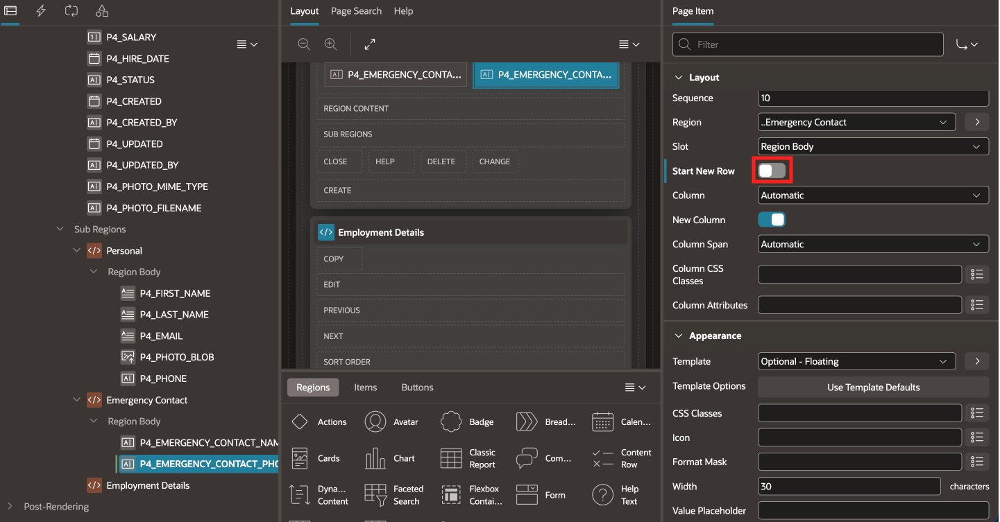

8. Select **P4\_JOB\_ID**, **P4\_DEPT\_ID**, **P4\_MANAGER\_ID**, **P4\_HIRE\_DATE**, and **P4\_STATUS**. For each item, set **Layout > Region** to **Employment Details**.

    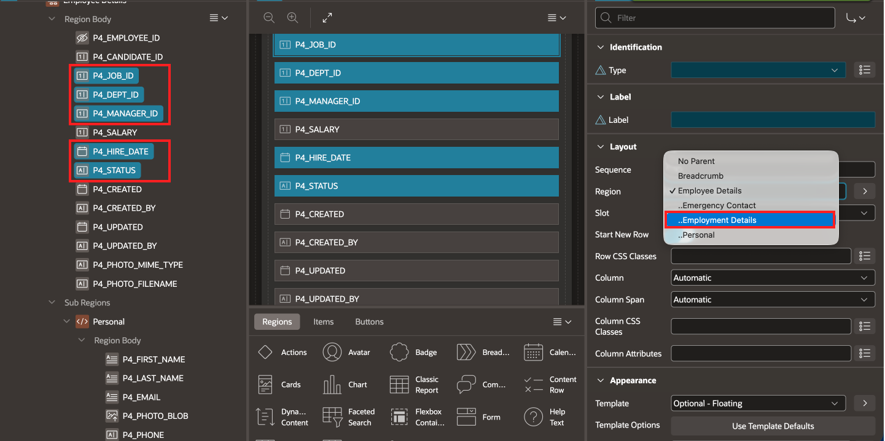

9. The job, department, and manager values are reference data. Use read-only select lists to show their descriptive names while preventing employees from changing them.

    Select **P4\_JOB\_ID**. In the Property Editor, enter or select:

    - Under Identification:
        - Type: **Select List**
    - Under List of Values:
        - Type: **SQL Query**
        - SQL Query: Copy and paste the following:

            ```sql
            <copy>
            SELECT
                title AS display_value,
                job_id AS return_value
            FROM tms_jobs
            ORDER BY title
            </copy>
            ```

    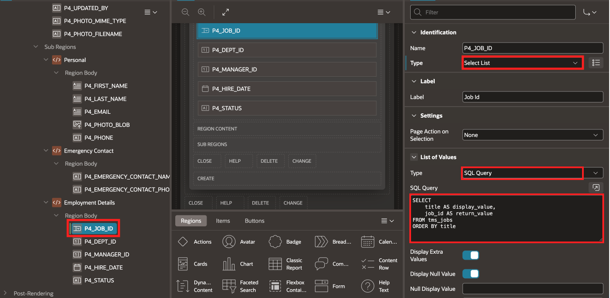

    - Under Read Only:
        - Type: **Always**
    - Under Source:
        - Query Only: **Toggle ON**

    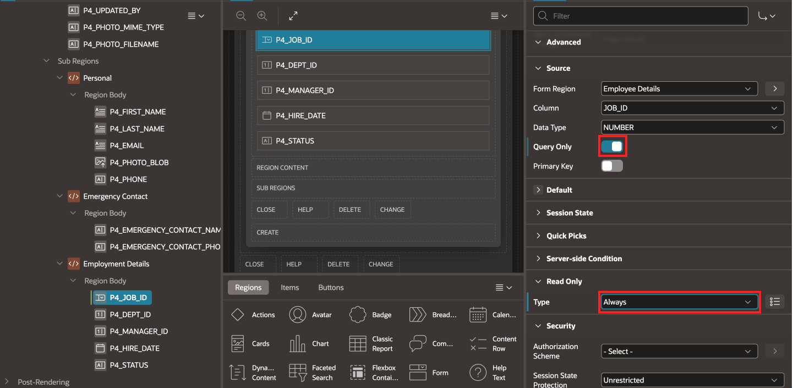

10. Similarly, select **P4\_DEPT\_ID** and configure the list in the same way:

    - Under Identification:
        - Type: **Select List**
    - Under List of Values:
        - Type: **SQL Query**
        - SQL Query: Copy and paste the following:

            ```sql
            <copy>
            SELECT
                name AS display_value,
                dept_id AS return_value
            FROM tms_departments
            ORDER BY name
            </copy>
            ```

    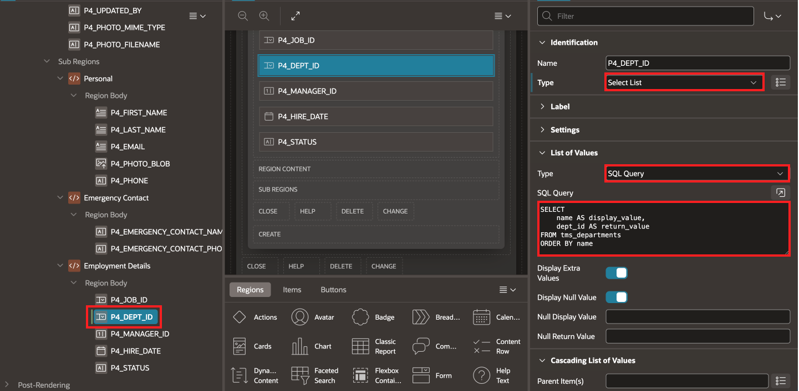

    - Under Read Only:
        - Type: **Always**
    - Under Source:
        - Query Only: **Toggle ON**

11. Select **P4\_MANAGER\_ID** and configure the list in the same way:

    - Under Identification:
        - Type: **Select List**
    - Under List of Values:
        - Type: **SQL Query**
        - SQL Query: Copy and paste the following:

            ```sql
            <copy>
            SELECT
                first_name || ' ' || last_name AS display_value,
                employee_id AS return_value
            FROM tms_employees
            ORDER BY first_name, last_name
            </copy>
            ```

    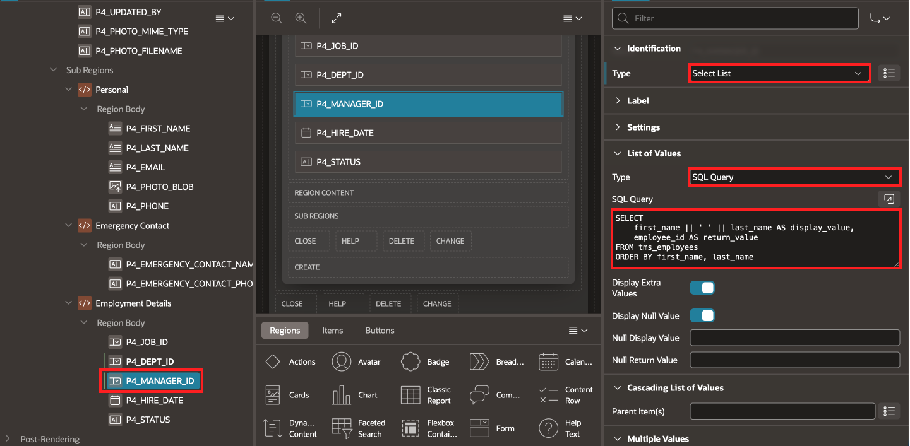

    - Under Read Only:
        - Type: **Always**
    - Under Source:
        - Query Only: **Toggle ON**

12. Select **P4\_HIRE\_DATE**. In the Property Editor, set:

    - Under Identification:
        - Type: **Display Only**
    - Under Appearance:
        - Format Mask: **DD-MON-YYYY**
    - Under Source:
        - Query Only: **Toggle ON**

    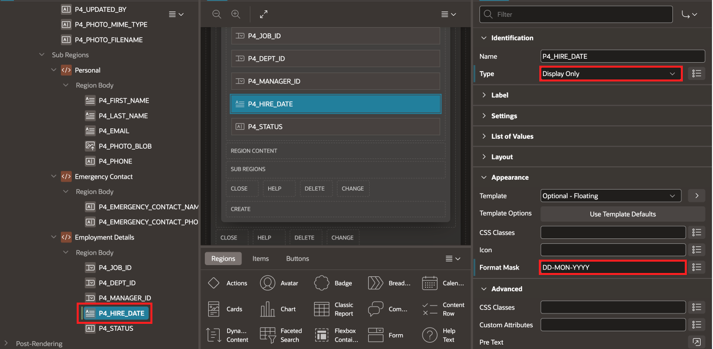

13. Select **P4\_STATUS**. In the Property Editor, set:

    - Under Identification:
        - Type: **Display Only**
    - Under Source:
        - Query Only: **Toggle ON**

    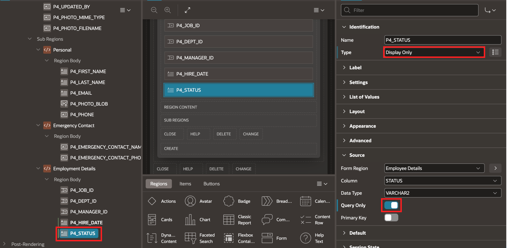

14. Set **Identification > Type** to **Hidden** for the remaining Employee Details items that are not displayed in **Personal**, **Emergency Contact**, or **Employment Details**. Keep **P4\_EMPLOYEE\_ID** hidden as the form's primary key.

15. Click **Save**.

## Task 4: Save Profile Changes

In this task, you will add a button to submit the Employee Details form and confirm that its automatic row-processing process saves the changes.

1. In the Rendering tree, right-click **Employee Details** and select **Create Button**.

    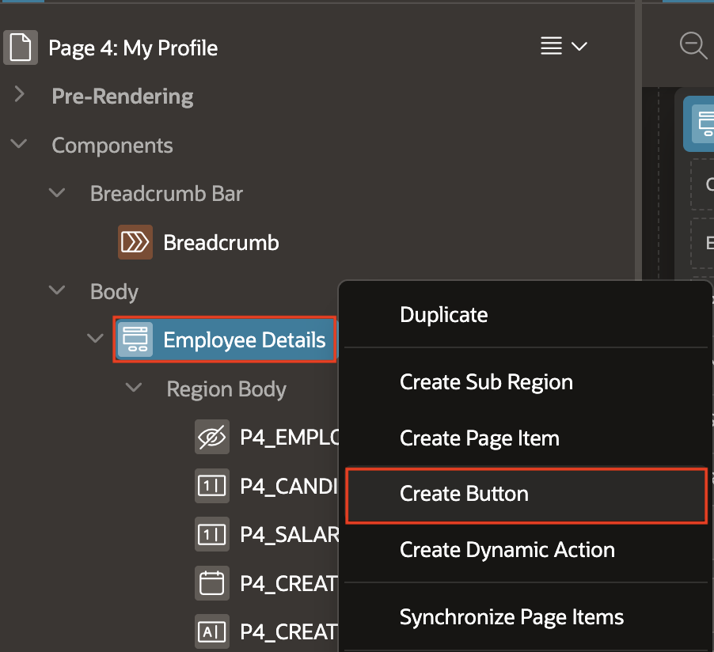

2. Select the new button. In the Property Editor, enter or select:

    - Under Identification:
        - Button Name: **SAVE\_PROFILE**
        - Label: **Save Profile**
    - Under Layout:
        - Slot: **Change**
    - Under Appearance:
        - Hot: **Yes**
    - Under Behavior:
        - Action: **Submit Page**
        - Database Action: **SQL UPDATE Action**

    This button saves the editable profile values: the photo, phone number, and emergency-contact details.

    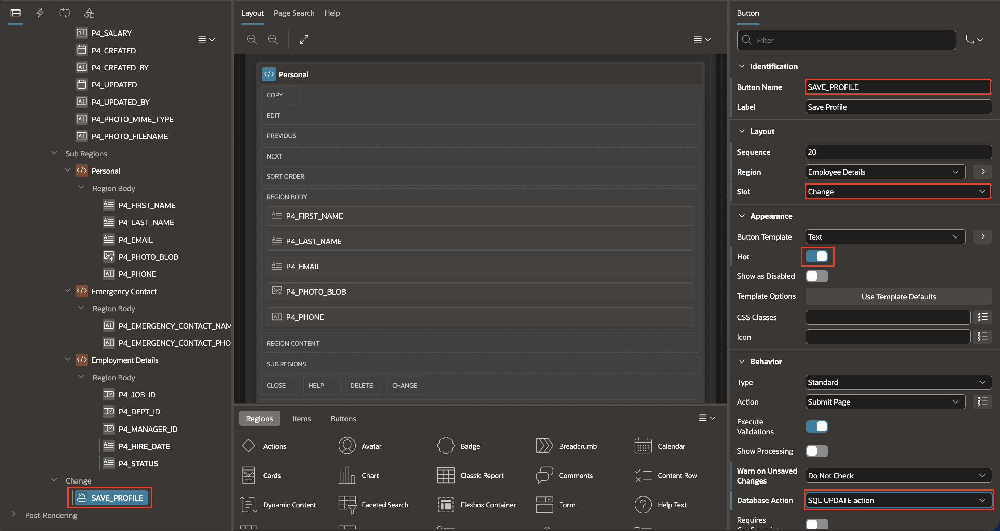

3. Click the **Processing** tab and select the existing **Employee Details** form process. If it is missing, right-click **Processing**, select **Create Process**, and create a **Form - Automatic Row Processing (DML)** process for the **Employee Details** region.

    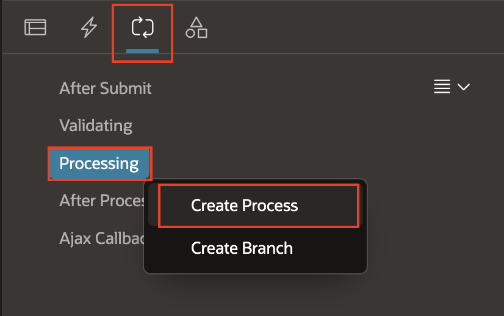

4. Select the form process. In the Property Editor, enter or select:

    - Under Identification:
        - Type: **Form - Automatic Row Processing (DML)**
        - Form Region: **Employee Details**
    - Under Target:
        - Prevent Lost Updates: **Toggle ON**
    - Under Success Message:
        - Success Message: **Profile updated successfully.**

    The automatic DML process updates the form row and uses APEX's built-in row locking and lost-update checks.

    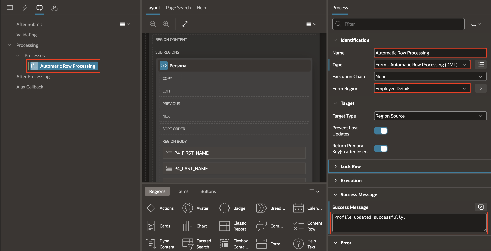

5. Click **Save**.

## Task 5: Add a Supporting Attachment to Leave Request

In this task, you will synchronize the Leave Request form, configure its attachment upload and download behavior, and hide attachment metadata from employees.

1. In Page Designer, open **Page 5: Leave Request**. Use the Page Finder to locate the page if it is not visible in the Rendering tree.

    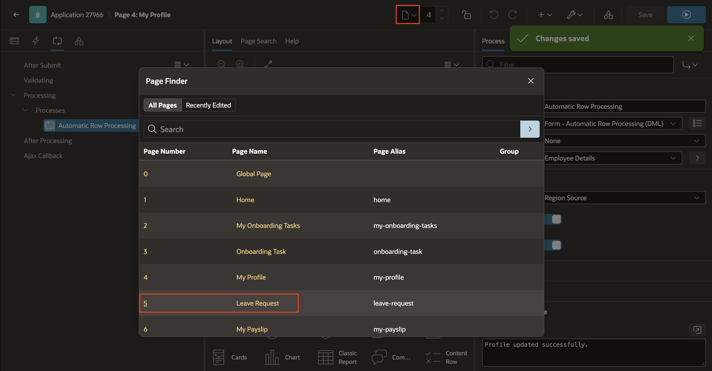

2. In the Rendering tree, right-click **Leave Request Form** and select **Synchronize Page Items**. Confirm the synchronization to create items for the new attachment columns.

    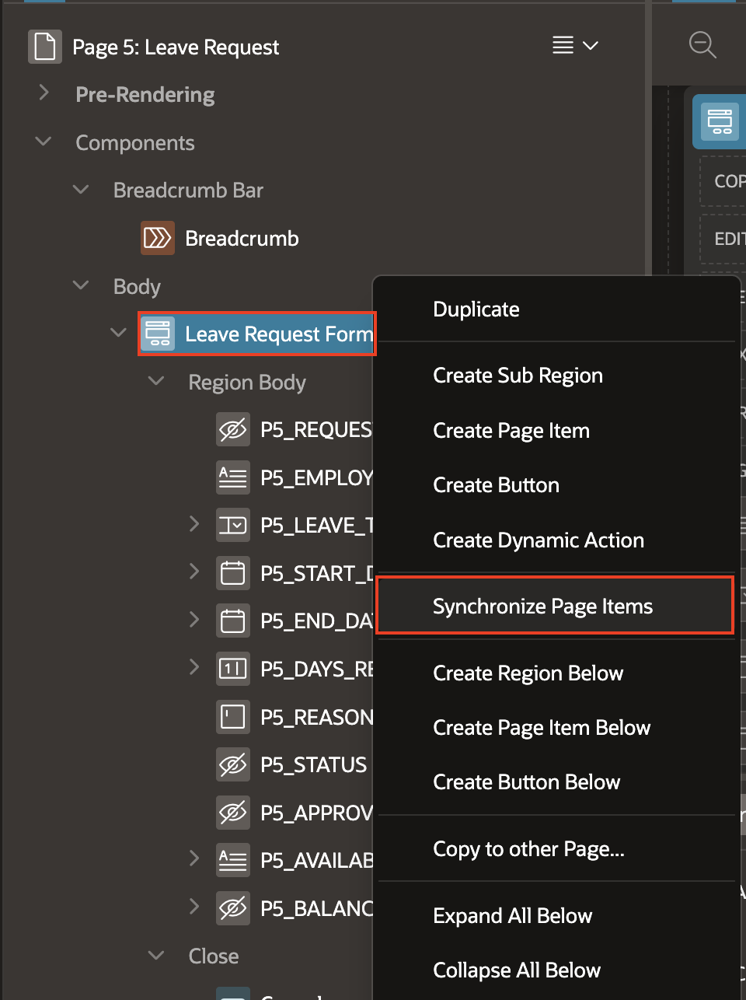

3. Select **P5\_ATTACHMENT\_BLOB**. In the Property Editor, enter or select:

    - Under Identification:
        - Type: **File Upload**
    - Under Label:
        - Label: **Supporting Attachment**
    - Under Display:
        - Display As: **Inline File Browse**
        - Display Download Link: **Toggle ON**
        - Download Link Text: **Download Attachment**
    - Under Storage:
        - Type: **BLOB column specified in Item Source**
        - MIME Type Column: **ATTACHMENT\_MIME\_TYPE**
        - Filename Column: **ATTACHMENT\_FILENAME**
    - Under Security:
        - Content Disposition: **Attachment**

    These settings let employees upload a file and download an attachment that is already saved with the request.

    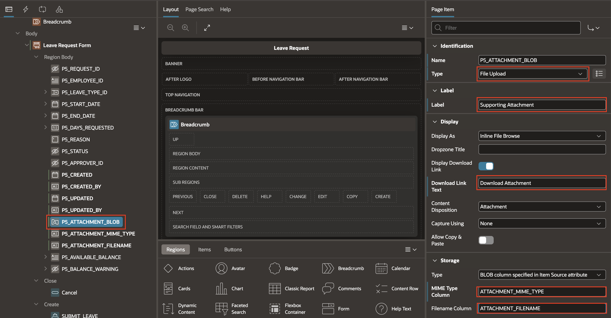

4. Select **P5\_CREATED**, **P5\_CREATED\_BY**, **P5\_UPDATED**, **P5\_UPDATED\_BY**, **P5\_ATTACHMENT\_MIME\_TYPE**, and **P5\_ATTACHMENT\_FILENAME**. Set **Identification > Type** to **Hidden** for each item. Keep the existing **P5\_REQUEST\_ID** and **P5\_STATUS** items hidden.

    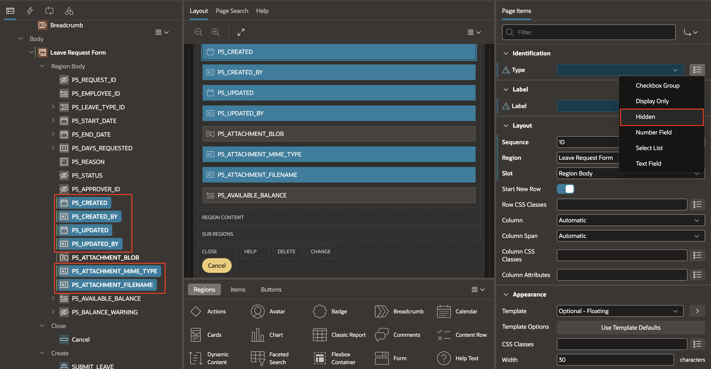

5. Click **Save**.

## Task 6: Run and Verify the Forms

1. Run the ESS application and sign in with an employee test account. The application home page contains the **My Profile** and **Leave Request** pages.

    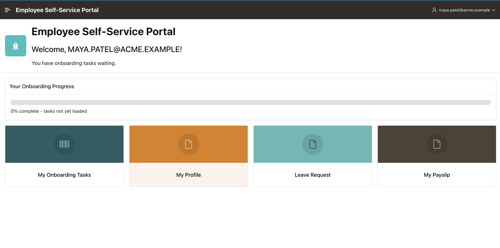

2. Open **My Profile** and confirm that the signed-in employee's information is displayed.

    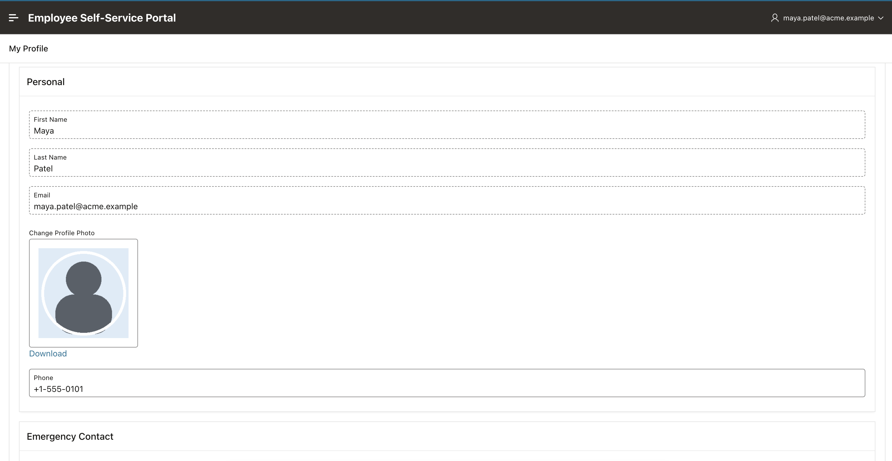

    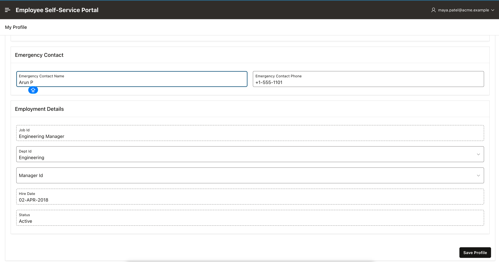

3. Change the emergency-contact name or phone number, then click **Save Profile**.

4. Confirm that **Profile updated successfully.** appears. Reload the page and verify that the changed contact details remain.

    *Note: This success-message capture shows an earlier form layout. Use it only to identify the confirmation message; the completed layout is shown in the preceding screenshots.*

    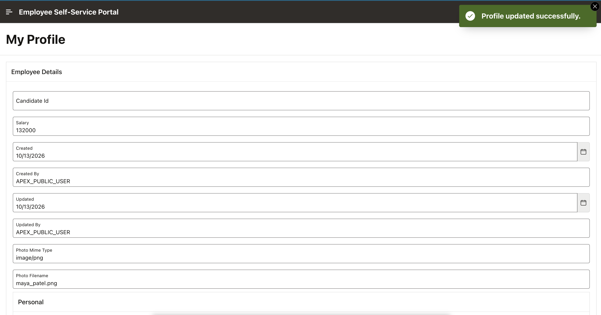

5. Open **Leave Request**. Create or edit a request, select a PDF file in **Supporting Attachment**, and save the request.

6. Reopen the request and select **Download Attachment**. Confirm that the saved PDF opens or downloads.

## Summary

You added the profile and attachment columns, loaded sample data, configured the My Profile form, and enabled attachment upload and download on Leave Request.

You may now proceed to the next module.

## Learn More

- [Oracle APEX 26.1: Configuring an Image Upload Item Source](https://docs.oracle.com/en/database/oracle/apex/26.1/apxdc/configuring-upload-image-item-source.html)
- [Oracle APEX 26.1: Configuring File Upload to a BLOB Column](https://docs.oracle.com/en/database/oracle/apex/26.1/apxdc/configuring-file-upload-blob-column.html)
- [Oracle APEX 26.1: Saving Changes with a Page Process](https://docs.oracle.com/en/database/oracle/apex/26.1/apxdc/saving-changes-page-process.html)

## Acknowledgements

- **Author** - Roopesh Thokala, Principal Product Manager
- **Last Updated By/Date** - October 2026
