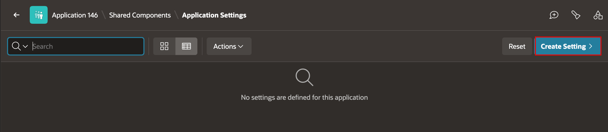
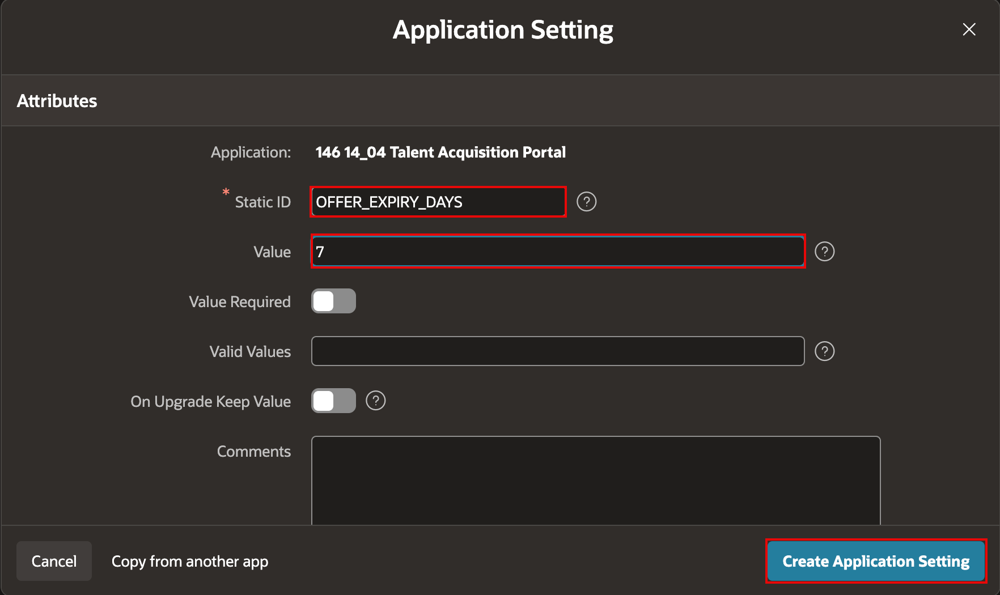
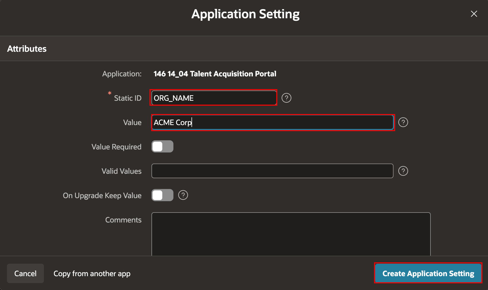
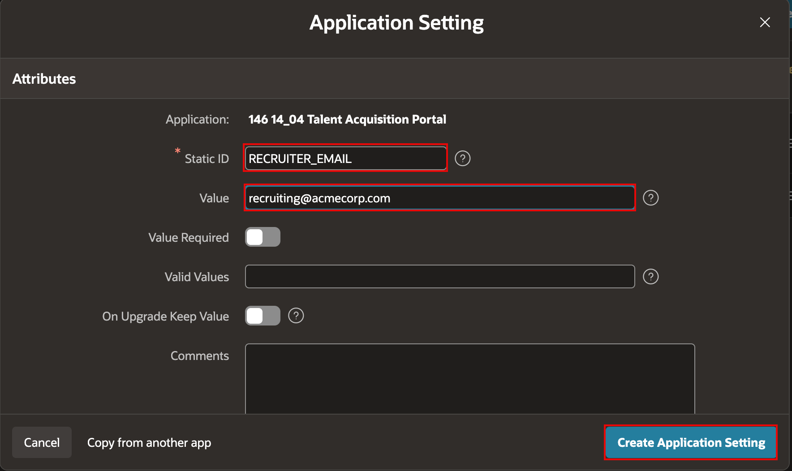
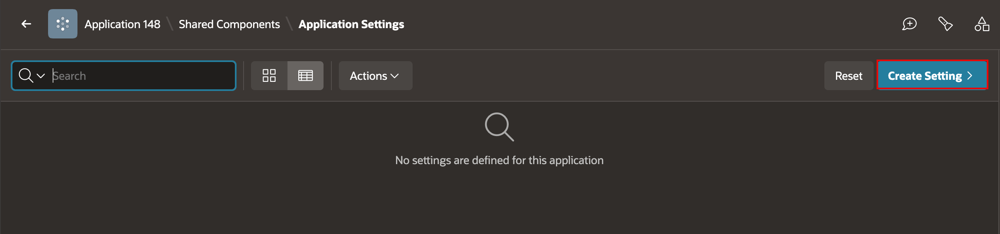
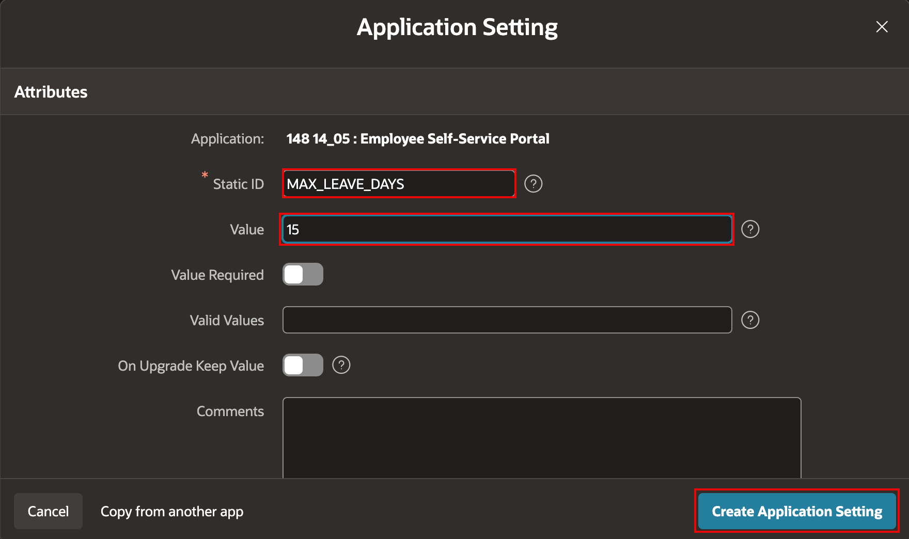
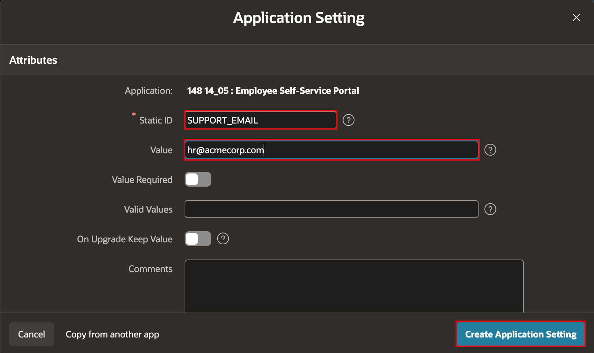
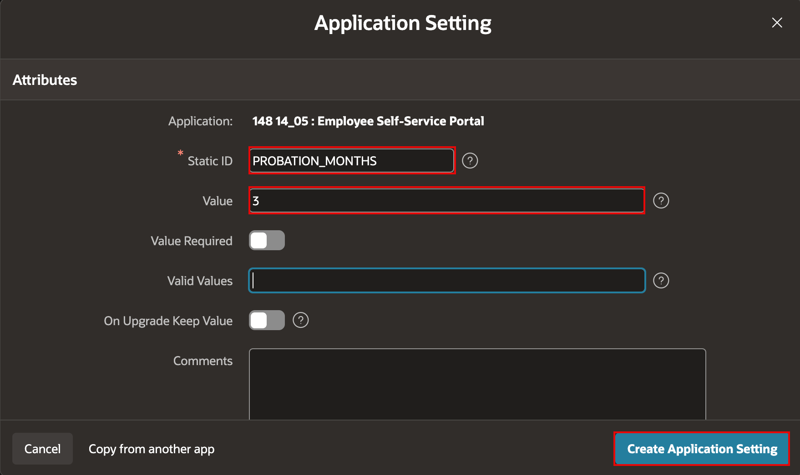

# Create Application Settings

## Introduction

Application Settings store values that an application can reference with substitution syntax. In this lab, you will create settings for the Talent Acquisition Portal (TAP) and Employee Self Service (ESS) applications.

Estimated Lab Time: 2 minutes

### Objectives

In this lab, you will:

- Create application settings for TAP.
- Create application settings for ESS.

## Task 1: Create TAP Application Settings

1. In **App Builder**, open the **Talent Acquisition Portal** application.

2. Click **Shared Components**. Under **Other Components**, click **Application Settings**.

    

3. Click **Create Setting**.

4. Create the offer-expiry setting. Enter/select the following:

    - Static ID: **OFFER\_EXPIRY\_DAYS**
    - Value: **7**

    Click **Create Application Setting**.

    

5. Create the remaining TAP settings. Click **Create Setting** before adding each setting.

    | Static ID | Value |
    | --- | --- |
    | ORG\_NAME | ACME Corp |
    | RECRUITER\_EMAIL | recruiting@acmecorp.com |

    Click **Create Application Setting** after entering each setting.

    

    

## Task 2: Create ESS Application Settings

1. In **App Builder**, open the **Employee Self Service** application.

2. Click **Shared Components**. Under **Other Components**, click **Application Settings**.

    

3. Click **Create Setting**.

4. Create the maximum-leave setting. Enter/select the following:

    - Static ID: **MAX\_LEAVE\_DAYS**
    - Value: **15**

    Click **Create Application Setting**.

    

5. Create the remaining ESS settings. Click **Create Setting** before adding each setting.

    | Static ID | Value |
    | --- | --- |
    | SUPPORT\_EMAIL | hr@acmecorp.com |
    | PROBATION\_MONTHS | 3 |

    Click **Create Application Setting** after entering each setting.

    

    

## Summary

You created application settings for TAP and ESS. Later modules can reference these values without hardcoding them in pages or shared components.

You may now proceed to the next lab.

## Acknowledgements

- **Author** - Apoorva Srinivas, Principal Product Manager; Roopesh Thokala, Principal Product Manager
- **Last Updated By/Date** - October 2026
