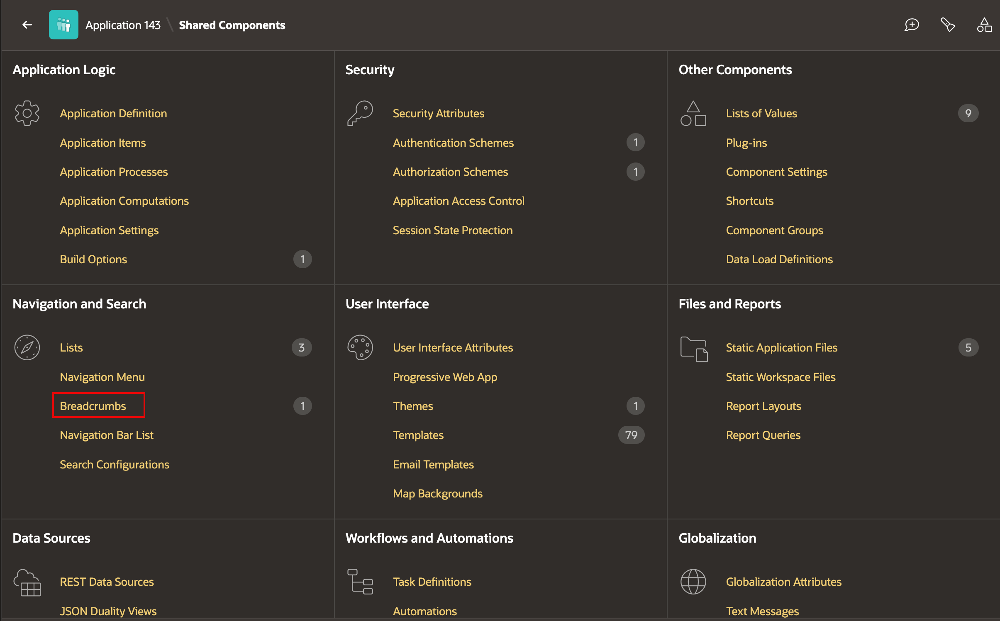
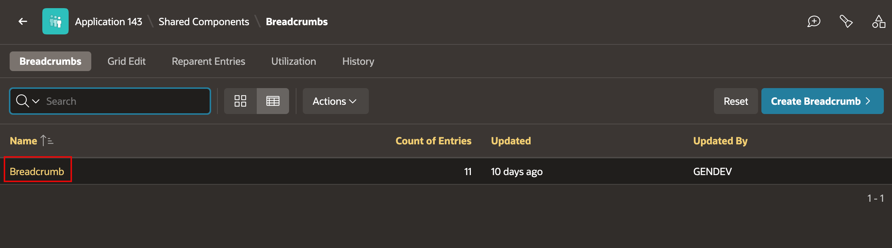
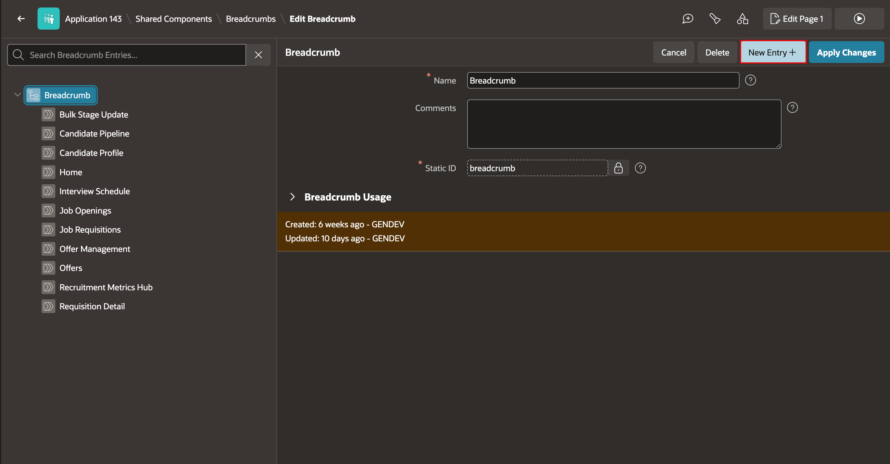
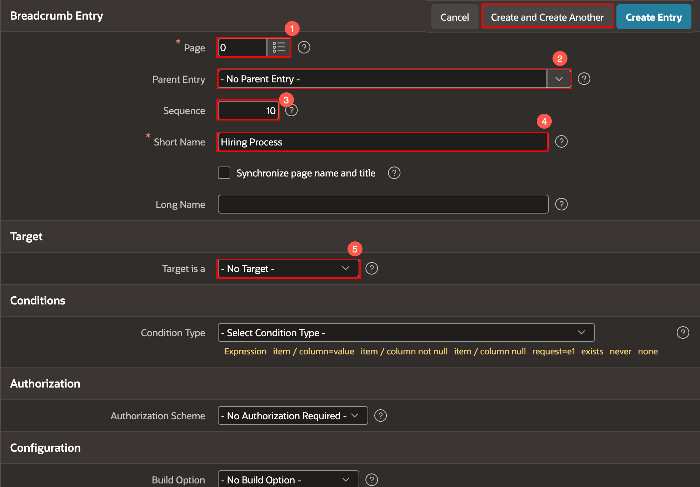
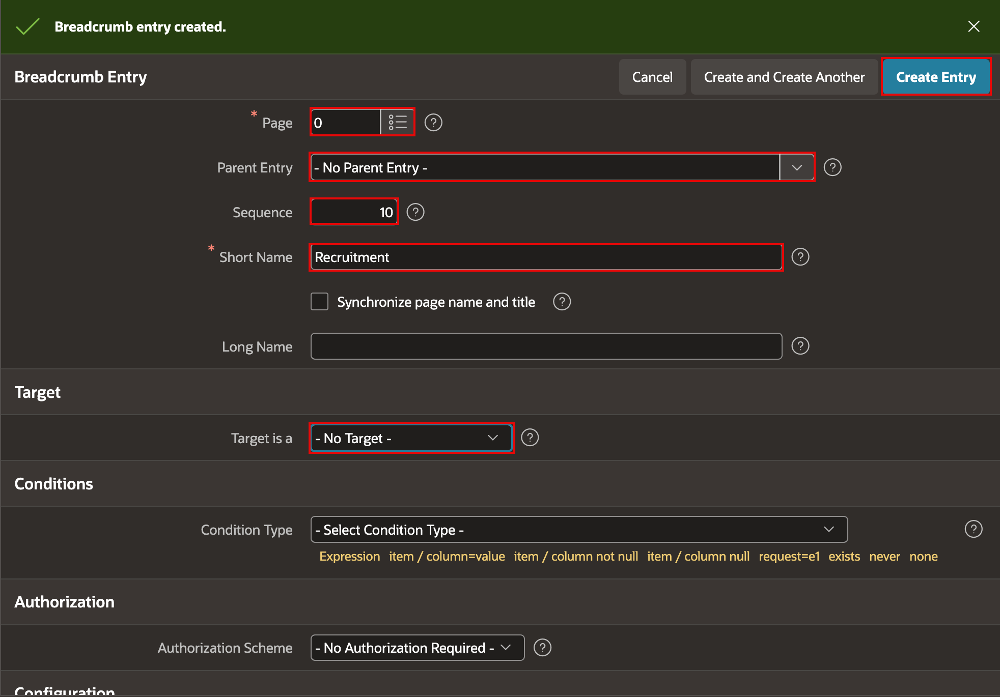
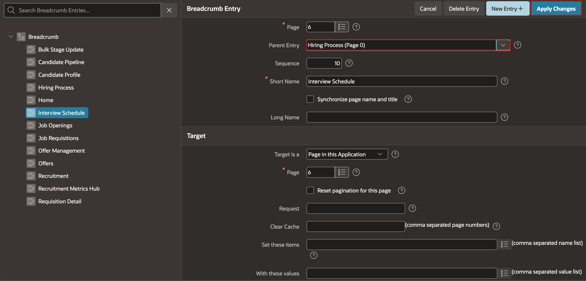
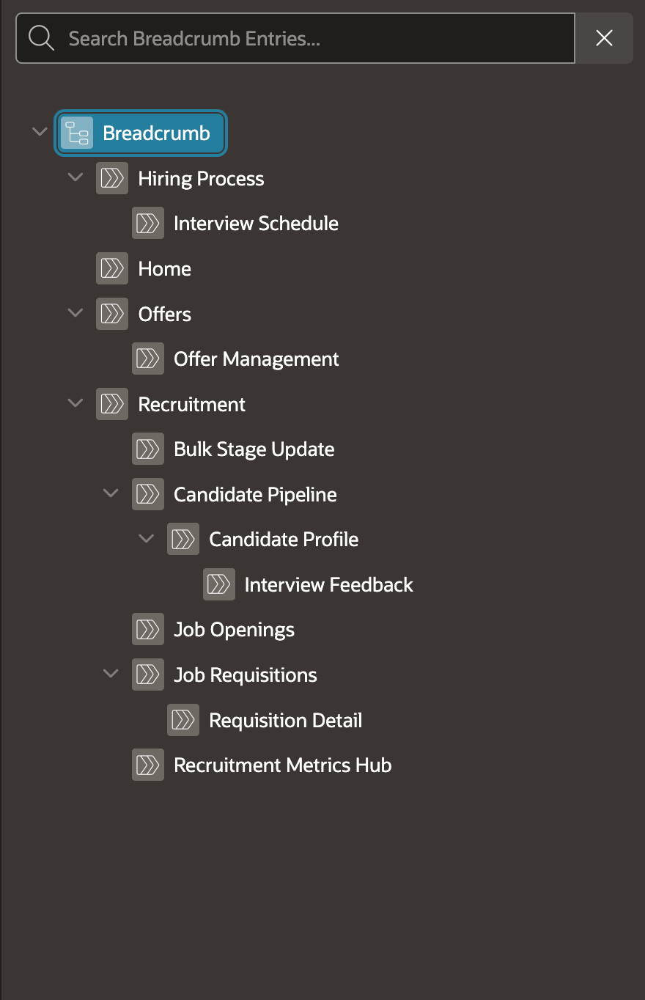
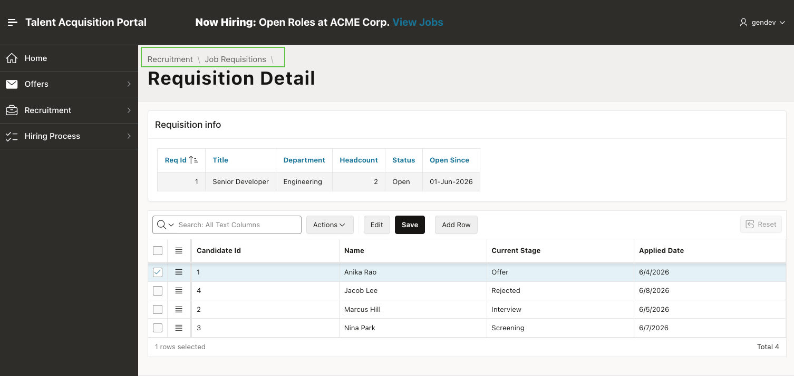

# Add TAP Breadcrumbs

## Introduction

Breadcrumbs show the location of the current page in the Talent Acquisition Portal (TAP). In this lab, you will create the Recruitment and Hiring Process parent entries, then define the page hierarchy for the existing breadcrumb entries.

Estimated Lab Time: 3 minutes

### Objectives

In this lab, you will:

- Create Recruitment and Hiring Process breadcrumb parents.
- Configure the parent entry for the existing TAP pages.
- Verify the breadcrumb path at runtime.

### Prerequisites

Complete [Lab 1: Restructure TAP Navigation](../tap-navigation/tap-navigation.md).

## Task 1: Open the TAP Breadcrumb

1. In **App Builder**, open the **Talent Acquisition Portal** application.

2. Click **Shared Components**. Under **Navigation and Search**, click **Breadcrumbs**.

    

3. Select the existing **Breadcrumb**.

    

## Task 2: Create Breadcrumb Parent Entries

In this task, you will create the parent breadcrumb entries. These entries organize the page paths but do not open a page.

1. Click **New Entry**.

    

2. Create the **Hiring Process** parent entry. Enter/select the following:

    - Page: **0**
    - Parent Entry: **- No Parent Entry -**
    - Sequence: **10**
    - Short Name: **Hiring Process**
    - Target is a: **- No Target -**

    Click **Create and Create Another**.

    

3. Create the **Recruitment** parent entry. Enter/select the following:

    - Page: **0**
    - Parent Entry: **- No Parent Entry -**
    - Sequence: **20**
    - Short Name: **Recruitment**
    - Target is a: **- No Target -**

    Click **Create Entry**.

    

## Task 3: Configure the Breadcrumb Hierarchy

In this task, you will set the parent entry for each breadcrumb entry.

1. Select **Interview Schedule**.

2. In the Property Editor, set **Parent Entry** to **Hiring Process (Page 0)**, then click **Apply Changes**.

    

3. Repeat the same update for the remaining breadcrumb entries:

    | Breadcrumb Entry | Parent Entry |
    | --- | --- |
    | Home | - No Parent Entry - |
    | Recruitment | - No Parent Entry - |
    | Recruitment Metrics Hub | Recruitment (Page 0) |
    | Job Openings | Recruitment (Page 0) |
    | Bulk Stage Update | Recruitment (Page 0) |
    | Requisition Detail | Job Openings |
    | Job Requisitions | Recruitment (Page 0) |
    | Candidate Pipeline | Recruitment (Page 0) |
    | Candidate Profile | Candidate Pipeline |
    | Interview Feedback | Candidate Profile |
    | Hiring Process | - No Parent Entry - |
    | Offers | - No Parent Entry - |
    | Offer Management | Offers |

    Click **Apply Changes** after updating each entry.

    

## Task 4: Run and Verify the Breadcrumb Path

1. Run the **Talent Acquisition Portal** application.

2. Open a candidate from **Candidate Pipeline** and confirm the breadcrumb path includes **Recruitment > Candidate Pipeline > Candidate Profile**.

3. Open a requisition from **Job Openings** and confirm the breadcrumb path includes **Recruitment > Job Openings > Requisition Detail**.

    

## Summary

You created the Recruitment and Hiring Process breadcrumb parents and defined the hierarchy for the existing TAP pages. Users can now see a meaningful breadcrumb path while navigating related pages.

You may now proceed to the next lab.

## Acknowledgements

- **Author** - Apoorva Srinivas, Principal Product Manager; Roopesh Thokala, Principal Product Manager
- **Last Updated By/Date** - October 2026
