# Restructure TAP Navigation

## Introduction

The Talent Acquisition Portal (TAP) navigation menu lists individual pages at the top level. In this lab, you will group related pages under parent entries so recruiters can find the pages they need more easily. You will also remove contextual pages that users open from reports and buttons.

Estimated Lab Time: 5 minutes

### Objectives

In this lab, you will:

- Create parent entries for the TAP navigation menu.
- Assign existing pages to the appropriate parent entry.
- Remove contextual pages from the navigation menu.
- Verify the updated menu at runtime.

### Downloads

Stuck or missed out on completing the previous labs? Don't worry! You can download the following application:

- **<a href="../introduction/files/tap-export8.sql" download="tap-export8.sql">Talent Acquisition Portal</a>**

Import it into your workspace. In **App Builder**, select **Import**, upload `tap-export8.sql`, and follow the steps in the **Import Application** wizard.

> **Note:**
>
> - **APEX Version:** The supplied application export was created with Oracle APEX 26.2 and cannot be imported into earlier APEX releases.
> - **Supporting Objects:** Supporting objects are already loaded in the workspace.
> - **AI Configuration:** Configure a Generative AI Service from **App Builder > Workspace Utilities > Generative AI**. See **Module 1, Lab 2: Configure Generative AI Service**.

## Task 1: Create Parent Navigation Entries

In this task, you will create top-level entries for the Recruitment, Hiring Process, and Offers groups.

1. In **App Builder**, open the **Talent Acquisition Portal** application.

2. Click **Shared Components**. Under **Navigation and Search**, click **Navigation Menu**.

    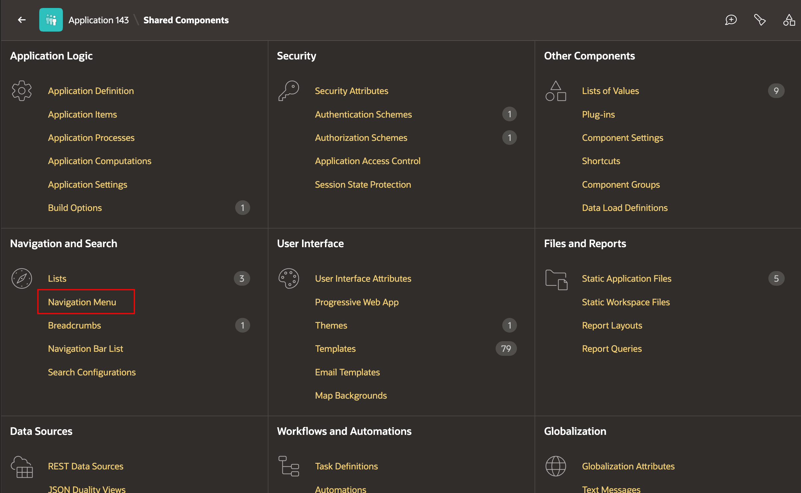

3. Select **Navigation Menu**.

    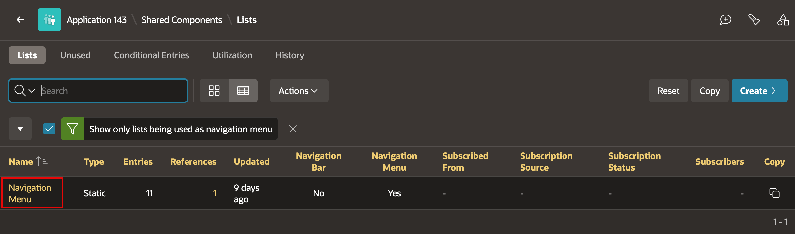

4. Click **Create List Entry**.

    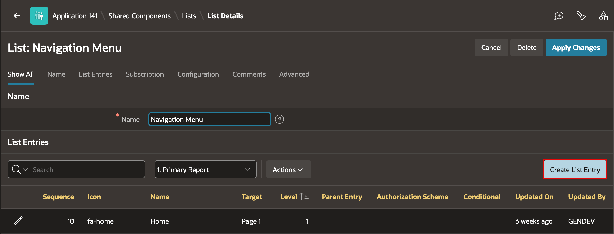

5. Create the **Recruitment** parent entry. Enter/select the following:

    - List Entry Label: **Recruitment**
    - Sequence: **120**
    - Icon: **fa-briefcase**
    - Target Type: **- No Target -**

    Click **Create and Create Another**.

    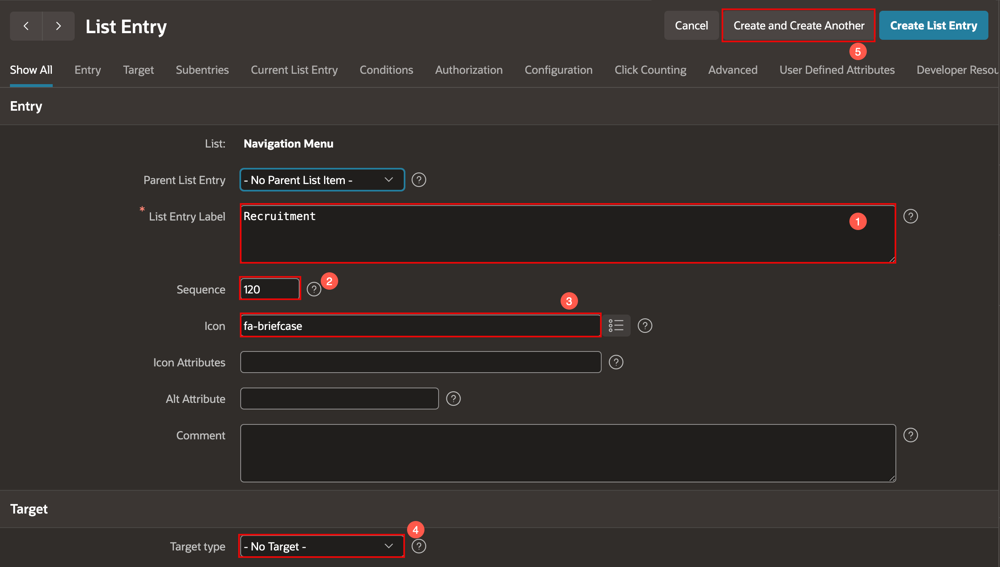

    A parent entry with **No Target** groups its child pages without opening a page itself.

6. Create the remaining parent entries. For each entry, set **Parent List Entry** to **- No Parent List Item -** and **Target Type** to **- No Target -**.

    | List Entry Label | Sequence | Icon |
    | --- | --- | --- |
    | Hiring Process | 130 | fa-tasks |
    | Offers | 50 | fa-envelope |

    Click **Create and Create Another** after **Hiring Process**, then click **Create List Entry** after **Offers**.

    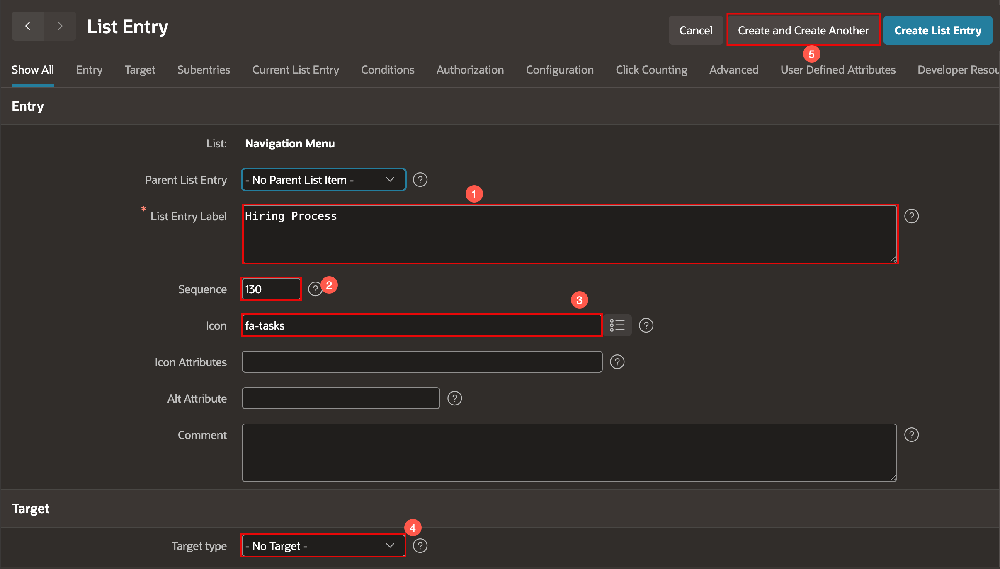

    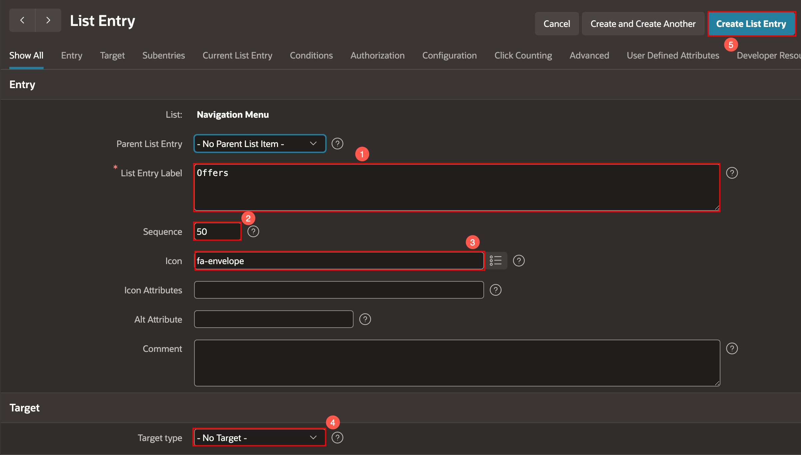

## Task 2: Assign Pages to the Parent Entries

In this task, you will organize the existing TAP pages below their parent entries.

1. In the Navigation Menu entries report, select **Recruitment Metrics Hub**.

    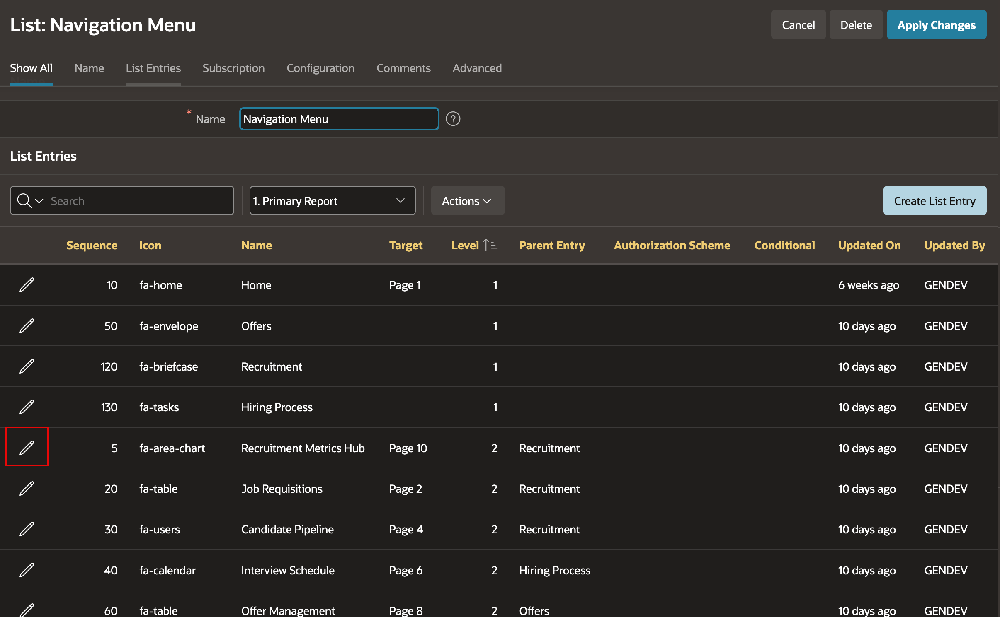

2. In the Property Editor, set **Parent List Entry** to **Recruitment**, then click **Apply Changes**.

    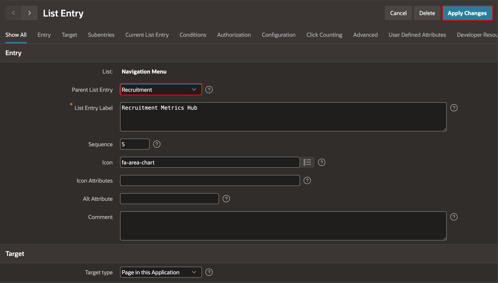

3. Repeat the same update for the following entries:

    | Navigation Menu Entry | Parent List Entry |
    | --- | --- |
    | Job Openings | Recruitment |
    | Job Requisitions | Recruitment |
    | Candidate Pipeline | Recruitment |
    | Interview Schedule | Hiring Process |
    | Bulk Stage Update | Hiring Process |
    | Offer Management | Offers |

    Click **Apply Changes** after updating each entry.

    

    

    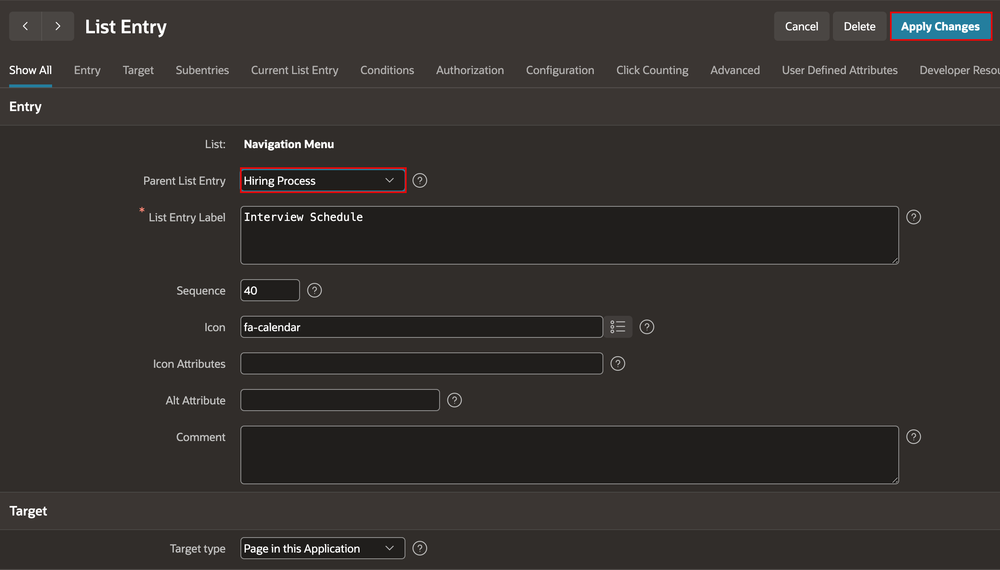

    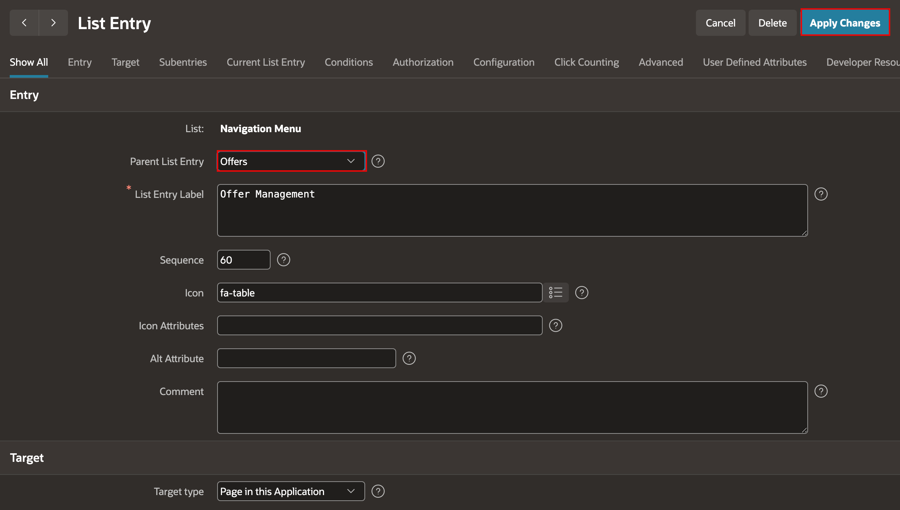

## Task 3: Remove Contextual Pages from the Menu

In this task, you will remove the detail pages that users access from reports and buttons.

1. In the Navigation Menu entries report, select **Requisition Detail**.

2. Click **Delete** and confirm the deletion.

3. Repeat the deletion for **Candidate Profile**.

    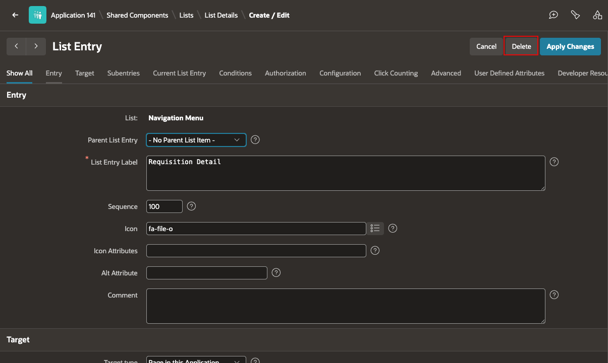

## Task 4: Run and Verify the Navigation Menu

1. Run the **Talent Acquisition Portal** application.

2. Expand **Recruitment**, **Hiring Process**, and **Offers** in the navigation menu.

3. Confirm that each group shows the expected child pages and that the links open the correct pages.

    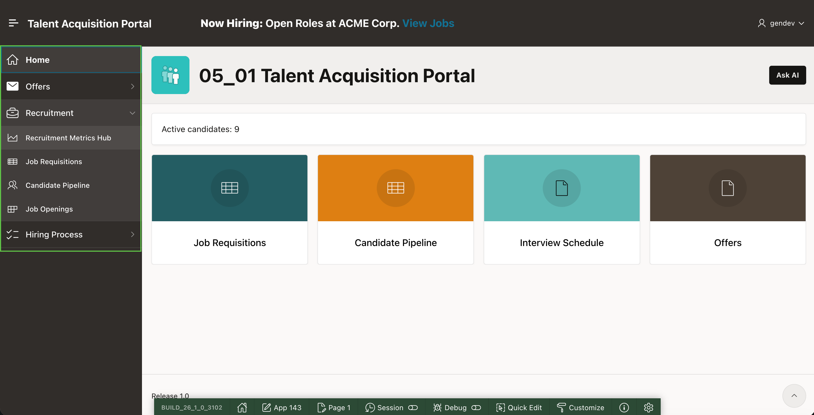

## Summary

You created parent navigation entries, grouped the TAP pages beneath them, and removed detail pages from the main navigation menu. Recruiters can now navigate the application through focused page groups.

You may now proceed to the next lab.

## Acknowledgements

- **Author** - Apoorva Srinivas, Principal Product Manager; Roopesh Thokala, Principal Product Manager
- **Last Updated By/Date** - October 2026
