# Add TAP Quick Links

## Introduction

Quick Links give recruiters direct access to common actions from the Talent Acquisition Portal (TAP) home page. In this lab, you will create a static list, configure its entries and icons, and display it as a Quick Links region on the home page.

Estimated Lab Time: 5 minutes

### Objectives

In this lab, you will:

- Create the TAP Quick Links static list.
- Configure links and icons for common recruiter actions.
- Display the list on the TAP home page.

## Task 1: Create the TAP Quick Links List

1. In **App Builder**, open the **Talent Acquisition Portal** application.

2. Click **Shared Components**. Under **Other Components**, click **Lists**.

    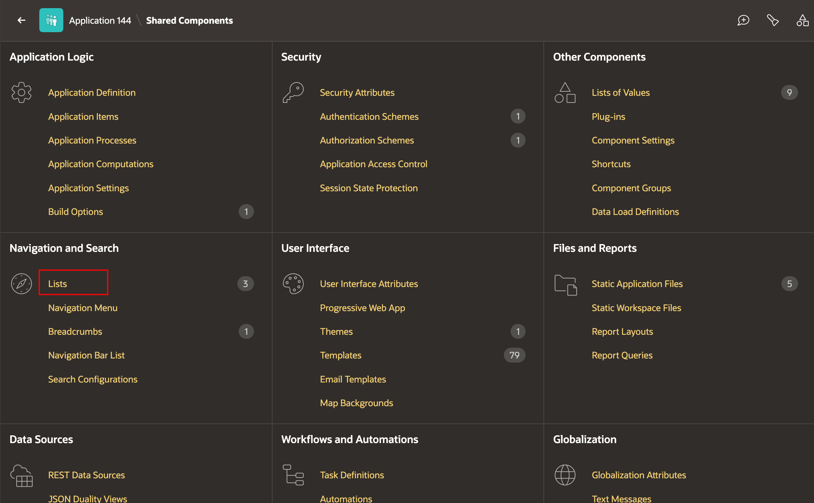

3. Click **Create**.

    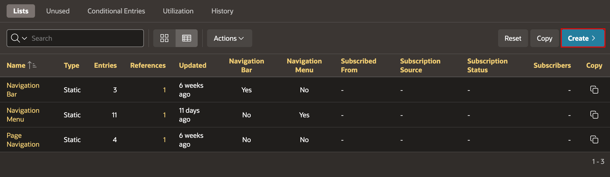

4. Create a static list. Enter/select the following:

    - Name: **TAP Quick Links**
    - Type: **Static**

    Click **Next**.

    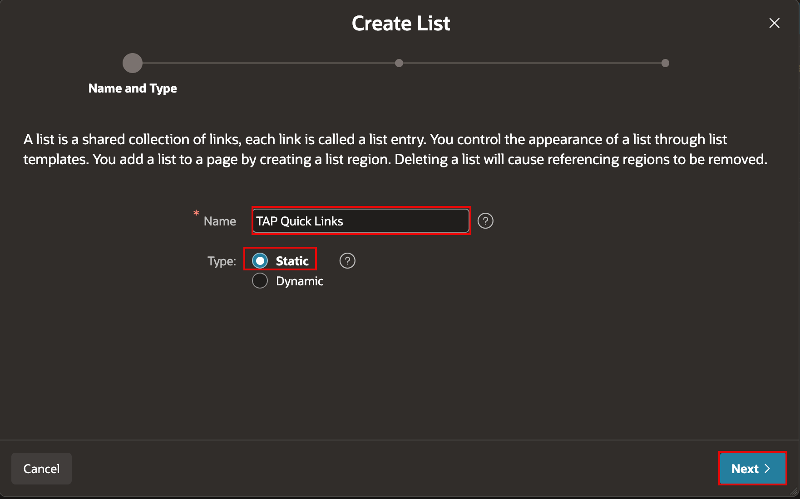

5. Add the following list entries:

    | List Entry Label | Target Page | Target Page Name |
    | --- | --- | --- |
    | New Requisition | 2 | Job Requisitions |
    | Add Candidate | 5 | Candidate |
    | Today's Interviews | 6 | Interview Schedule |
    | Pending Offers | 8 | Offer Management |

    Click **Next**.

    *Note: Page numbers can differ between applications. If a page number differs, select the appropriate target page by using its name in the **Target Page Name** column.*

    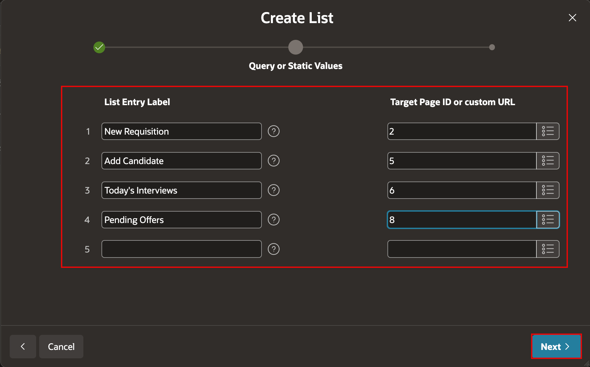

6. Click **Create List**.

    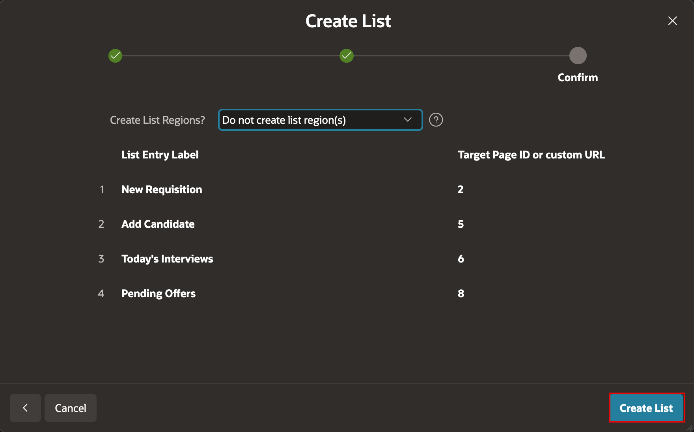

## Task 2: Configure Quick Link Icons

1. Select **TAP Quick Links** in the Lists report.

2. In the List Details pane, click **Grid Edit**.

    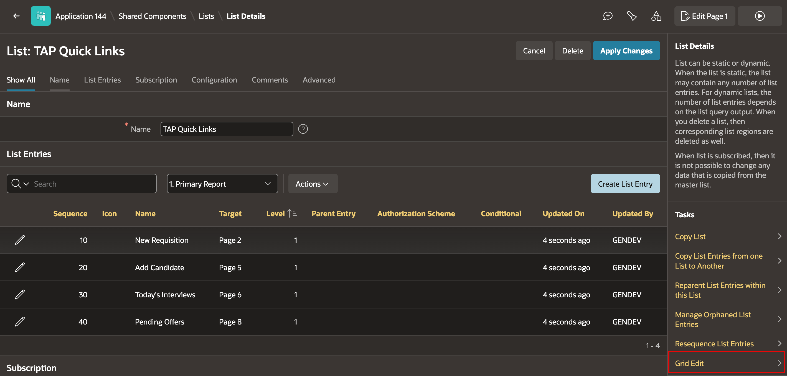

3. Set the icon for **New Requisition** to **fa-plus**.

4. Set the icons for the remaining entries:

    | List Entry Label | Icon |
    | --- | --- |
    | Add Candidate | fa-user-plus |
    | Today's Interviews | fa-calendar |
    | Pending Offers | fa-envelope |

5. Click **Save**.

    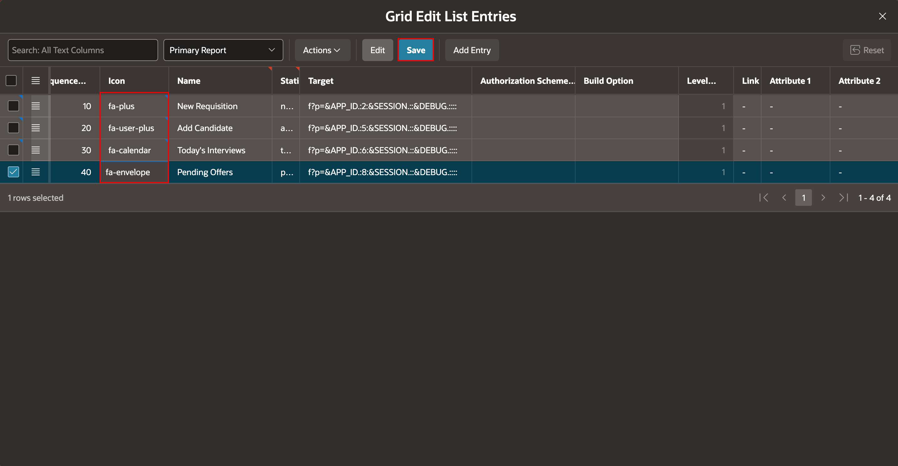

## Task 3: Display Quick Links on the TAP Home Page

1. Open **Page 1: Home** in Page Designer.

    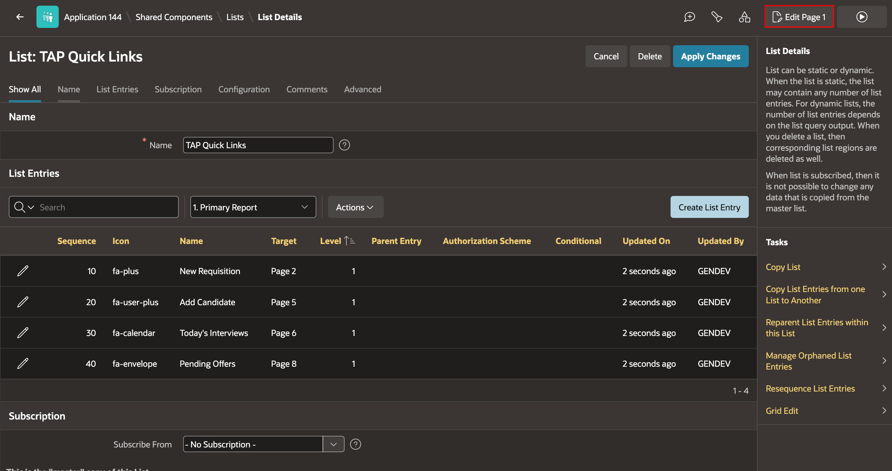

2. In the Rendering tree, right-click **Body** and select **Create Region**.

    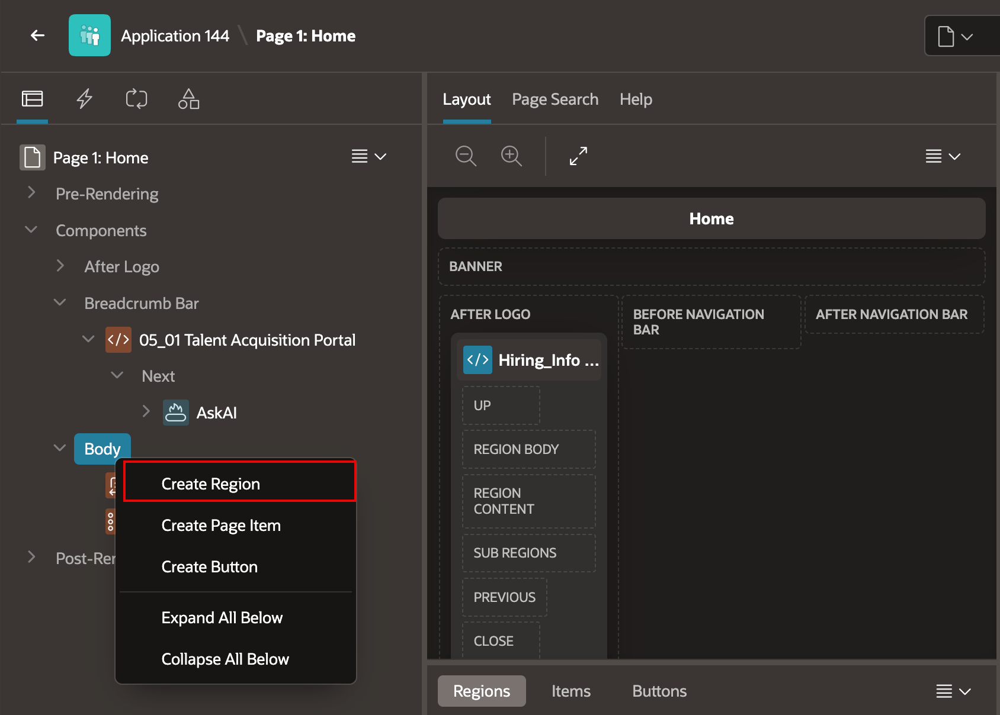

3. Select the new region and enter/select the following in the Property Editor:

    - Identification > Name: **Quick Links**
    - Identification > Type: **List**
    - Source > List: **TAP Quick Links**
    - Appearance > Template Options > Style: **Remove UI Decoration**

    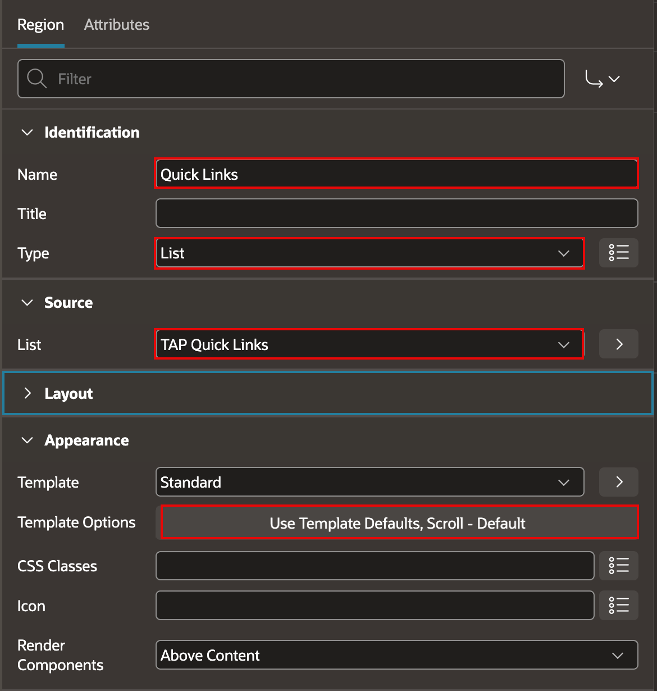

    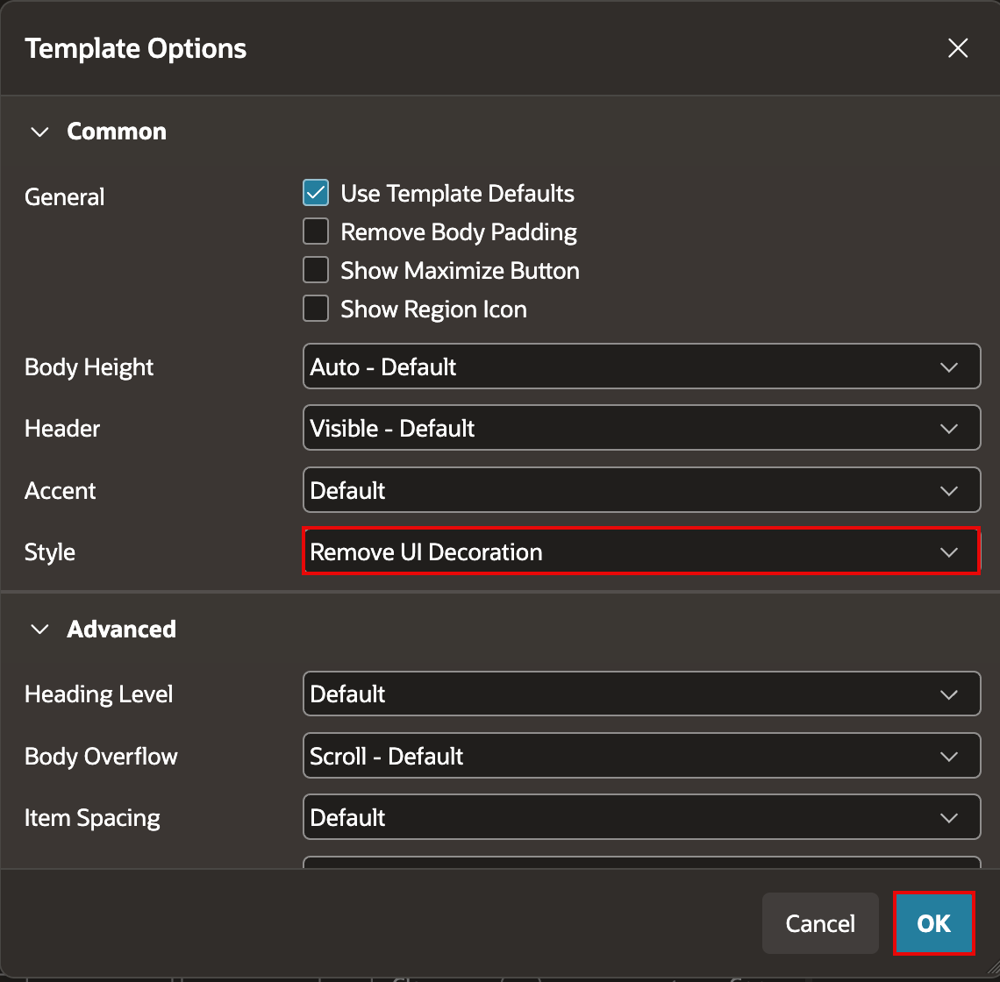

4. Select the **Attributes** tab. Enter/select the following:

    - List Template: **Media List**
    - Template Options > Apply Theme Colors: **On**

    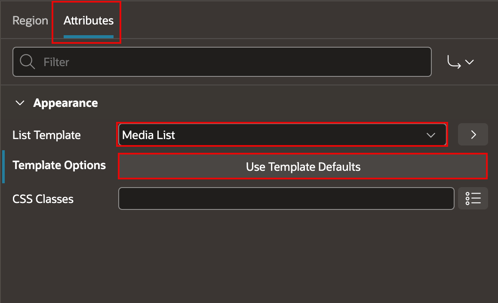

    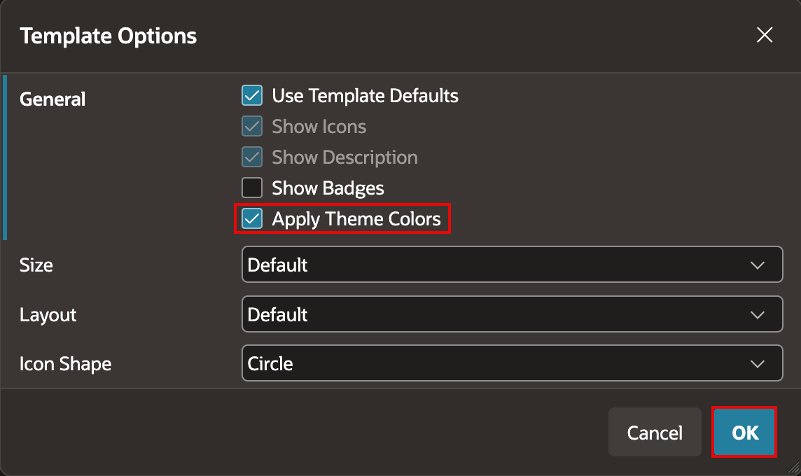

5. Click **Save and Run Page**.

6. Confirm that all four links appear on the home page and open their expected pages.

    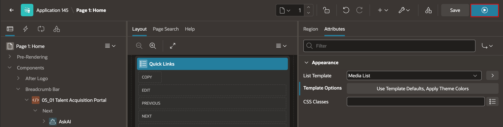

    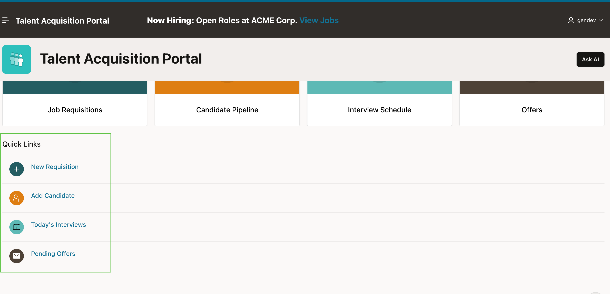

## Summary

You created a TAP Quick Links list, configured its icons, and displayed it on the home page. Recruiters can now open common actions directly from the application home page.

You may now proceed to the next lab.

## Acknowledgements

- **Author** - Apoorva Srinivas, Principal Product Manager; Roopesh Thokala, Principal Product Manager
- **Last Updated By/Date** - October 2026
