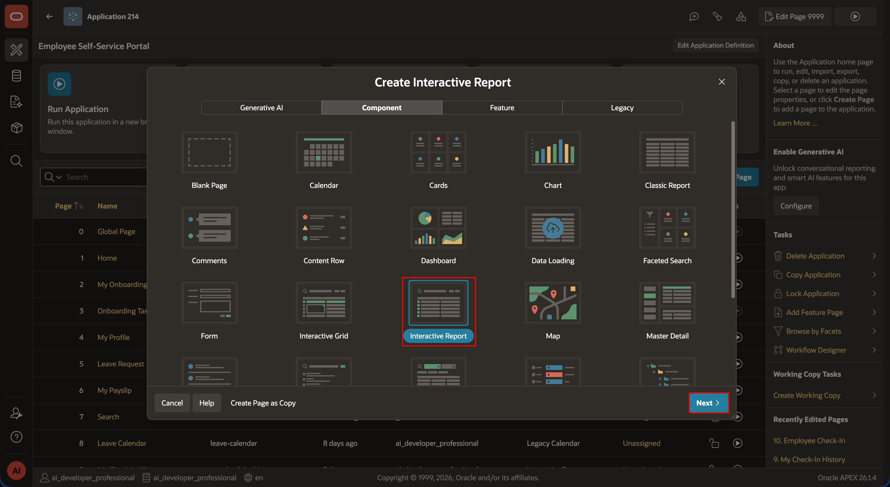
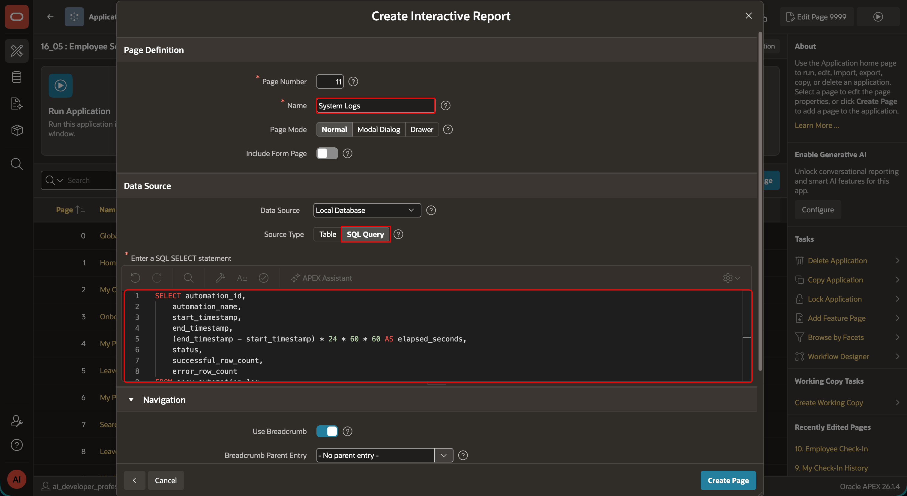
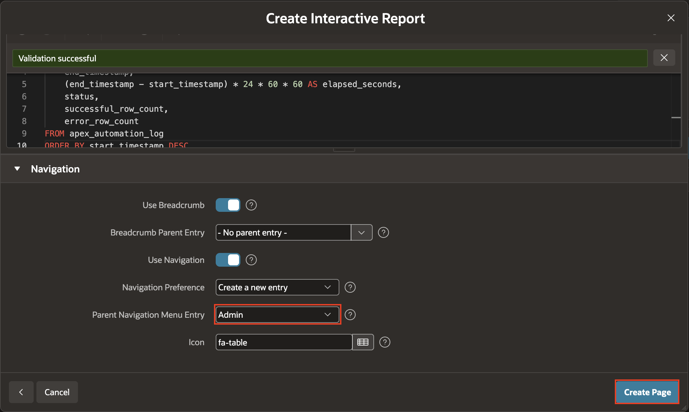
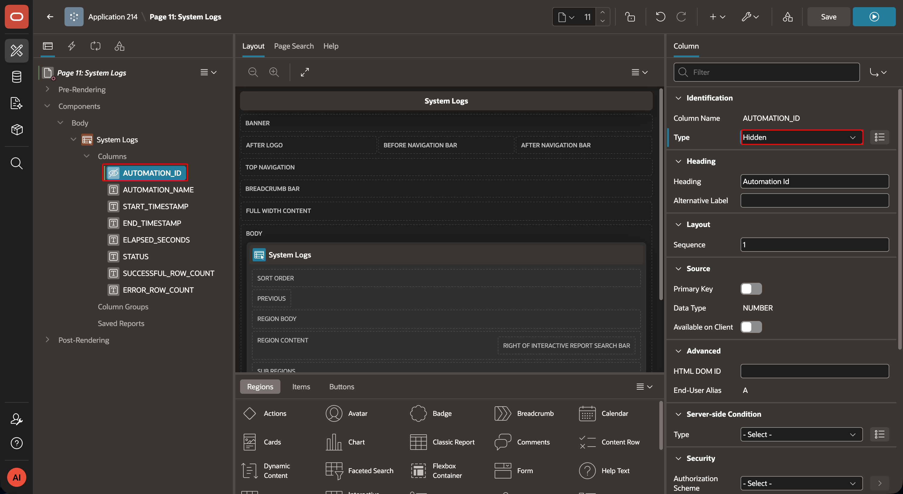
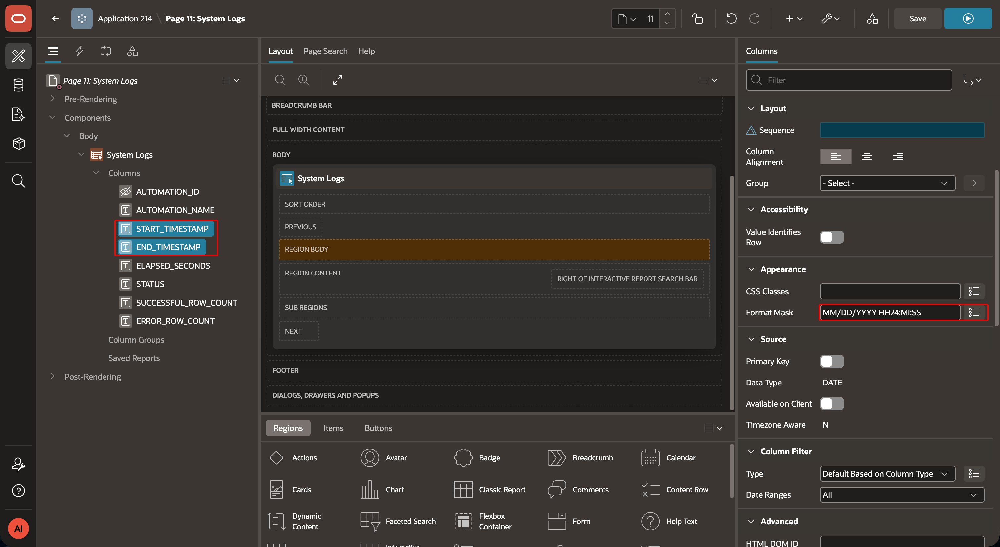
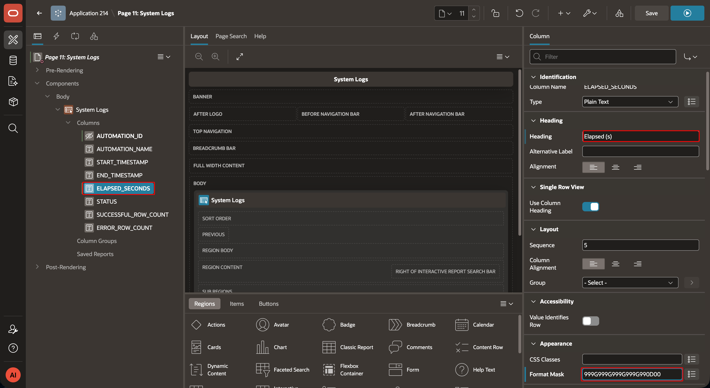
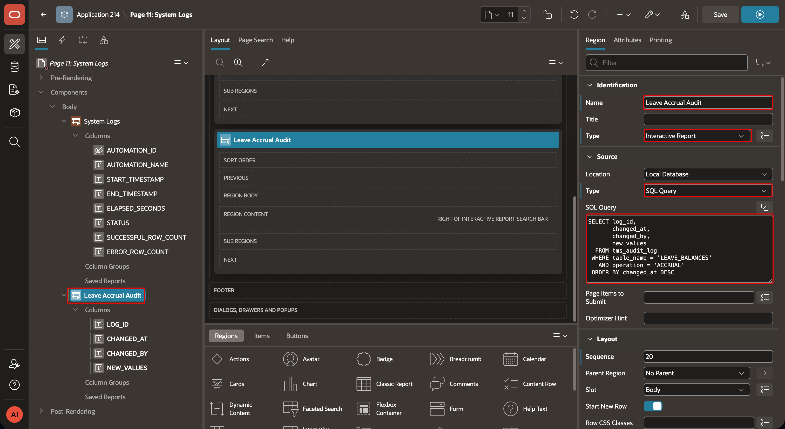
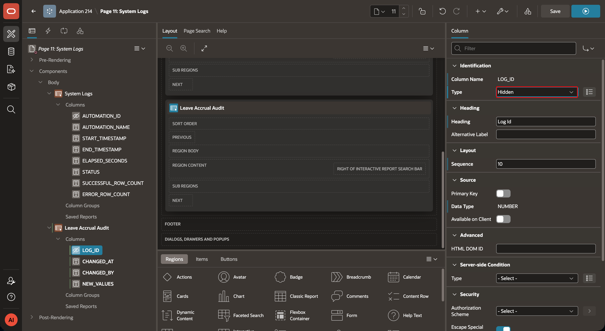
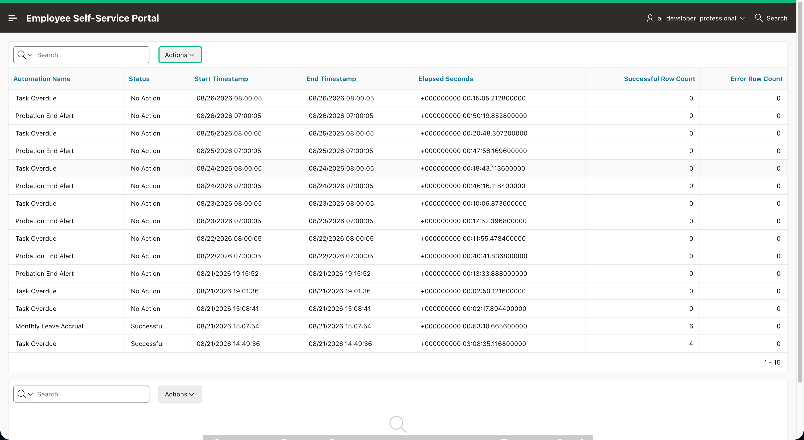

# Create the ESS System Logs Page

## Introduction

Oracle APEX stores the result of each automation run in `APEX_AUTOMATION_LOG`. In this lab, you will create an administrator-only Interactive Report that displays those records in ESS. You will also optionally add a report for leave-accrual audit records when the application includes the `TMS_AUDIT_LOG` table.

Estimated Lab Time: 5 minutes

### Where We Are

The ESS automations now mark overdue tasks, accrue leave, and send probation notifications. HR administrators need a page where they can review the outcome and duration of those automation runs.

### Objectives

In this lab, you will:

- Create the **System Logs** Interactive Report page.
- Display recent `APEX_AUTOMATION_LOG` records with readable column formats.
- Restrict the page to HR administrators.
- Optionally add a leave-accrual audit report.

## Task 1: Create the System Logs Page

1. In **App Builder**, open the **Employee Self-Service Portal** application.

2. On the application home page, select **Create Page**.

    

3. Under **Component**, select **Interactive Report**.

4. In the Create Page wizard, enter/select the following:

    - **Page Name**: `System Logs`
    - **Data Source**: `Local Database`
    - **Source Type**: `SQL Query`
    - **Navigation Menu Entry**: `System Logs`
    - **Parent Navigation Menu Entry**: `Admin`

5. For **SQL Query**, enter the following code:

    ```sql
    <copy>
    SELECT
        automation_id,
        automation_name,
        start_timestamp,
        end_timestamp,
        (end_timestamp - start_timestamp) * 24 * 60 * 60 AS elapsed_seconds,
        status,
        successful_row_count,
        error_row_count
    FROM apex_automation_log
    ORDER BY start_timestamp DESC
    </copy>
    ```

    -  Click **Create Page**.

    

    

## Task 2: Format the Report

1. In Page Designer, select the **System Logs** page in the Rendering tree.

2. In the Rendering tree, expand **System Logs > Columns**, and then select **AUTOMATION_ID**.

3. In the Property Editor, set **Identification > Type** to **Hidden**.

    

4. In the Rendering tree, select **START_TIMESTAMP**. Under **Appearance**, set **Format Mask** to `MM/DD/YYYY HH24:MI:SS`

5. Repeat step 5 for **END_TIMESTAMP**.

    

6. In the Rendering tree, select **ELAPSED_SECONDS** and enter/select the following in the Property Editor:

    | Property | Value |
    | --- | --- |
    | Heading | `Elapsed (s)` |
    | Appearance > Format Mask | `999G999G999G999G990D00` |

    

8. Select **Save and Run Page**. Confirm that the newest automation runs appear first and that the **Elapsed (s)** column shows the calculated duration.

## Task 3: Add the Leave Accrual Audit Report (Optional)

Complete this task only if `TMS_AUDIT_LOG` is available in your workspace.

1. Return to Page Designer. In the Rendering tree, right-click **Body**, and then select **Create Region**.

2. In the Property Editor, enter/select the following:

    - **Name**: `Leave Accrual Audit`
    - **Type**: `Interactive Report`

    

3. Under **Source**, set **Type** to **SQL Query**, and enter the following code:

    ```sql
    <copy>
    SELECT
        id,
        changed_at,
        changed_by,
        new_values
    FROM tms_audit_log
    WHERE table_name = 'LEAVE_BALANCES'
      AND operation = 'ACCRUAL'
    ORDER BY changed_at DESC
    </copy>
    ```

4. In the Rendering tree, expand **Leave Accrual Audit > Columns**, select **ID**, and set **Identification > Type** to **Hidden**.

    

5. Select **Save and Run Page**. Confirm that the report displays leave-accrual records in descending order of **CHANGED_AT**.

    

## Summary

You created an administrator-only System Logs page that displays recent automation executions with readable dates and durations. You also added an optional report for leave-accrual audit records.

You may now **proceed to the next lab**.

## Acknowledgements

- **Author** - Aravind Madhavan, Senior Product Manager
- **Last Updated By/Date** - Aravind Madhavan, Senior Product Manager, July 2026
