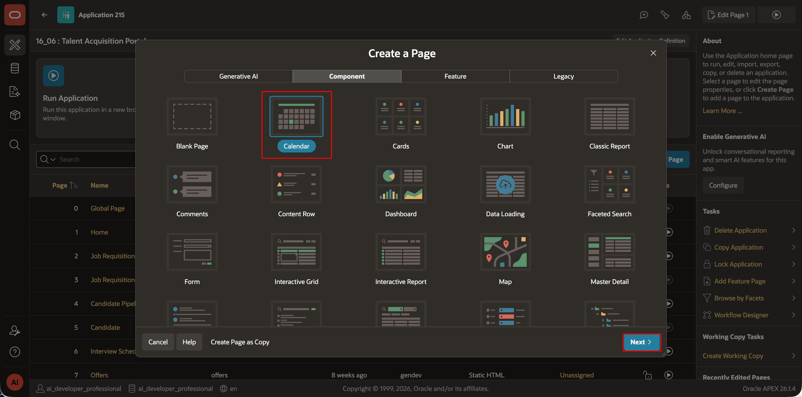
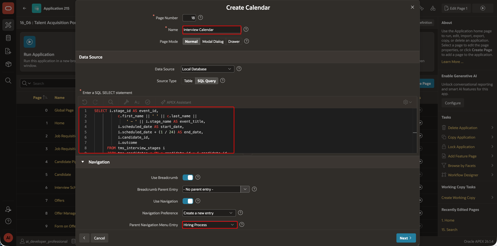
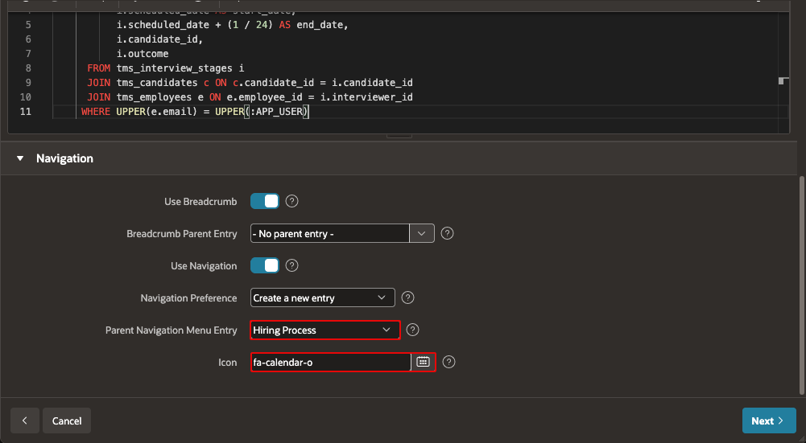
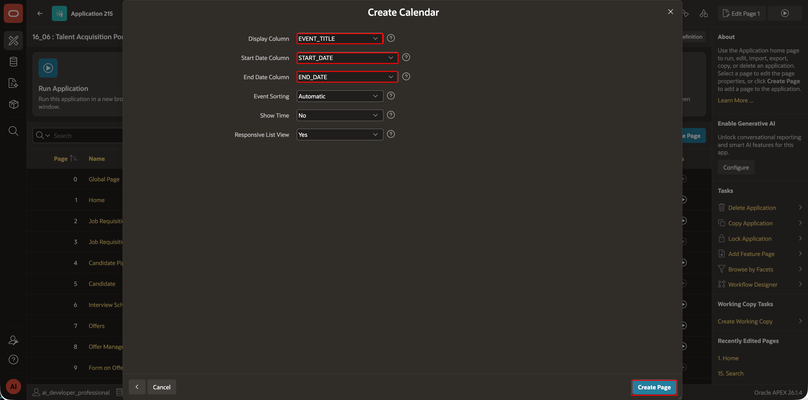
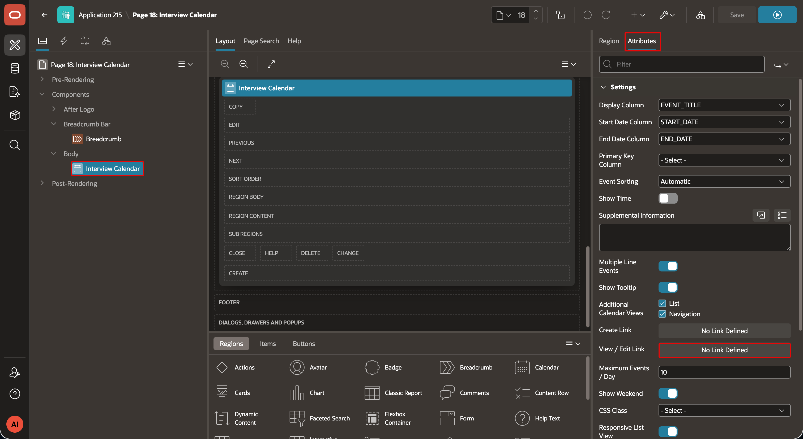
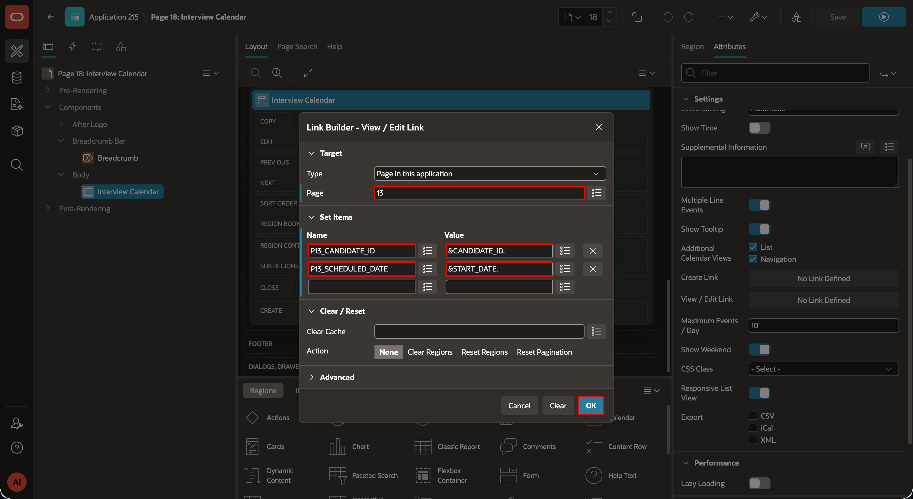
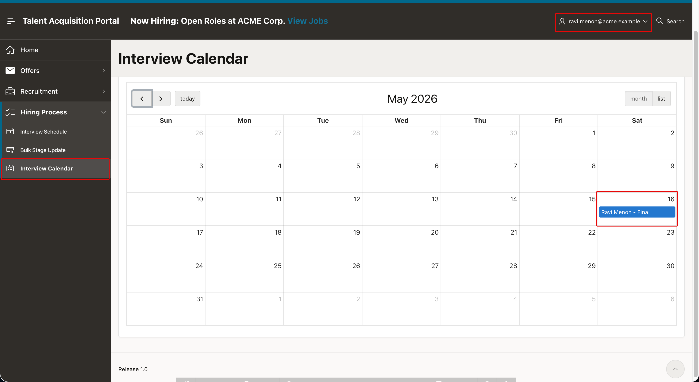

# Create the TAP Interview Calendar

## Introduction

In this lab, you will create a Calendar page that shows each interviewer only the interview stages assigned to them. You will configure the event query, map the calendar columns, and link each event to the existing **Interview Feedback** page.

Estimated Lab Time: 5 minutes

### Where We Are

TAP stores interview stages and feedback, but interviewers need a focused view of their upcoming interviews. The calendar provides that view while preserving the existing Interview Feedback workflow.

### Objectives

In this lab, you will:

- Create the **Interview Calendar** page.
- Display only the signed-in interviewer's assigned interviews.
- Link each calendar event to **Interview Feedback**.

### Downloads

Stuck or missed out on completing the previous labs? Don't worry! You can download the following application:

- **<a href="../introduction/files/tap-export10.sql" download="tap-export10.sql">Talent Acquisition Portal</a>**

Import it into your workspace. In **App Builder**, select **Import**, upload `tap-export10.sql`, and follow the steps in the **Import Application** wizard.

> **Note:**
>
> - **APEX Version:** The supplied application export was created with Oracle APEX 26.2 and cannot be imported into earlier APEX releases.
> - **Supporting Objects:** Supporting objects are already loaded in the workspace.
> - **AI Configuration:** Configure a Generative AI Service from **App Builder > Workspace Utilities > Generative AI**. See **Module 1, Lab 2: Configure Generative AI Service**.

## Task 1: Create the Interview Calendar Page

1. In **App Builder**, open the **Talent Acquisition Portal** application.

2. On the application home page, select **Create Page**.

3. Under **Component**, select **Calendar**.

    

4. In the Create Calendar wizard, enter/select the following:

    - **Page Name**: `Interview Calendar`
    - **Data Source**: `Local Database`
    - **Source Type**: `SQL Query`

5. For **SQL Query**, enter the following code:

    ```sql
    <copy>
    SELECT
        i.stage_id AS event_id,
        c.first_name || ' ' || c.last_name ||
            ' - ' || i.stage_name AS event_title,
        i.scheduled_date AS start_date,
        i.scheduled_date + (1 / 24) AS end_date,
        i.candidate_id,
        i.outcome
    FROM tms_interview_stages i
    JOIN tms_candidates c
        ON c.candidate_id = i.candidate_id
    JOIN tms_employees e
        ON e.employee_id = i.interviewer_id
    WHERE UPPER(e.email) = UPPER(:APP_USER)
    </copy>
    ```

    

6. In the navigation settings, enter/select the following:

    - **Parent Navigation Menu Entry**: `Hiring Process`
    - **Icon**: `fa-calendar-o`
    - Click **Next**

    

7. Map the calendar columns as follows:

    | Calendar Setting | Column |
    | --- | --- |
    | Display Column | `EVENT_TITLE` |
    | Start Date Column | `START_DATE` |
    | End Date Column | `END_DATE` |

    

8. Select **Create Page**.

## Task 2: Link Calendar Events to Interview Feedback

1. In Page Designer, select the **Interview Calendar** region.

2. Select the **Attributes** tab.

3. Under **Settings**, open **View/Edit Link**.

    

4. In the link target dialog, enter/select the following:

    - **Target Type**: `Page in this Application`
    - **Page**: `13 - Interview Feedback`
    - **Set Items**: `P13_CANDIDATE_ID`, `P13_SCHEDULED_DATE`
    - **With These Values**: `&CANDIDATE_ID.`, `&START_DATE.`

5. Select **OK**, and then select **Save and Run Page**.

    

6. Sign in with an interviewer account. Confirm that the calendar displays only that interviewer's assigned interviews and that selecting an event opens the related **Interview Feedback** page.

    

## Summary

You created a TAP interview calendar that displays only the signed-in interviewer's assigned interviews and links each event to the related Interview Feedback page.

You may now **proceed to the next lab**.

## Acknowledgements

- **Author** - Aravind Madhavan; Roopesh Thokala, Principal Product Manager
- **Last Updated By/Date** - Roopesh Thokala, October 2026
