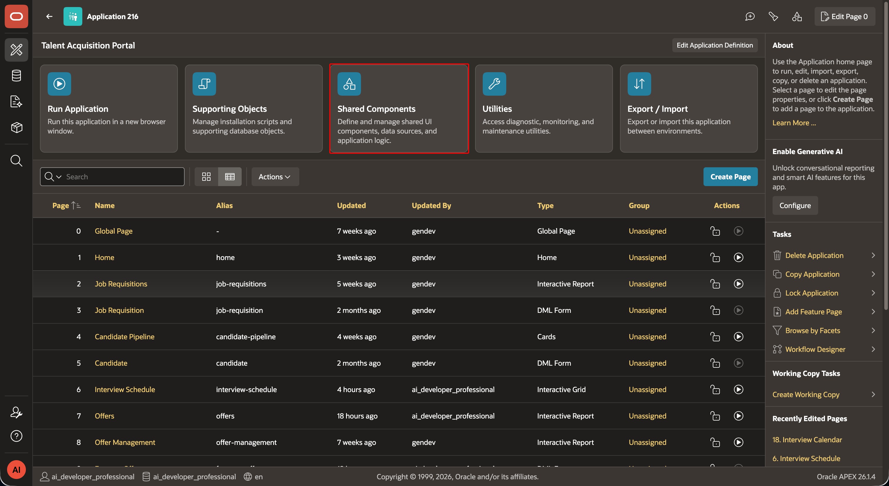
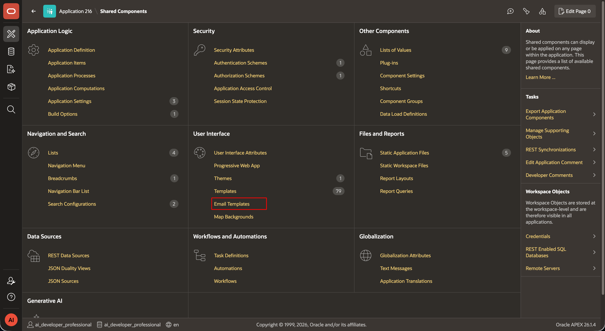
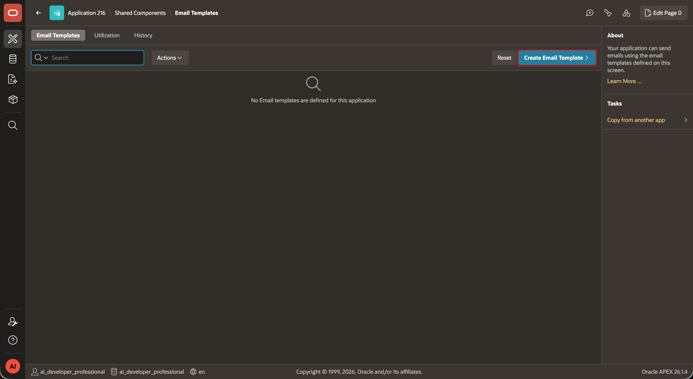
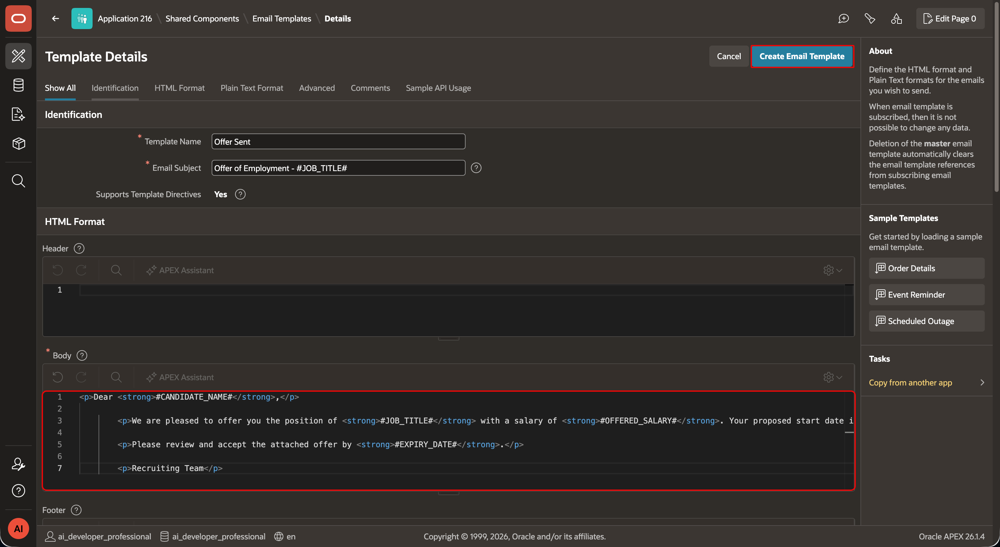
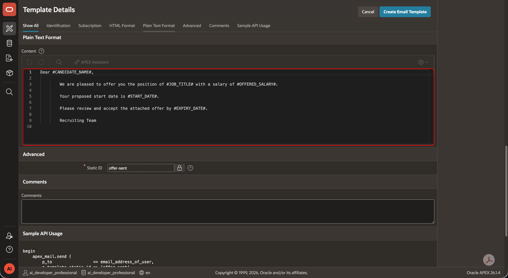
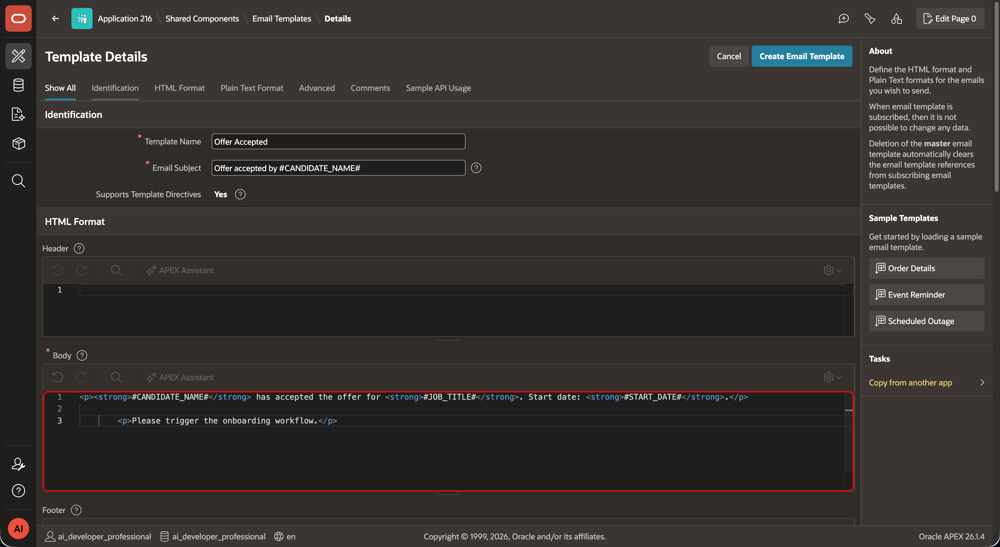
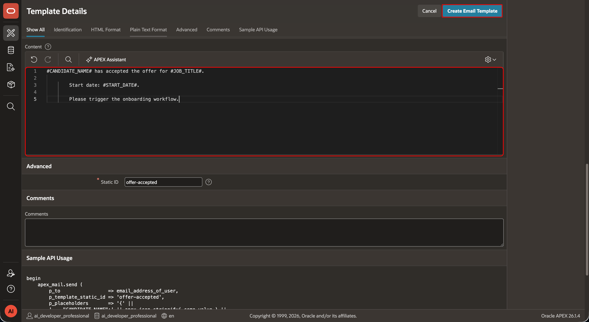
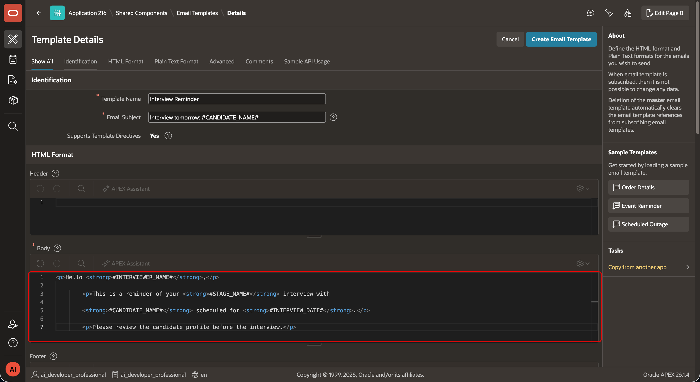
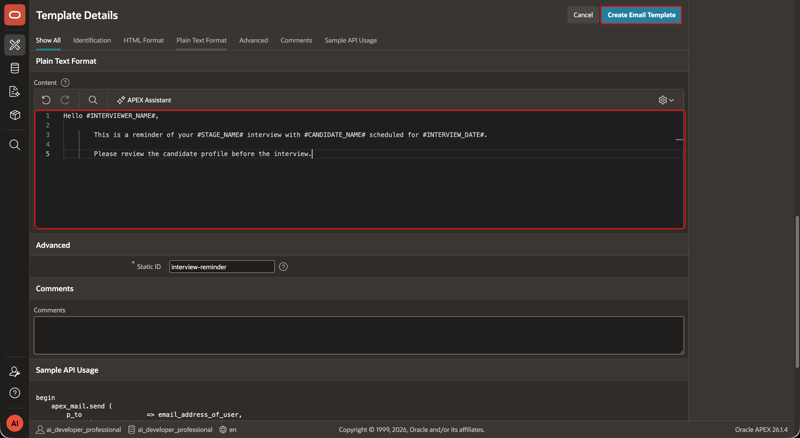
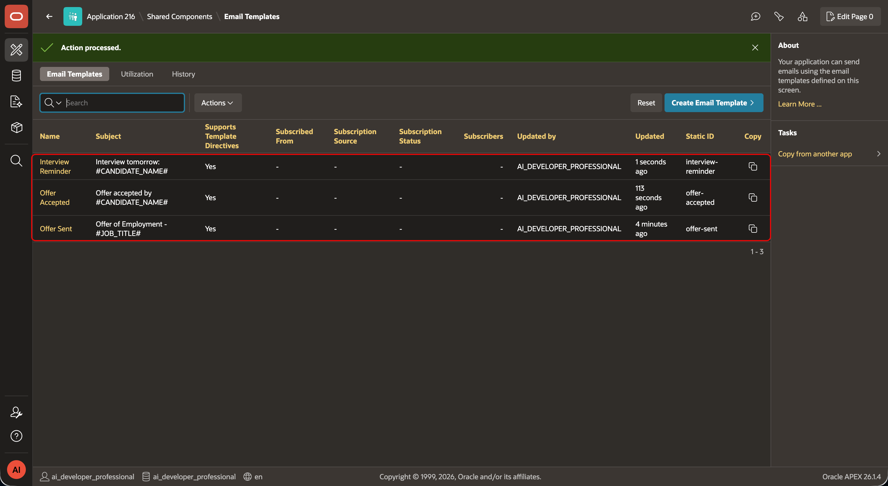

# Create TAP Email Templates

## Introduction

Oracle APEX email templates keep notification content separate from the process that sends it. In this lab, you will create reusable templates for offer and interview events. Each template uses a static identifier and placeholders that receive values from the row processed by an automation.

Estimated Lab Time: 5 minutes

### Where We Are

TAP now provides interviewers with a calendar of their assigned interviews. You will create the notifications that TAP uses for offers and interview reminders before configuring the associated automations in the next lab.

### Objectives

In this lab, you will:

- Create templates for sent offers, accepted offers, and interview reminders.
- Configure a static identifier, subject, HTML body, and plain-text body for each template.
- Verify the identifiers used by TAP automation actions.

## Task 1: Open Email Templates

1. In **App Builder**, open the **Talent Acquisition Portal** application.

2. Select **Shared Components**.

    

3. Under **User Interface**, select **Email Templates**.

    

## Task 2: Create the Offer Sent Template

1. Select **Create Email Template**.

    

2. Under **Identification**, enter/select the following:

    | Property | Value |
    | --- | --- |
    | Template Name | `Offer Sent` |
    | Email Subject | `Offer of Employment - #JOB_TITLE#` |

    

3. Under **HTML Format > Body**, enter the following code:

    ```html
    <copy>
    <p>Dear <strong>#CANDIDATE_NAME#</strong>,</p>

    <p>We are pleased to offer you the position of <strong>#JOB_TITLE#</strong> with a salary of <strong>#OFFERED_SALARY#</strong>. Your proposed start date is <strong>#START_DATE#</strong>.</p>

    <p>Please review and accept the attached offer by <strong>#EXPIRY_DATE#</strong>.</p>

    <p>Recruiting Team</p>
    </copy>
    ```

4. Under **Plain Text Format > Content**, enter the following text:

    ```text
    <copy>
    Dear #CANDIDATE_NAME#,

    We are pleased to offer you the position of #JOB_TITLE# with a salary of #OFFERED_SALARY#.

    Your proposed start date is #START_DATE#.

    Please review and accept the attached offer by #EXPIRY_DATE#.

    Recruiting Team
    </copy>
    ```

5. Select **Create Email Template**.

    

## Task 3: Create the Offer Accepted Template

1. Again, click **Create Email Template**.

2. Under **Identification**, enter/select the following:

    | Property | Value |
    | --- | --- |
    | Template Name | `Offer Accepted` |
    | Email Subject | `Offer accepted by #CANDIDATE_NAME#` |

    

3. Under **HTML Format > Body**, enter the following code:

    ```html
    <copy>
    <p><strong>#CANDIDATE_NAME#</strong> has accepted the offer for <strong>#JOB_TITLE#</strong>. Start date: <strong>#START_DATE#</strong>.</p>

    <p>Please trigger the onboarding workflow.</p>
    </copy>
    ```

4. Under **Plain Text Format > Content**, enter the following text:

    ```text
    <copy>
    #CANDIDATE_NAME# has accepted the offer for #JOB_TITLE#.

    Start date: #START_DATE#.

    Please trigger the onboarding workflow.
    </copy>
    ```

5. Select **Create Email Template**.

    

## Task 4: Create the Interview Reminder Template

1. Return to **Email Templates**, and then click **Create Email Template**.

2. Under **Identification**, enter/select the following:

    | Property | Value |
    | --- | --- |
    | Template Name | `Interview Reminder` |
    | Email Subject | `Interview tomorrow: #CANDIDATE_NAME#` |

    

3. Under **HTML Format > Body**, enter the following code:

    ```html
    <copy>
    <p>Hello <strong>#INTERVIEWER_NAME#</strong>,</p>

    <p>This is a reminder of your <strong>#STAGE_NAME#</strong> interview with <strong>#CANDIDATE_NAME#</strong> scheduled for <strong>#INTERVIEW_DATE#</strong>.</p>

    <p>Please review the candidate profile before the interview.</p>
    </copy>
    ```

4. Under **Plain Text Format > Content**, enter the following text:

    ```text
    <copy>
    Hello #INTERVIEWER_NAME#,

    This is a reminder of your #STAGE_NAME# interview with #CANDIDATE_NAME# scheduled for #INTERVIEW_DATE#.

    Please review the candidate profile before the interview.
    </copy>
    ```

5. Select **Create Email Template**.

    

## Task 5: Verify the Template Identifiers

1. Return to **Email Templates**.

2. Confirm that the **Static ID** column includes `offer-sent`, `offer-accepted`, and `interview-reminder`.

    

3. Use `offer-sent` after generating an offer and `offer-accepted` when a candidate accepts an offer. Lab 8 uses the **Interview Reminder** template.

4. In PL/SQL business logic, reference a template by its static identifier, for example: `p_template_static_id => 'offer-sent'` in `APEX_MAIL.SEND`.

## Summary

You created three TAP email templates with stable static identifiers and placeholders for offer and interview notifications. The next lab uses the **Interview Reminder** template in a scheduled automation.

You may now **proceed to the next lab**.

## Acknowledgements

- **Author** - Aravind Madhavan, Senior Product Manager; Roopesh Thokala, Principal Product Manager
- **Last Updated By/Date** - Roopesh Thokala, October 2026