# Create TAP Scheduled Automations

## Introduction

In this lab, you will create scheduled TAP automations for interview reminders and expiring offers. Each automation uses a SQL query to identify the records to process, then sends an email using either a template or an action-specific email body.

Estimated Lab Time: 5 minutes

### Where We Are

TAP now has reusable templates for offer and interview communication. You will connect those templates and the underlying recruiting data to scheduled automations that notify interviewers and recruiters at the appropriate time.

### Objectives

In this lab, you will:

- Create the **Interview Reminder** automation.
- Create the **Offer Expiry Alert** automation.
- Configure email actions and placeholder values.
- Review the automation execution log.

## Task 1: Open TAP Automations

1. In **App Builder**, open the **Talent Acquisition Portal** application.

2. Select **Shared Components**.

    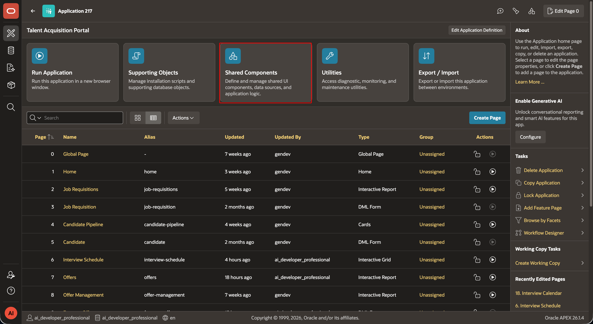

3. Under **Workflows and Automations**, select **Automations**.

    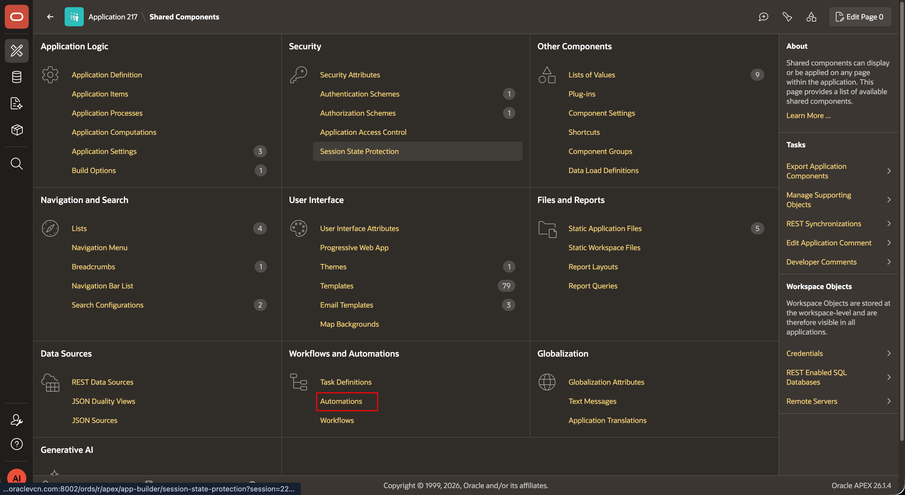

## Task 2: Create the Interview Reminder Automation

1. Select **Create**.

    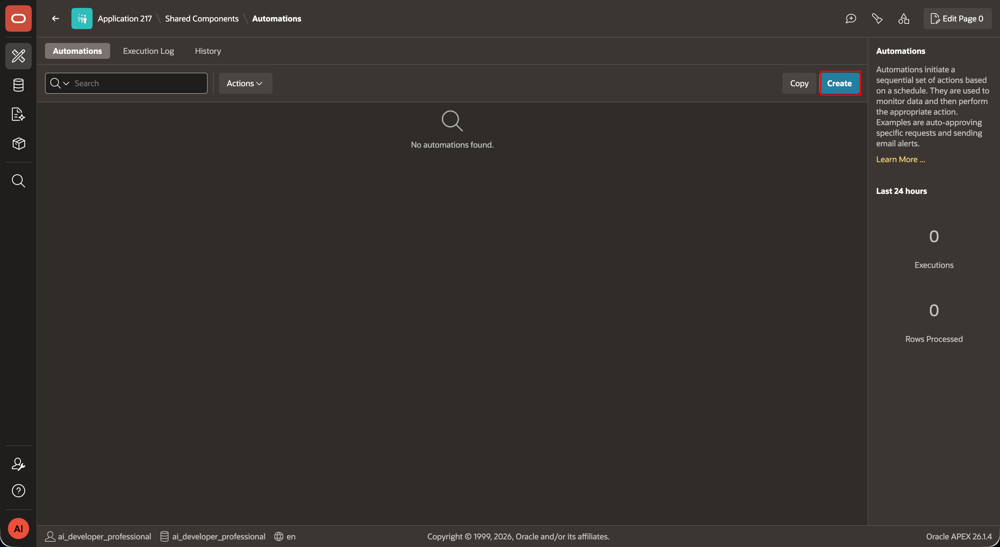

2. In the Create Automation wizard, enter/select the following:

    | Property | Value |
    | --- | --- |
    | Name | `Interview Reminder` |
    | Type | `Scheduled` |
    | Actions Initiated On | `Query` |
    | Execution Schedule | `Custom` |
    | Frequency | `Daily` |
    | Interval | `1` |
    | Execution Time | `07:00` |

    The schedule runs in the database server time zone.

    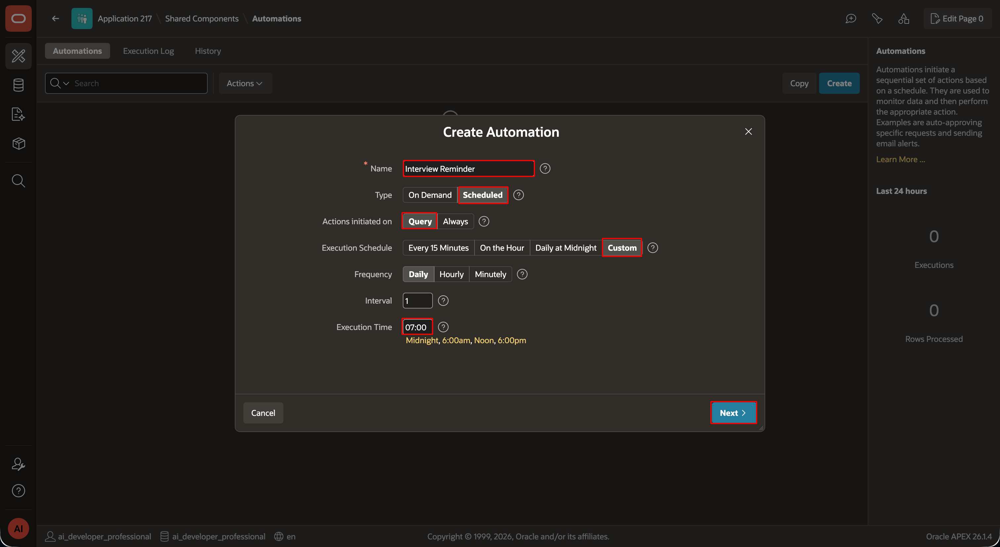

3. Set **Source Type** to **SQL Query**, and enter the following code:

    ```sql
    <copy>
    SELECT
        i.stage_id,
        i.stage_name,
        i.scheduled_date AS interview_date,
        TO_CHAR(i.scheduled_date, 'DD-Mon-YYYY HH24:MI') AS interview_date_text,
        c.first_name || ' ' || c.last_name AS candidate_name,
        e.email AS interviewer_email,
        e.first_name || ' ' || e.last_name AS interviewer_name
    FROM tms_interview_stages i
    JOIN tms_candidates c
        ON c.candidate_id = i.candidate_id
    JOIN tms_employees e
        ON e.employee_id = i.interviewer_id
    WHERE TRUNC(i.scheduled_date) = TRUNC(SYSDATE) + 1
    </copy>
    ```

    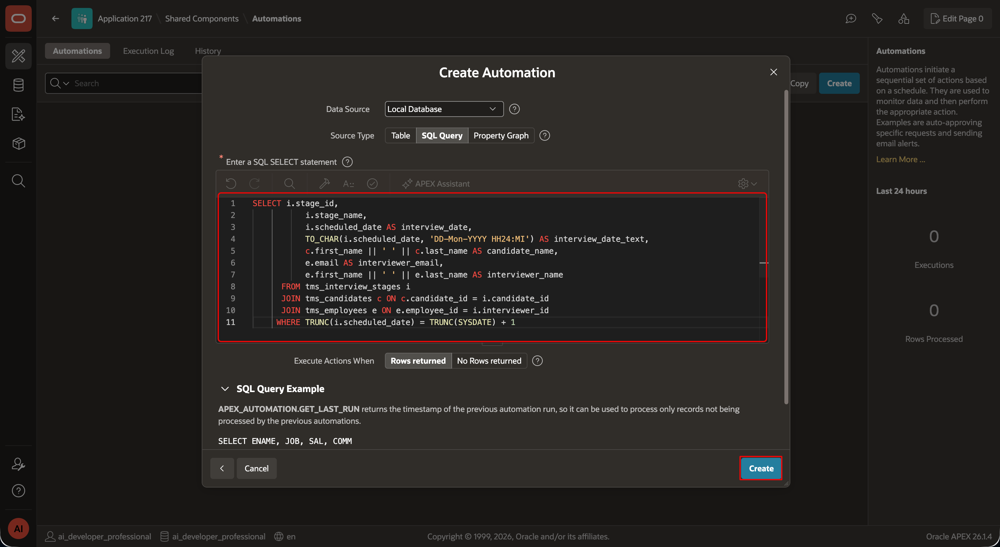

4. Select **Create**.

5. Under **Actions**, click **Edit** on the existing **New Action**. For **Type**, select **Send E-Mail**.

    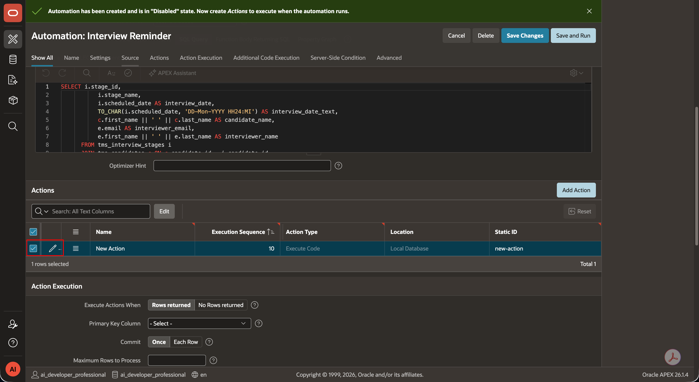

6. Under **Send Email Settings**, enter/select the following:

    | Property | Value |
    | --- | --- |
    | Name | Send Email |
    | From | `&APP_EMAIL.` |
    | To | `&INTERVIEWER_EMAIL.` |
    | Email Template | `Interview Reminder` |

    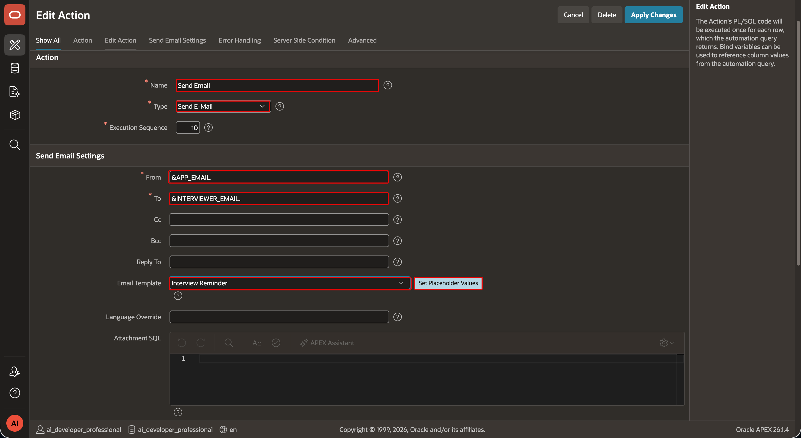

7. Select **Set Placeholder Values**, and map the following values:

    | Placeholder | Value |
    | --- | --- |
    | `CANDIDATE_NAME` | `&CANDIDATE_NAME.` |
    | `INTERVIEW_DATE` | `&INTERVIEW_DATE_TEXT.` |
    | `STAGE_NAME` | `&STAGE_NAME.` |
    | `INTERVIEWER_NAME` | `&INTERVIEWER_NAME.` |

    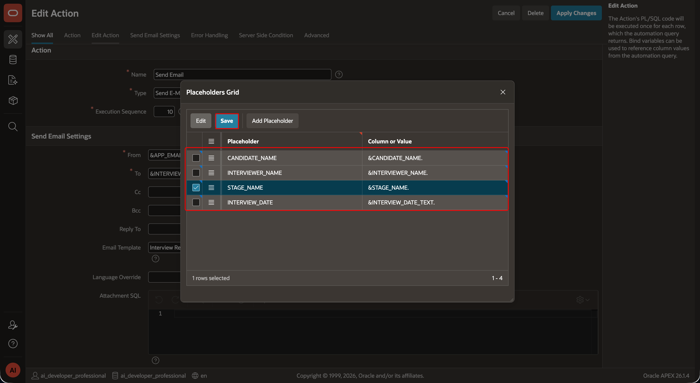

8. Select **Create** to save the action. Set **Schedule Status** to **Active**, and then select **Save and Run**.

    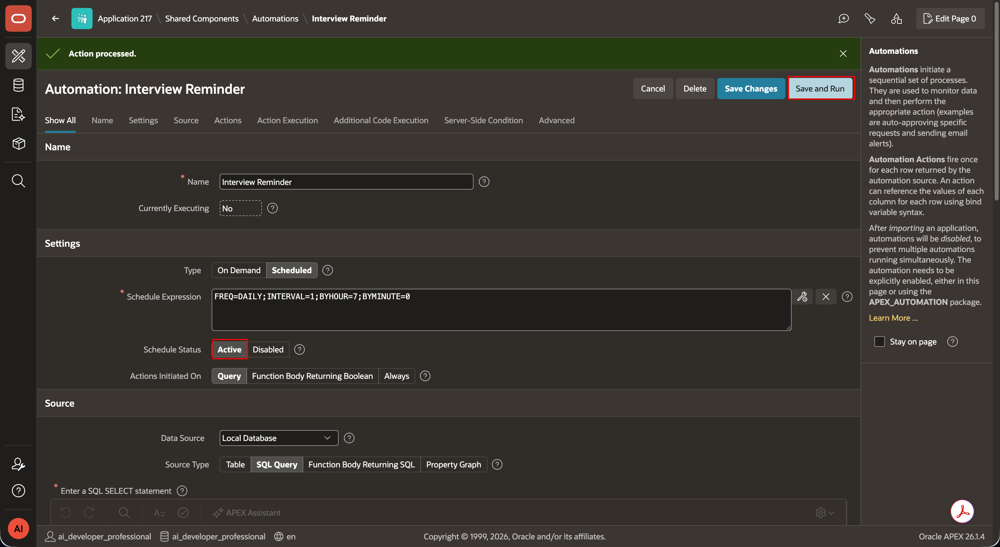

## Task 3: Create the Offer Expiry Alert Automation

1. Return to **Automations**, and select **Create**.

    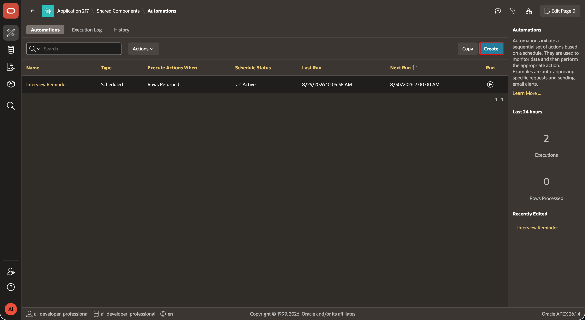

2. In the Create Automation wizard, enter/select the following:

    | Property | Value |
    | --- | --- |
    | Name | `Offer Expiry Alert` |
    | Type | `Scheduled` |
    | Actions Initiated On | `Query` |
    | Execution Schedule | `Custom` |
    | Frequency | `Daily` |
    | Interval | `1` |
    | Execution Time | `08:00` |

    The schedule runs in the database server time zone.

    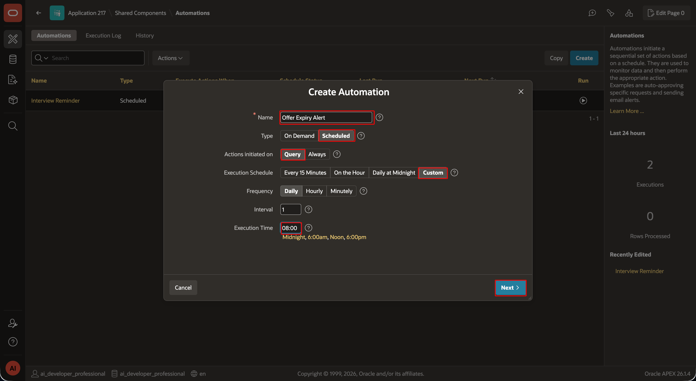

3. Set **Source Type** to **SQL Query**, and enter the following code:

    ```sql
    <copy>
    SELECT
        o.offer_id,
        o.candidate_id,
        o.expiry_date,
        c.first_name || ' ' || c.last_name AS candidate_name,
        o.offered_salary,
        r.requested_by AS recruiter_email
    FROM tms_offers o
    JOIN tms_candidates c
        ON c.candidate_id = o.candidate_id
    JOIN tms_job_requisitions r
        ON r.req_id = o.req_id
    WHERE o.status = 'Sent'
      AND o.expiry_date = TRUNC(SYSDATE) + 3
    </copy>
    ```

    The query expects `REQUESTED_BY` to contain the recruiter's email address.

    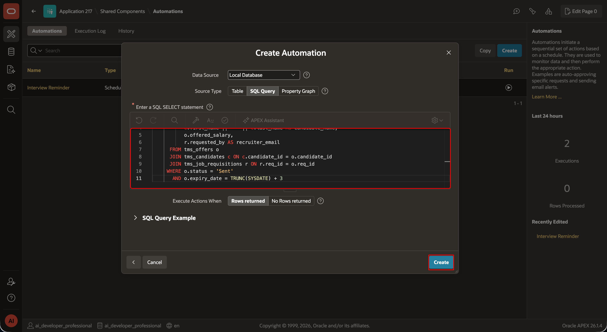

4. Select **Create**. Under **Actions**, click **Edit** on the existing **New Action**, and set **Type** to **Send E-Mail**.

    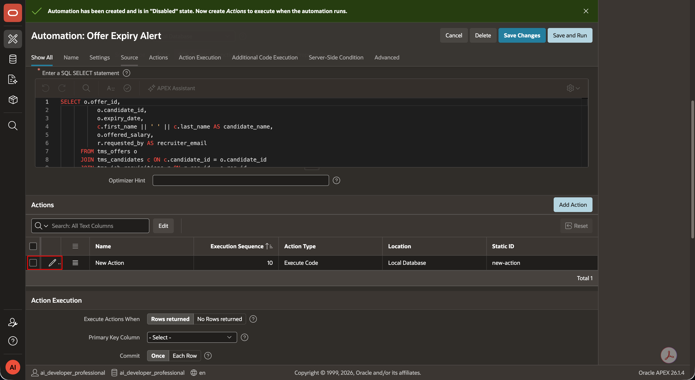

5. Under **Send Email Settings**, enter/select the following:

    | Property | Value |
    | --- | --- |
    | Name | Send Email |
    | From | `&APP_EMAIL.` |
    | To | `&RECRUITER_EMAIL.` |
    | Subject | `Offer expiring soon: &CANDIDATE_NAME.` |

6. For the plain-text message body, enter the following text:

    ```text
    <copy>
    The offer for &CANDIDATE_NAME. will expire on &EXPIRY_DATE. Please take action.
    </copy>
    ```

7. For the HTML message body, enter the following code:

    ```html
    <copy>
    <p>The offer for <strong>&CANDIDATE_NAME.</strong> will expire on <strong>&EXPIRY_DATE.</strong>. Please take action.</p>
    </copy>
    ```

    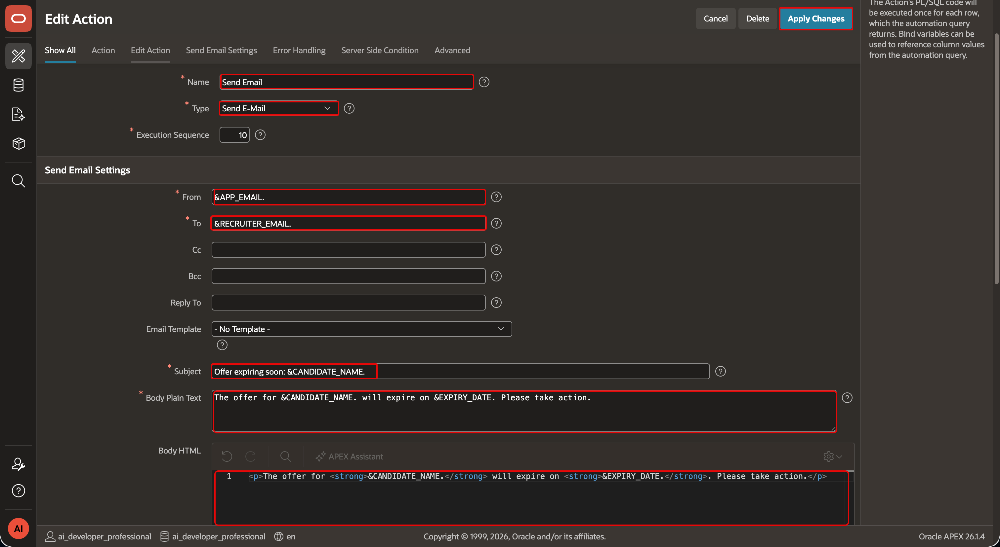

8. Select **Create** to save the action. Set **Schedule Status** to **Active**, and then select **Save and Run**.

    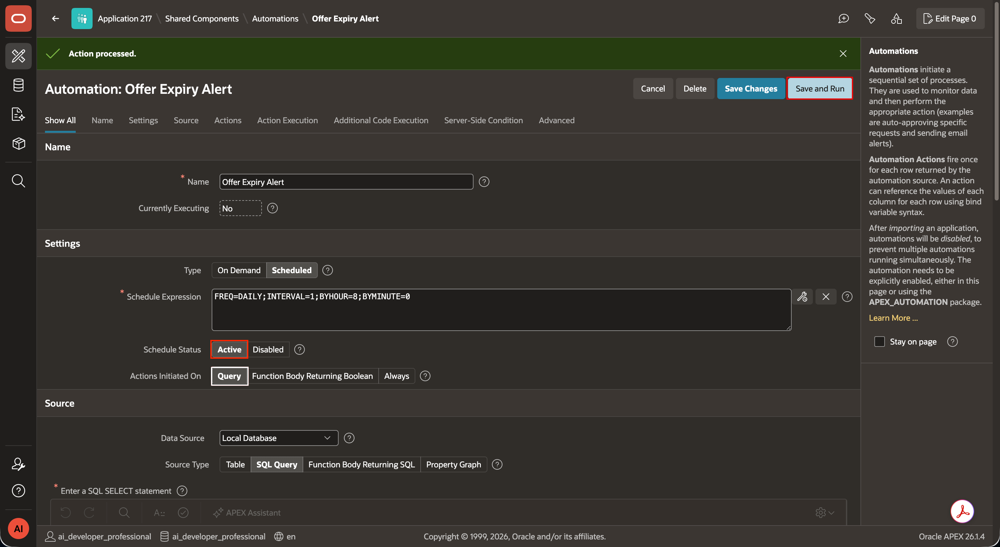

9. Return to **Automations**, and confirm that both TAP automations are listed.

    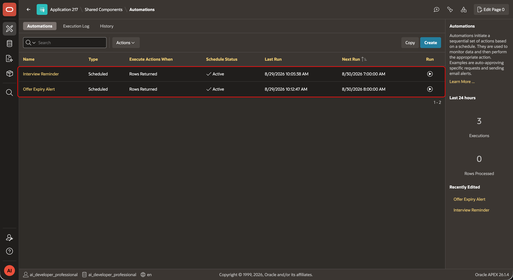

## Task 4: Review Automation Runs

1. In **Shared Components**, select **Automations**, and then select **Execution Log**.

2. For each automation, confirm that the latest run has a **Succeeded** status. Review the timestamp, successful rows, error rows, and messages.

    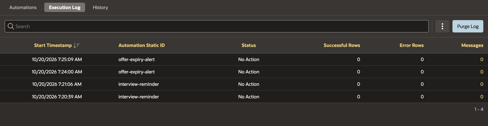

## Summary

You created TAP automations that send interview reminders and offer-expiry alerts, configured their email actions, and reviewed their execution results.

You have completed this workshop.

## Acknowledgements

- **Author** - Aravind Madhavan, Senior Product Manager; Roopesh Thokala, Principal Product Manager
- **Last Updated By/Date** - Roopesh Thokala, October 2026
