# Build the TMS Schema with Quick SQL

## Introduction

Use Quick SQL shorthand to generate the Talent Management System (TMS) tables.

Estimated Lab Time: 15 minutes

### Objectives

In this lab, you will learn how to:

- Create the TMS schema from Quick SQL shorthand.
- Review and run the generated DDL.
- Optionally add a vector column to the HR policy table.
- Verify the created tables in Object Browser.

## Task 1: Generate the TMS DDL

1. In SQL Workshop, select **Utilities**, and then select **Quick SQL**.

    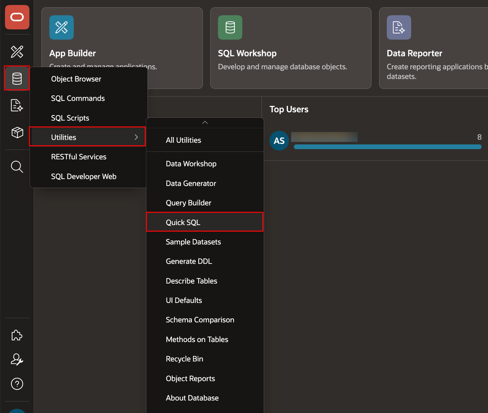

2. Copy the contents of [tms-schema.qsql](files/tms-schema.qsql) into Quick SQL and review the generated DDL.

    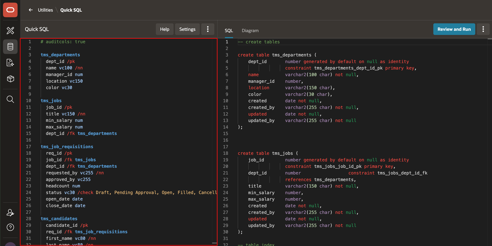

3. In the generated SQL pane, select **SQL Actions**, and then select **Save SQL Script**.

    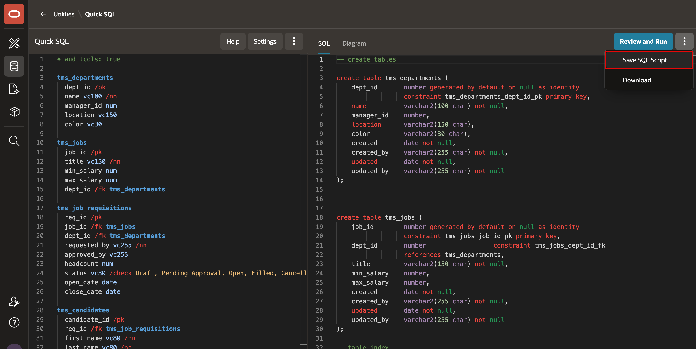

4. For the script name, enter **TMS SCHEMA**, and then select **Save Script**.

    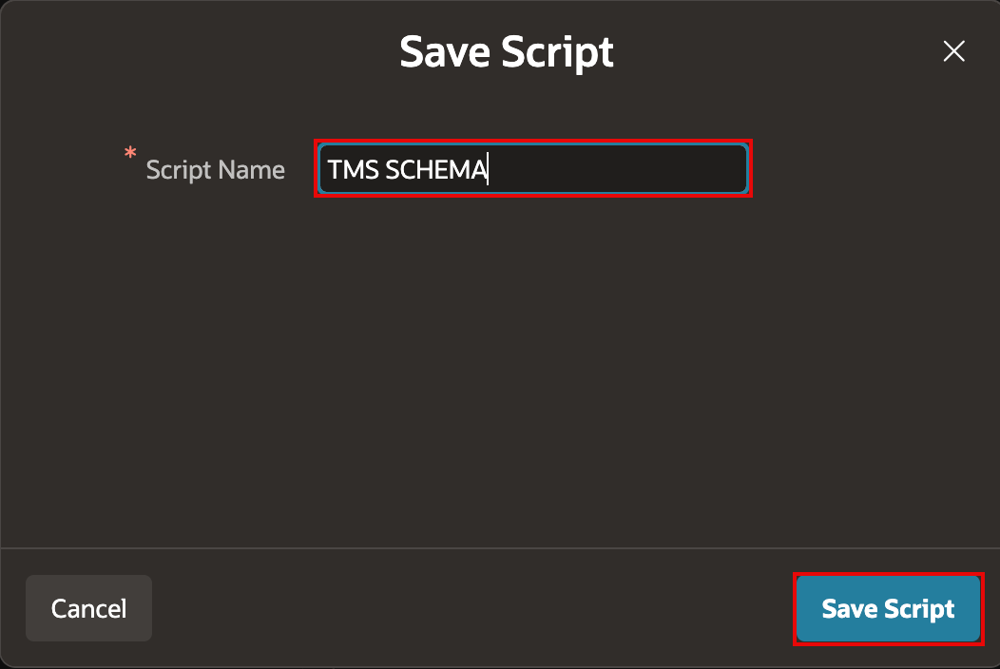

5. Select **Review and Run**.

    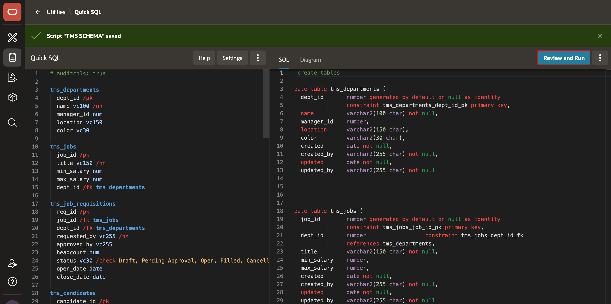

6. Select **Run**.

    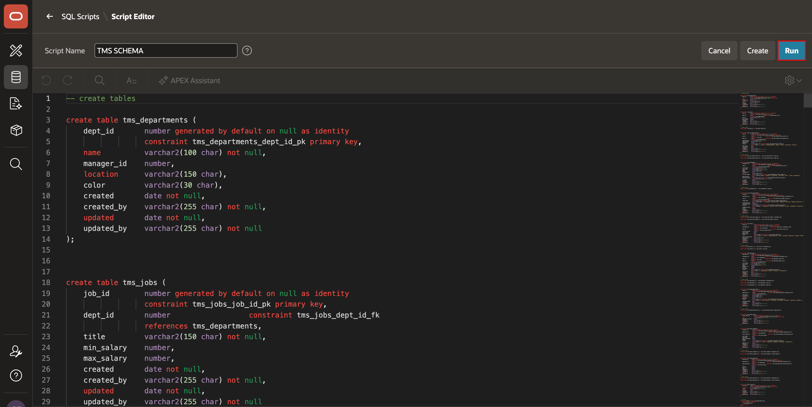

7. If prompted to overwrite the script that you saved, select **Yes**.

8. On the confirmation page, select **Run**.

    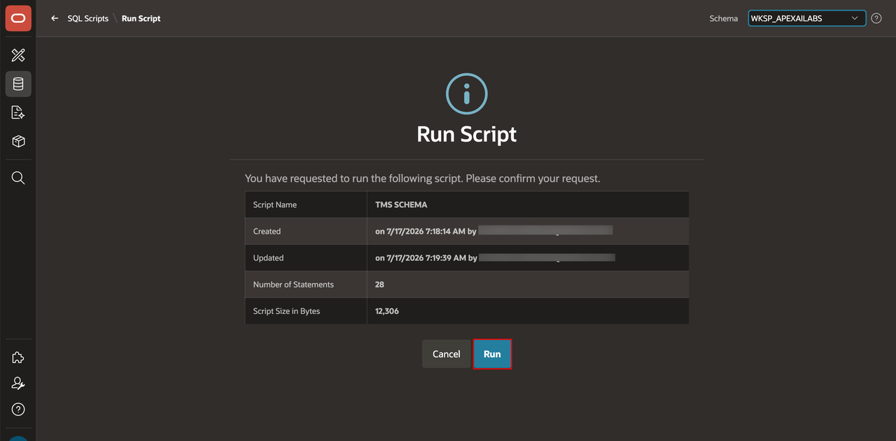

9. If Quick SQL reports errors, or if you prefer to run the completed script directly, use [TMS_SCHEMA.sql](files/TMS_SCHEMA.sql).

## Task 2: Add the Optional Vector Column

1. In SQL Workshop, open **SQL Commands**.

    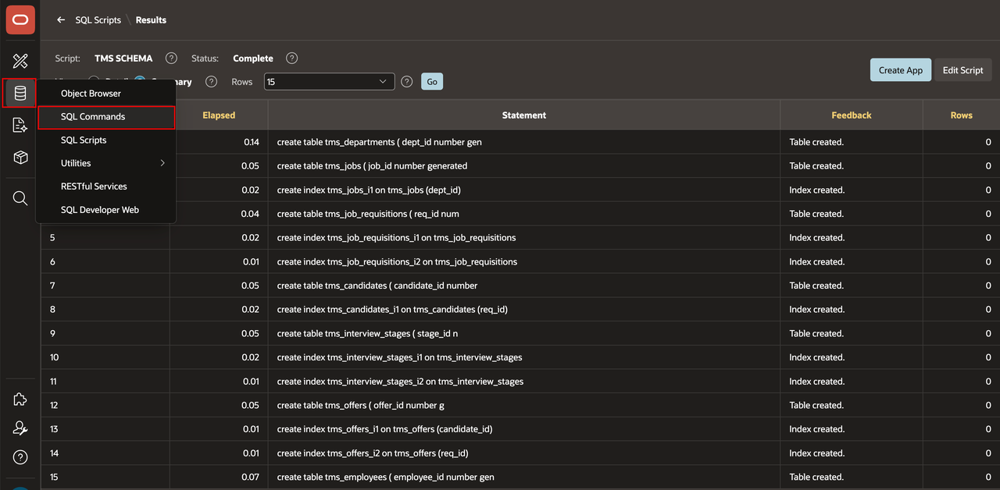

2. If your database supports Oracle AI Database vector data types, run the following statement:

    ```sql
    <copy>
    ALTER TABLE tms_hr_policy ADD embedding_vector VECTOR
    </copy>
    ```

    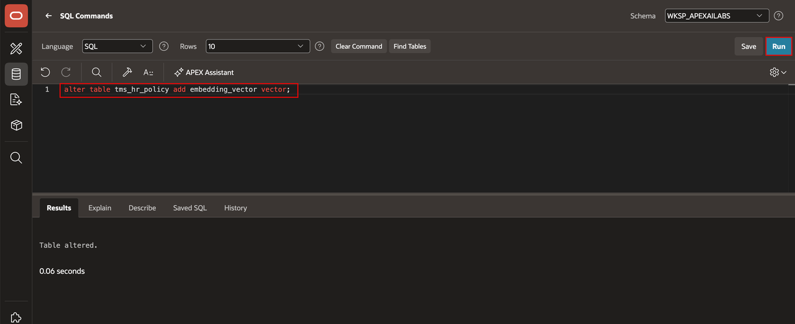

    > **Note:** If the database does not support vector data types, skip this task.

## Task 3: Verify the Tables

1. In SQL Workshop, open **Object Browser**.

    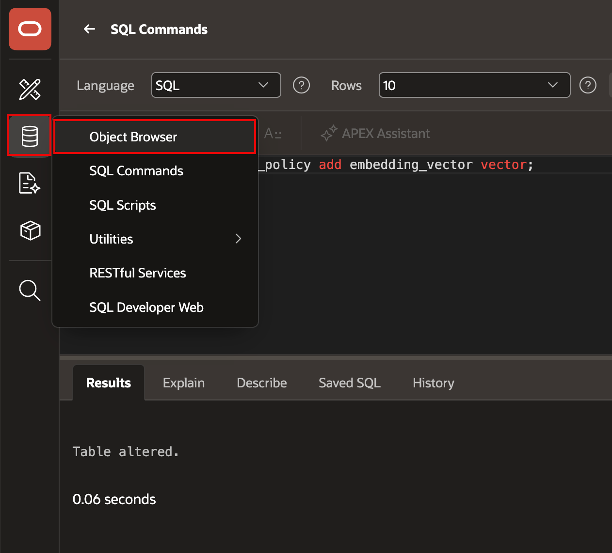

2. Confirm that the **TMS_** tables are listed under **Tables**.

    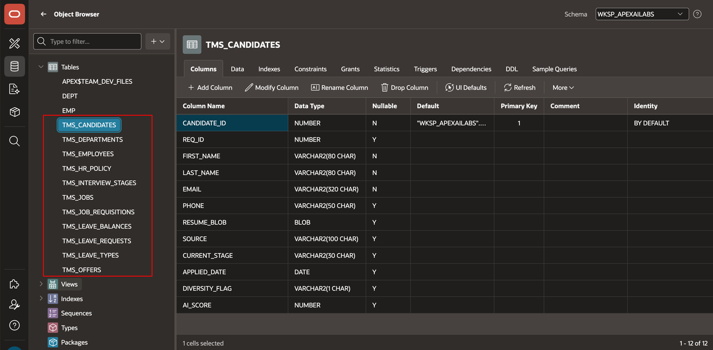

## Summary

You generated and ran the Quick SQL script that creates the TMS schema, optionally added a vector column, and verified the TMS tables.

### Acknowledgements

- **Author** - Apoorva Srinivas, Principal Product Manager; Roopesh Thokala, Principal Product Manager
- **Last Updated By/Date** - Roopesh Thokala, Principal Product Manager, October 2026
