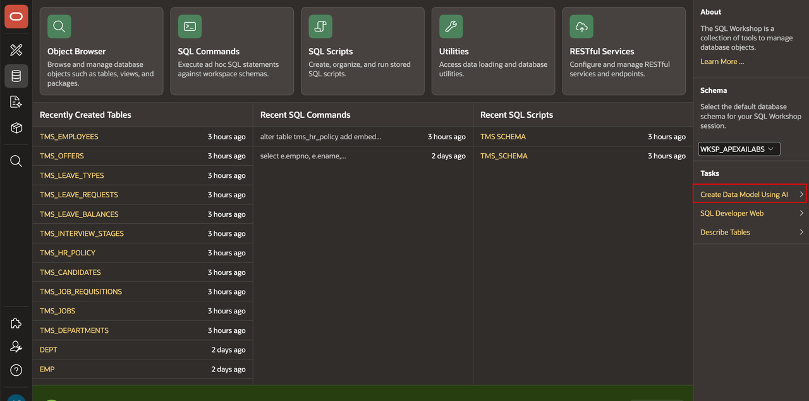
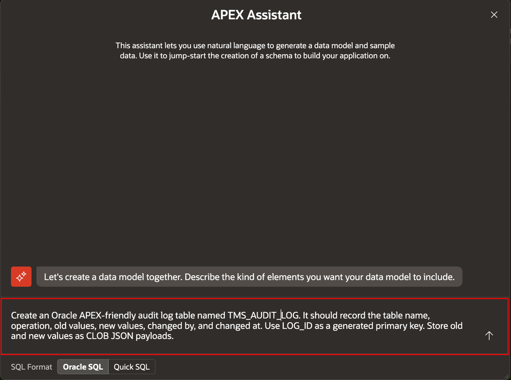
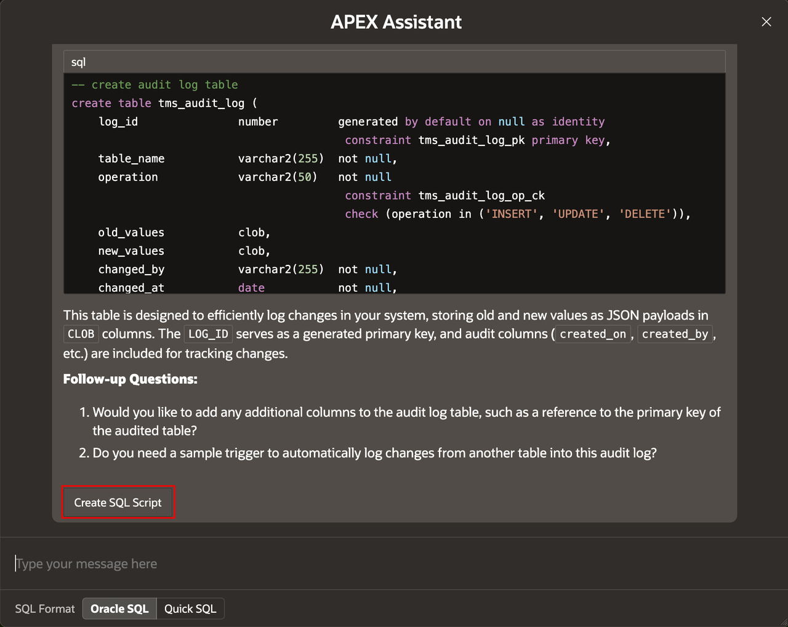
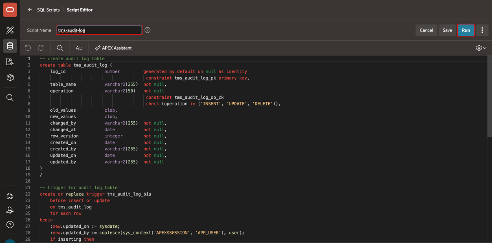
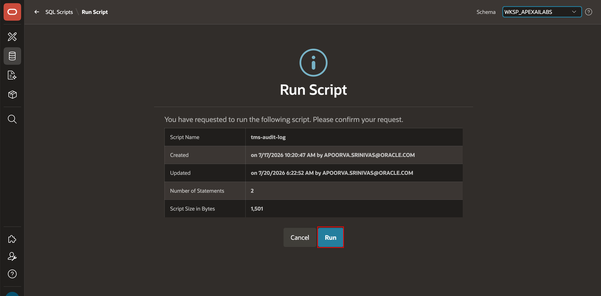
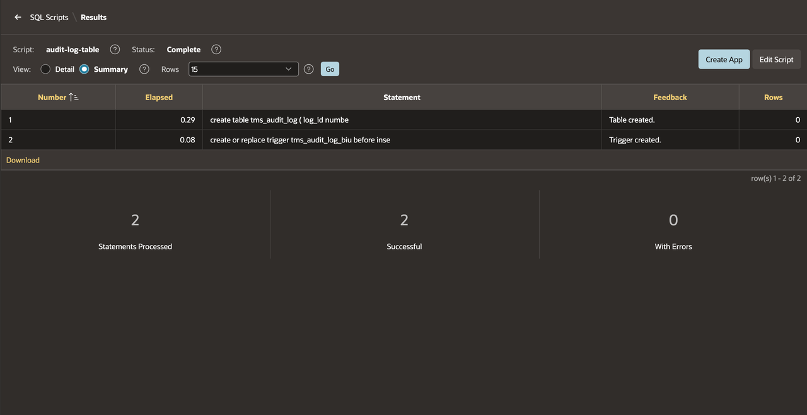
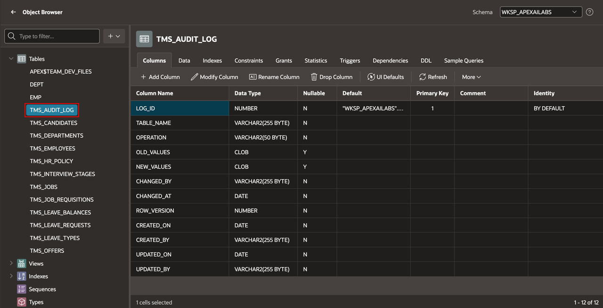

# Add the Audit Log Table with AI

## Introduction

Use the AI-assisted custom data model experience to create the TMS audit-log table. Keep the supplied SQL script as a deterministic fallback.

Estimated Lab Time: 10 minutes

### Objectives

In this lab, you will learn how to:

- Use the AI-assisted data-model feature to create an audit-log table.
- Review and run the generated DDL.
- Use the supplied SQL fallback when the AI feature is unavailable.

## Task 1: Generate the Table with AI

1. In SQL Workshop, open **Create Data Model Using AI**.

    

    > **Note:** This option appears only if a Generative AI service is configured in your APEX workspace.

2. Enter the following prompt:

    ```
    <copy>
    Create an Oracle APEX-friendly audit log table named TMS_AUDIT_LOG.
    It should record the table name, operation, old values, new values,
    changed by, and changed at. Use ID as a generated primary key.
    Store old and new values as CLOB JSON payloads.
    </copy>
    ```

    

3. Review the generated DDL.

4. Select **Create SQL Script**.

    

## Task 2: Run the SQL Script

1. If the AI-assisted feature is unavailable or does not produce a suitable DDL script, use [tms-audit-log.sql](files/tms-audit-log.sql) from SQL Scripts.

2. For **Script Name**, enter **tms-audit-log**.

3. Select **Run**.

    

4. Select **Run**.

    

5. Verify that the script completed without errors.

    

6. In Object Browser, confirm that **TMS\_AUDIT\_LOG** is listed.

    

## Summary

You used the AI-assisted data-model feature to create an audit-log table and used the supplied SQL script as a fallback.

### Acknowledgements

- **Author** - Apoorva Srinivas, Principal Product Manager; Roopesh Thokala, Principal Product Manager
- **Last Updated By/Date** - Roopesh Thokala, Principal Product Manager, October 2026
