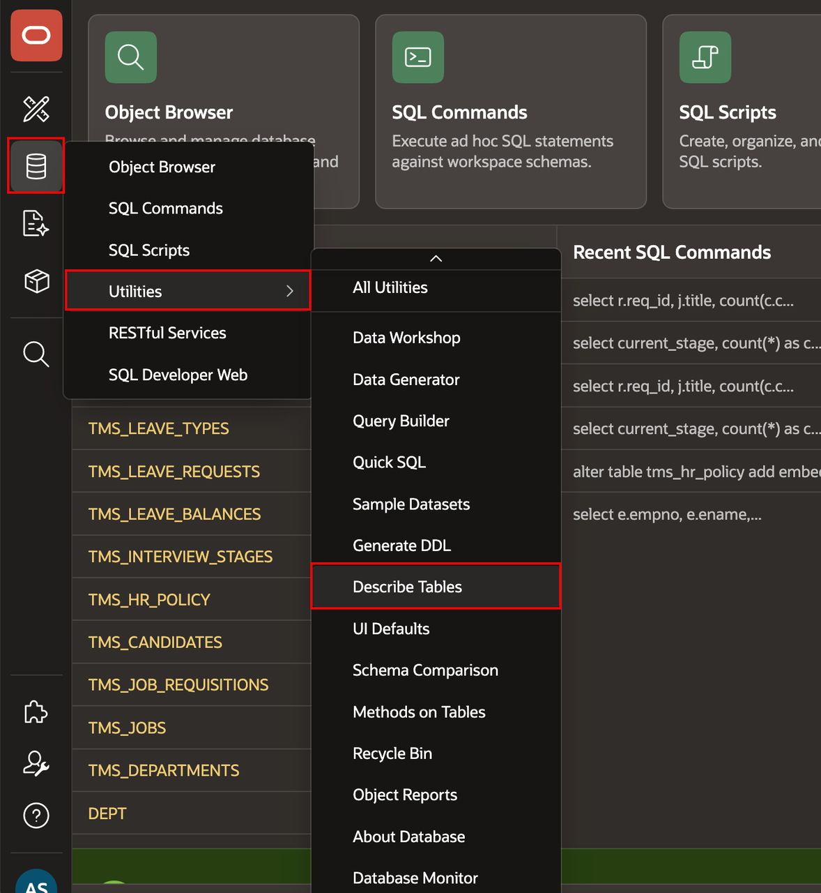
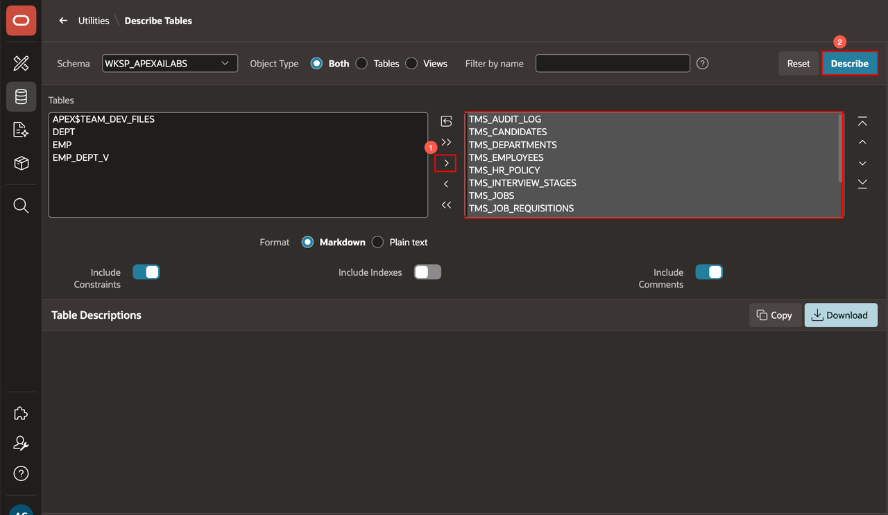
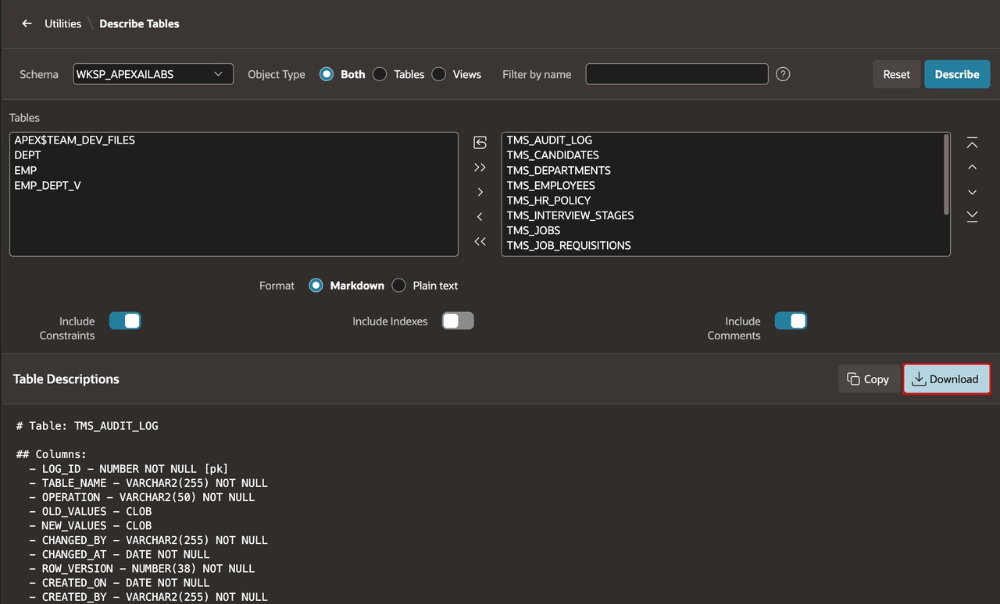
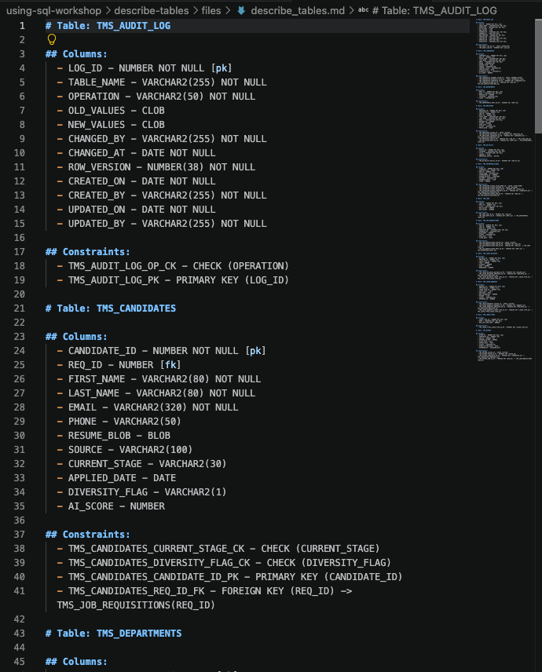

# Describe Tables

## Introduction

Use the Describe Tables feature to export schema metadata for Talent Acquisition Portal (TAP) and shared tables. This metadata helps teams understand the available columns before they build pages and integrations.

Estimated Lab Time: 5 minutes

### Objectives

In this lab, you will learn how to:

- Open the Describe Tables feature.
- Select the Talent Acquisition Portal (TAP) and shared tables.
- Download the resulting schema metadata.

## Task 1: Describe the Tables

1. In SQL Workshop, select **Utilities**.

2. Select **Describe Tables**.

    

3. Select the required tables whose names begin with **TMS_**

4. Select **Describe**.

    

5. Download the schema metadata.

6. Store the downloaded metadata where later labs can reference it.

    

## Task 2: Confirm the Module Outcome

1. Open the downloaded metadata file.

2. Confirm that it contains the TMS schema details.

    

## Summary

You used Describe Tables to download the TMS schema metadata for later reference.

## Acknowledgements
- **Author** - Apoorva Srinivas, Principal Product Manager; Roopesh Thokala, Principal Product Manager
- **Last Updated By/Date** - Roopesh Thokala, Principal Product Manager, October 2026
