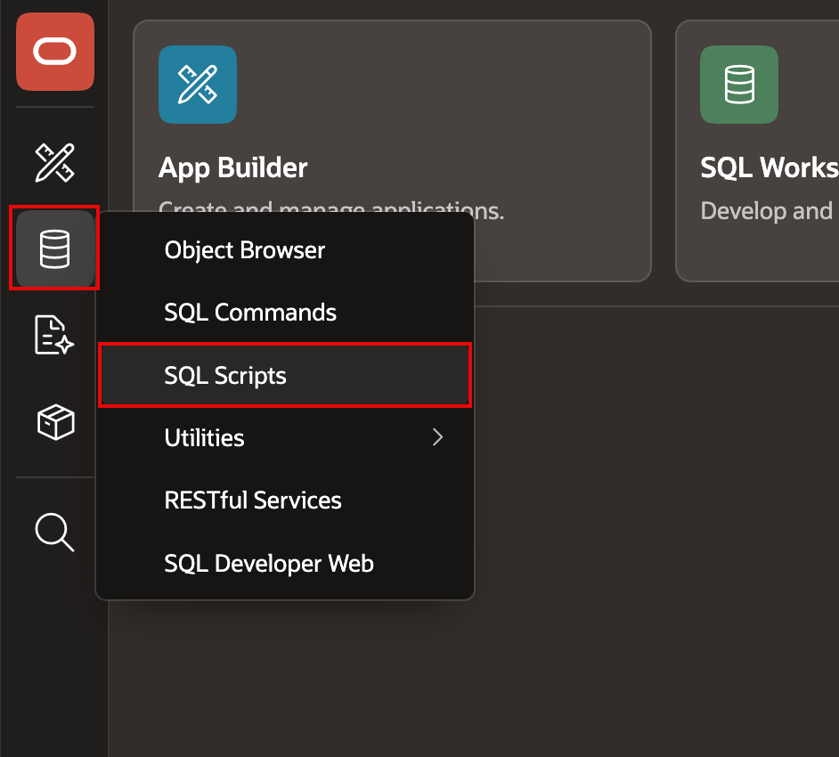
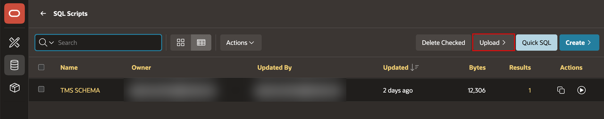
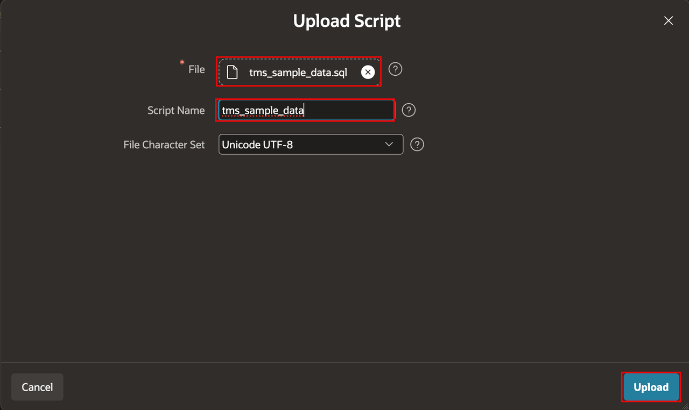
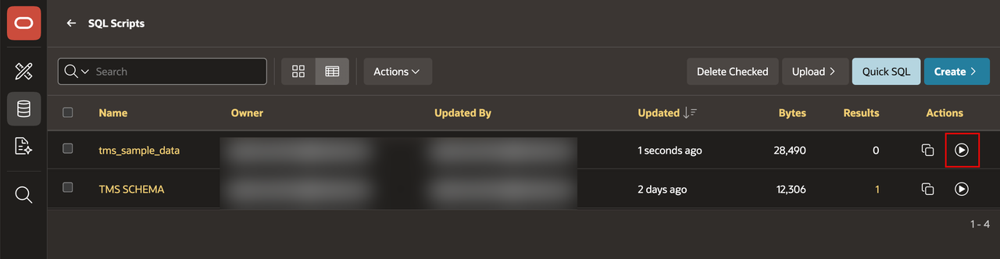
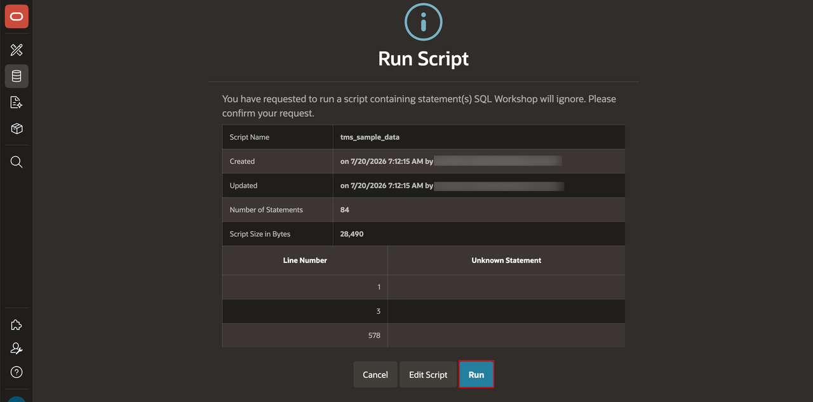
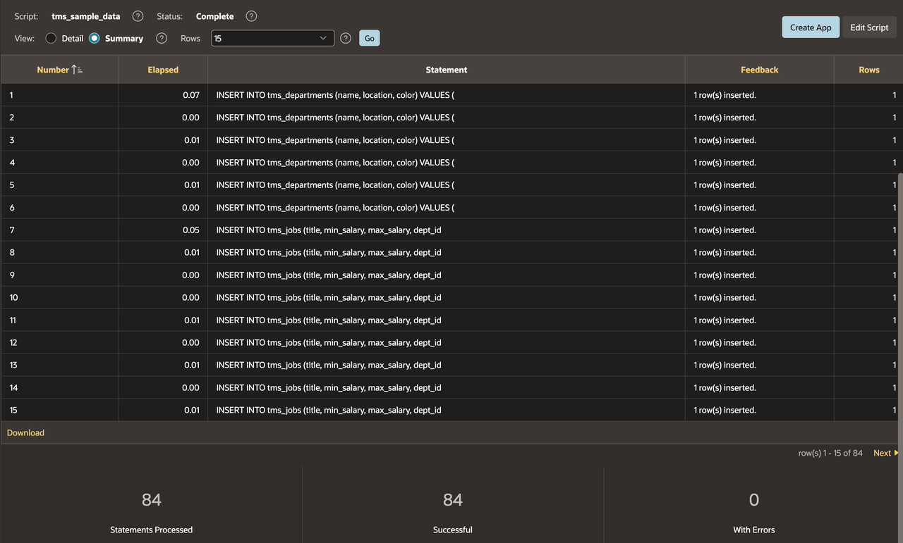

# Insert Realistic Data

## Introduction

Load data that you can use to develop and test the APEX application.

Estimated Lab Time: 5 minutes

### Objectives

In this lab, you will learn how to:

- Upload the DML script to SQL Scripts.
- Run the script to insert TMS data into the relevant tables.

## Task 1: Upload the SQL Script

1. In SQL Workshop, select **SQL Scripts**.

    

2. Select **Upload**.

    

3. Select [tms\_sample\_data.sql](files/tms_sample_data.sql).

4. For **Script Name**, enter **tms\_sample\_data**.

5. Select **Upload**.

    

## Task 2: Run the SQL Script

1. Select the **tms\_sample\_data** script.

2. Select **Run**.

    

3. Select **Run**.

    

4. Verify that the script completed without errors.

    

## Summary

You uploaded and ran the sample-data script to populate the TMS tables.

## Acknowledgements

- **Author** - Apoorva Srinivas, Principal Product Manager; Roopesh Thokala, Principal Product Manager
- **Last Updated By/Date** - Roopesh Thokala, Principal Product Manager, October 2026
