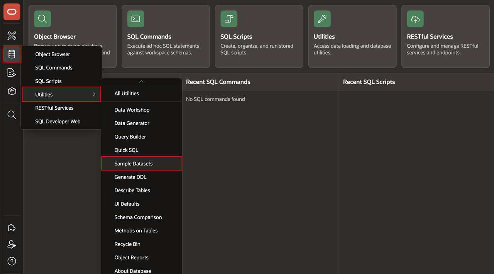
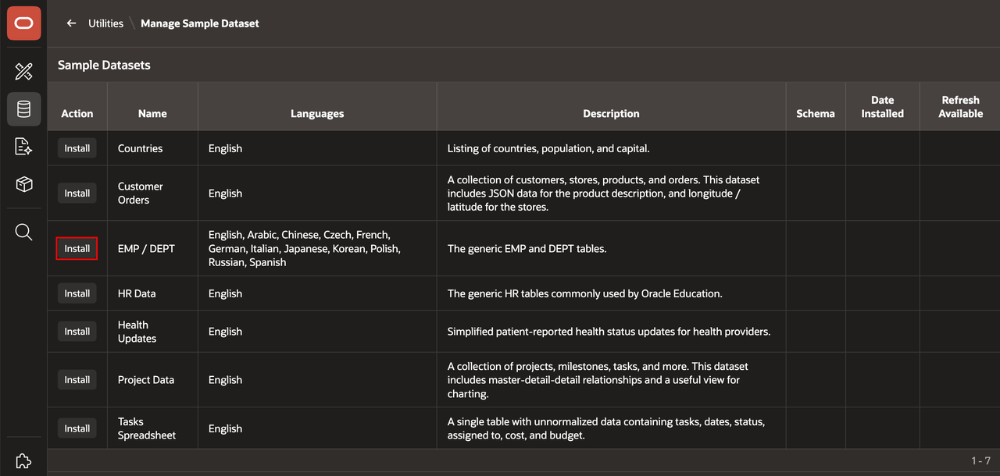
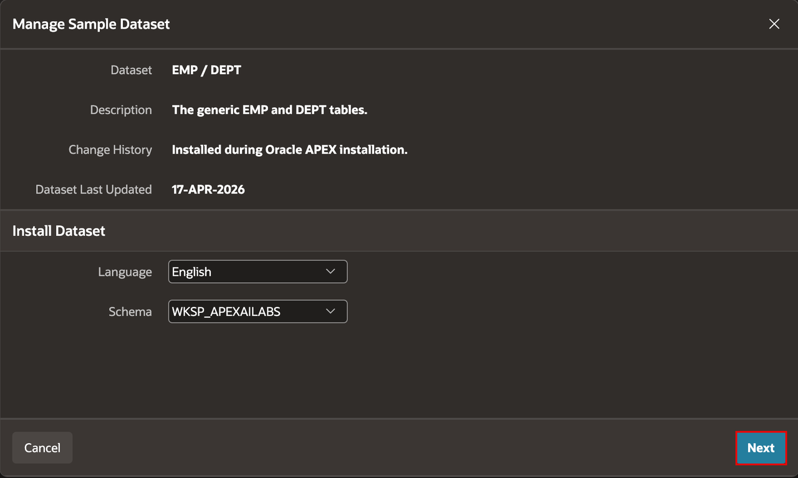
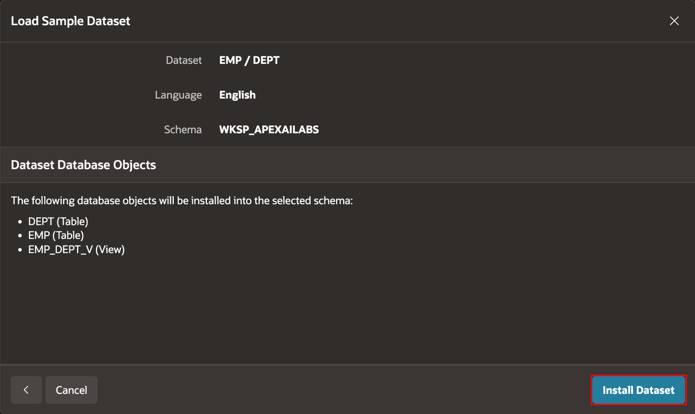
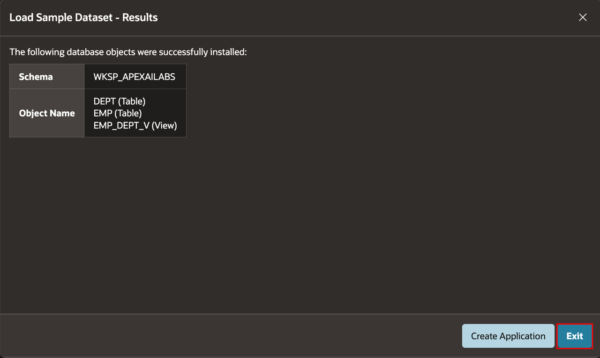
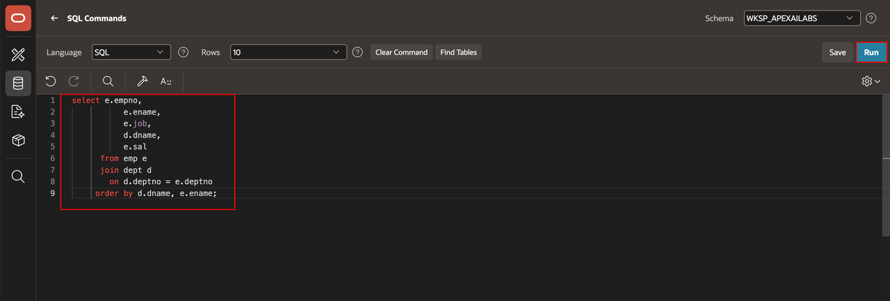
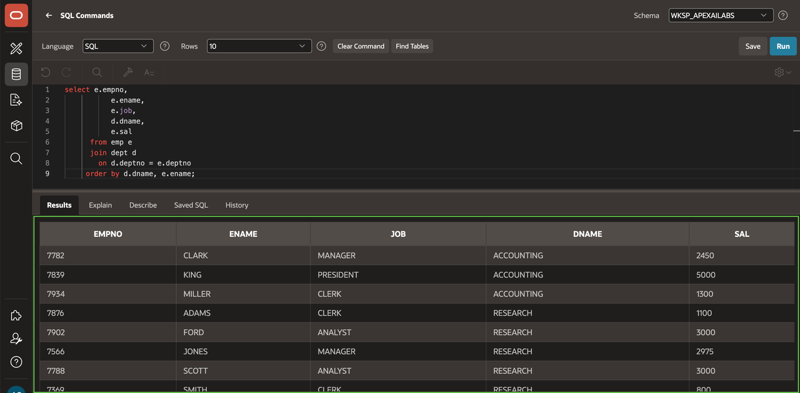

# Load a Sample Dataset

## Introduction

Install the EMP/DEPT sample dataset to confirm that you can load data and run a relational query before creating the TMS schema.

Estimated Lab Time: 5 minutes

### Objectives

In this lab, you will learn how to:

- Install the EMP/DEPT sample dataset.
- Run a SQL statement in SQL Commands.
- Verify that the dataset returns department and employee data.

## Task 1: Install EMP/DEPT

1. In SQL Workshop, select **Utilities**, and then select **Sample Datasets**.

    

2. Select the **EMP/DEPT** dataset.

    

3. Select **Next**.

    

4. Select **Install Dataset**.

    

5. When the installation completes, select **Exit**.

    

## Task 2: Query the Sample Data

1. In SQL Workshop, open **SQL Commands** and run the following query:

    ```sql
    <copy>
    SELECT e.empno,
           e.ename,
           e.job,
           d.dname,
           e.sal
      FROM emp e
      JOIN dept d
        ON d.deptno = e.deptno
     ORDER BY d.dname, e.ename
    </copy>
    ```

    

3. Confirm that the result contains employees with their department names and salaries.

    

## Summary

You installed the EMP/DEPT sample dataset and used SQL Commands to query employee and department data.

## Acknowledgements

- **Author** - Apoorva Srinivas, Principal Product Manager; Roopesh Thokala, Principal Product Manager
- **Last Updated By/Date** - Roopesh Thokala, Principal Product Manager, October 2026
