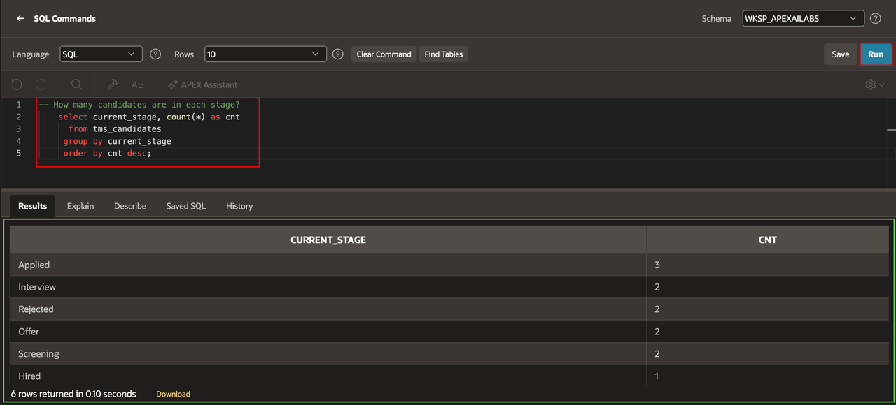
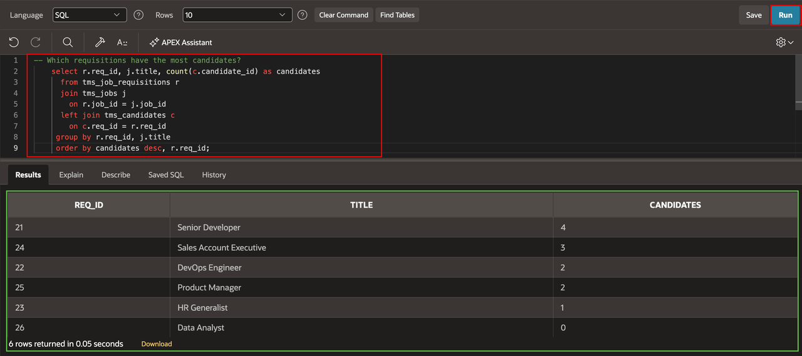
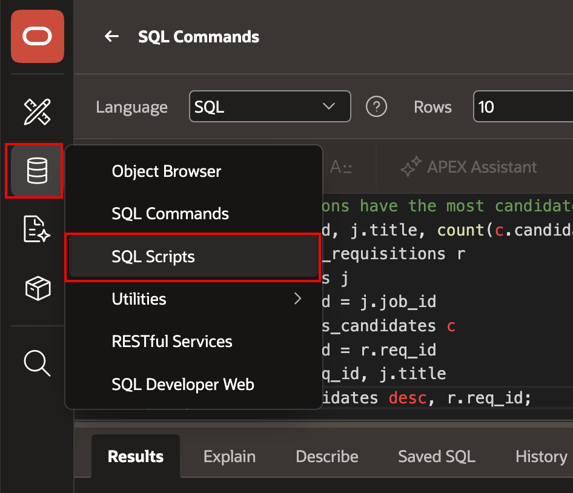
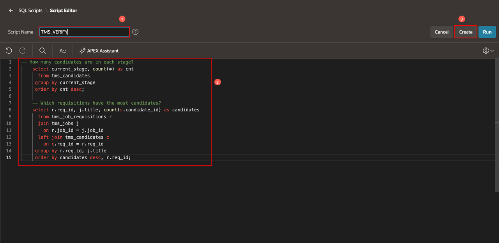
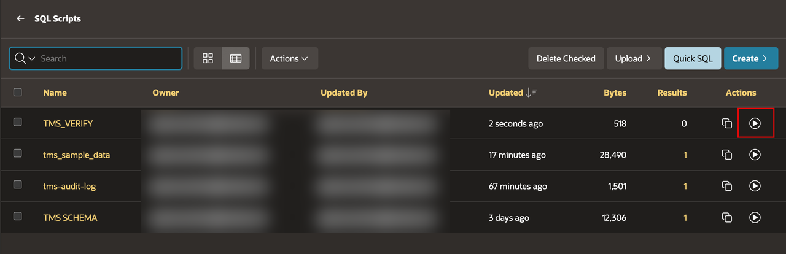
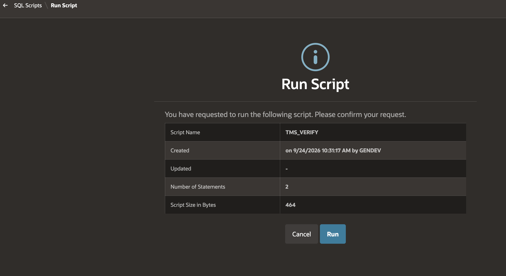
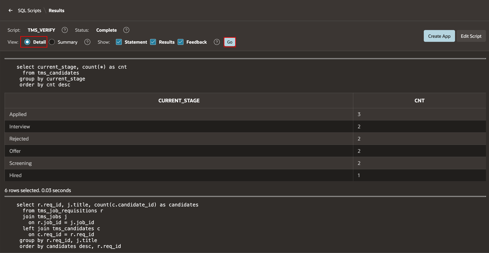

# Save Verification Queries as Scripts

## Introduction

Run verification queries against the TMS data, then save them as a reusable SQL script for later labs.

Estimated Lab Time: 5 minutes

### Objectives

In this lab, you will learn how to:

- Count candidates by stage.
- Identify requisitions with candidates.
- Save the statements as `TMS_VERIFY`.

## Task 1: Run Verification Queries

1. Open **SQL Commands**.

2. Run the following query to count candidates in each stage:

    ```sql
    <copy>
    -- How many candidates are in each stage?
    SELECT current_stage,
           COUNT(*) AS cnt
      FROM tms_candidates
     GROUP BY current_stage
     ORDER BY cnt DESC
    </copy>
    ```

    

3. Run the following query to identify requisitions with candidates:

    ```sql
    <copy>
    -- Which requisitions have the most candidates?
    SELECT r.req_id,
           j.title,
           COUNT(c.candidate_id) AS candidates
      FROM tms_job_requisitions r
      JOIN tms_jobs j
        ON r.job_id = j.job_id
      LEFT JOIN tms_candidates c
        ON c.req_id = r.req_id
     GROUP BY r.req_id, j.title
     ORDER BY candidates DESC, r.req_id
    </copy>
    ```

    

4. Confirm that both queries return rows.

## Task 2: Save the Script

1. In SQL Workshop, select **SQL Scripts**.

2. Select **Create**.

    

3. For **Script Name**, enter `TMS_VERIFY`.

4. In **SQL Editor**, enter the following statements:

    ```sql
    <copy>
    -- How many candidates are in each stage?
    SELECT current_stage,
           COUNT(*) AS cnt
      FROM tms_candidates
     GROUP BY current_stage
     ORDER BY cnt DESC;

    -- Which requisitions have the most candidates?
    SELECT r.req_id,
           j.title,
           COUNT(c.candidate_id) AS candidates
      FROM tms_job_requisitions r
      JOIN tms_jobs j
        ON r.job_id = j.job_id
      LEFT JOIN tms_candidates c
        ON c.req_id = r.req_id
     GROUP BY r.req_id, j.title
     ORDER BY candidates DESC, r.req_id;
    </copy>
    ```

5. Select **Create**.

    

6. Select the **TMS_VERIFY** script.

7. Select **Run**.

    

8. Select **Run**.

    

9. For **View**, select **Detail**.

10. Select **Go**.

    

## Summary

You ran two TMS verification queries and saved them as the reusable `TMS_VERIFY` script.

### Acknowledgements

- **Author** - Apoorva Srinivas, Principal Product Manager; Roopesh Thokala, Principal Product Manager
- **Last Updated By/Date** - Roopesh Thokala, Principal Product Manager, October 2026
