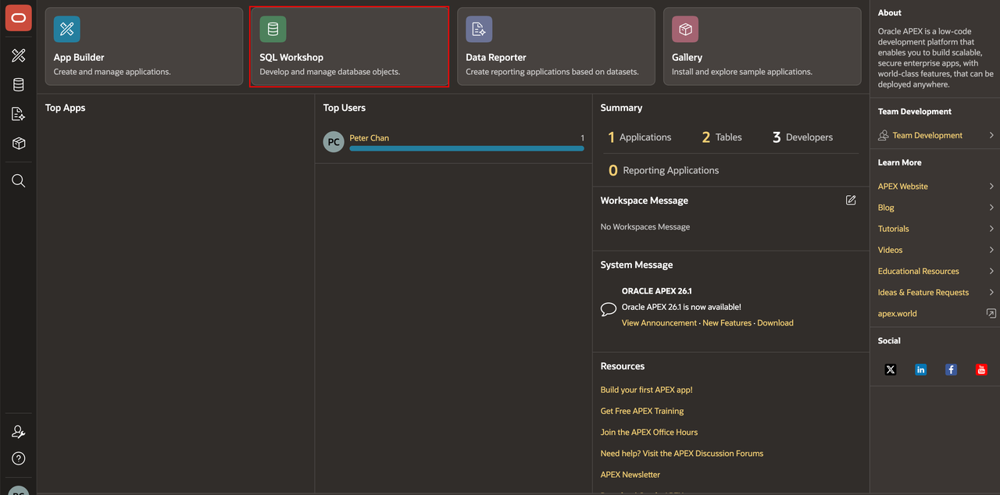
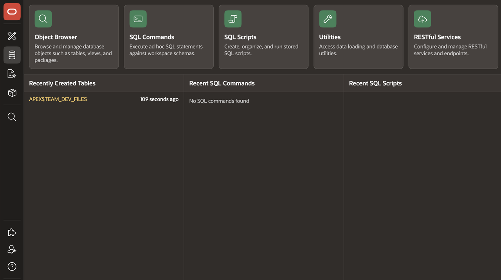
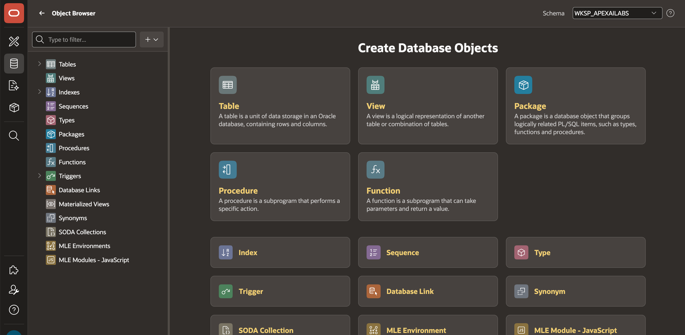
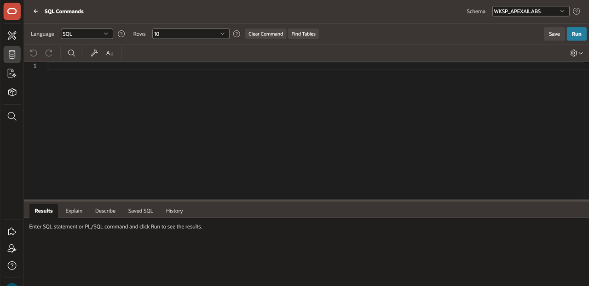
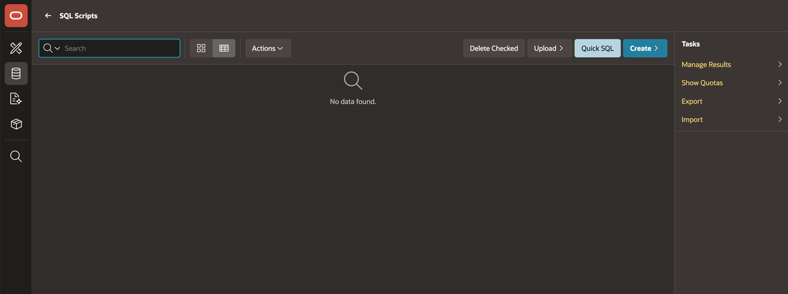
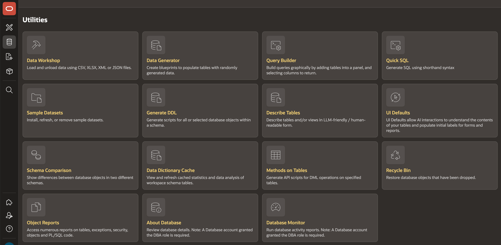
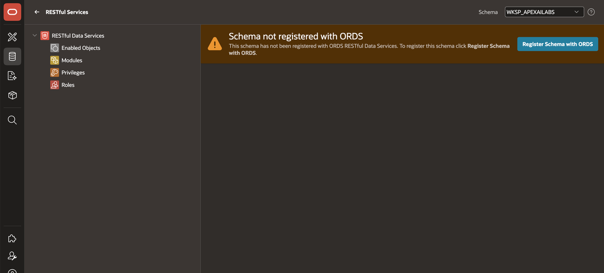

# Tour SQL Workshop

## Introduction

SQL Workshop is an APEX workspace component for working directly with the database. Explore its tools before you create database objects for the application.

Estimated Lab Time: 5 minutes

### Objectives

In this lab, you will learn how to:

- Open SQL Workshop.
- Identify the SQL Workshop components.
- Explore the available SQL Workshop tools.

## Task 1: Open SQL Workshop

1. On the APEX workspace home page, select **SQL Workshop**.

    

## Task 2: Identify the SQL Workshop Components

1. Review the available SQL Workshop components.

    

2. Review **Object Browser**. Use it to inspect and manage database objects.

    

3. Review **SQL Commands**. Use it to run an individual SQL or PL/SQL statement.

    

4. Review **SQL Scripts**. Use it to save and run a script.

    

5. Review **Utilities**. It contains tools for working with data, generating sample data, building queries, managing database objects, and performing database-related administration tasks.

    

6. Review **SQL Developer Web**. Use it to configure schema REST access and open SQL Developer Web to manage RESTful services and endpoints.

    

7. Keep SQL Workshop open for the next lab.

## Summary

You opened SQL Workshop and reviewed the components used to manage database objects, run SQL, and save scripts.

## Acknowledgements

- **Author** - Apoorva Srinivas, Principal Product Manager; Roopesh Thokala, Principal Product Manager
- **Last Updated By/Date** - Roopesh Thokala, Principal Product Manager, October 2026
