# TAP Requisition Approval Workflow

## Introduction

In this lab, you create a TAP workflow that routes submitted requisitions by requested headcount. Requisitions for more than three people go to an HR administrator. All other requisitions go to the department head. The task outcome updates the requisition status.

Estimated Lab Time: 45 minutes

### Where We Are

TAP already contains the Job Requisition form, employee data, and authorization schemes. In this lab, you create the approval workflow that routes a submitted requisition to the appropriate reviewer.

### Objectives

In this lab, you will:

- Create approval task definitions with task parameters and potential owners.
- Build a workflow that loads requisition details and routes by headcount.
- Start the workflow from the Job Requisition form and test both routes.

### Prerequisites

- Oracle APEX 26.1 or later and the starter application for this lab.
- TAP users and roles identified in the workshop prerequisites.
- A department with a manager whose employee record has a valid email address.

### Downloads

Stuck or missed out on completing the earlier labs? Don't worry! You can download the following file:

- **<a href="../introduction/files/tap-export15.sql" download="tap-export15.sql">Talent Acquisition Portal</a>**

Import it into your workspace. In **App Builder**, select **Import**, upload `tap-export15.sql`, and follow the steps in the **Import Application** wizard.

> **Note:**
>
> - **APEX Version:** The supplied application export was created with Oracle APEX 26.2 and cannot be imported into earlier APEX releases.

## Task 1: Create the Task Definitions

1. In TAP, open **Shared Components**.
    - Under **Workflows and Automations**, select **Task Definitions**.

    

2. Click **Create**.

    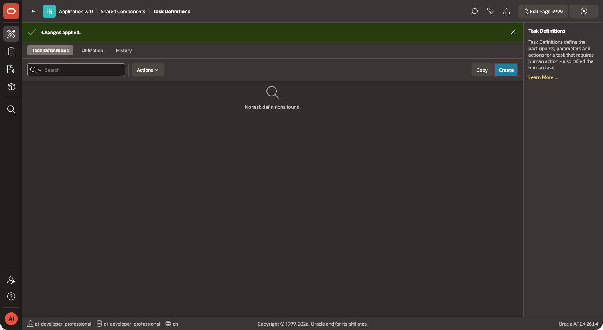

3. Create the HR administration task definition with the following values:

    **Requisition HR Admin Review**

    | Field | Value |
    | --- | --- |
    | Name | `Requisition HR Admin Review` |
    | Type | Approval Task |
    | Subject | `Approve Requisition &P_REQ_ID. for &P_REQUESTED_HEADCOUNT. headcount` |
    | Priority | Medium |


    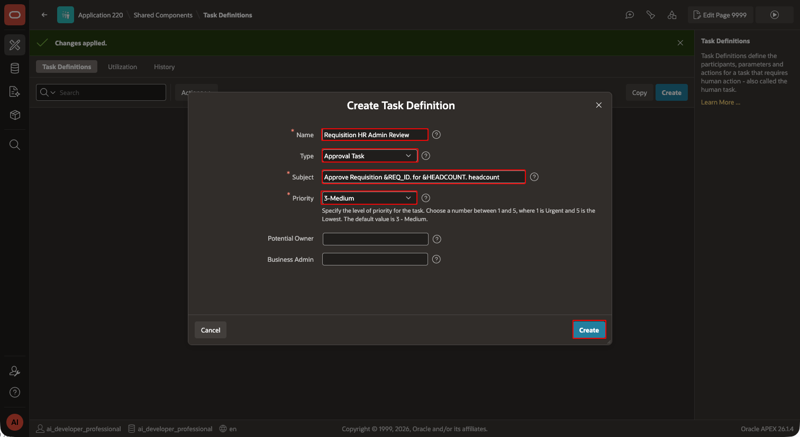

4. Configure the due date:

    - Set **Due On Type** to **Expression**
    - Set **Due On** to `SYSDATE + 2`

    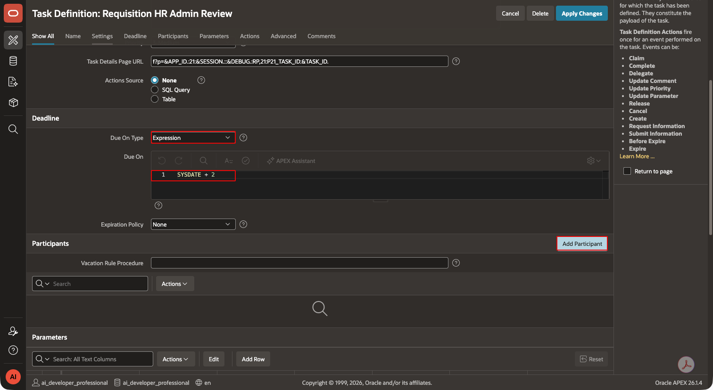

5. Add and configure the participant:

    - Click **Add Participant**.
    - Set the participant values as follows:

    | Participant Type | Identity Type | Value |
    | --- | --- | --- |
    | **Potential Owner** | **Authorization Scheme** |  `IS_TA_ADMIN` |

    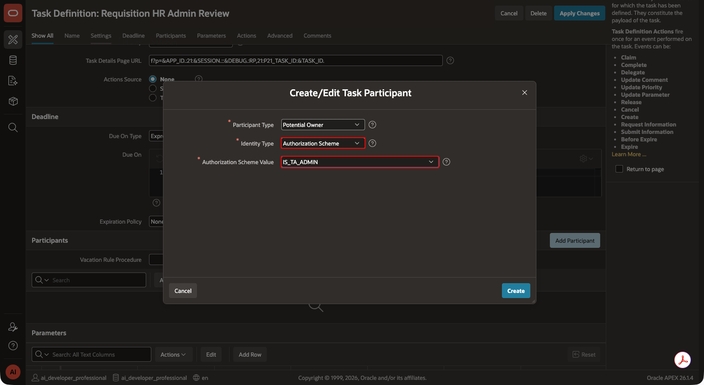

6. Add the following task parameters. The static IDs support the subject substitutions.

    - Set each parameter data type to **String**.
    - Provide a readable label for each parameter.

    | **Static ID** | Label | **Required** | **Visible** |
    | --- | --- | --- | --- |
    | `P_REQ_ID` | Requisition ID | Yes | Yes |
    | `P_REQUESTED_HEADCOUNT` | Requested Headcount | Yes | Yes |
    | `P_JOB_TITLE` | Job Title | Yes | Yes |
    | `P_DEPARTMENT_NAME` | Department Name | Yes | Yes |

    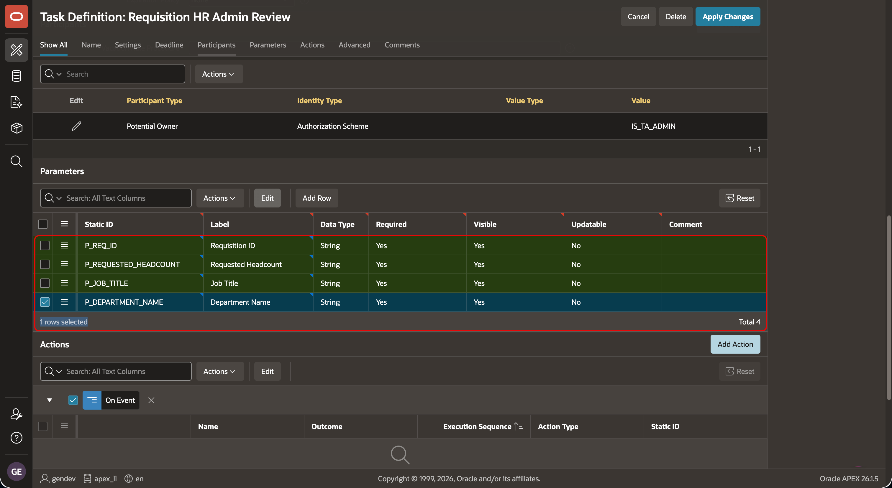

7. Keep **Initiator Can Complete** off.

    - Click **Create Task Details Page**.
    - Save the task definition.

    

8. Create a new **Task Definition** and Configure the **Requisition Department Head Review** task definition with these values:

    | Field | Value |
    | --- | --- |
    | Name | `Requisition Department Head Review` |
    | Type | Approval Task |
    | Subject | `Approve Requisition &P_REQ_ID. for &P_REQUESTED_HEADCOUNT. headcount` |

    - Click **Create** to save the task definition.

    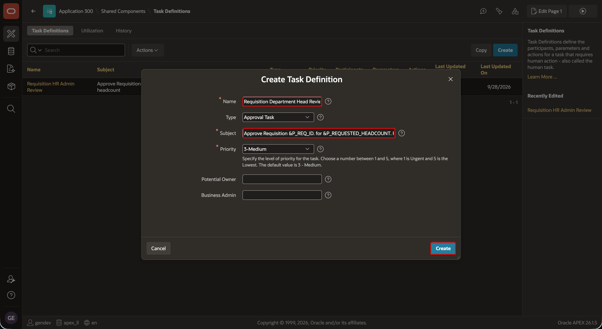

9. On the **Task Definition** page, configure the Department Head **Potential Owner**:

    - Click **Add Participant**.

    | Participant Type | Identity Type | Value Type | **SQL Query** |
    | --- | --- | --- | --- |
    | **Potential Owner** | User | **SQL Query** | `SELECT UPPER(e.email) FROM tms_employees e JOIN tms_departments d ON d.manager_id = e.employee_id WHERE d.dept_id = (SELECT r.dept_id FROM tms_job_requisitions r WHERE r.req_id = :APEX$TASK_PK)` |

    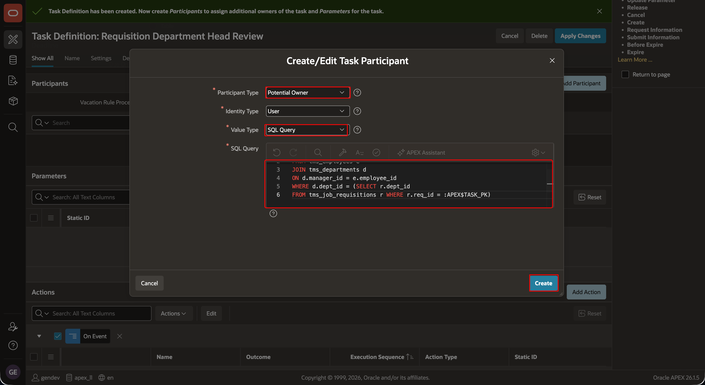

10. Add the same task parameters to this definition. The static IDs support the subject substitutions.

    - Set each parameter data type to **String**.
    - Provide a readable label for each parameter.

    | **Static ID** | Label | **Required** | **Visible** |
    | --- | --- | --- | --- |
    | `P_REQ_ID` | Requisition ID | Yes | Yes |
    | `P_REQUESTED_HEADCOUNT` | Requested Headcount | Yes | Yes |
    | `P_JOB_TITLE` | Job Title | Yes | Yes |
    | `P_DEPARTMENT_NAME` | Department Name | Yes | Yes |

    

11. Keep **Initiator Can Complete** off.

    - Click **Create Task Details Page**.
    - Save the task definition.

    

## Task 2: Create the Requisition Workflow

1. In TAP, open **Shared Components**.
    - Select **Workflows**.

    

2. Click **Create**.

    - Set **Name** to `Approve Job Requisition`.
    - Keep the version in **Development**.

3. Create the required workflow parameter. To create a Parameter, right click on **Approve Job Requisition** workflow in the rendering tree and click **Create Parameter**.

    | **Static ID** | Label | **Data Type** | **Direction** | **Required** |
    | --- | --- | --- | --- | --- |
    | `P_REQ_ID` | Requisition ID | NUMBER | In | Yes |

    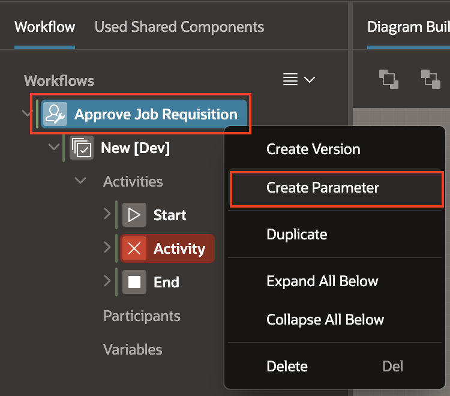

    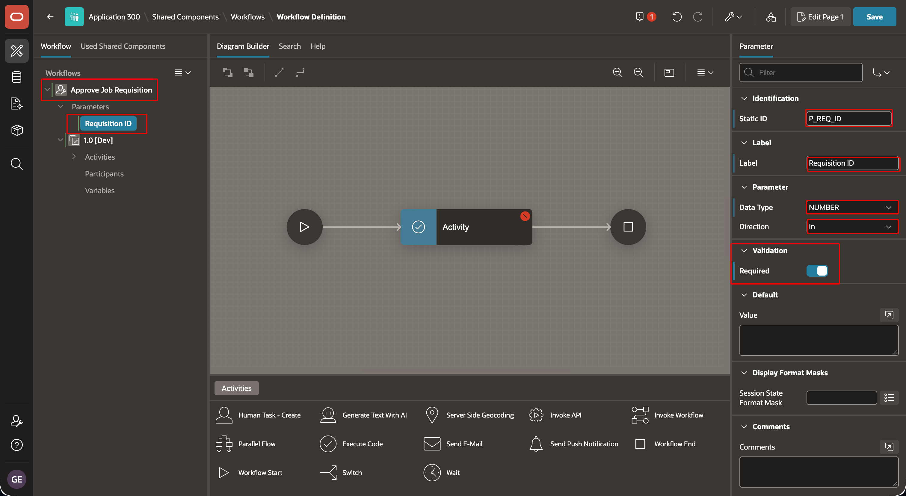

4. Create the following workflow variables. To create a Variable, right click on **Approve Job Requisition** workflow in the rendering tree and click **Create Parameter**.

    - Use the `V_` prefix for values that can change at runtime.

    - Add the label shown for each variable.

    | **Static ID** | Label | **Data Type** |
    | --- | --- | --- |
    | `V_REQUESTED_HEADCOUNT` | Requested Headcount | NUMBER |
    | `V_DEPARTMENT_ID` | Department ID | NUMBER |
    | `V_REQUESTER_ID` | Requester ID | VARCHAR2 |
    | `V_JOB_TITLE` | Job Title | VARCHAR2 |
    | `V_DEPARTMENT_NAME` | Department Name | VARCHAR2 |

    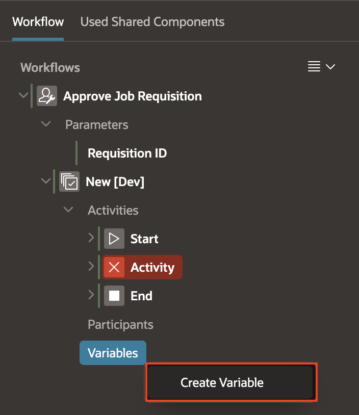

    

5. In **Workflow Designer**, notice that you have **Workflow Start** activity, an **Execute Code** and a **Workflow End** activity.

6. Select the **Execute Code** activity and then, in the Property Editor
    - Identification: Name > **Load Requisition Details**

    - Source: PL/SQL > Enter the following.

        ```sql
        <copy>
        BEGIN
            SELECT r.headcount,
                   r.dept_id,
                   r.requested_by,
                   j.title,
                   d.name
              INTO :V_REQUESTED_HEADCOUNT,
                   :V_DEPARTMENT_ID,
                   :V_REQUESTER_ID,
                   :V_JOB_TITLE,
                   :V_DEPARTMENT_NAME
              FROM tms_job_requisitions r
              JOIN tms_jobs j ON j.job_id = r.job_id
              JOIN tms_departments d ON d.dept_id = r.dept_id
             WHERE r.req_id = :P_REQ_ID;
        END;
        </copy>
        ```

    

7. Create a connection from **Start** to **Load Requisition Details**.

## Task 3: Route and Complete the Approval

1. In the **Diagram Builder**, drag a **Switch** activity from the Activities palette. Drop it after **Load Requisition Details**.

    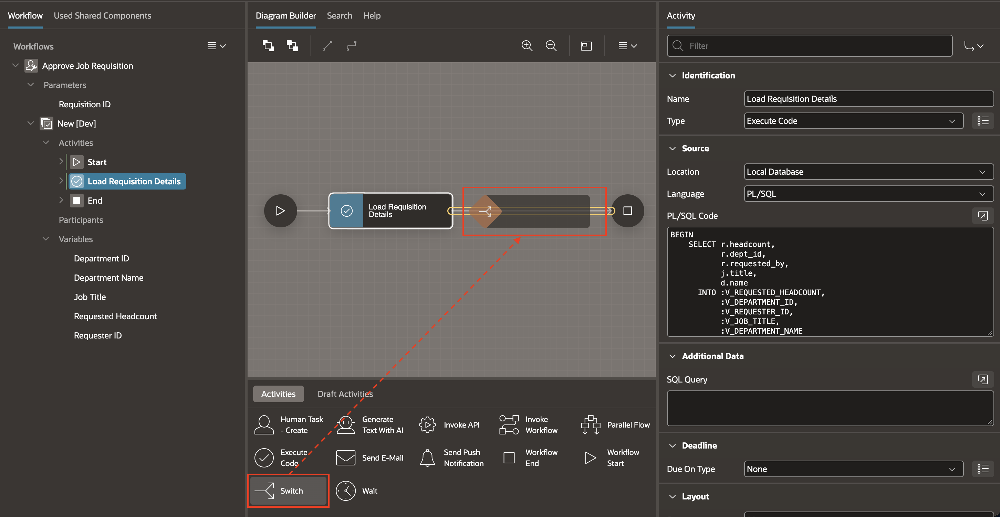

2. Select the new Switch activity. In the **Property Editor**, enter/select the following:

    | Property | Value |
    | --- | --- |
    | Identification > Name | Headcount Review Route |
    | Identification > Type | Switch |
    | Switch > Type | True False Check |
    | Condition > Condition Type | Rows Returned |

3. Under **Condition**, enter the following in **SQL Query**. This query returns a row only when the requested headcount is greater than three, which makes the True branch run.

    ```sql
    <copy>
    SELECT 1
      FROM tms_job_requisitions
     WHERE req_id = :P_REQ_ID
       AND headcount > 3
    </copy>
    ```

    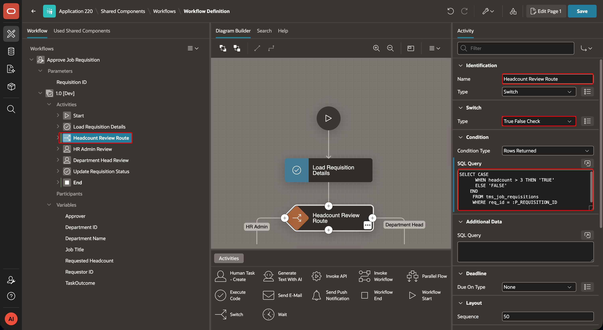

4. From the Activities palette, drag a **Human Task - Create** activity into the Diagram Builder. Place it near **Headcount Review Route**.

5. Select the new activity. In the **Property Editor**, enter/select the following:

    | Property | Value |
    | --- | --- |
    | Identification > Name | HR Admin Review |
    | Identification > Type | Human Task - Create |
    | Human Task > Definition | Requisition HR Admin Review |
    | Human Task > Details Primary Key Item | `P_REQ_ID` |
    | Result > Outcome | `TASK_OUTCOME` |

    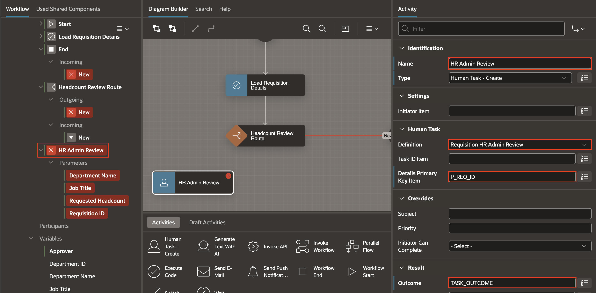

6. In the Workflow tree, expand **HR Admin Review > Parameters**. Configure the following parameters:

    | Task Parameter | Value > Type | Value > Item |
    | --- | --- | --- |
    | **Requisition ID** | Item | `P_REQ_ID` |
    | **Requested Headcount** | Item | `V_REQUESTED_HEADCOUNT` |
    | **Job Title** | Item | `V_JOB_TITLE` |
    | **Department Name** | Item | `V_DEPARTMENT_NAME` |

    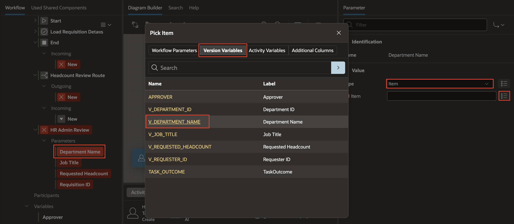

    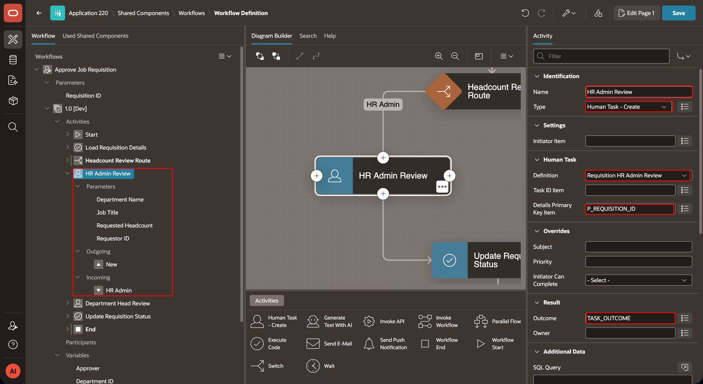

7. From the Activities palette, drag a second **Human Task - Create** activity into the Diagram Builder. Place it near **Headcount Review Route**.

8. Select the new activity. In the **Property Editor**, enter/select the following:

    | Property | Value |
    | --- | --- |
    | Identification > Name | Department Head Review |
    | Identification > Type | Human Task - Create |
    | Human Task > Definition | Requisition Department Head Review |
    | Human Task > Details Primary Key Item | `P_REQ_ID` |
    | Result > Outcome | `TASK_OUTCOME` |

    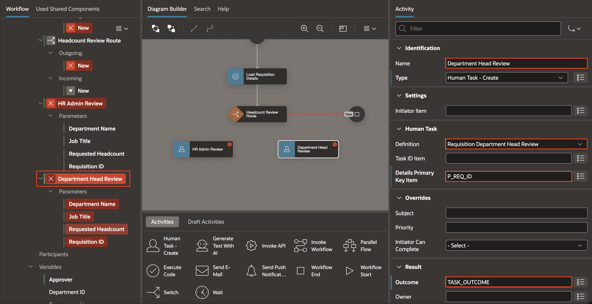

9. In the Workflow tree, expand **Department Head Review > Parameters**. Configure the same four parameter mappings:

    | Task Parameter | Value > Type | Value > Item |
    | --- | --- | --- |
    | **Department Name** | Item | `P_REQ_ID` |
    | **Requested Headcount** | Item | `V_REQUESTED_HEADCOUNT` |
    | **Job Title** | Item | `V_JOB_TITLE` |
    | **Requisition ID** | Item | `V_DEPARTMENT_NAME` |

    

10. Select **Headcount Review Route**. Select the **+** icon for an outgoing connection and drag the connector to **HR Admin Review**.

    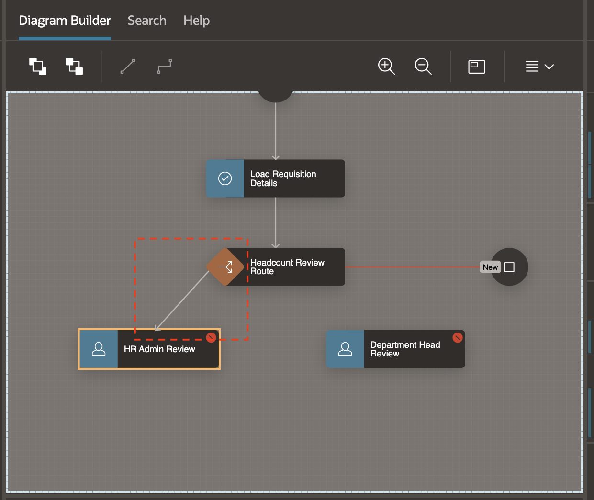

11. Select the new connection. In the **Property Editor**, enter/select the following:

    | Property | Value |
    | --- | --- |
    | Identification > Name | HR Admin |
    | Condition > When | True |
    | Activity > To | HR Admin Review |

    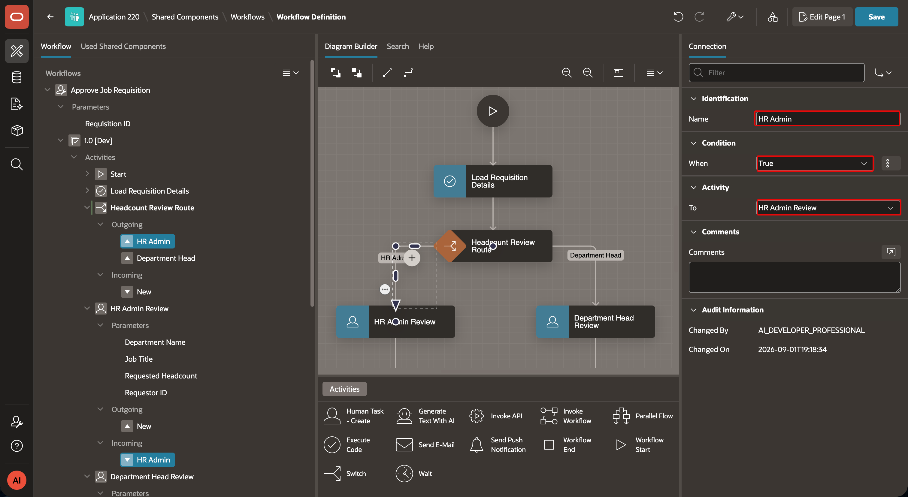

12. Select **Headcount Review Route**. Select the **+** icon for an outgoing connection and drag the connector to **Department Head Review**.

13. Select the new connection. In the **Property Editor**, enter/select the following:

    | Property | Value |
    | --- | --- |
    | Identification > Name | Department Head |
    | Condition > When | False |
    | Activity > To | Department Head Review |

    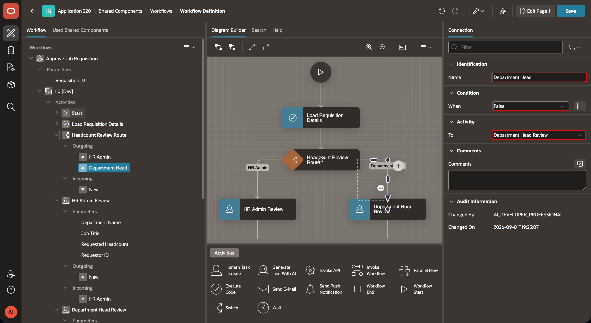

14. From the Activities palette, drag an **Execute Code** activity into the Diagram Builder. Place it after the two review activities.

15. Select the new activity. In the **Property Editor**, set **Identification > Name** to `Update Requisition Status`.

16. Under **Source**, enter the following PL/SQL code:

    ```sql
    <copy>
    BEGIN
        UPDATE tms_job_requisitions
           SET status = CASE UPPER(:TASK_OUTCOME)
                            WHEN 'APPROVED' THEN 'Open'
                            WHEN 'REJECTED' THEN 'Rejected'
                            ELSE status
                        END
         WHERE req_id = :P_REQ_ID;
    END;
    </copy>
    ```

    

17. Select **HR Admin Review**. Select the **+** icon for an outgoing connection and drag the connector to **Update Requisition Status**.

18. Select **Department Head Review**. Select the **+** icon for an outgoing connection and drag the connector to **Update Requisition Status**.

19. Drag the existing **Workflow End** activity and place it after **Update Requisition Status**. Set **Identification > Name** to `End` and set the end state to **Completed**.

    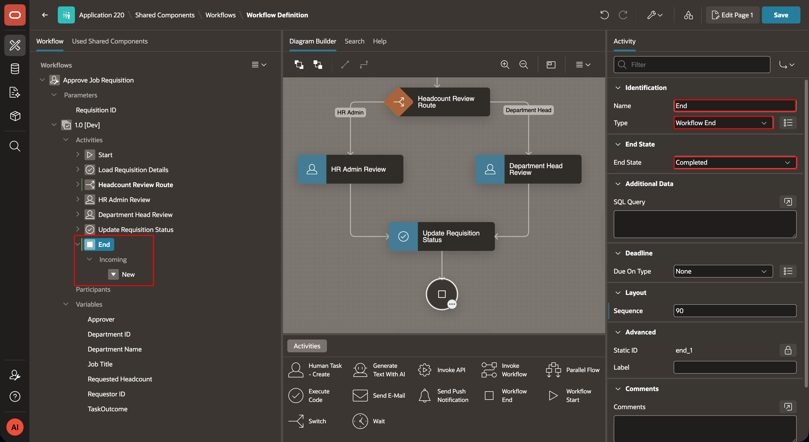

20. Create a workflow participant. Set the **workflow owner** to **sofia.garcia@acme.example**.

    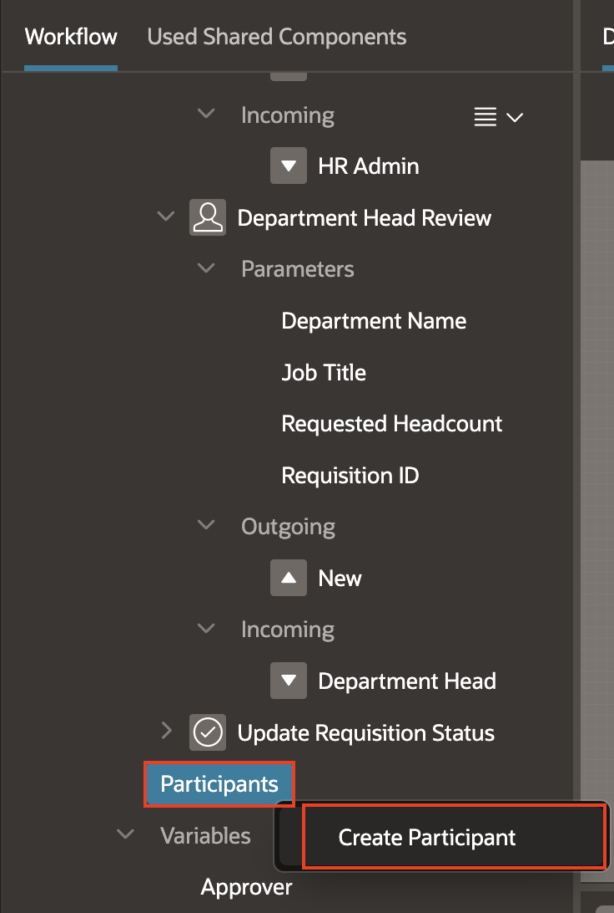

    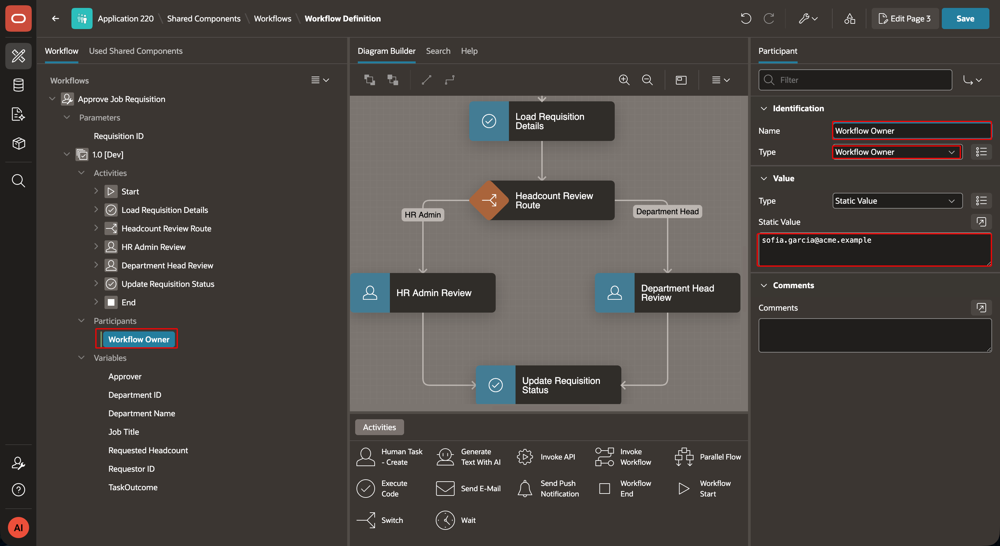

21. Select **Update Requisition Status**. Select the **+** icon for an outgoing connection and drag the connector to **End**.

22. Save the workflow version.

23. Activate the workflow version. Then click **Save**.

    

## Task 4: Add Task and Monitoring Pages

1. In **App Builder**:

    - Click **Create Page**.
    - Select **Unified Task List**.

    

2. Configure the **My Approvals** page:

    - Set **Page Name** to `My Approvals`.
    - Set **Report Context** to **My Tasks**.

    - Enable navigation.
    - Click **Create Page**.

    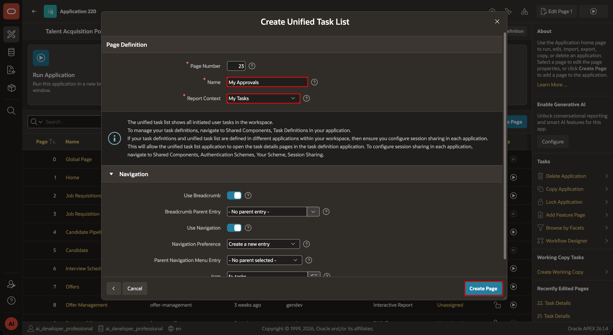

3. Create a second **Unified Task List** page.

    - Set its name to `Tasks Initiated by Me`.
    - Set **Report Context** to **Initiated by Me**.

    - Enable navigation.
    - Create the page.

    

4. In **App Builder**:

    - Click **Create Page**.
    - Select **Workflow Console**.

    

5. Configure the Workflow Console page:

    - Set **Name** to `Workflow Console`.
    - Set **Report Context** to **Initiated by Me**.
    - Enable **Include Dashboard Page**.

    - Name the generated dashboard `Workflow Dashboard`.
    - Name the generated details page `Workflow Form`.

    - Enable navigation.
    - Click **Create Page**.

    

6. In **Page Designer**, select the **Workflow Console** page. In the **Property Editor**, set **Security > Authorization Scheme** to `IS_TA_ADMIN`.

   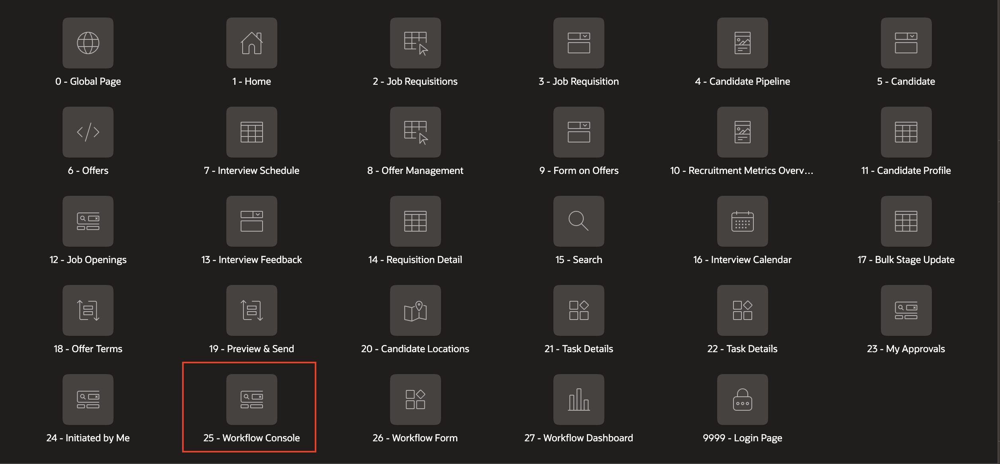

   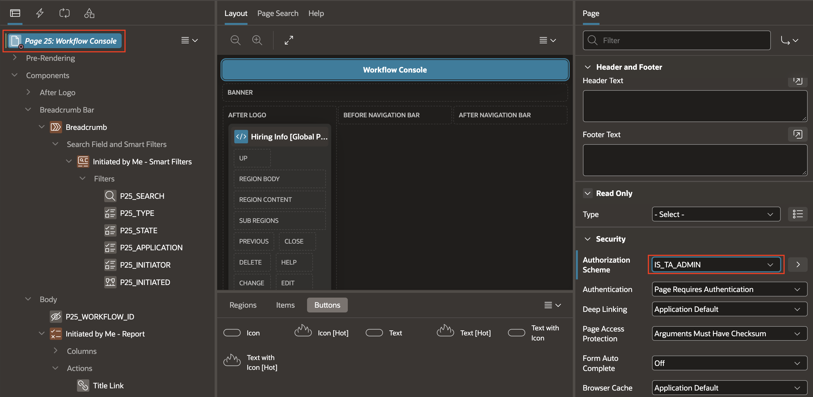

7. In **Page Designer**, open the TAP **Job Requisition Form**:

    - Open the **Job Requisition Form**.
    - Select **Processing**.
    - Create a **Workflow** page process after the **Form DML** process.

    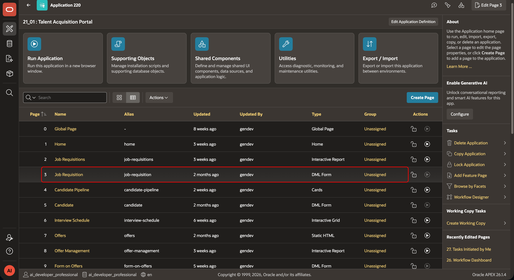

8. Configure the workflow process:

    - Set **Workflow** to `Approve Job Requisition`.
    - Set **Operation** to **Start**.

    

9. Under **Parameters**:

    - Select **Requisition ID**.
    - Map it to page item `PXX_REQ_ID`.
    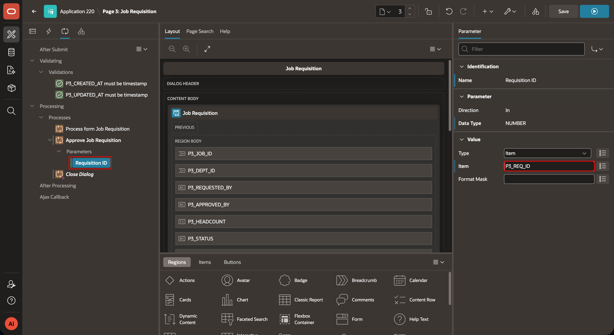

10. Add a server-side condition to the Workflow process.

    - Set the condition to run only when the **Create** button is pressed.
    - Set the `PXX_STATUS` condition to `Open`.

    

    > **Note:** Your generated page number might differ. Replace `XX` in page item names such as `PXX_REQ_ID` with the page number of the **Job Requisition Form** page.

## Task 5: Test Both Approval Routes

### Test the Department Head Route

1. Sign in to TAP as **olivia.brown@acme.example**:

    - Open **Job Requisitions**.
    - Create a requisition with these values:

    | Field | Value |
    | --- | --- |
    | Job | DevOps Engineer |
    | Department | Engineering |
    | Requested By | **olivia.brown@acme.example** |
    | Approved By | **olivia.brown@acme.example** |
    | Headcount | **2** |
    | Status | Open |

    - Click **Create**.
    - A headcount of `2` follows the Department Head route.

    

2. Check the initiated task:

    - Open **Tasks Initiated by Me**.
    - Open the new `Requisition Department Head Review` task.
    - Confirm that APEX assigned it to `maya.patel@acme.example`.

    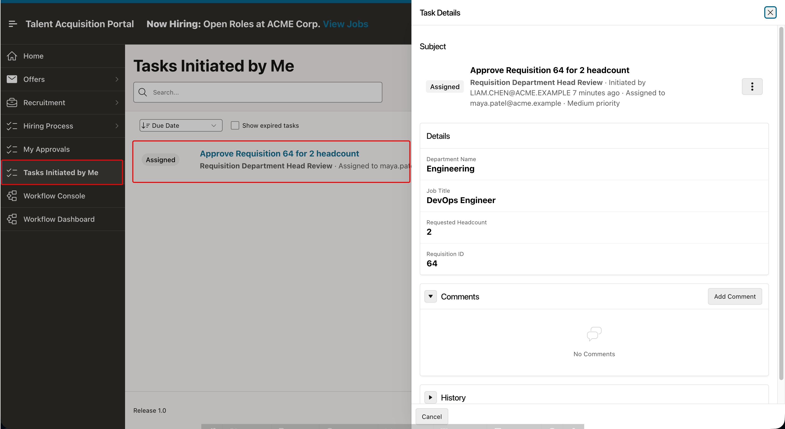

3. Complete the Department Head approval:

    - Sign out as Liam.
    - Sign in as `maya.patel@acme.example`.
    - Open **My Approvals**.
    - Select **Approve** for the `Requisition Department Head Review` task.

    

4. Check the completed task as the requester:

    - Sign out as Maya.
    - Sign in as `liam.chen@acme.example`.
    - Open **Tasks Initiated by Me**.
    - Confirm that the task state is **Completed**.
    - Confirm that the outcome is **Approved**.

    

5. Verify the workflow in **Workflow Console**:

    - Select the `Approve Job Requisition` workflow instance that you started.
    - Confirm that its state is **Completed**.
    - Review the workflow diagram.
    - Confirm that the Department Head Review activity completed before **Update Requisition Status**.

    

### Test the HR Admin Route

6. While signed in as `liam.chen@acme.example`, create another Job Requisition:

    - Set the headcount to a value greater than `3`, such as `4`.
    - Create the requisition. This value routes the workflow to **HR Admin Review**.

7. Sign in as a TA administrator who matches authorization scheme `IS_TA_ADMIN`:

    - Sign out as Liam.
    - Sign in as the TA administrator.
    - Open **My Approvals**.
    - Claim the `Requisition HR Admin Review` task if necessary.
    - Approve the task.

8. Verify the HR Admin route:

    - Sign back in as `liam.chen@acme.example`.
    - Open **Workflow Console**.
    - Confirm that the HR Admin route instance progresses from **Active** to **Completed** after approval.
    - Verify that the requisition status is **Open**.

    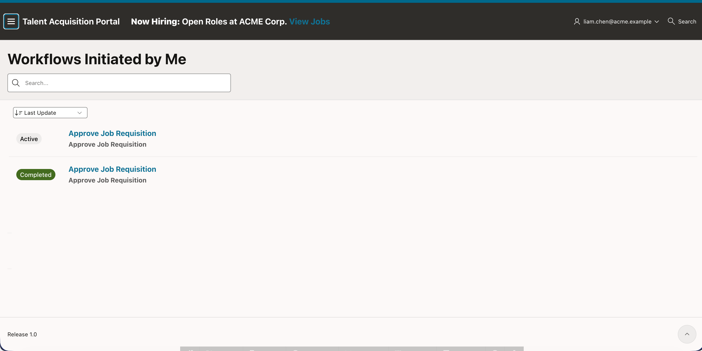

## Summary

You created TAP task definitions, a headcount-based requisition approval workflow, and pages for approvers and workflow monitoring. You started the workflow from the Job Requisition form and tested both approval routes.

You may now **proceed to the next lab**.

## Acknowledgements

- **Author** - Aravind Madhavan, Senior Product Manager; Roopesh Thokala, Principal Product Manager
- **Last Updated By/Date** - Roopesh Thokala, Principal Product Manager, October 2026
