# ESS Employee Onboarding Workflow

## Introduction

In this lab, you create an ESS onboarding workflow with parallel HR document and department orientation tasks. The workflow continues after both **Human Task - Create** activities complete. It then sends the new employee a welcome email.

Estimated Lab Time: 45 minutes

### Where We Are

ESS already contains employee data, email templates, and authorization schemes. In this lab, you create and test an onboarding workflow that requires both assigned tasks to complete before it sends the welcome email.

### Objectives

In this lab, you will:

- Create action task definitions for HR and the department manager.
- Create a parallel APEX workflow that loads employee data and waits for both tasks.
- Start, complete, and monitor an onboarding instance.

### Prerequisites

- Oracle APEX 26.1 or later and the starter application for this lab.
- ESS users and roles identified in the workshop prerequisites.
- The **Welcome to Acme Corp** email template.
- A configured email service and an **APP\_EMAIL** substitution string containing the sender address.
- An active employee whose department has a manager with a valid application username and email address.

### Downloads

Stuck or missed out on completing the earlier labs? Don't worry! You can download the following file:

- **<a href="../introduction/files/ess-export14.sql" download="ess-export14.sql">Employee Self-Service Portal</a>**

Import it into your workspace. In **App Builder**, select **Import**, upload **ess-export14.sql**, and follow the steps in the **Import Application** wizard.

> **Note:**
>
> - **APEX Version:** The supplied application export was created with Oracle APEX 26.2 and cannot be imported into earlier APEX releases.

## Task 1: Create the Task Definitions

1. In ESS, open **Shared Components**.

    - Under **Workflows and Automations**, select **Task Definitions**.

2. Click **Create**.

    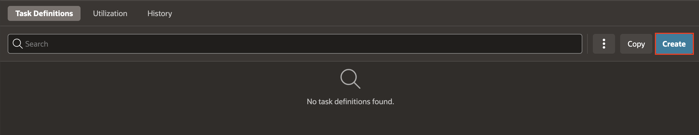

3. Create the Department Orientation task definition with the following values:

    | Field | Value |
    | --- | --- |
    | Name | **New Employee Department Orientation** |
    | Type | Action Task |
    | Subject | **Schedule Department Orientation for &EMPLOYEE\_NAME.** |
    | Priority | Medium |

    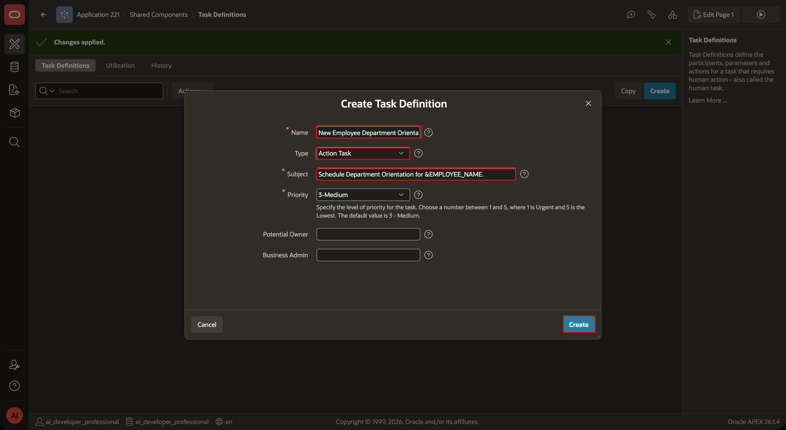

4. Click **Create** to save the task definition. On the **Task Definition** page, configure the Department Orientation **Potential Owner**:

    - Click **Add Participant**.
    - Enter/select the following:

    | Participant Type | Identity Type | Value Type | Static Value |
    | --- | --- | --- | --- |
    | **Potential Owner** | User | Static | **&DEPARTMENT\_MANAGER.** |

    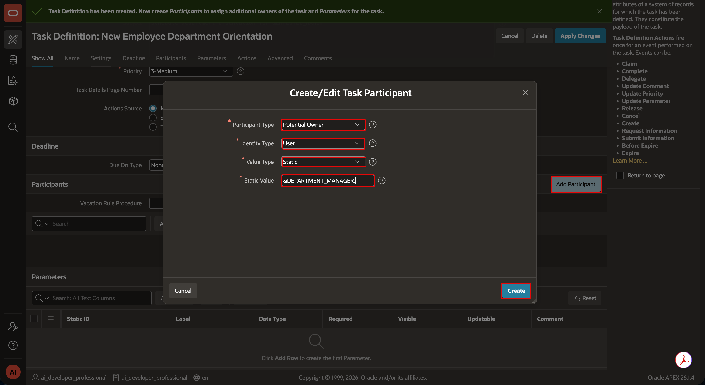

    - Click **Create** to save the participant.

5. Under **Parameters**, click **Add Row** for each of the following task parameters. The static IDs support the subject and participant substitutions.

    - Set each parameter data type to **String**.
    - Provide the label shown for each parameter.
    - Set **Required** and **Visible** to **Yes**.

    | **Static ID** | Label | **Required** | **Visible** |
    | --- | --- | --- | --- |
    | **EMPLOYEE\_ID** | Employee ID | Yes | Yes |
    | **EMPLOYEE\_NAME** | Employee Name | Yes | Yes |
    | **START\_DATE** | Start Date | Yes | Yes |
    | **DEPARTMENT\_MANAGER** | Department Manager | Yes | Yes |

    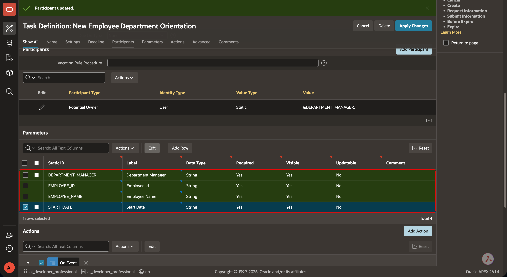

6. Create the Department Orientation task details page:

    - Click **Create Task Details Page**.
    - Complete the page creation wizard.
    - Click **Apply Changes** to save the task definition.

    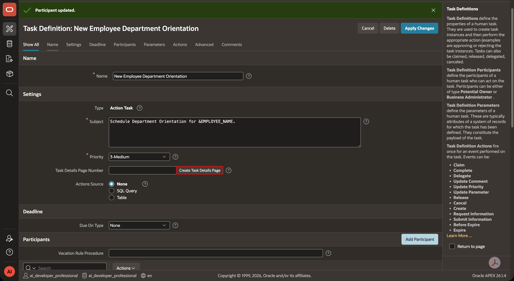

7. From the **Shared Components > Task Definitions** and click **Create**.

8. Create the HR Documents task definition with the following values:

    | Field | Value |
    | --- | --- |
    | Name | **New Employee HR Documents** |
    | Type | Action Task |
    | Subject | **Complete HR Documents for &EMPLOYEE\_NAME.** |
    | Priority | Medium |

    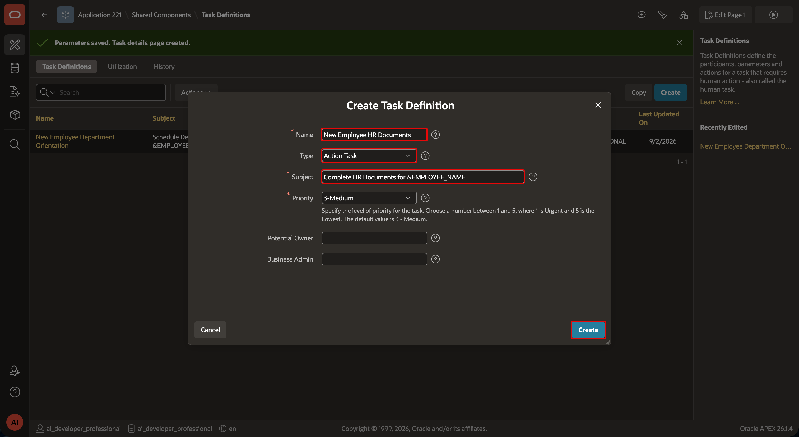

9. Click **Create** to save the task definition. On the **Task Definition** page, configure the HR Documents **Potential Owner**:

    - Click **Add Participant**.
    - Enter/select the following:

    | Participant Type | Identity Type | **Authorization Scheme** |
    | --- | --- | --- |
    | **Potential Owner** | **Authorization Scheme** | **IS\_HR\_ADMIN** |

    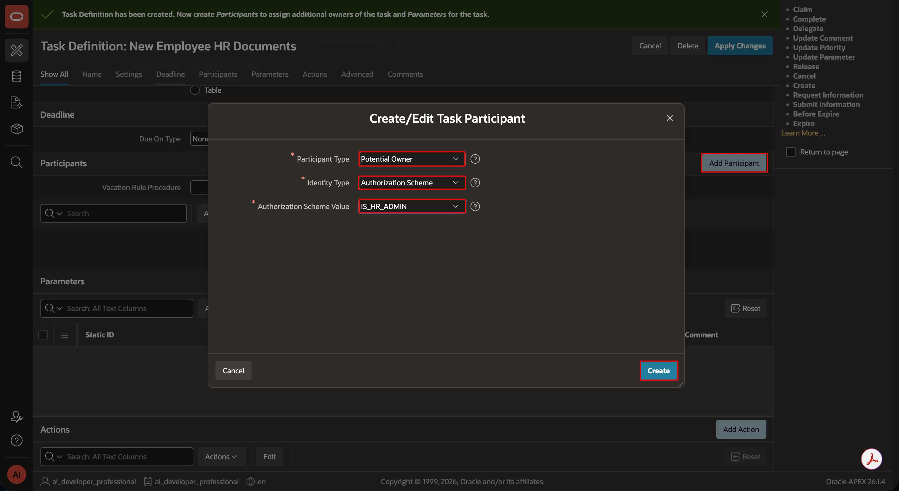

    - Click **Create** to save the participant.

10. Under **Parameters**, click **Add Row** for each of the following task parameters. The static IDs support the subject substitutions.

    - Set each parameter data type to **String**.
    - Provide the label shown for each parameter.
    - Set **Required** and **Visible** to **Yes**.

    | **Static ID** | Label | **Required** | **Visible** |
    | --- | --- | --- | --- |
    | **EMPLOYEE\_ID** | Employee ID | Yes | Yes |
    | **EMPLOYEE\_NAME** | Employee Name | Yes | Yes |
    | **START\_DATE** | Start Date | Yes | Yes |

    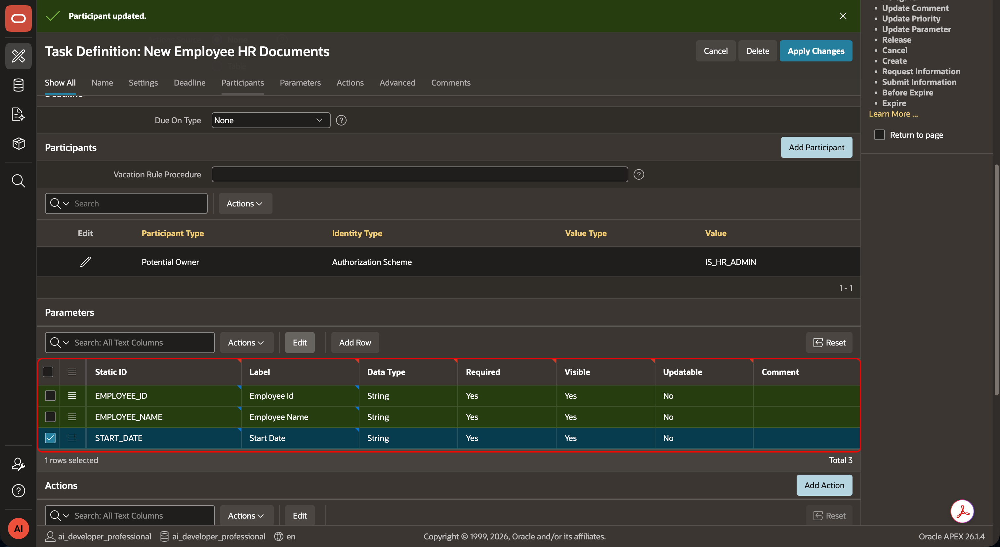

11. Create the HR Documents task details page:

    - Click **Create Task Details Page**.

    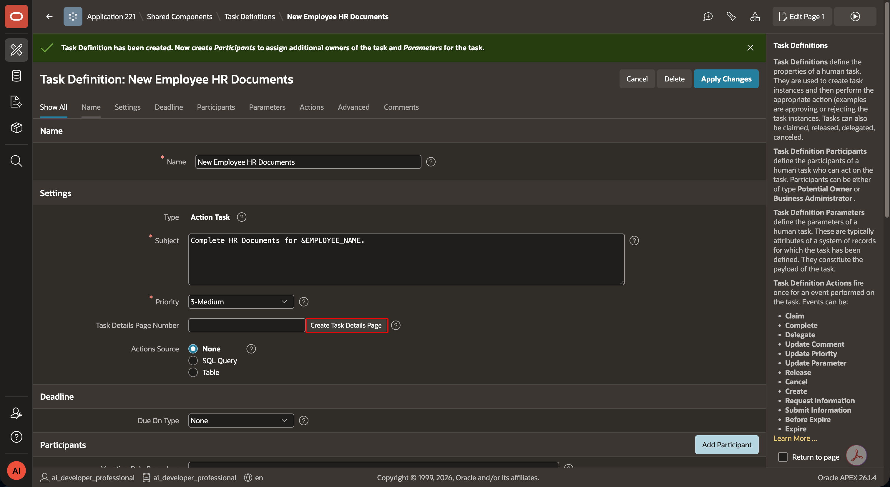

## Task 2: Create the Onboard New Employee Workflow

1. In ESS, open **Shared Components**.

    - Select **Workflows**.

    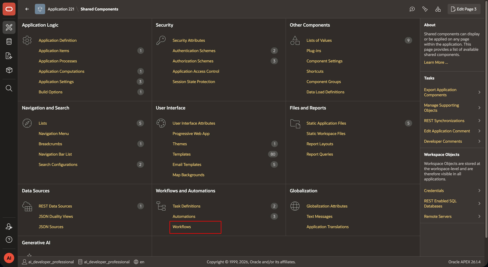

2. Click **Create** and configure the workflow:

    | Property | Value |
    | --- | --- |
    | Name | **Onboard New Employee** |
    | Title | **Onboard New Employee** |

    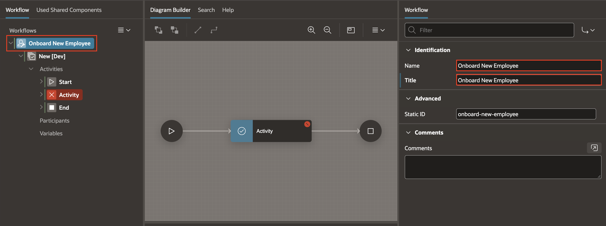

    - Keep the version in **Development**.

3. In the **Workflow tree**, right-click **Onboard New Employee** and select **Create Parameter**. In the **Property Editor**, enter/select the following:

    | **Static ID** | Label | **Data Type** | **Direction** | **Required** |
    | --- | --- | --- | --- | --- |
    | **V\_EMPLOYEE\_ID** | Employee ID | VARCHAR2 | In | No |

    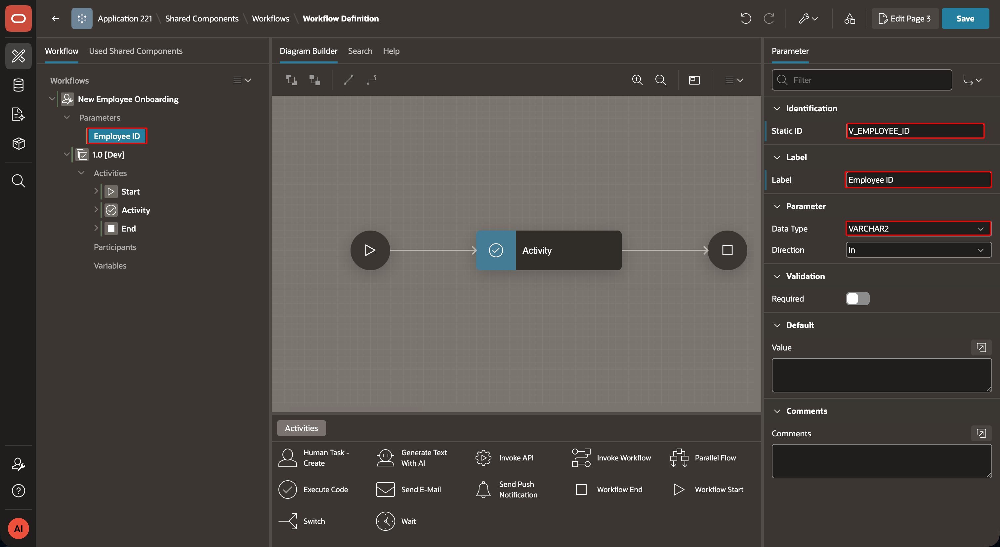

4. In the **Workflow tree**, right-click the workflow version, **New[Dev]**, or Variables, and select **Create Variable**. Repeat for each variable in the following table:

    - Use the **V\_** prefix for values that can change at runtime.
    - Provide the label shown for each variable.
    - Leave **Value > Type** set to **Null**. The next activity loads these values.

    | **Static ID** | Label | **Data Type** |
    | --- | --- | --- |
    | **V\_EMPLOYEE\_NAME** | Employee Name | VARCHAR2 |
    | **V\_EMPLOYEE\_EMAIL** | Employee Email | VARCHAR2 |
    | **V\_START\_DATE** | Start Date | TIMESTAMP |
    | **V\_DEPARTMENT** | Department | VARCHAR2 |
    | **V\_DEPARTMENT\_MANAGER** | Department Manager | VARCHAR2 |

    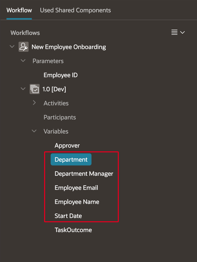

5. In the **Diagram Builder**, notice the existing **Workflow Start**, **Execute Code**, and **Workflow End** activities. Select **Workflow Start**.

6. Select the existing **Execute Code** activity. In the **Property Editor**, enter/select the following:

    | Property | Value |
    | --- | --- |
    | Identification > Name | **Load Employee Details** |
    | Identification > Type | Execute Code |
    | Source > Location | Local Database |
    | Source > Language | PL/SQL |

    Under **Source > PL/SQL Code**, enter the following:

    ```sql
    <copy>
    BEGIN
        SELECT e.first_name || ' ' || e.last_name,
               e.email,
               e.hire_date,
               d.name,
               mgr.email
          INTO :V_EMPLOYEE_NAME,
               :V_EMPLOYEE_EMAIL,
               :V_START_DATE,
               :V_DEPARTMENT,
               :V_DEPARTMENT_MANAGER
          FROM tms_employees e
          LEFT JOIN tms_departments d ON d.dept_id = e.dept_id
          LEFT JOIN tms_employees mgr ON mgr.employee_id = d.manager_id
         WHERE e.employee_id = :V_EMPLOYEE_ID;
    END;
    </copy>
    ```

    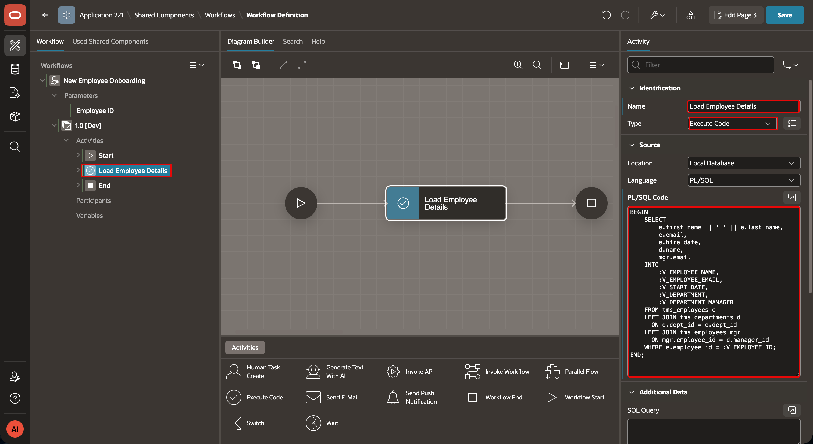

7. Confirm that **Start** connects to **Load Employee Details**. If the connection is missing, select **Start**, select the **+** icon for an outgoing connection, and drag the connector to **Load Employee Details**.

8. From the **Activities palette**, drag a **Parallel Flow** activity into the Diagram Builder. Place it after **Load Employee Details**.

    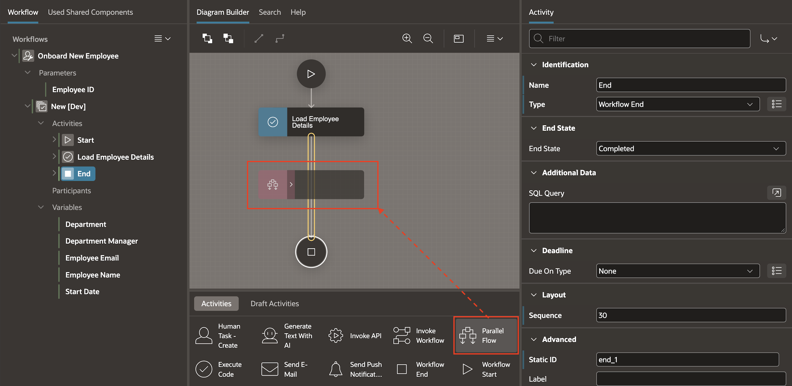

9. Select the new activity. In the **Property Editor**, enter/select the following:

    | Property | Value |
    | --- | --- |
    | Identification > Name | **Complete Onboarding Setup** |
    | Identification > Type | Parallel Flow |

10. Select the existing connection from **Load Employee Details** to **Workflow End**. Drag its arrowhead from **Workflow End** to **Complete Onboarding Setup**.

    - If no connection exists, select the **+** icon on **Load Employee Details** and drag the connector to **Complete Onboarding Setup**.
    - Confirm that the only outgoing connection from **Load Employee Details** leads to **Complete Onboarding Setup**.

    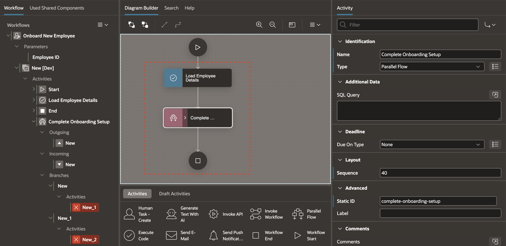

## Task 3: Configure the Parallel Activities and Email

1. Select **Complete Onboarding Setup** and click the arrow on its icon to expand the **Parallel Flow**. APEX creates two branches, each containing an **Execute Code** activity.

    - Select the left branch and set **Identification > Name** to **HR Documents**
    - Select the right branch and set **Identification > Name** to **Department Orientation**

    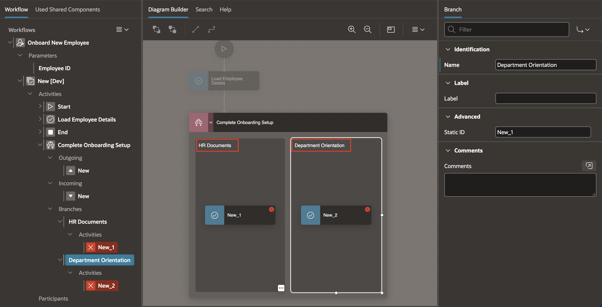

2. Select the existing activity in the **HR Documents** branch. In the **Property Editor**, change its type and enter/select the following:

    | Property | Value |
    | --- | --- |
    | Identification > Name | HR Documents |
    | Identification > Type | Human Task - Create |
    | Human Task > Definition | New Employee HR Documents |
    | Result > Outcome | **TASK\_OUTCOME** |

    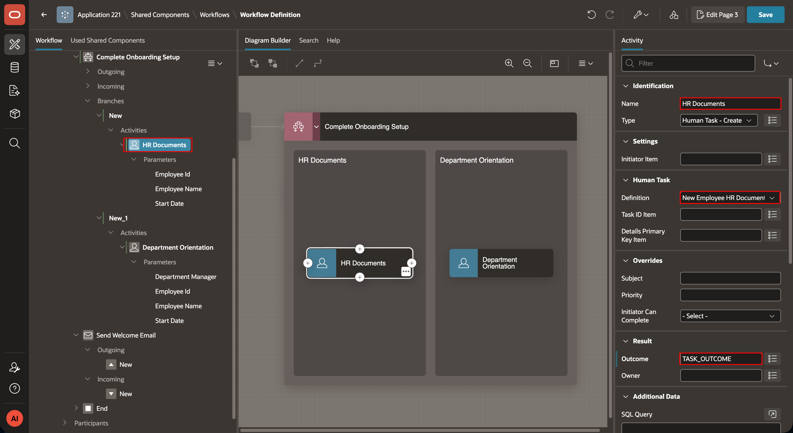

3. In the **Workflow tree**, expand **HR Documents > Parameters**. Select each task parameter and configure its **Value > Type** and **Value > Item**:

    | Task Parameter | Value > Type | Value > Item |
    | --- | --- | --- |
    | **Employee ID** | Item | **V\_EMPLOYEE\_ID** |
    | **Employee Name** | Item | **V\_EMPLOYEE\_NAME** |
    | **Start Date** | Item | **V\_START\_DATE** |

    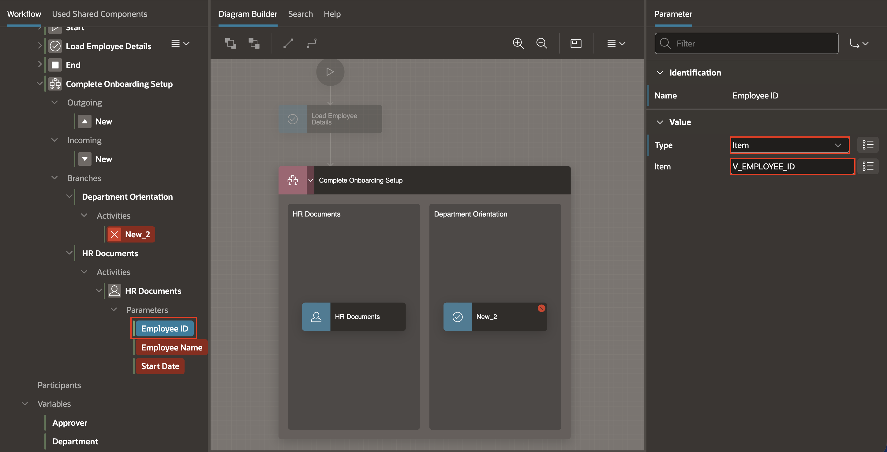

4. Select the existing activity in the **Department Orientation** branch.

5. In the **Property Editor**, change its type and enter/select the following:

    | Property | Value |
    | --- | --- |
    | Identification > Name | Department Orientation |
    | Identification > Type | Human Task - Create |
    | Human Task > Definition | New Employee Department Orientation |
    | Result > Outcome | **TASK\_OUTCOME** |

6. In the **Workflow tree**, expand **Department Orientation > Parameters**. Select each task parameter and configure its **Value > Type** and **Value > Item**:

    | Task Parameter | Value > Type | Value > Item |
    | --- | --- | --- |
    | **Employee ID** | Item | **V\_EMPLOYEE\_ID** |
    | **Employee Name** | Item | **V\_EMPLOYEE\_NAME** |
    | **Start Date** | Item | **V\_START\_DATE** |
    | **Department Manager** | Item | **V\_DEPARTMENT\_MANAGER** |

    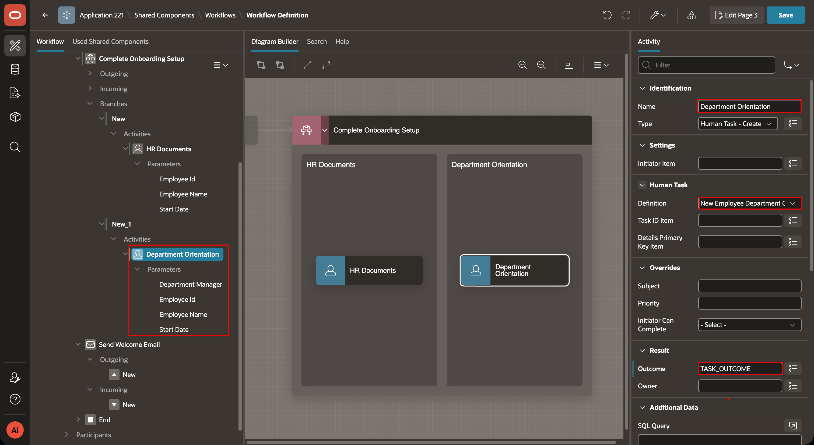

7. Confirm that each branch contains its configured **Human Task - Create** activity. Click the arrow on **Complete Onboarding Setup** to collapse the **Parallel Flow** and return to the main workflow.

    APEX continues to the next activity only after both branches complete.

8. From the Activities palette, drag a **Send E-Mail** activity into the Diagram Builder. Place it after **Complete Onboarding Setup**.

    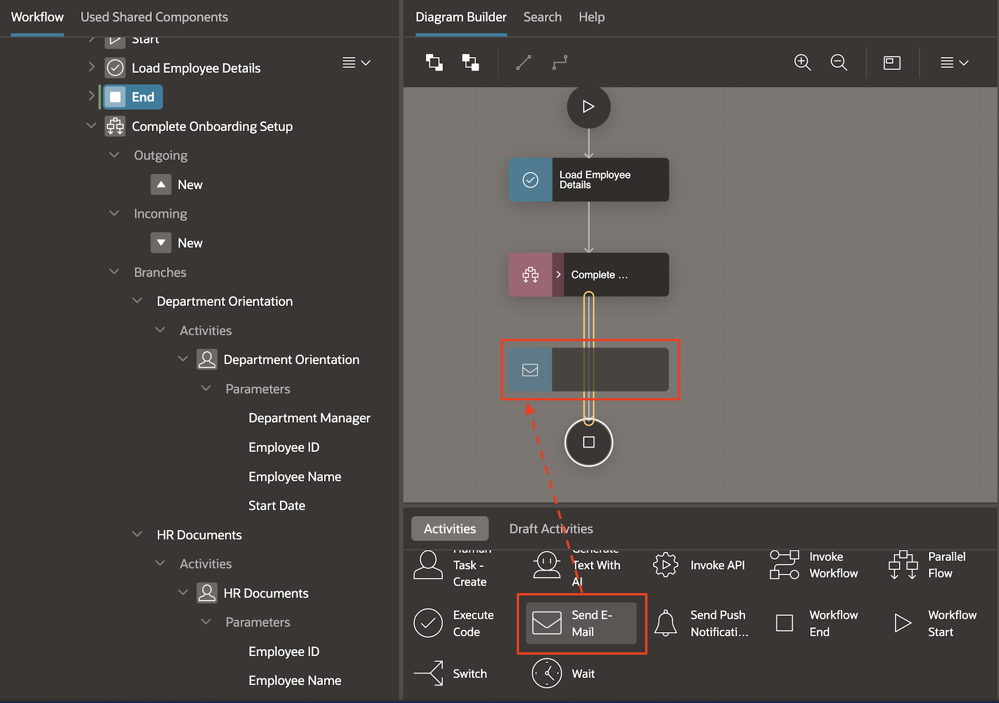

9. Select the new activity. In the **Property Editor**, enter/select the following:

    | Property | Value |
    | --- | --- |
    | Identification > Name | Send Welcome Email |
    | Identification > Type | Send E-Mail |
    | Email Header > From | **&APP\_EMAIL.** |
    | Email Header > To | **&V\_EMPLOYEE\_EMAIL.** |
    | Email Template > Email Template | Welcome to Acme Corp |

    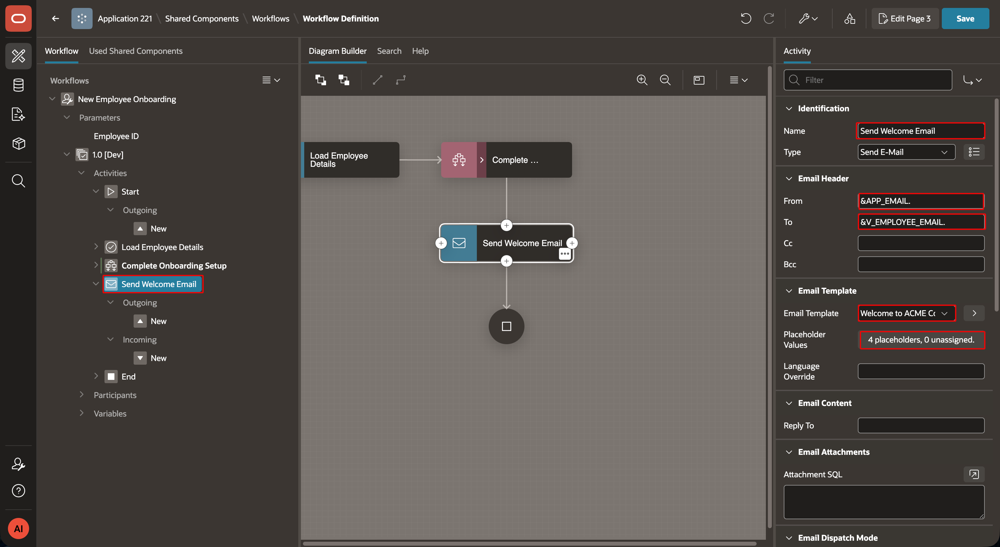

10. For **Email Template**, open **Placeholder Values**. Configure the following mappings and save the placeholder values:

    | Placeholder | Value |
    | --- | --- |
    | **EMPLOYEE\_NAME** | **&V\_EMPLOYEE\_NAME.** |
    | **START\_DATE** | **&V\_START\_DATE.** |
    | **DEPT\_NAME** | **&V\_DEPARTMENT.** |
    | **MANAGER\_NAME** | **&V\_DEPARTMENT\_MANAGER.** |

    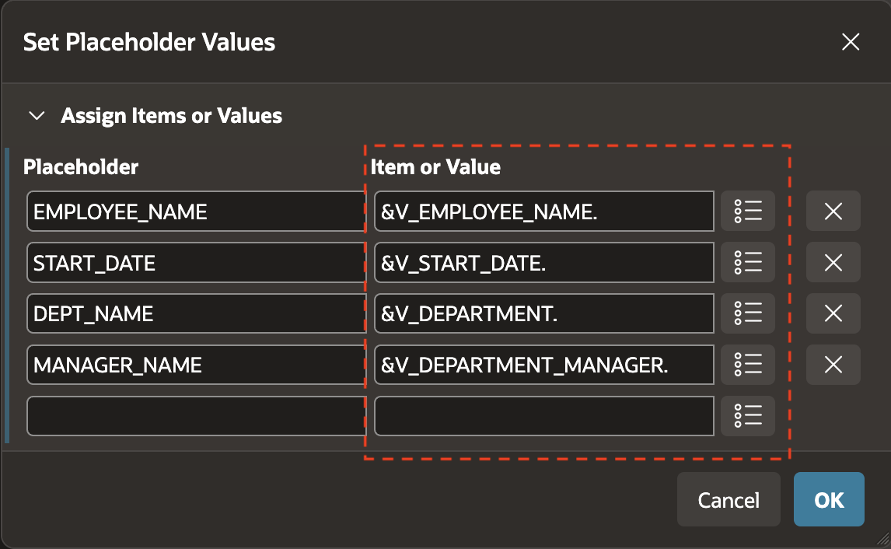

11. In the **Workflow tree**, right-click the workflow version and select **Create Participant**.

    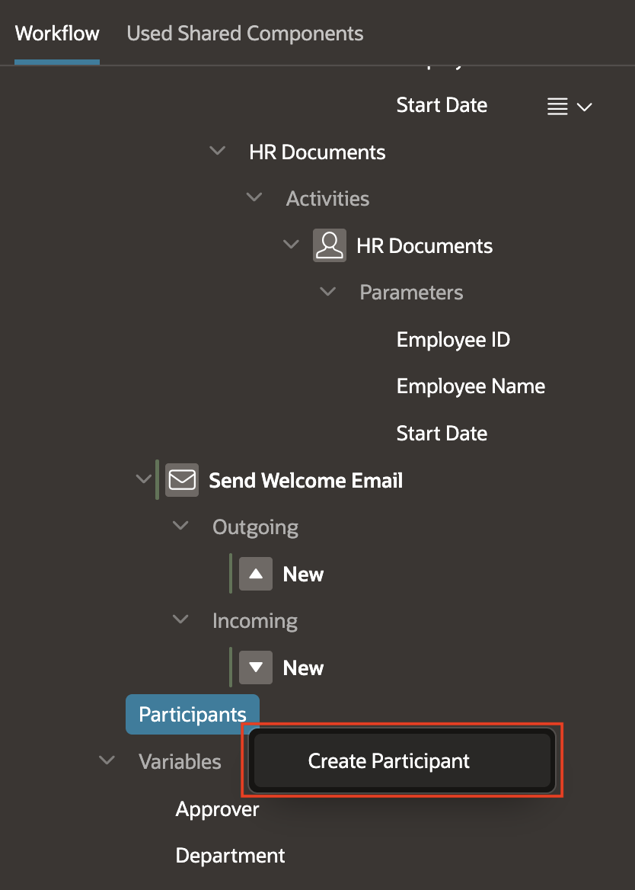

12. In the **Property Editor**, enter/select the following:

    | Property | Value |
    | --- | --- |
    | Identification > Name | Department Owner |
    | Identification > Type | Workflow Owner |
    | Value > Type | Static Value |
    | Value > Static Value | **&V\_DEPARTMENT\_MANAGER.** |

    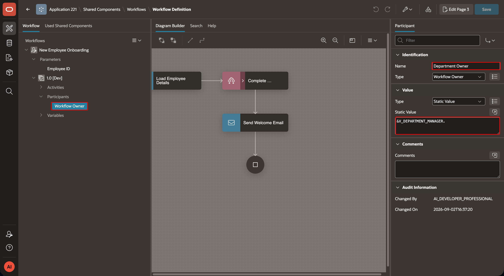

13. Confirm that the workflow connections follow this order, then click **Save**:

    **Start → Load Employee Details → Complete Onboarding Setup → Send Welcome Email → End**

14. In the **Workflow tree**, select the workflow version. Under **Settings**, click **Activate**, then click **Save**.

    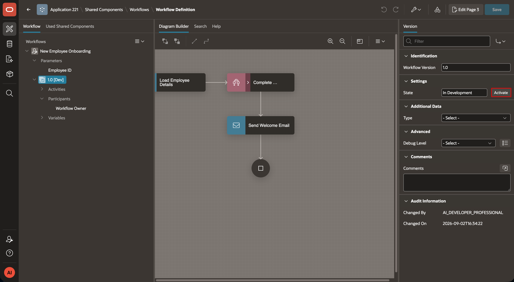

## Task 4: Add the Inbox, Console, and Start Page

1. In ESS **App Builder**, click **Create Page** and select **Unified Task List**.

2. Configure the task list page:

    | Field | Value |
    | --- | --- |
    | Name | **My Workflow Tasks** |
    | Report Context | My Tasks |
    | Use Navigation | On |

    - Click **Create Page**.

    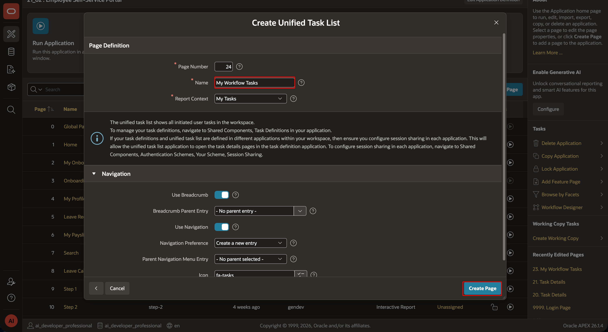

3. Similarly, **Create** another **Unified Task List** page for **Initiated by Me**.

4. Return to the application home page. Click **Create Page** and select **Workflow Console**.

5. Configure the Workflow Console page:

    | Field | Value |
    | --- | --- |
    | Name | **Workflow Console** |
    | Report Context | My Workflows |
    | Include Dashboard Page | Off |
    | Form Page Name | **Workflow Form** |
    | Use Navigation | On |

    - Click **Create Page**.

    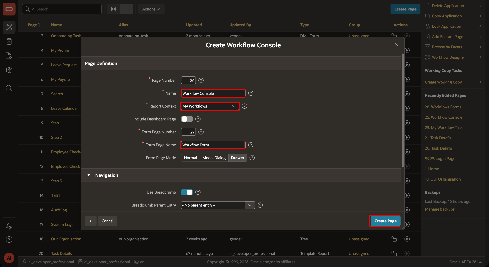

    > **Note:** **My Workflows** lists instances owned by the signed-in user. In this lab, the workflow owner is the employee's department manager. Use that account when checking the console in Task 5.

6. Similarly, **Create** another **Workflow Console Page** page for **Initiated by Me**, and name it as **Workflows - Initiated by Me**.

7. Return to the application home page. Click **Create Page** and select **Blank Page**. Enter/select the following:

    | Field | Value |
    | --- | --- |
    | Name | **Start Employee Onboarding** |
    | Page Mode | Normal |
    | Use Navigation | On |

    - Click **Create Page**.

    > **Note:** Your generated page number might differ. Use the page named **Start Employee Onboarding**. Replace **XX** in page item names with this page number.

    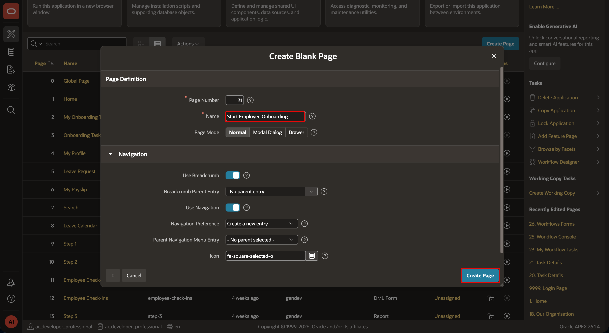

8. In **Page Designer**, select the **Start Employee Onboarding** page. In the **Property Editor**, set **Security > Authorization Scheme** to **IS\_HR\_ADMIN**.

    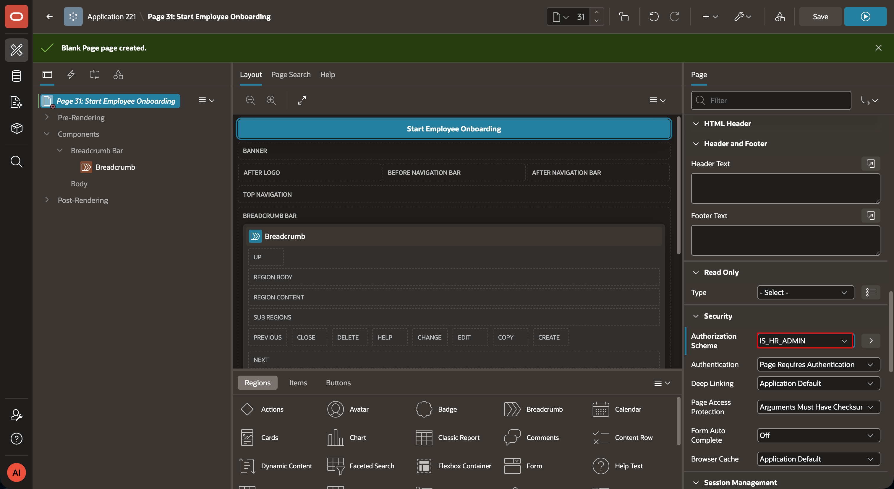

9. In the **Rendering tree**, right-click **Body** and select **Create Page Item**. Select the new item. In the **Property Editor**, enter/select the following:

    | Property | Value |
    | --- | --- |
    | Identification > Name | **PXX\_EMPLOYEE\_ID** |
    | Identification > Type | Select List |
    | Label > Label | Employee ID |
    | List of Values > Type | SQL Query |
    | List of Values > Display Null Value | On |
    | List of Values > Null Display Value | **- Select Employee -** |
    | Validation > Value Required | On |

    Under **List of Values > SQL Query**, enter the following:

    ```sql
    <copy>
    SELECT first_name || ' ' || last_name AS display_value,
           employee_id AS return_value
      FROM tms_employees
     WHERE status = 'Active'
     ORDER BY first_name, last_name
    </copy>
    ```

    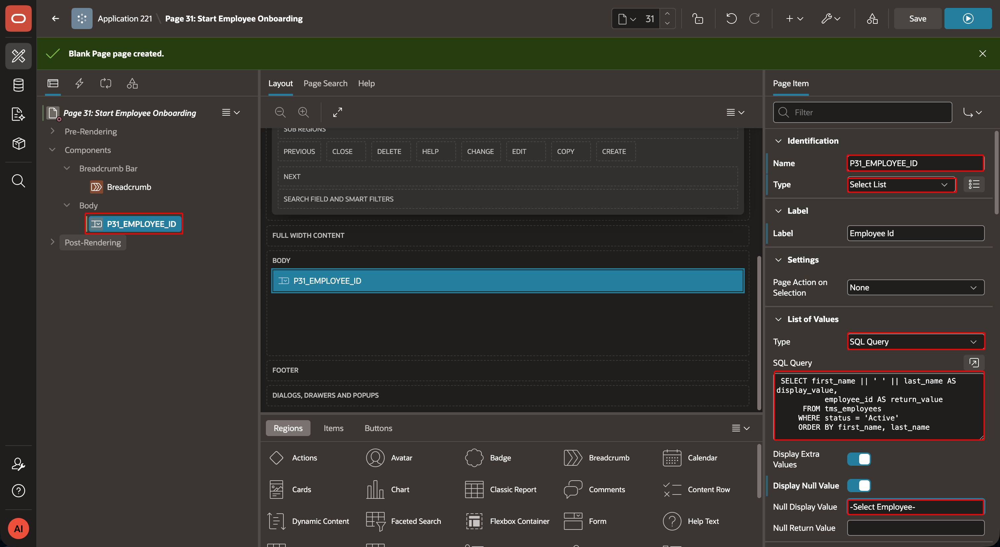

10. In the **Rendering tree**, right-click **Body** and select **Create Button**. Select the new button. In the **Property Editor**, enter/select the following:

    | Property | Value |
    | --- | --- |
    | Identification > Button Name | **START\_ONBOARDING** |
    | Identification > Label | Start Onboarding |
    | Appearance > Hot | Yes |
    | Layout > Start New Row | No |

    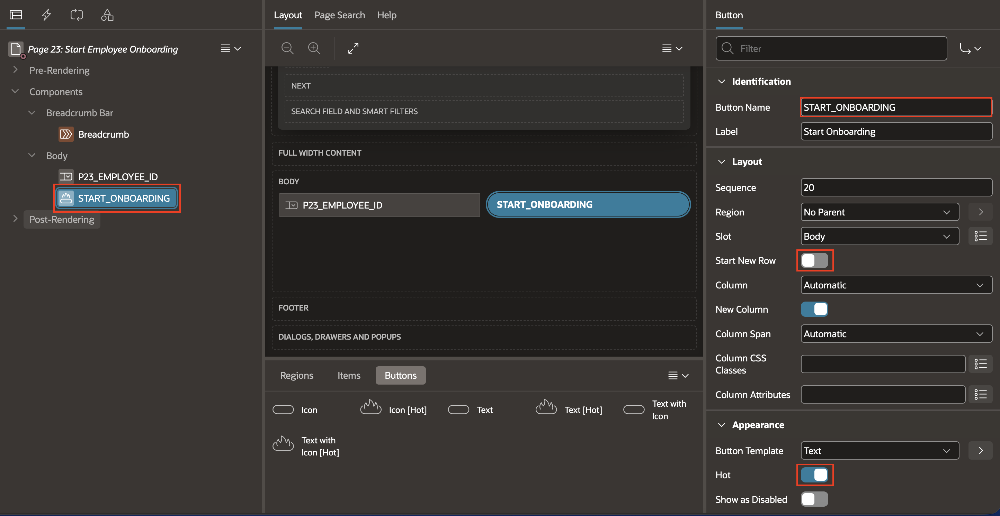

11. Select the **Processing** tab. Right-click **Processing** and select **Create Process**. In the **Property Editor**, enter/select the following:

    | Property | Value |
    | --- | --- |
    | Identification > Name | **Start Onboarding** |
    | Identification > Type | Workflow |
    | Operation | Start |
    | Workflow > Definition | Onboard New Employee |
    | Server-side Condition > When Button Pressed | START\_ONBOARDING |

    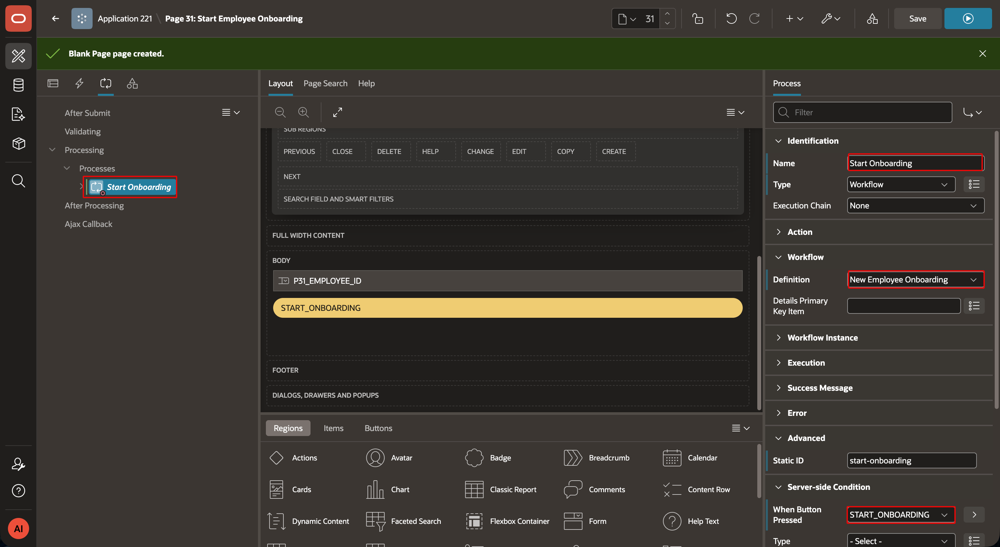

12. In the **Processing tree**, expand **Start Onboarding > Parameters** and select **Employee ID**. In the **Property Editor**, enter/select the following:

    | Property | Value |
    | --- | --- |
    | Value > Type | Item |
    | Value > Item | **PXX\_EMPLOYEE\_ID** |

    This passes the selected employee ID to the workflow parameter **V\_EMPLOYEE\_ID**.

    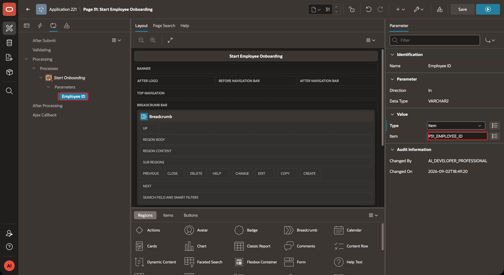

11. Click **Save**.

## Task 5: Test Parallel Completion

### Start the Onboarding Workflow

1. Run ESS and sign in as **arjun.mehta@acme.example**, the HR administrator:

    - Navigate to **Start Employee Onboarding**.

2. Start Noah Reed's onboarding:

    - Select **Noah Reed** as the employee to onboard.
    - Click **Start Onboarding**.

    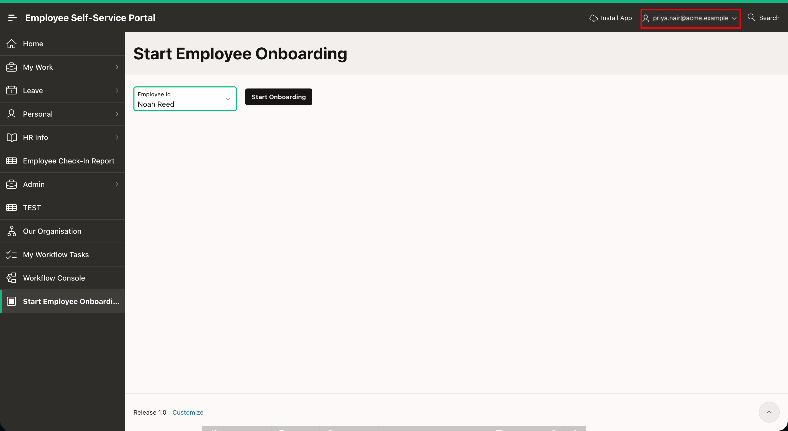

### Complete the Parallel Tasks

3. Check the assigned tasks as **Noah Reed**:

    - Sign out as Priya.
    - Sign in as **noah.reed@acme.example**.
    - Open **My Workflow Tasks**.
    - In the sample configuration shown, confirm that the following tasks are listed:

    | Task | Potential Owner configured in Task 1 |
    | --- | --- |
    | Complete HR Documents for Noah Reed | User matching **IS\_HR\_ADMIN** |
    | Schedule Department Orientation for Noah Reed | Department manager passed in **DEPARTMENT\_MANAGER** |

    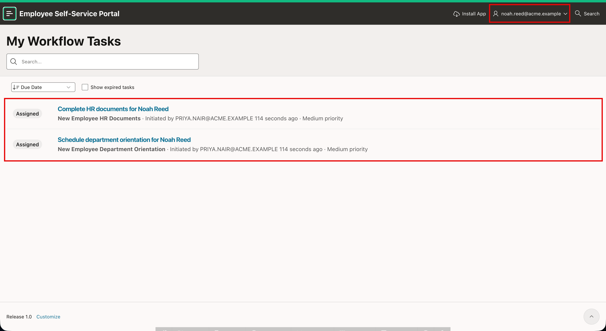

    > **Note:** The screenshot shows both tasks under Noah's account. If your workspace assigns these roles to different users, sign in as each configured potential owner to complete that user's task.

4. Complete the HR Documents task:

    - Open **Complete HR Documents for Noah Reed**.
    - Claim the task if necessary.
    - Click **Complete**.
    - Leave **Schedule Department Orientation for Noah Reed** open for the next check.

5. While one task remains open, check **Workflow Console** as the department manager who owns the workflow:

    - Open the workflow instance for Noah Reed.
    - Confirm that **Complete Onboarding Setup** has not completed.
    - Confirm that **Send Welcome Email** has not completed.

6. Complete the Department Orientation task:

    - Sign in as its potential owner, if different from the current user.
    - Open **My Workflow Tasks**.
    - Open **Schedule Department Orientation for Noah Reed**.
    - Claim the task if necessary and click **Complete**.

### Verify the Completed Workflow

7. Verify Noah Reed's workflow as its department-manager owner:

    - Use **noah.reed@acme.example** for the sample configuration shown, where Noah is also the department manager.
    - Open **Workflow Console**.
    - Select the workflow instance for Noah Reed.
    - Confirm that its state is **Completed**.
    - In the activity list, verify that **Send Welcome Email** shows **Email Sent**.
    - Confirm that the final **End** activity is **Completed**. The existing screenshot labels this activity **Stop**.

    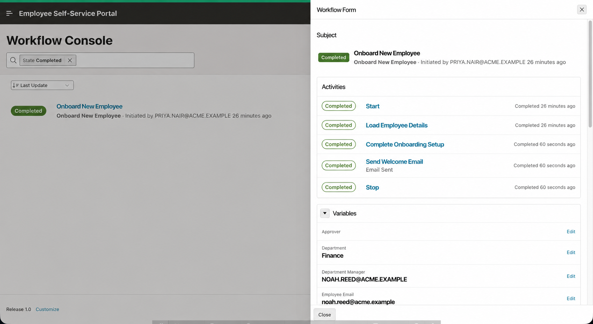

8. Verify the workflow diagram:

    - Scroll to the bottom of the Workflow Form.
    - Expand the workflow diagram.
    - Confirm that **HR Documents** is complete.
    - Confirm that **Department Orientation** is complete.
    - Confirm that the overall workflow completed successfully.

    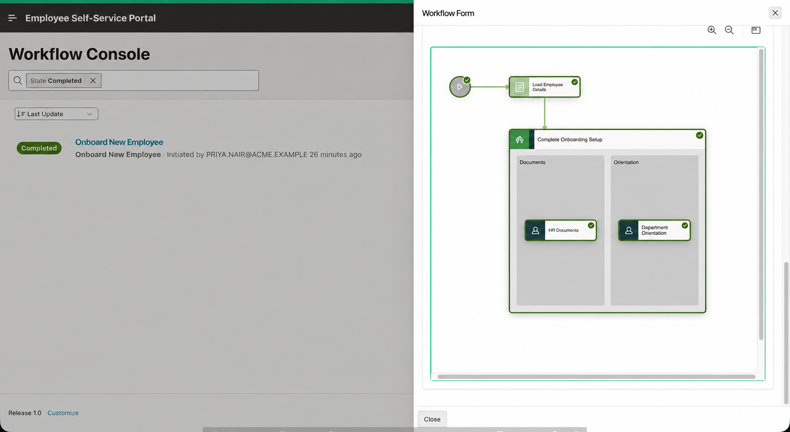

## Summary

You created an ESS onboarding workflow with parallel HR Documents and Department Orientation tasks. You added the pages that start and monitor the workflow, then verified that both tasks complete before the workflow ends.

You have completed this workshop.

## Acknowledgements

- **Author** - Aravind Madhavan, Senior Product Manager; Roopesh Thokala, Principal Product Manager
- **Last Updated By/Date** - Roopesh Thokala, Principal Product Manager, October 2026
