# Search Configuration and Vector Providers

## Introduction

This lab prepares the environment for semantic search by granting the required database privilege, loading the ONNX embedding model, and creating the APEX vector provider. You will validate the model and vector functions before creating any application-specific search logic.

Estimated Lab Time: 10 minutes

### Objectives

In this lab, you will:

- Grant the required database privilege for model creation.
- Load the ONNX embedding model into the database.
- Create the APEX vector provider.
- Validate vector embeddings and semantic distance functions.

### Prerequisites

- Access to your Oracle APEX workspace and its parsing schema.
- Access to a SYS or ADMIN account to grant the privileges in Task 1.

## Task 1: Grant Database Privileges

Grant the parsing schema the privileges required to load the ONNX model.

1. Sign in to **SQL Actions** as a SYS or ADMIN user.

2. Replace `<YourSchemaName>` with your APEX parsing schema name and run the following statements:

    ```sql
    <copy>
    GRANT EXECUTE ON DBMS_CLOUD TO <YourSchemaName>;
    GRANT CREATE MINING MODEL TO <YourSchemaName>;
    </copy>
    ```

    These privileges allow the APEX parsing schema to use `DBMS_CLOUD` and create the model used for semantic search.

    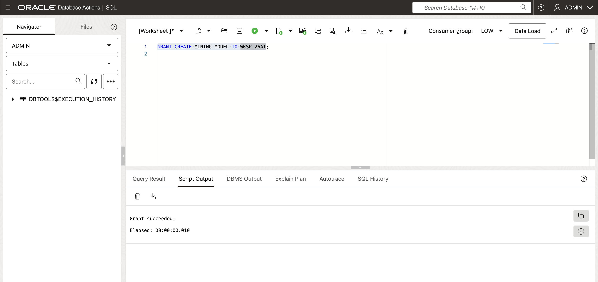

## Task 2: Load the ONNX Model into Oracle Database

1. Log in to your Oracle APEX workspace.

2. Navigate to **SQL Workshop** > **SQL Commands**.

    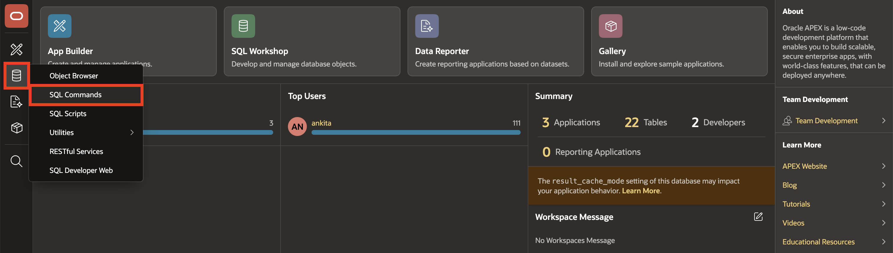

3. Enter the following PL/SQL code in the command editor to load the model.

    Click **Run**.

    ```sql
    <copy>
    DECLARE
        l_par_url       VARCHAR2(1000);
        l_response_blob BLOB;
    BEGIN
        l_par_url := 'https://adwc4pm.objectstorage.us-ashburn-1.oci.customer-oci.com/p/eLddQappgBJ7jNi6Guz9m9LOtYe2u8LWY19GfgU8flFK4N9YgP4kTlrE9Px3pE12/n/adwc4pm/b/OML-Resources/o/all_MiniLM_L12_v2.onnx';
        l_response_blob := apex_web_service.make_rest_request_b(
            p_url => l_par_url,
            p_http_method => 'GET'
        );

        dbms_vector.load_onnx_model(
            model_name => 'DOC_MODEL',
            model_data => l_response_blob,
            metadata => json(
                '{
                    "function" : "embedding",
                    "embeddingOutput" : "embedding",
                    "input" : {
                        "input" : ["DATA"]
                    }
                }'
            )
        );
    END;
    </copy>
    ```

    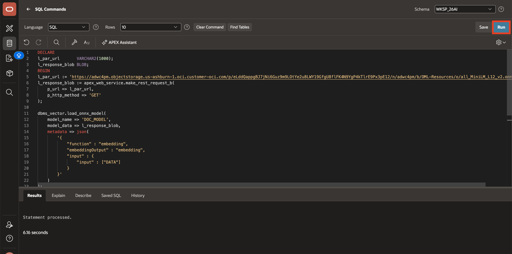

4. Replace the code in the command editor with the following query to validate the model registration.

    Click **Run**.

    ```sql
    <copy>
    SELECT model_name, mining_function, algorithm
    FROM user_mining_models
    WHERE model_name = 'DOC_MODEL';
    </copy>
    ```

5. In the results, confirm that **DOC_MODEL** is registered as an embedding model.

    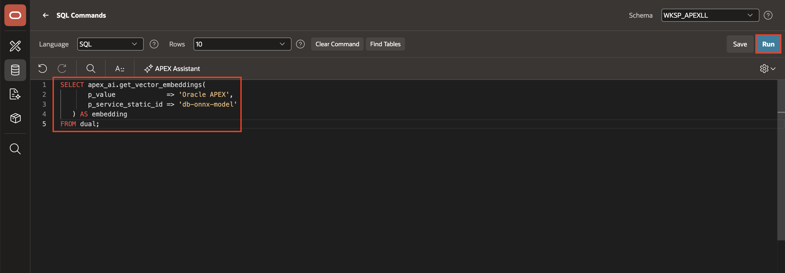

## Task 3: Create the Oracle APEX Vector Provider

1. In the left navigation menu, hover over **App Builder** and select **Workspace Utilities** > **All Workspace Utilities**.

    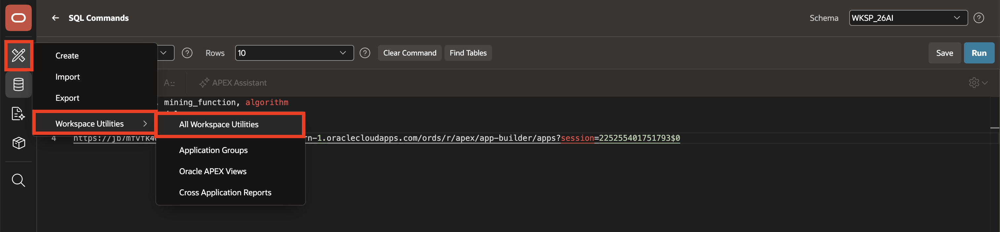

2. Select **Vector Providers**.

    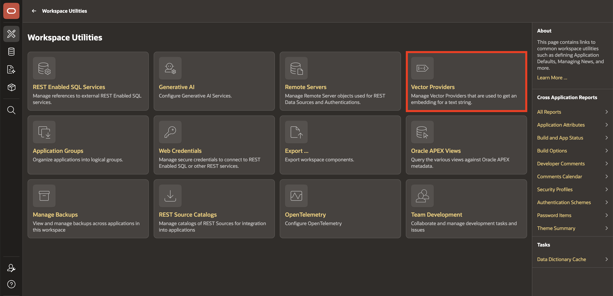

3. Click **Create**.

    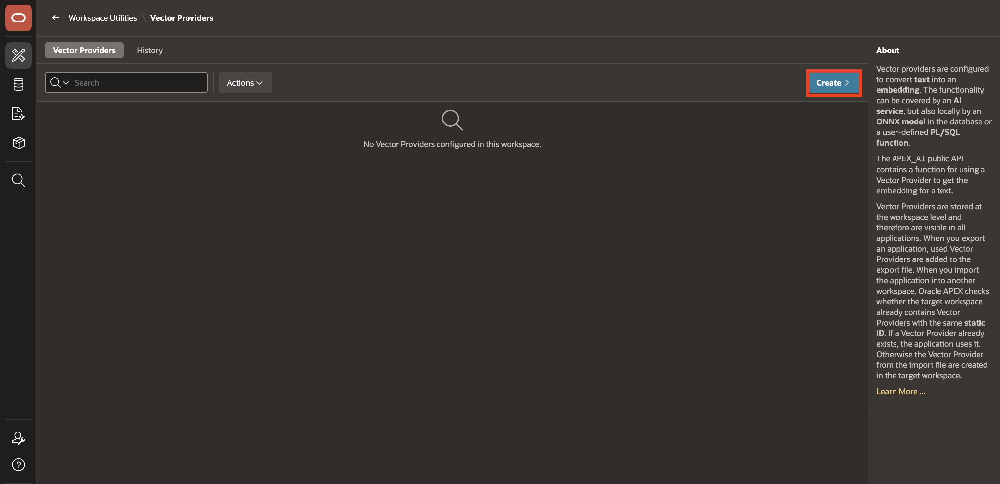

4. On the **Vector Provider** page, enter/select the following:

    - Under **Identification**:

        - **Provider Type:** **Database ONNX Model**

        - **Name:** **ONNX Model**

    - Under **Local Embedding**:

        - **ONNX Model Owner:** Select your parsing schema.

        - **ONNX Model Name:** **DOC_MODEL**

    - **Advanced > Static ID:** **db-onnx-model**

    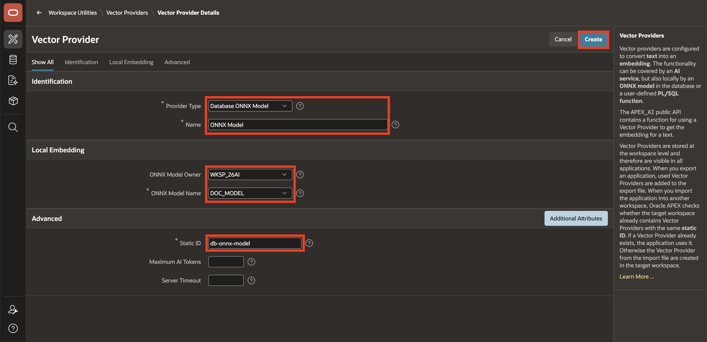

5. Click **Create**.

    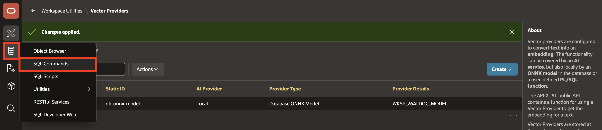

6. Navigate to **SQL Workshop** > **SQL Commands**.

7. Enter the following query in the command editor.

    Click **Run**.

    Verify that a vector value is returned.

    ```sql
    <copy>
    SELECT apex_ai.get_vector_embeddings(
           p_value             => 'Oracle APEX',
           p_service_static_id => 'db-onnx-model'
       ) AS embedding
    FROM dual;
    </copy>
    ```

    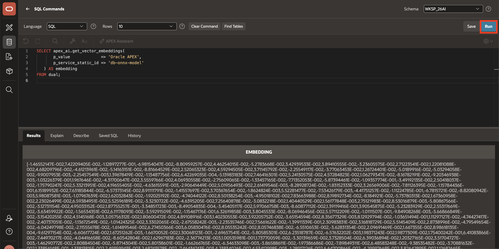

8. Replace the query in the command editor with the following query to test semantic distance.

    Click **Run**.

    ```sql
    <copy>
    SELECT VECTOR_DISTANCE(
           apex_ai.get_vector_embeddings(
               p_value => 'Java backend developer',
               p_service_static_id => 'db-onnx-model'
           ),
           apex_ai.get_vector_embeddings(
               p_value => 'Spring Boot microservices engineer',
               p_service_static_id => 'db-onnx-model'
           ),
           COSINE
       ) AS semantic_distance
    FROM dual;
    </copy>
    ```

    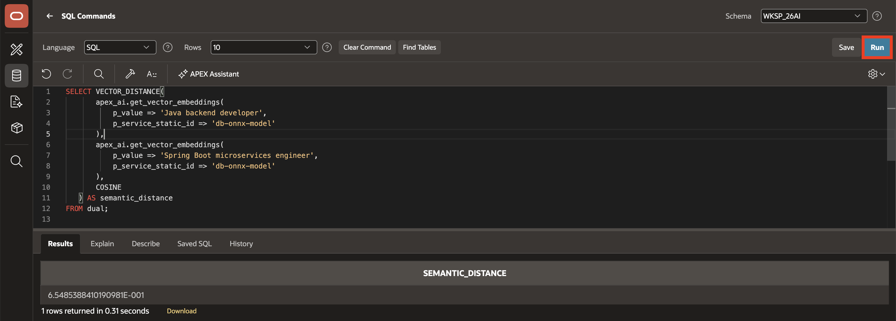

    Verify that the query returns a numeric value. The distance depends on the model and the input text.

## Summary

This lab prepares the foundation for semantic search. The database contains the embedding model, the APEX vector provider is available, and the vector functions are returning usable semantic results.

## Acknowledgements

- **Author** - Ankita Beri, Senior Product Manager; Roopesh Thokala, Principal Product Manager
- **Last Updated By/Date** - Ankita Beri, August 2026
