# Implement Semantic Search on the Candidate Pipeline in TAP

## Introduction

This lab adds semantic search to the Candidate Pipeline in TAP. You will create a vector search configuration, add a search page item, and validate ranking against natural-language skills queries such as low-code Oracle application developer, cloud infrastructure engineer, and AI database developer.

Estimated Lab Time: 10 minutes

### Objectives

In this lab, you will:

- Create an Oracle AI Vector Search configuration for the candidate table.

- Add a semantic search input to the Candidate Pipeline page.

- Connect the search region to the vector source.

- Validate result ranking with natural-language searches.

### Prerequisites

- Complete Labs 1 and 2 to create the vector provider and generate candidate embeddings.
- Access to the **Talent Acquisition Portal** application.

### Downloads

Stuck or missed out on completing the earlier labs? Don't worry! You can download the following file:

- **<a href="../introduction/files/tap-export16.sql" download="tap-export16.sql">Talent Acquisition Portal</a>**

Import it into your workspace. In **App Builder**, select **Import**, upload `tap-export16.sql`, and follow the steps in the **Import Application** wizard.

> **Note:**
>
> - **APEX Version:** The supplied application export was created with Oracle APEX 26.2 and cannot be imported into earlier APEX releases.
> - **Vector Provider:** Before running this lab, configure the vector provider. See **Module 22, Lab 1: Search Configuration and Vector Providers**.

## Task 1: Create the Vector Search Configuration

1. In **App Builder**, open the **Talent Acquisition Portal (TAP)** application.

2. On the Application home page, click **Shared Components**.

    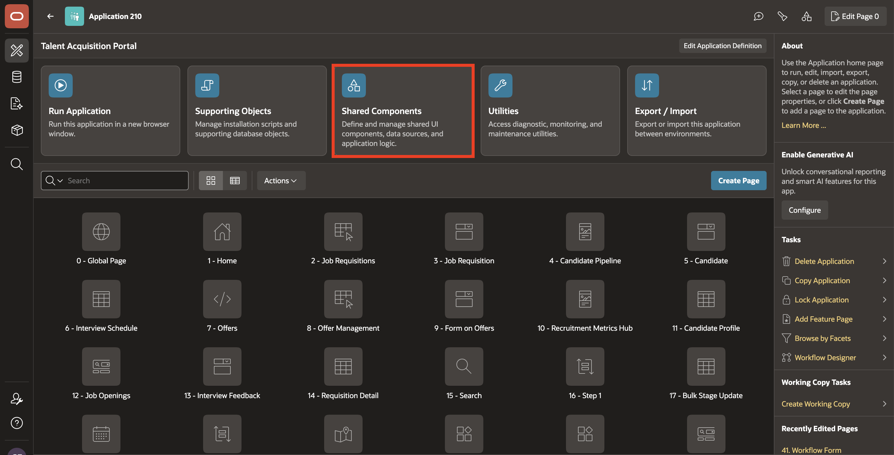

3. Under **Navigation and Search**, select **Search Configurations**.

    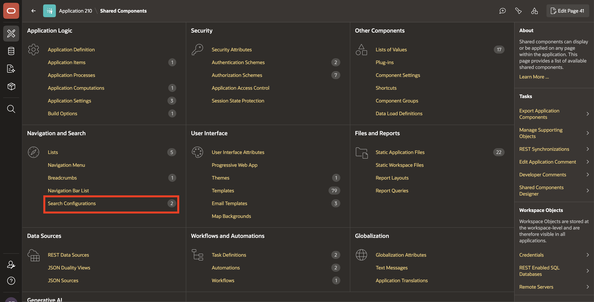

4. Click **Create**.

    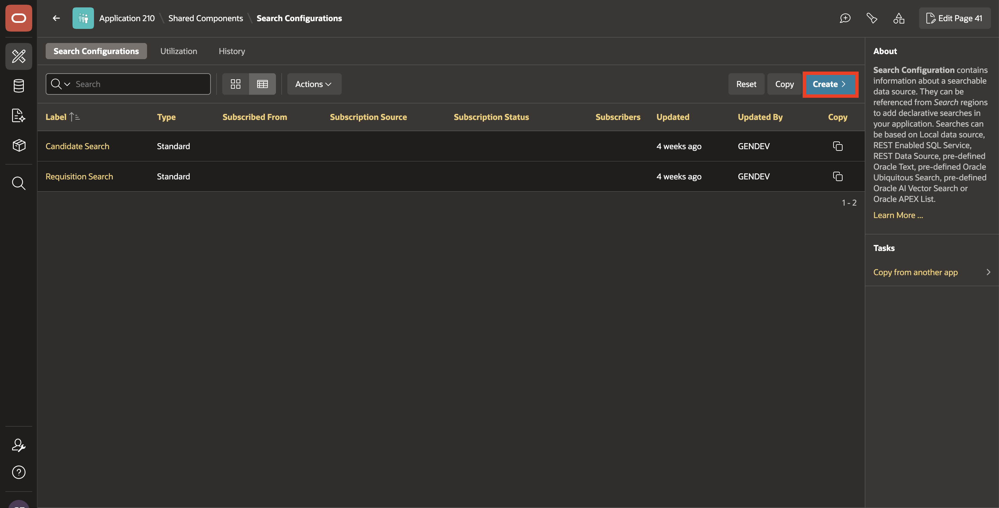

5. On the **Create Search Configuration** page, enter/select the following:

    - **Name:** **Candidate Semantic Search**

    - **Search Type:** **Oracle AI Vector Search**

6. Click **Next**.

    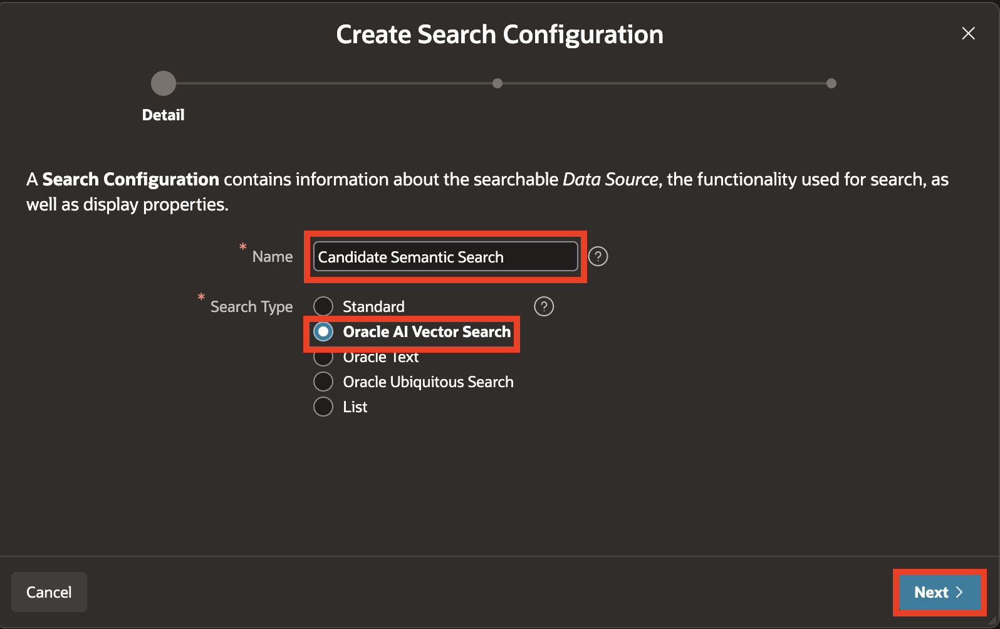

7. On the **Source** page, enter/select the following:

    - **Vector Provider:** **ONNX Model**, created in Lab 1 with Static ID `db-onnx-model`.
    - **Source Type:** **Table**
    - **Table / View Owner:** Select the schema that contains `TMS_CANDIDATES`.
    - **Table / View Name:** **TMS_CANDIDATES**

    > **Note:** The screenshots show this vector provider named **DB ONNX Model**. Select the provider created in Lab 1.

8. Click **Next**.

    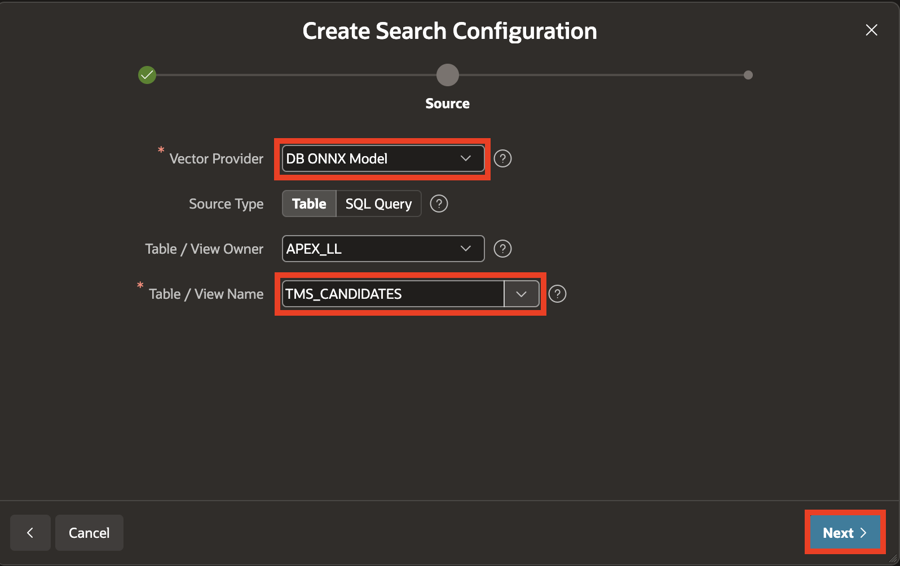

9. On the **Column Mapping** page, enter/select the following:

    - **Primary Key:** **CANDIDATE_ID (Number)**

    - **Vector Column:** **SKILLS_VECTOR (Vector)**

    - **Title Column:** **FIRST_NAME (Varchar2)**

    - **Description Column:** **SKILLS_TEXT (Varchar2)**

10. Click **Create Search Configuration**.

    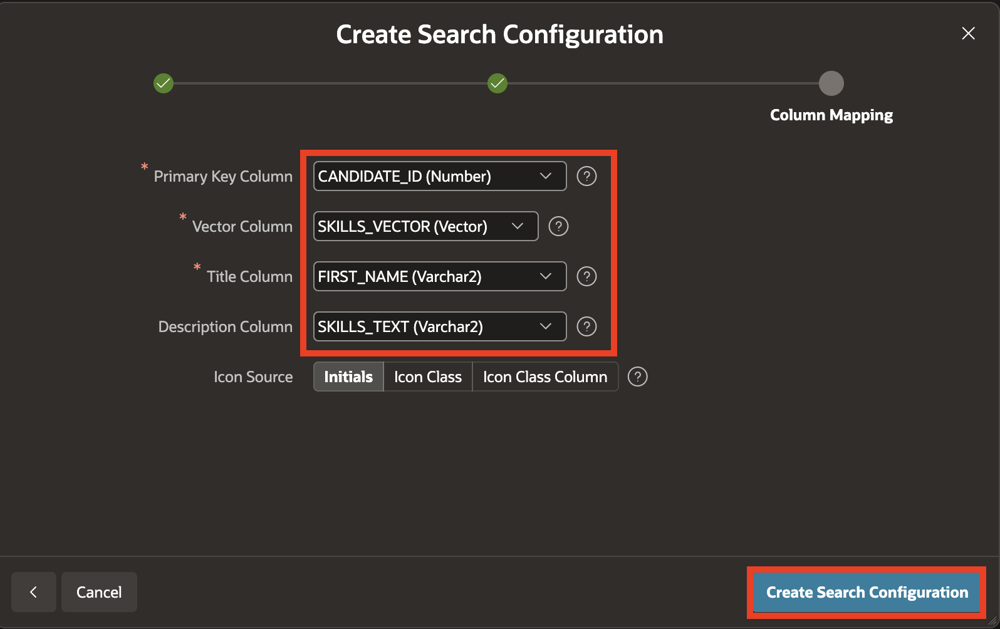

## Task 2: Add the Search Item and Region to the Candidate Pipeline Page

1. In the breadcrumb, click the **Application ID** to return to the Application home page.

    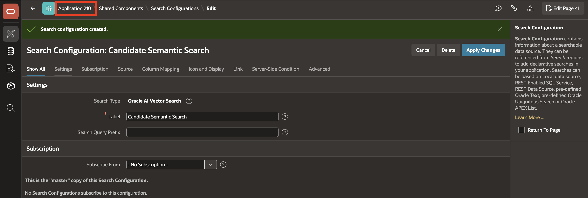

2. Select the **4: Candidate Pipeline** page.

    > **Note:** Your page number might differ. Open the page named **Candidate Pipeline** and use its page number in place of `4` in page item names such as `P4_SEMANTIC_SEARCH` and `P4_REQ_ID`.

    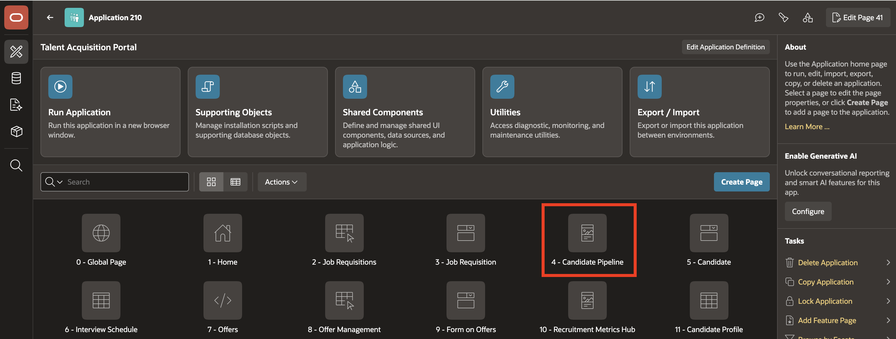

3. In the **Rendering** tab, right-click **Body** and select **Create Page Item**.

4. Drag the new page item above **P4\_REQ\_ID**.

    In the **Property Editor**, enter/select the following:

    - Under **Identification**:

        - **Name:** **P4\_SEMANTIC\_SEARCH**

        - **Type:** **Text Field**

    - **Label > Label:** **Search Candidates**

    - **Appearance > Value Placeholder:** **Search candidates by skills or experience...**

    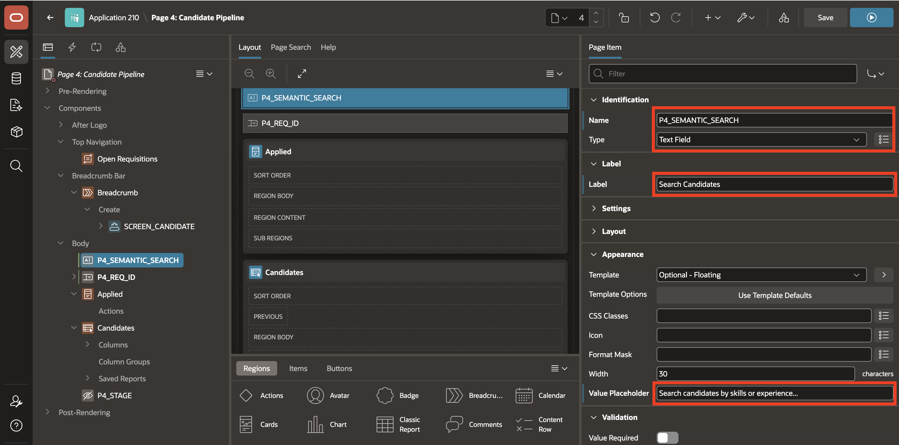

5. In the **Rendering** tab, right-click **Body** and select **Create Region**.

6. Drag the new region below **P4\_SEMANTIC\_SEARCH**.

    In the **Property Editor**, enter/select the following:

    - Under **Identification**:

        - **Name:** **Semantic Candidate Search**

        - **Type:** **Search**

    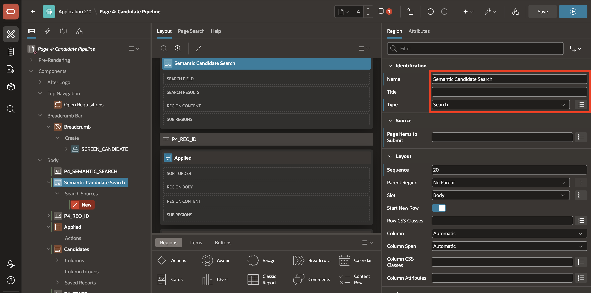

7. With **Semantic Candidate Search** selected, click the **Attributes** tab in the **Property Editor** and enter/select the following:

    - Under **Settings**:

        - **Search Page Item:** **P4_SEMANTIC_SEARCH**

        - **Search as You Type:** **Toggle ON**

        - **Minimum Characters:** **3**

    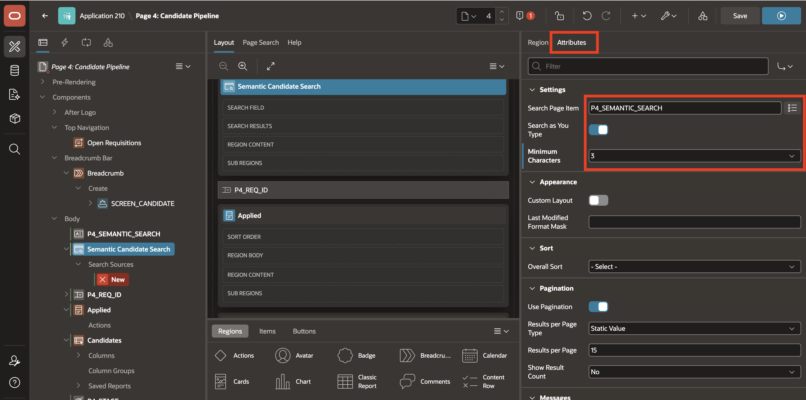

8. In the **Rendering** tab, expand **Semantic Candidate Search > Search Sources** and select **New**.

    In the **Property Editor**, enter/select the following:

    - Under **Identification**:

        - **Name:** **Candidate Semantic Search**

        - **Search Configuration:** **Candidate Semantic Search**

    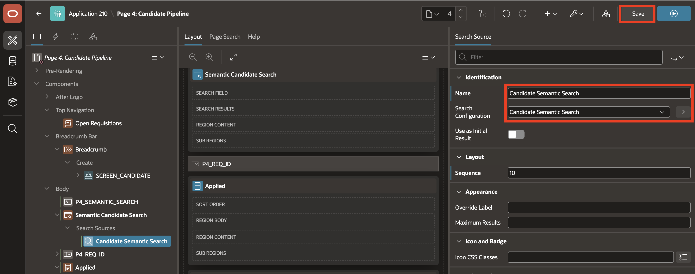

9. Click **Save and Run**.

    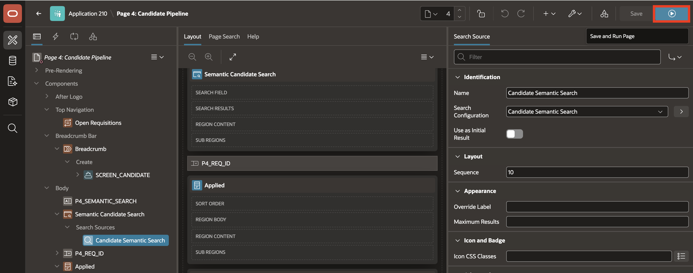

## Task 3: Test Semantic Candidate Ranking

1. On the **Candidate Pipeline** page, enter **low code Oracle application developer** in **Search Candidates**.

    Candidates with skills such as Oracle APEX, PL/SQL, ORDS, REST APIs, and Oracle Database should rank higher in the results.

    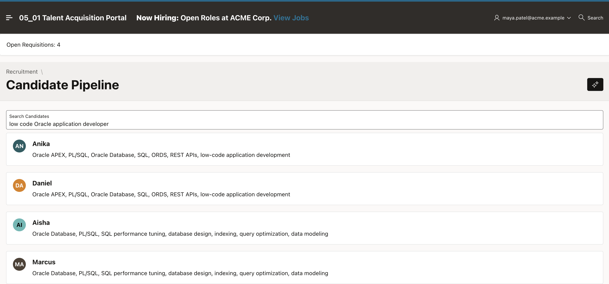

2. Replace the search text with **cloud infrastructure engineer**.

    Candidates with OCI Compute, OCI Networking, IAM, Object Storage, and cloud architecture experience should rank higher.

    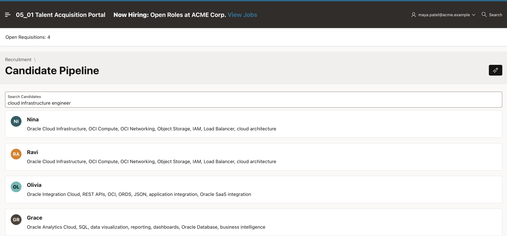

3. Replace the search text with **AI semantic search database developer**.

    Candidates with Oracle AI Database, AI Vector Search, VECTOR, ONNX embedding models, SQL, and PL/SQL should rank higher.

    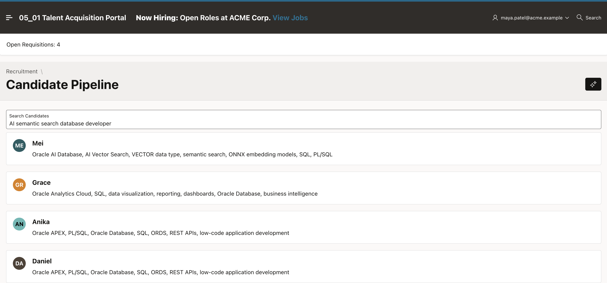

## Summary

The Candidate Pipeline now supports semantic search using the vector embeddings generated from candidate skill descriptions. The ranking aligns with the meaning of the prompt rather than exact word matching alone.

## Acknowledgements

- **Author** - Ankita Beri, Senior Product Manager; Roopesh Thokala, Principal Product Manager
- **Last Updated By/Date** - Roopesh Thokala, Principal Product Manager, October 2026
