# Build the HR Policy Search Page in ESS

## Introduction

This lab prepares the HR policy data for semantic search and then creates a dedicated search page in ESS. You will embed policy content, build the search configuration, and test natural-language prompts such as annual leave policy, benefits information, and employee onboarding requirements.

Estimated Lab Time: 15 minutes

### Objectives

In this lab, you will:

- Generate embeddings for HR policy content.

- Create an Oracle AI Vector Search configuration for policy records.

- Create an HR Policy Search page in ESS.

- Test semantic ranking for policy-related natural-language questions.

### Prerequisites

- Complete Lab 1 to create the **ONNX Model** vector provider.
- Access to the **Employee Self-Service Portal** application and the schema that contains `TMS_HR_POLICY`.

### Downloads

Stuck or missed out on completing the earlier labs? Don't worry! You can download the following file:

- **<a href="../introduction/files/ess-export15.sql" download="ess-export15.sql">Employee Self-Service Portal</a>**

Import it into your workspace. In **App Builder**, select **Import**, upload `ess-export15.sql`, and follow the steps in the **Import Application** wizard.

> **Note:**
>
> - **APEX Version:** The supplied application export was created with Oracle APEX 26.2 and cannot be imported into earlier APEX releases.

## Task 1: Generate HR Policy Embeddings

1. In your APEX workspace, navigate to **SQL Workshop** > **SQL Commands**.

2. Enter the following SQL statement in the command editor to generate embeddings for the HR policies.

    Click **Run**.

    ```sql
    <copy>
    UPDATE tms_hr_policy
    SET embedding_vector = apex_ai.get_vector_embeddings(
            p_value => title || ' ' || content,
            p_service_static_id => 'db-onnx-model'
        );
    </copy>
    ```

    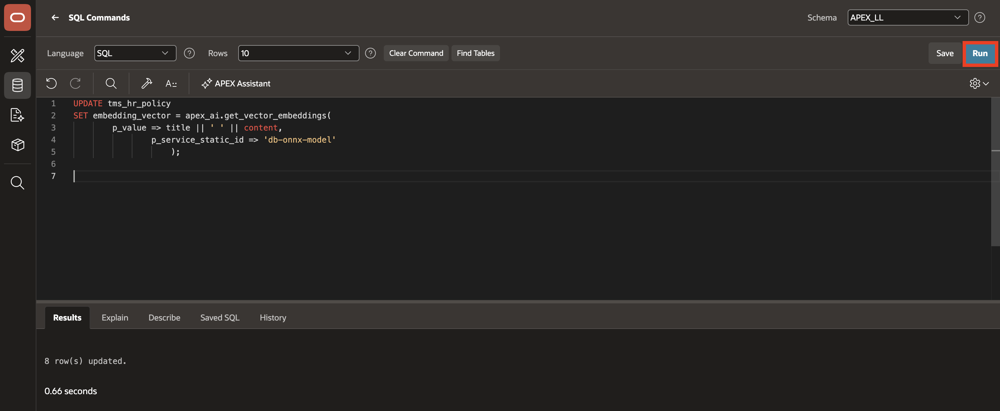

3. Replace the statement in the command editor with the following query to verify the embedding status.

    Click **Run**.

    ```sql
    <copy>
    SELECT policy_id,
           category,
           title,
           CASE
               WHEN embedding_vector IS NULL THEN 'NOT EMBEDDED'
               ELSE 'EMBEDDED'
           END AS embedding_status
    FROM tms_hr_policy
    ORDER BY category, title;
    </copy>
    ```

    Confirm that the policy rows show **EMBEDDED**.

    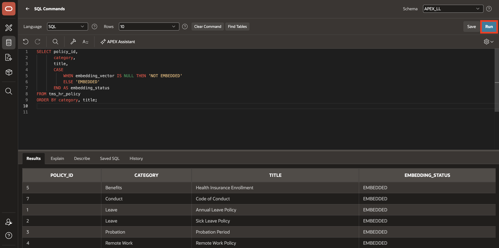

## Task 2: Create the HR Policy Vector Search Configuration

1. In **App Builder**, open the **Employee Self-Service Portal (ESS)** application.

2. On the Application home page, click **Shared Components**.

    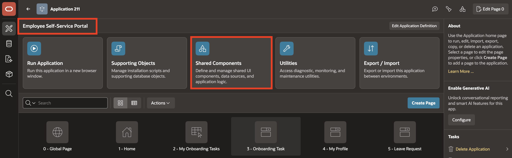

3. Under **Navigation and Search**, select **Search Configurations**.

    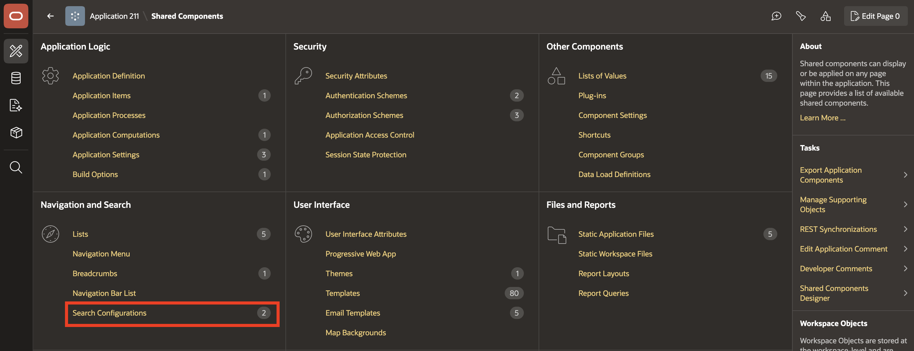

4. Click **Create**.

    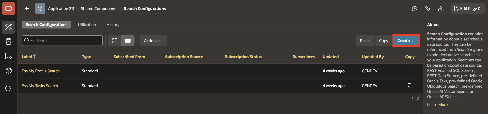

5. On the **Create Search Configuration** page, enter/select the following:

    - **Name:** **HR Policy Semantic Search**

    - **Search Type:** **Oracle AI Vector Search**

6. Click **Next**.

    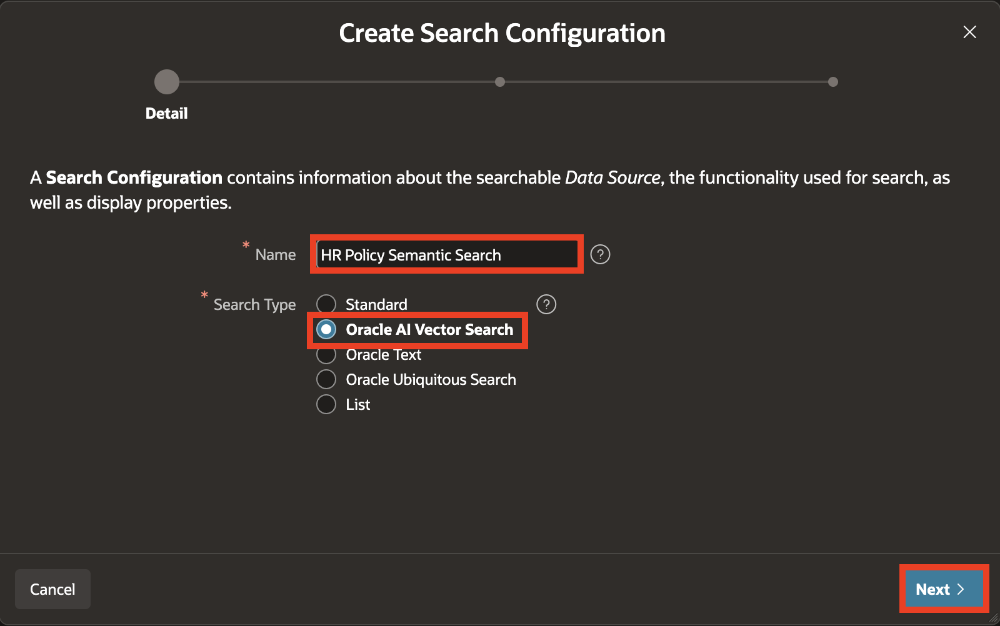

7. On the **Source** page, enter/select the following:

    - **Vector Provider:** **ONNX Model**, created in Lab 1 with Static ID `db-onnx-model`.
    - **Source Type:** **Table**
    - **Table / View Owner:** Select the schema that contains `TMS_HR_POLICY`.
    - **Table / View Name:** **TMS\_HR\_POLICY**

    > **Note:** The screenshots show this vector provider named **DB ONNX Model**. Select the provider created in Lab 1.

8. Click **Next**.

    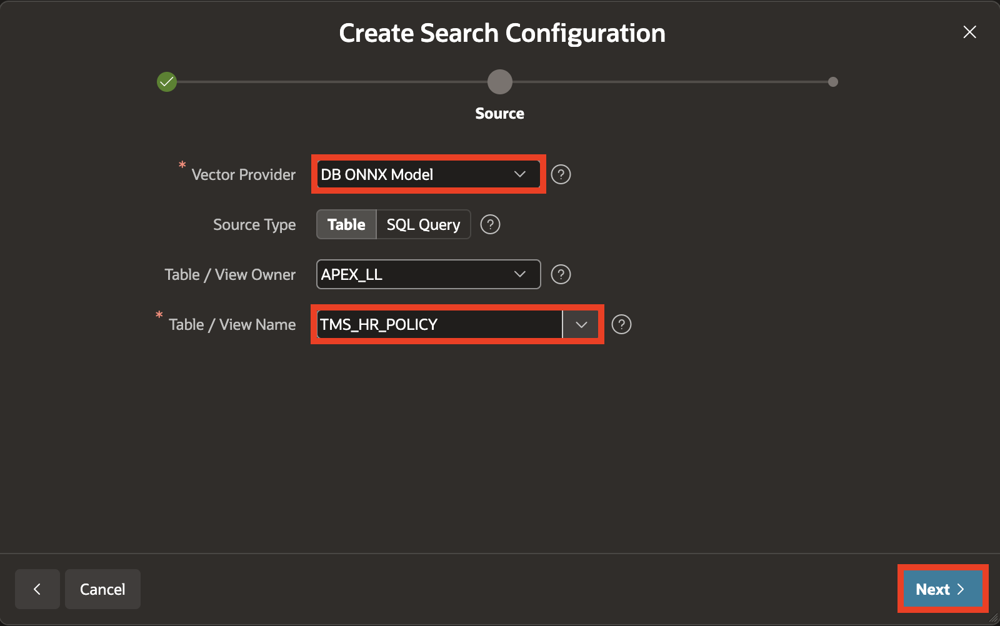

9. On the **Column Mapping** page, enter/select the following:

    - **Primary Key:** **POLICY_ID (Number)**

    - **Vector Column:** **EMBEDDING_VECTOR (Vector)**

    - **Title Column:** **TITLE (Varchar2)**

    - **Description Column:** **CONTENT (Clob)**

10. Click **Create Search Configuration**.

    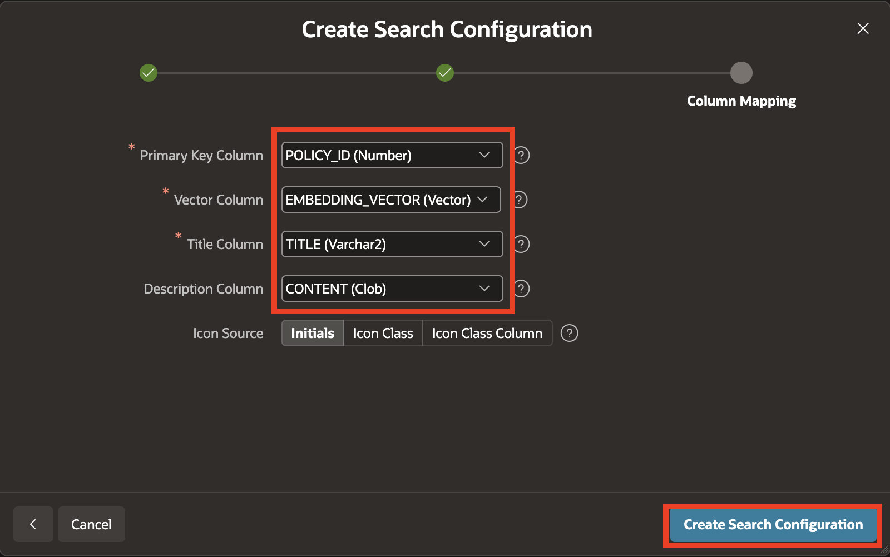

## Task 3: Create the HR Policy Search Page

1. In the breadcrumb, click the **Application ID** to return to the Application home page.

    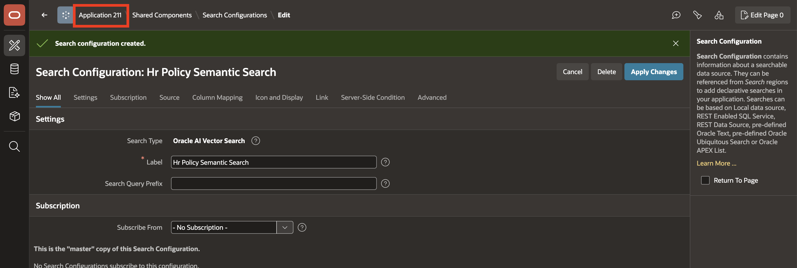

2. Click **Create Page**.

    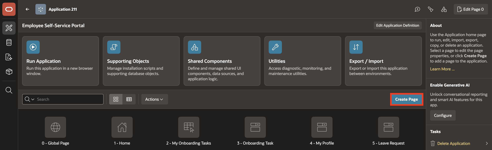

3. Select **Search Page**.

    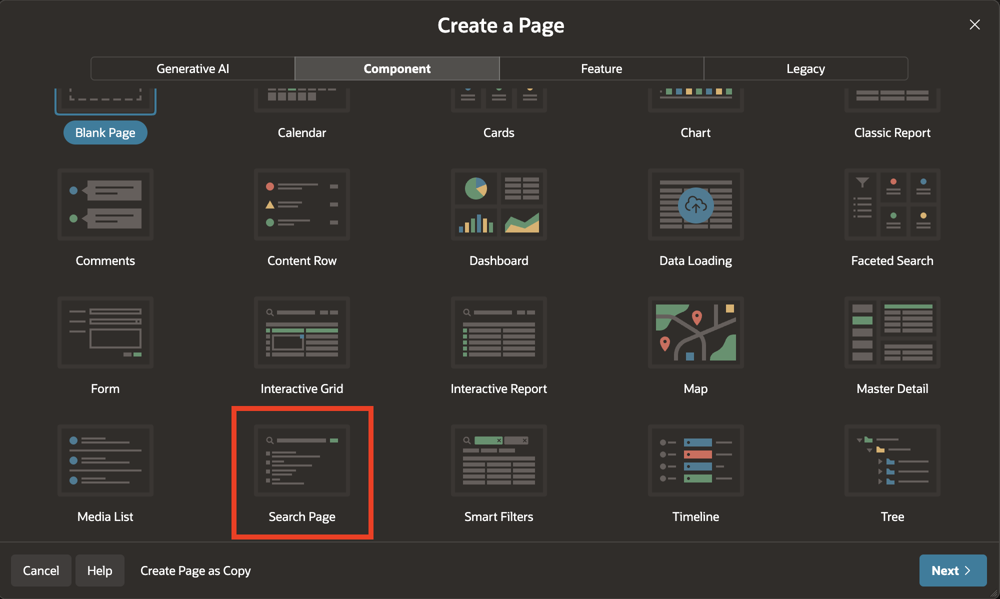

4. In the **Create Search Page** wizard, enter/select the following:

    - **Name:** **HR Policy Search**

    - **Search Configurations:** Select **HR Policy Semantic Search**.

    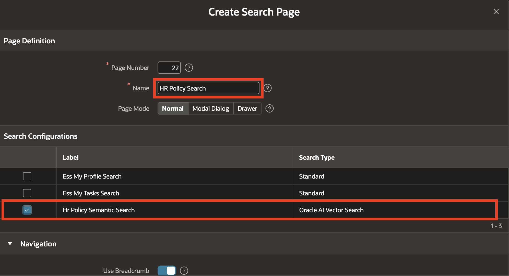

5. Under **Navigation**, set **Parent Navigation Menu Entry** to **HR Info**.

    Click **Create Page**.

    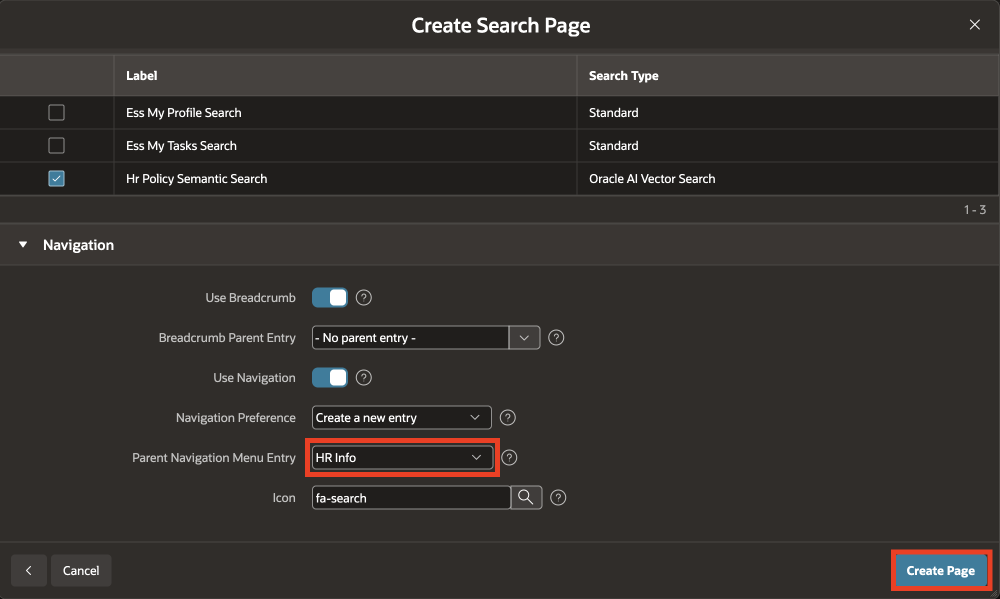

    > **Note:** Your generated page number might differ. Use the page named **HR Policy Search**. The following step uses `P24_SEARCH`; select the `P<page number>_SEARCH` item on your page.

6. In **Page Designer**, open the **Rendering** tab and select **P24_SEARCH**.

    In the **Property Editor**, enter/select the following:

    - **Appearance > Value Placeholder:** **Search HR policies by meaning...**

    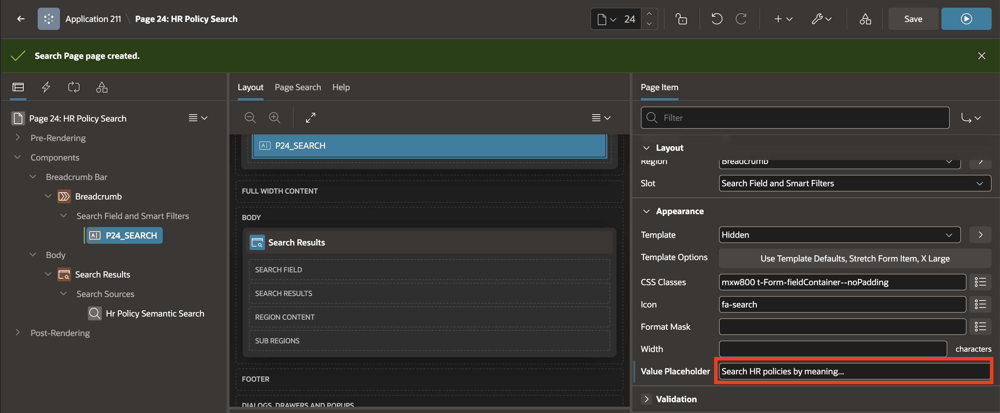

7. Click **Save and Run**.

## Task 4: Validate Policy Search Behavior

1. On the **HR Policy Search** page, enter **annual leave policy** in the search field.

    Relevant leave-related policies should rank higher.

    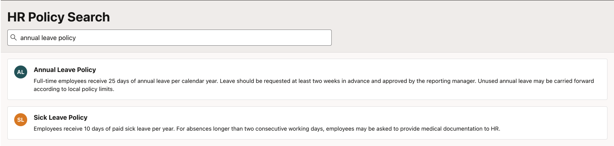

2. Replace the search text with **what benefits are available to employees**.

    Relevant benefit-related policies should rank higher.

    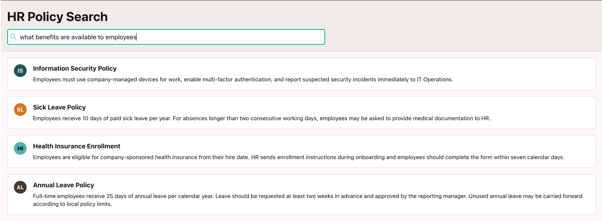

3. Replace the search text with **new employee onboarding requirements**.

    Relevant onboarding and employee-policy content should rank higher.

    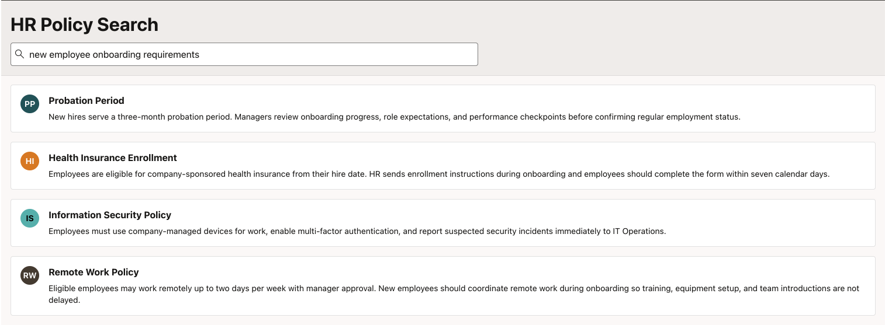

## Summary

The HR Policy Search page now uses semantic ranking to find relevant policies based on their titles and content. You have tested searches for leave, benefits, and onboarding requirements.

## Acknowledgements

- **Author** - Ankita Beri, Senior Product Manager; Roopesh Thokala, Principal Product Manager
- **Last Updated By/Date** - Roopesh Thokala, Principal Product Manager, October 2026
