# Set Up the Environment

## Introduction

In this lab, you prepare your local machine with the core tools needed to enhance the TAP application.

Estimated Lab Time: 15 minutes

> **Note:** Use of an AI agent or LLM incurs additional costs and requires a separate commercial agreement with the provider.

### Objectives

In this lab, you will:

- Install Visual Studio Code on the local machine.
- Install the Codex and SQL Developer extensions required for APEX development.
- Configure SQLcl as an MCP server in Codex.

## Task 1: Install Visual Studio Code on Your Local Machine

1. Open the [Visual Studio Code download page](https://code.visualstudio.com/Download) in a web browser.

    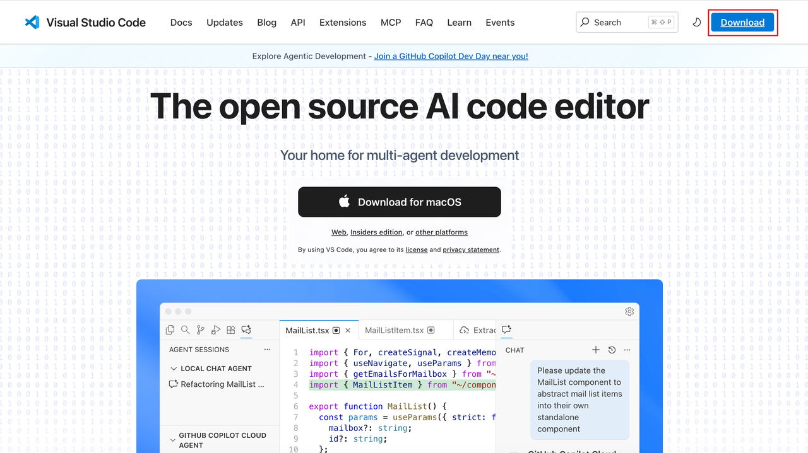

2. Download the installer for your operating system (Windows, macOS, or Linux).

    

3. Run the downloaded installer.

    Accept the default options to complete the installation.

4. Open **Visual Studio Code** and confirm that the welcome screen appears.

    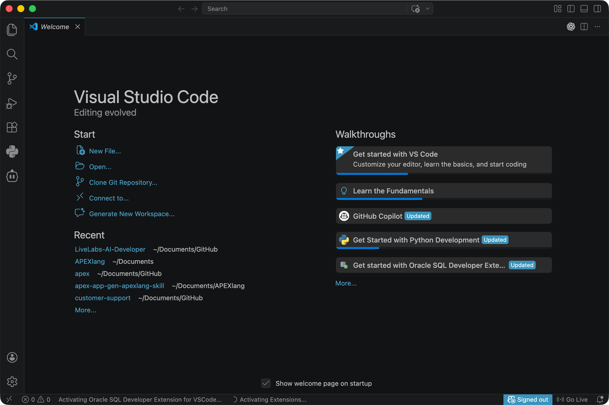

## Task 2: Install the Extensions

1. In **Visual Studio Code**, select **View** > **Extensions**.

    Search for **Codex**.

    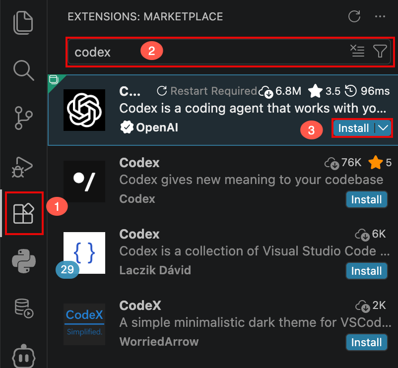

2. Select the **Codex** extension.

    Click **Install**.

3. Open **Codex** and select **Use API Key**.

    Enter your OpenAI API key.

    Click **OK**.

    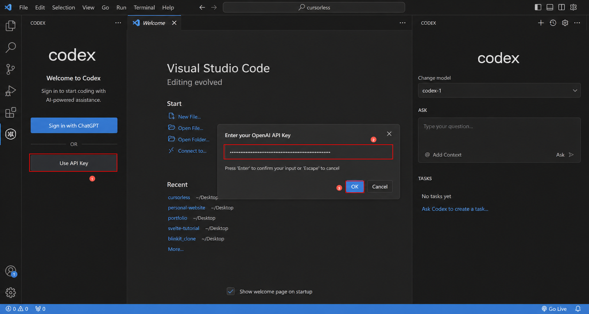

4. In **Extensions**, search for **Oracle SQL Developer for VS Code**.

    Select the extension.

    Click **Install**.

    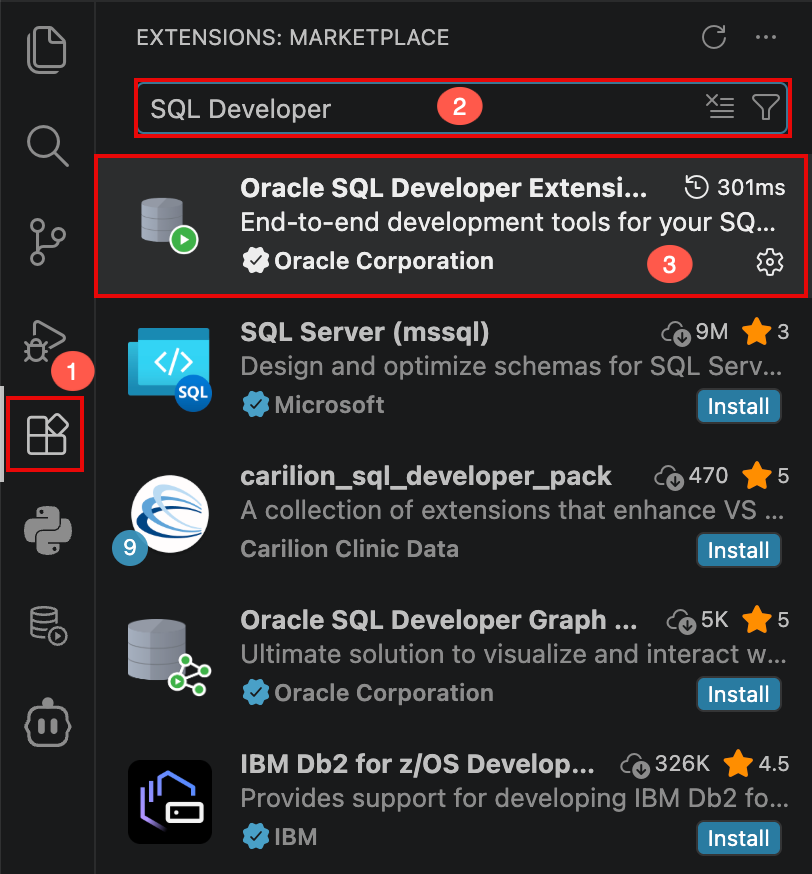

5. In **Oracle SQL Developer for VS Code**, add a database connection for the schema associated with your APEX workspace.

    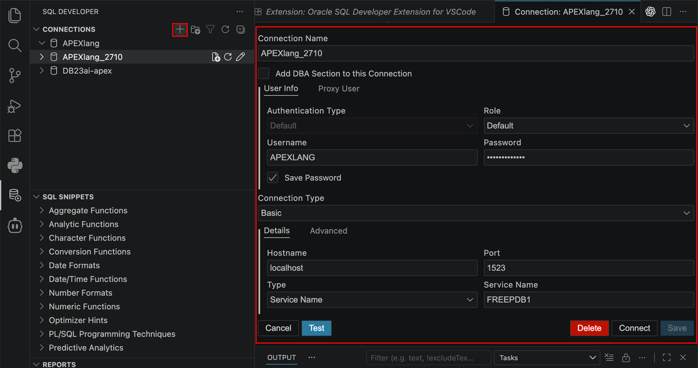

6. In **Extensions**, search for **Python**.

    Select the extension.

    Click **Install**.

    > **Note:** A coding agent may use Python for tasks such as offline syntax validation.

    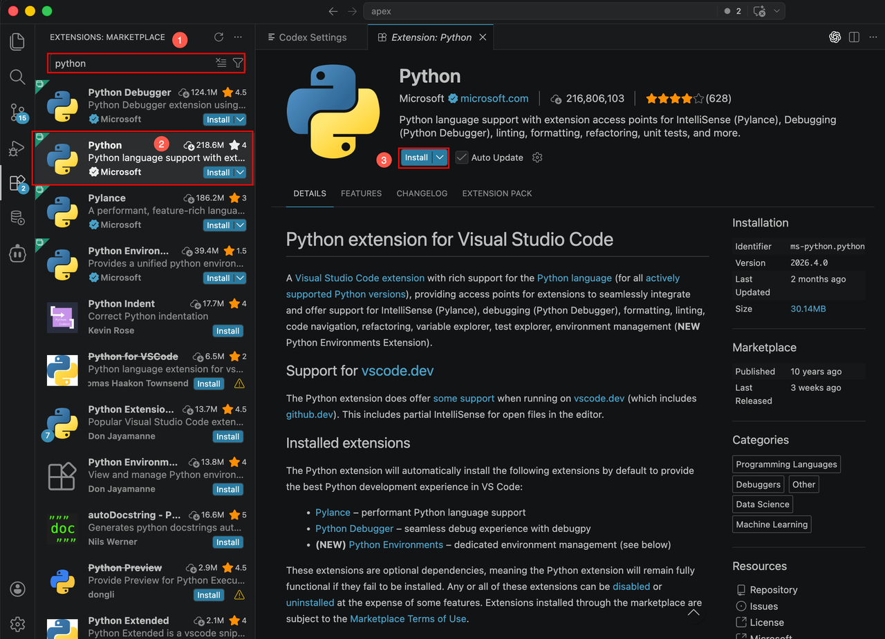

## Task 3: Configure the SQLcl MCP Server

1. Download [SQLcl](https://www.oracle.com/database/sqldeveloper/technologies/sqlcl/download/) to your local machine.

    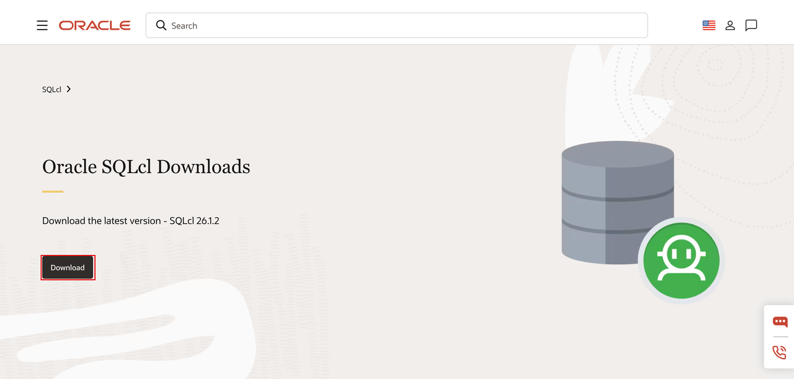

    > **Note:** SQLcl requires a Java Runtime Environment (JRE) or Java Development Kit (JDK). Ensure that Java is installed and available in your system's `PATH` before using SQLcl.

2. In **Codex**, open **Codex Settings**.

    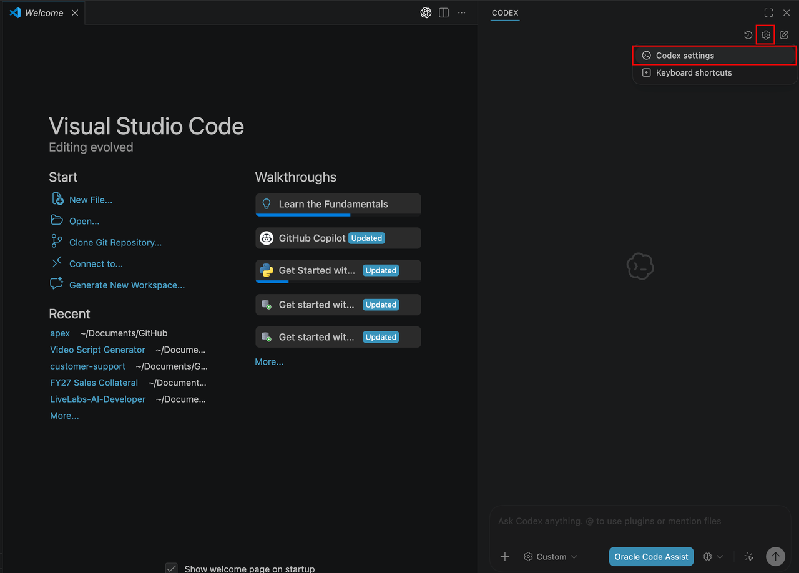

3. In **Codex Settings**, select **MCP servers**.

    Click **Add server**.

    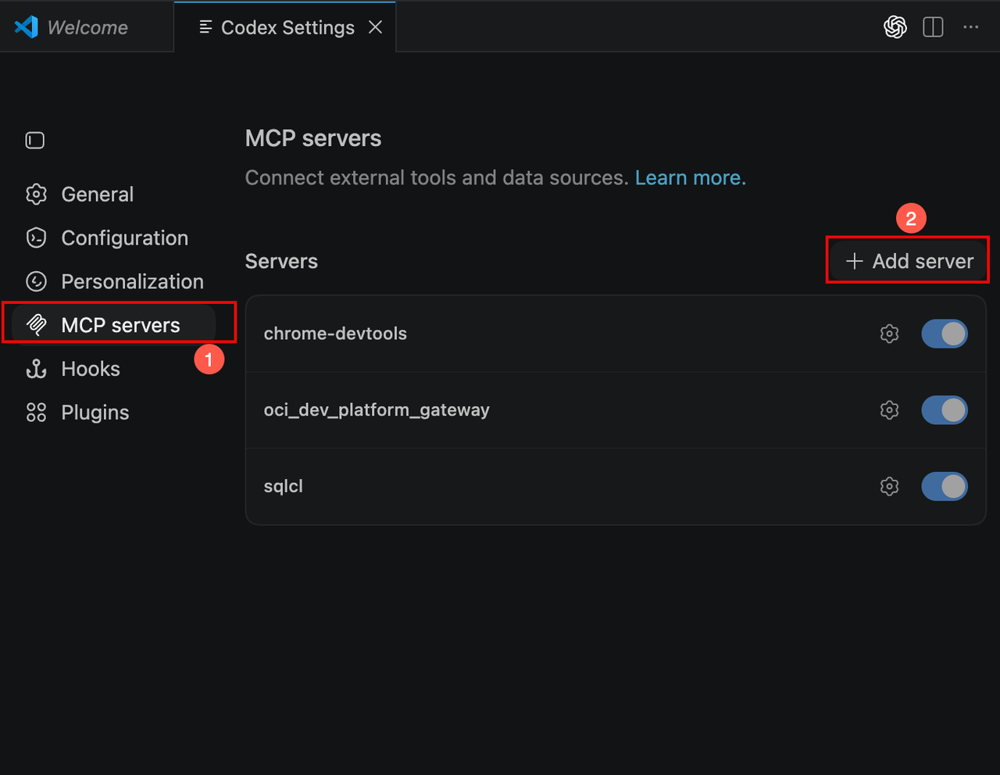

4. On the **Connect to a custom MCP** page, enter/select the following:

    - **Name:** **sqlcl**

    - **Command to launch:** Enter the full path to the SQLcl executable, `sqlcl/bin/sql`, on your machine.

    - **Arguments:** **-mcp**

5. Click **Save**.

    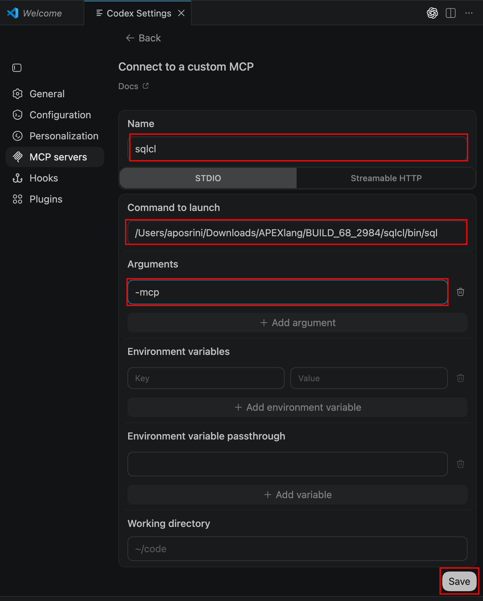

## Acknowledgements

- **Author** - Ankita Beri, Senior Product Manager; Roopesh Thokala, Principal Product Manager
- **Last Updated By/Date** - Ankita Beri, Senior Product Manager, October 2026