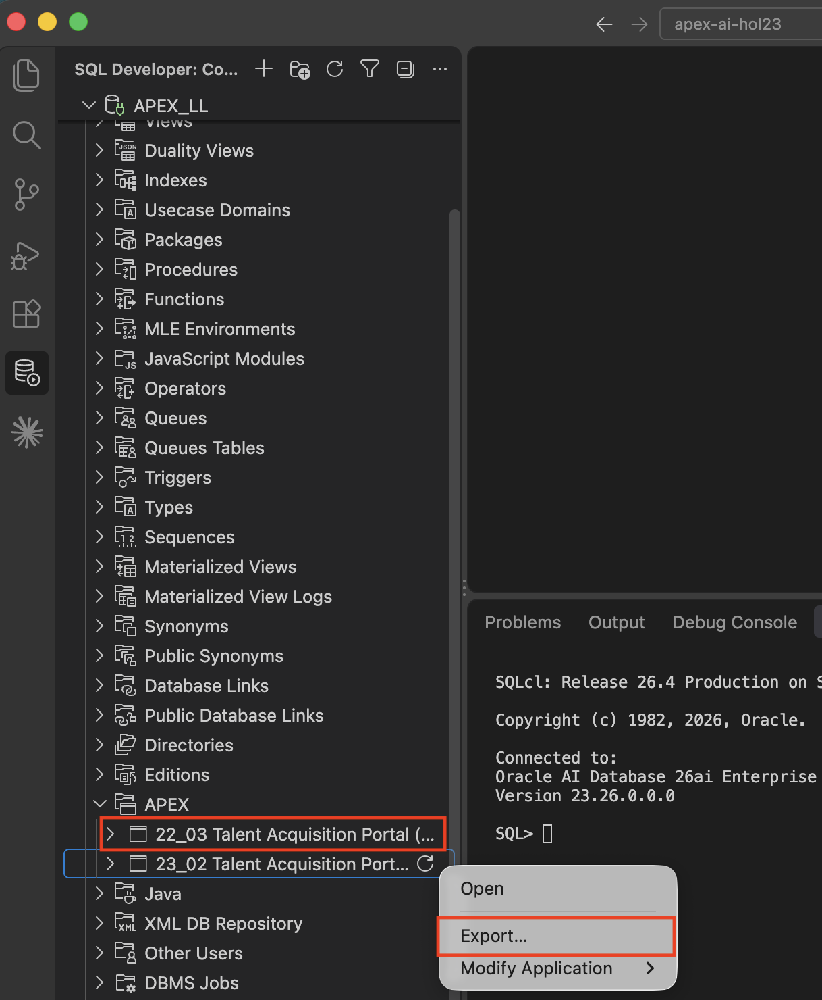
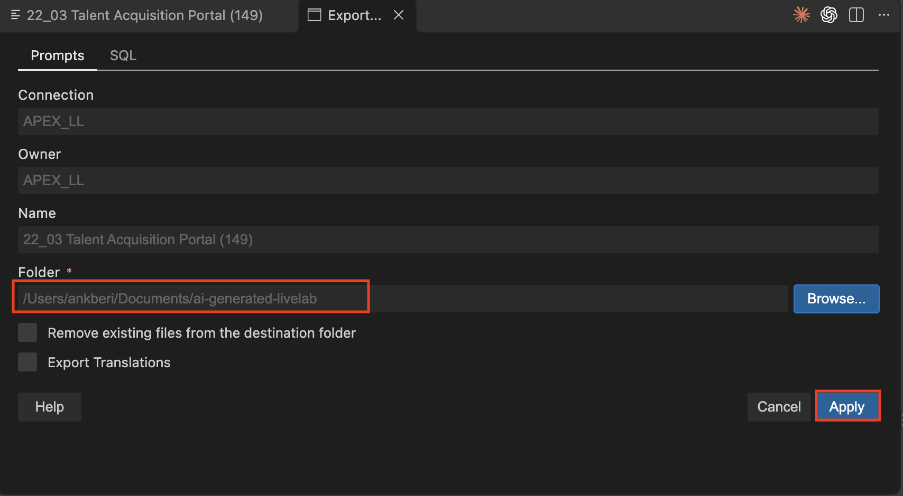
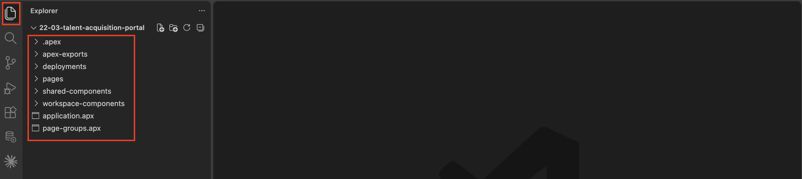
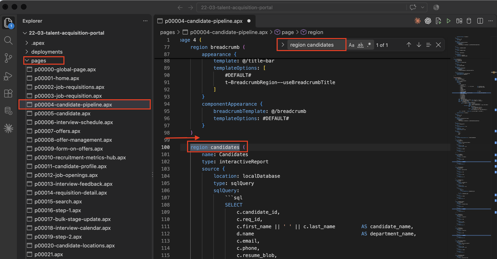
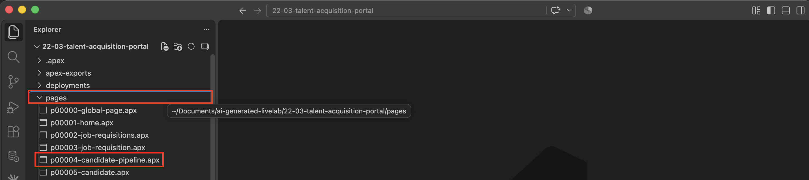
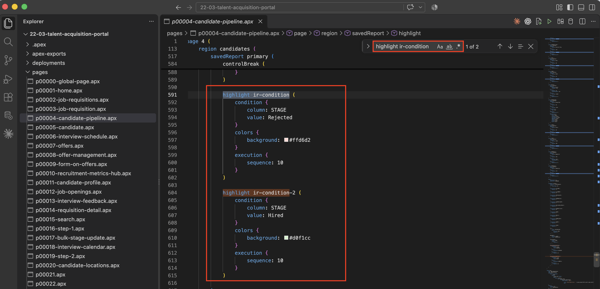

# Export TAP and Review the APEXlang Project

## Introduction

In this lab, you export the TAP application from SQL Developer for VS Code and review the files that describe the application in APEXlang. You will identify the Candidate Pipeline interactive report, its AI Score column, and its existing highlighting configuration.

Estimated Lab Time: 10 minutes

### Objectives

In this lab, you will:

- Connect to the lab database from Visual Studio Code.
- Export TAP to a local APEXlang project.
- Locate Page 4 and review existing APEX components.

### Prerequisites

- Complete Labs 1 and 2 to set up Visual Studio Code, the database connection, and the APEXlang skills.
- Access to the **Talent Acquisition Portal** application developed in the preceding modules.

### Downloads

Stuck or missed out on completing the earlier labs? Don't worry! You can download the following file:

- **<a href="../intro/files/tap-export17.sql" download="tap-export17.sql">Talent Acquisition Portal</a>**

Import it into your workspace. In **App Builder**, select **Import**, upload `tap-export17.sql`, and follow the steps in the **Import Application** wizard.

> **Note:**
>
> - **APEX Version:** The supplied application export was created with Oracle APEX 26.2 and cannot be imported into earlier APEX releases.

## Task 1: Export TAP

Export the TAP application to a local project.

1. In **Oracle SQL Developer for VS Code**, expand your database connection.

    Expand **APEX** to display the applications in that schema.

2. Under **APEX**, right-click **Talent Acquisition Portal** and select **Export**.

    

3. In the export dialog, keep the default values for the application.

    For **Folder**, click **Browse…**.

    Select your local applications folder.

    Click **Apply**.

    

4. Wait for the export to complete.

## Task 2: Review the Project Structure

Open the exported project and review its main folders and files.

1. In **Visual Studio Code**, open the exported TAP project folder.

2. Review these main folders and files:

    - `application.apx`
    - `pages/`
    - `shared-components/`
    - `deployments/`

    

3. In **Explorer**, expand **pages** and open **p00004-candidate-pipeline.apx**.

    > **Note:** Your page number might differ. Open the `.apx` file for the page named **Candidate Pipeline**. The following steps use Page 4 and `p00004-candidate-pipeline.apx`.

## Task 3: Review Existing Components

Use search to connect the exported APEXlang entries with familiar APEX components.

You learned about interactive reports (IRs) in an earlier module. In this task, you will see how the Candidate Pipeline report and its components are represented in APEXlang.

1. With the Candidate Pipeline page file open, press **Ctrl+F** (Windows/Linux) or **Command+F** (macOS).

2. Search for `region candidates`.

    This definition represents the **Candidates** interactive report on the **Candidate Pipeline** page.

    

3. Search for `column AI_SCORE`.

    This is the AI Score report column.

    

4. Search for `highlight ir-condition`.

    This is the existing interactive report highlighting configuration.

    

## Summary

You can now identify familiar APEX components in the exported APEXlang file, including the Candidate Pipeline interactive report, the AI Score column, and the report highlighting configuration.

## Acknowledgements

- **Author** - Ankita Beri, Senior Product Manager; Roopesh Thokala, Principal Product Manager
- **Last Updated By/Date** - Ankita Beri, September 2026
