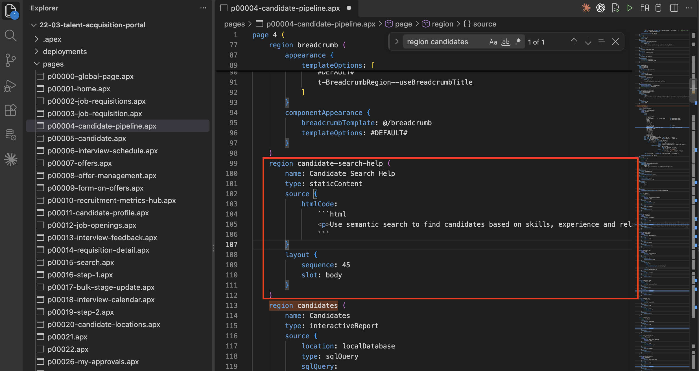
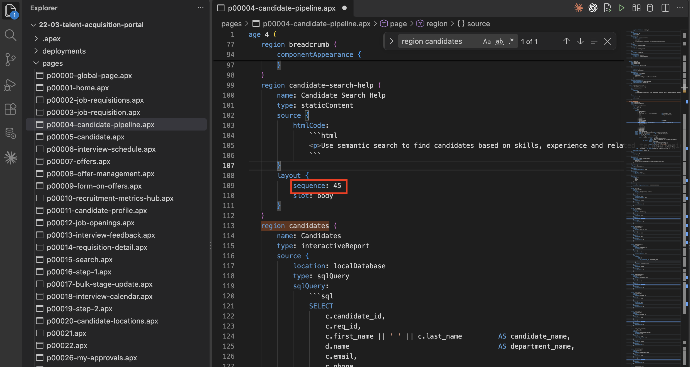
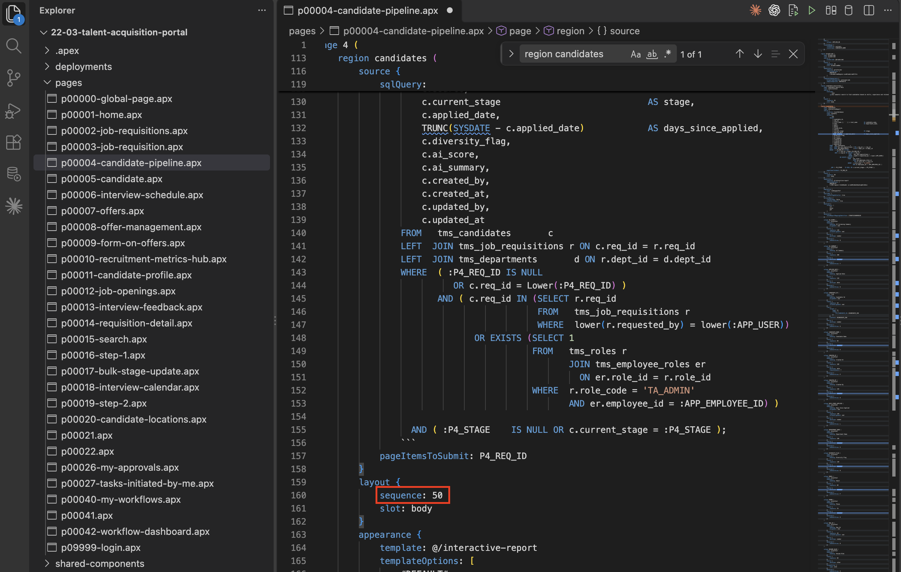
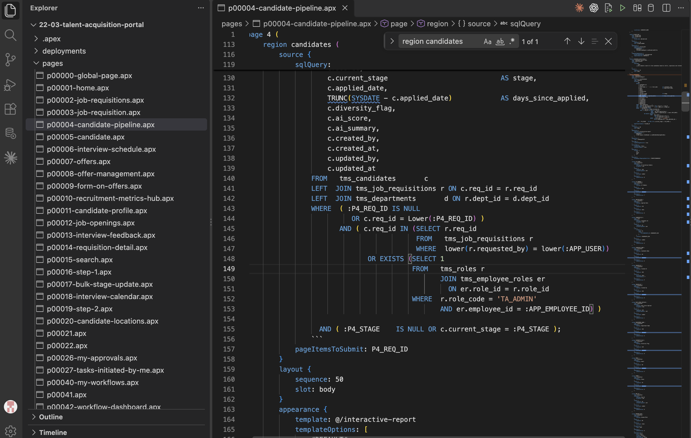
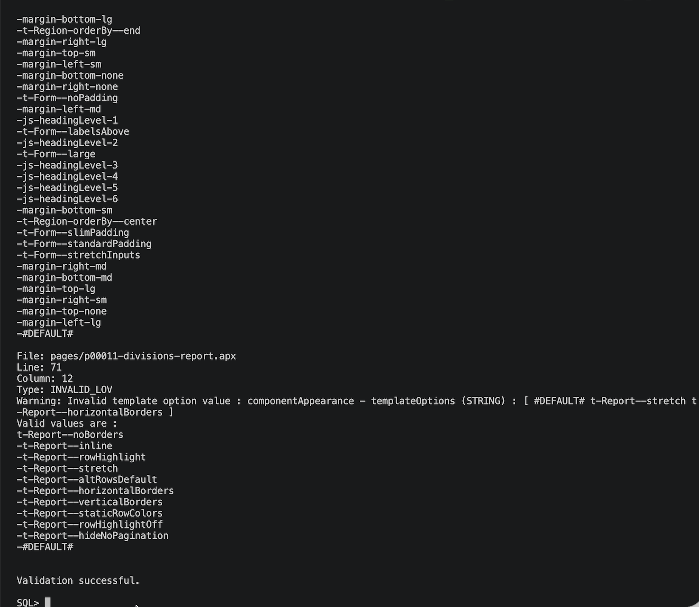

# Add a New Component and Validate the Project

## Introduction

In this lab, you update the Candidate Pipeline APEXlang file by adding a static content region. You then save the file and validate the complete project with the APEX command-line tool.

Estimated Lab Time: 10 minutes

### Objectives

In this lab, you will:

- Locate the Candidate Pipeline region and its layout sequence.
- Add the Candidate Search Help static content region.
- Save and validate the APEXlang project.

### Prerequisites

- Complete Lab 3 to export TAP and locate the Candidate Pipeline page file.

## Task 1: Locate the Candidate Pipeline Region

Find the existing Candidate Pipeline region and confirm its layout position.

1. In **Visual Studio Code**, expand **pages** in **Explorer**.

    Open **p00004-candidate-pipeline.apx**.

    > **Note:** Your page number might differ. Use the `.apx` file for the page named **Candidate Pipeline**.

2. Search for `region candidates`.

    

## Task 2: Add a New Static Content Region

Add a help message before the Candidate Pipeline region. The new region uses sequence 45, so it appears before the existing region at sequence 50.

1. Inside the page definition, add the following region immediately before **region candidates** or **region candidate-pipeline**:

    ````text
    <copy>
    region candidate-search-help (
        name: Candidate Search Help
        type: staticContent
        source {
            htmlCode:
                &#96;&#96;&#96;html
                <p>Use semantic search to find candidates based on skills, experience and related technologies.</p>
                &#96;&#96;&#96;
        }
        layout {
            sequence: 45
            slot: body
        }
    )
    </copy>
    ````

    

2. Confirm that `sequence: 45` places the new region before the Candidate Pipeline region at `sequence: 50`.

    You will verify the imported region in Page Designer in Lab 5.

    

    

3. Press **Ctrl+S** (Windows/Linux) or **Command+S** (macOS) to save the page file.

    

## Task 3: Validate the APEXlang Project

Validate the complete exported project after saving the page file.

1. In **Oracle SQL Developer for VS Code**, right-click your database connection and select **Open SQLcl**.

2. In the SQLcl terminal, run the following command.

    Replace `enter the folder path` with the full path to the exported TAP project folder that contains `application.apx`.

    ```text
    <copy>
    apex validate -input 'enter the folder path'
    </copy>
    ```

3. Wait for validation to complete.

4. Confirm that the output includes **Validation successful.**

    > **Note:** The example output includes template-option warnings. Review any warnings reported for your project.

    

## Summary

The APEXlang project now contains the Candidate Search Help region and validates successfully.

## Acknowledgements

- **Author** - Ankita Beri, Senior Product Manager; Roopesh Thokala, Principal Product Manager
- **Last Updated By/Date** - Roopesh Thokala, Principal Product Manager, October 2026