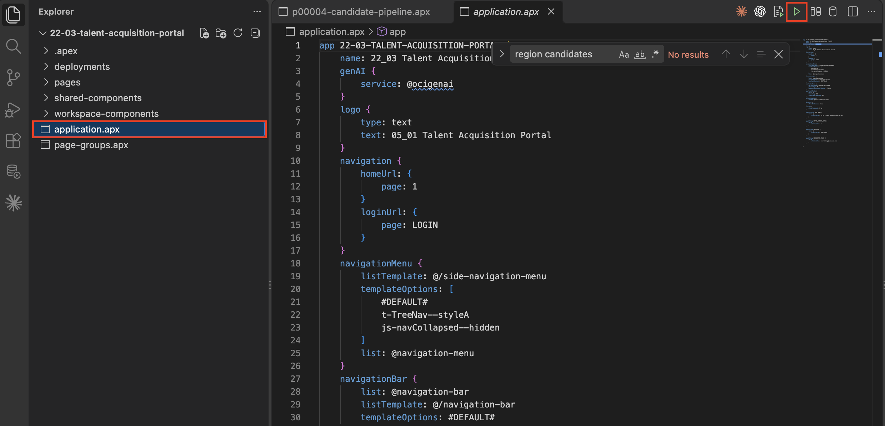
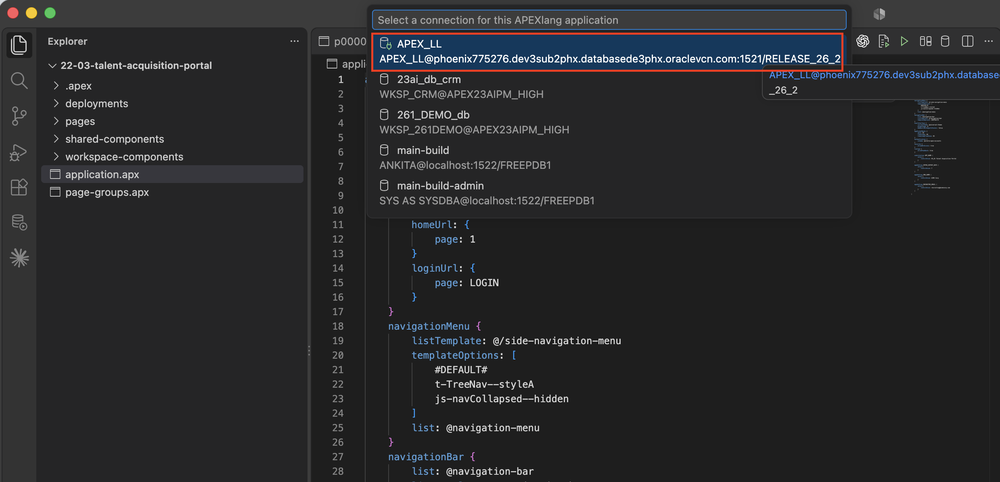
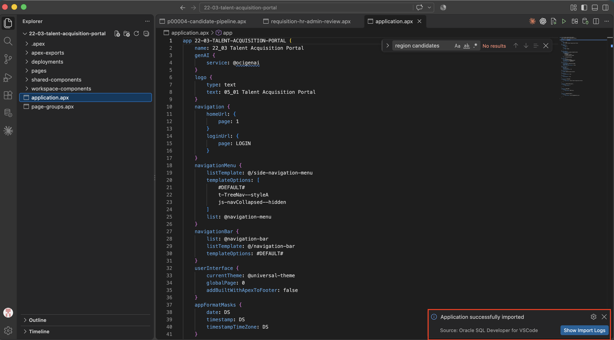
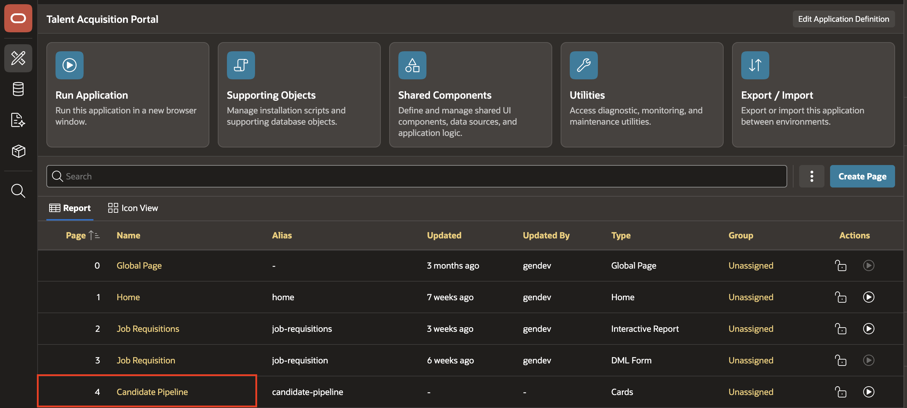
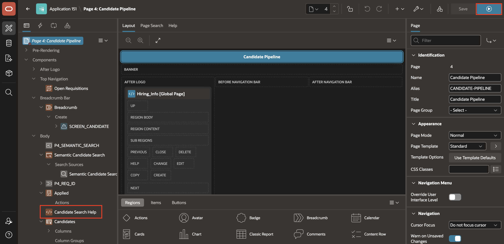
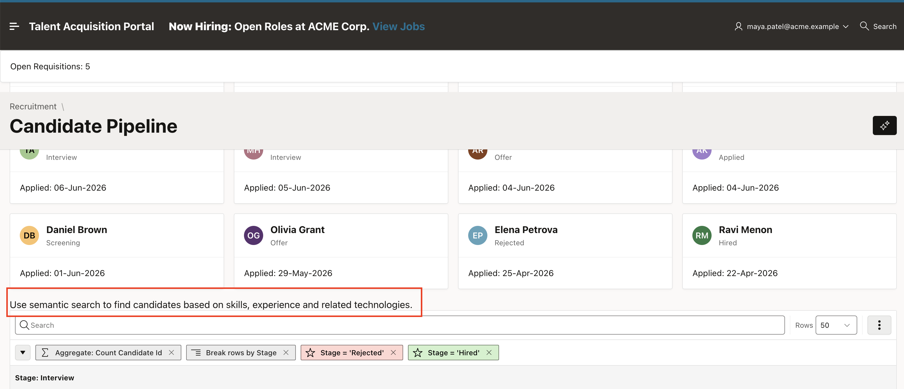

# Import TAP and Verify the Change

## Introduction

In this lab, you import the updated TAP application from the APEXlang project and verify the new region in Page Designer and at runtime.

Estimated Lab Time: 5 minutes

### Objectives

In this lab, you will:

- Import the updated TAP application in SQL Developer for VS Code.
- Verify the Candidate Search Help region in Page Designer.
- Verify the region and its message when you run the Candidate Pipeline page.

### Prerequisites

- Complete Lab 4 to add the **Candidate Search Help** region, save the page file, and validate the TAP project.

## Task 1: Import the Application

Import the updated application into the lab database.

1. In **Oracle SQL Developer for VS Code**, open **application.apx** in the exported TAP project.

    

2. Click **Import** in the editor toolbar.

    If prompted, select the database connection for your APEX workspace schema.

    

3. Save all files if prompted.

4. Wait for the import to complete successfully.

    

## Task 2: Verify in Page Designer

Confirm that the imported region appears in the APEX application.

1. In your APEX workspace, open **App Builder**.

2. Select the **Talent Acquisition Portal** application.

3. Open **Page 4: Candidate Pipeline** in **Page Designer**.

    > **Note:** Your page number might differ. Open the page named **Candidate Pipeline** in the application that you imported.

    

4. In the **Rendering** tab, expand **Body** and confirm that **Candidate Search Help** appears before **Candidates**.

    

## Task 3: Verify at Runtime

Run the Candidate Pipeline page and confirm that the new static content is visible.

1. In Page Designer, click **Save and Run** to run the **Candidate Pipeline** page.

    

2. Locate the help message before the **Candidates** report.

3. Verify that the page displays the following text:

    > Use semantic search to find candidates based on skills, experience and related technologies.

    

## Summary

The APEXlang change has been imported successfully and appears in the TAP application in Page Designer and at runtime.

## Acknowledgements

- **Author** - Ankita Beri, Senior Product Manager; Roopesh Thokala, Principal Product Manager
- **Last Updated By/Date** - Ankita Beri, September 2026
