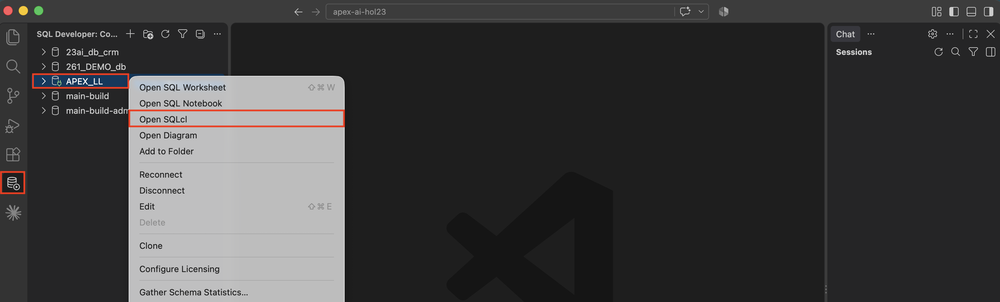
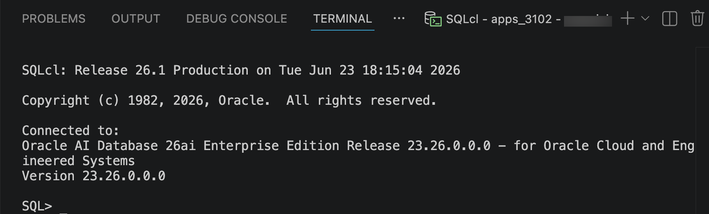
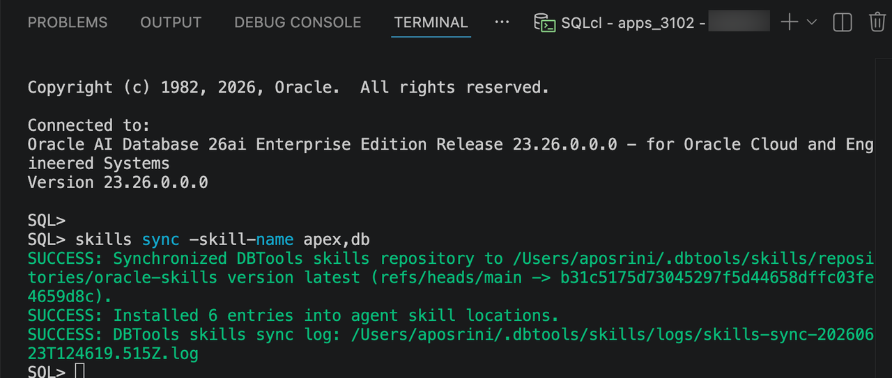

# Set Up the APEXlang Skills Repository

## Introduction

APEXlang is an Open Application Specification Language introduced in Oracle APEX 26.1. In this lab, you will set up APEXlang skills.

Estimated Lab Time: 5 minutes

### Objectives

In this lab, you will:

- Configure the APEXlang skills repository in Visual Studio Code.

### Prerequisites

- Complete Lab 1 to install Oracle SQL Developer for VS Code and create a database connection.

## Task 1: Set Up the APEXlang Skills Repository in Visual Studio Code

To install the required Oracle APEX and database skills:

1. In **Oracle SQL Developer for VS Code**, right-click your database connection and select **Open SQLcl**.

    

2. Confirm that the SQLcl terminal is connected to your database schema.

    

3. In the SQLcl terminal, run the following command to install the required skills:

    ```text
    <copy>
    skills sync -skill-name apex,db
    </copy>
    ```

4. Wait for the command to complete.

    Confirm that the output reports that the skills repository was synchronized and the skills were installed.

    

    > **Note:** The skills repository is updated regularly. Run the same command again to synchronize later changes.

    The command installs the Oracle APEX and database skills for use by your coding agent.

    The source files are available in the [Oracle skills repository](https://github.com/oracle/skills).

## Acknowledgements

- **Author** - Ankita Beri, Senior Product Manager; Roopesh Thokala, Principal Product Manager
- **Last Updated By/Date** - Ankita Beri, September 2026
