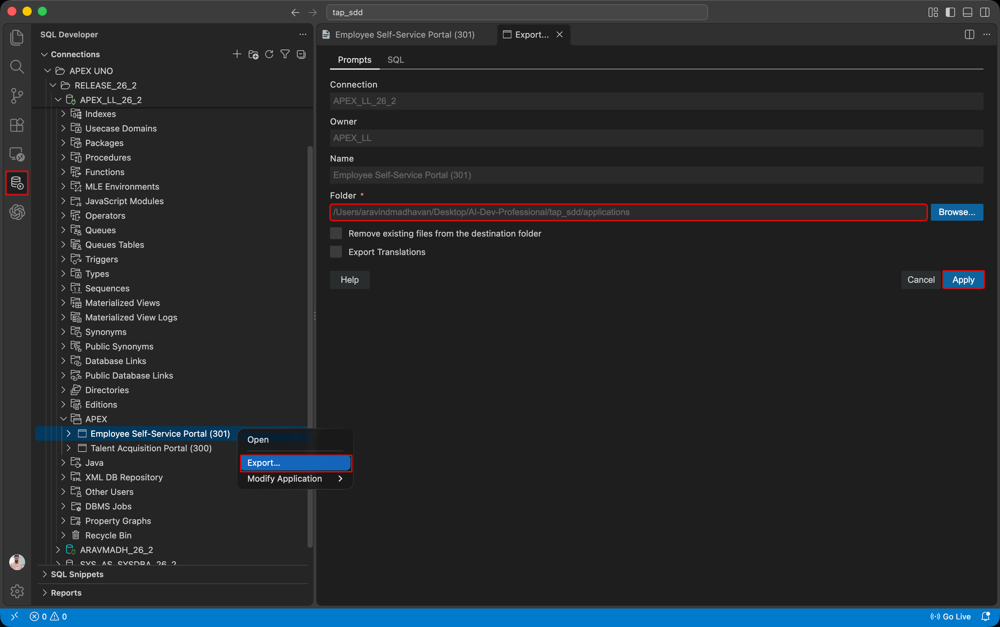
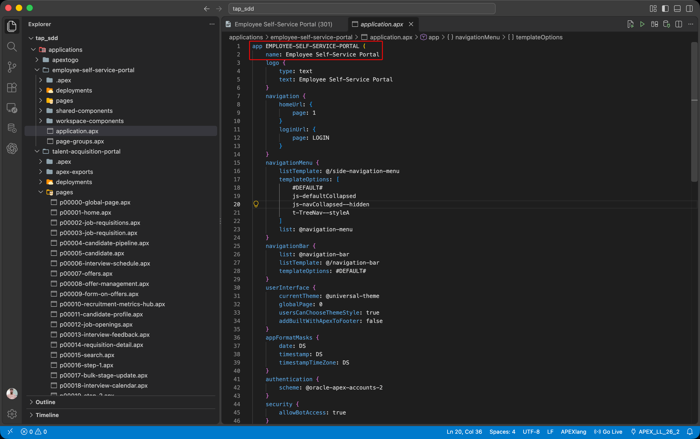

# Export ESS and Inspect Its Source

## Introduction

ESS already exists in the APEX workspace. Unlike TAP, it has not yet gone through the APEXlang export and import cycle from Module 23. Export its current definition so that Codex can update its pages in the next lab.

An existing application satisfies the selected file import prerequisite. You can apply page updates directly to the installed ESS application without importing the complete project first.

Estimated Lab Time: 10 minutes

### Objectives

In this lab, you will:

- Export the installed ESS application through SQL Developer for VS Code.
- Check the exported application name and project structure.
- Prepare the ESS project for Lab 3.

### Downloads

Stuck or missed out on completing the earlier labs? Don't worry! You can download the following file:

- **<a href="../introduction/files/ess-export16.sql" download="ess-export16.sql">Employee Self-Service Portal</a>**

Import it into your workspace. In **App Builder**, select **Import**, upload `ess-export16.sql`, and follow the steps in the **Import Application** wizard.

> **Note:**
>
> - **APEX Version:** The supplied application export was created with Oracle APEX 26.2 and cannot be imported into earlier APEX releases.
> - **Vector Provider:** Before running this lab, configure the vector provider. See **Module 22, Lab 1: Search Configuration and Vector Providers**.

## Task 1: Export the Current ESS Application

1. In **Oracle SQL Developer for VS Code**, locate ESS:

    - In **Connections**, expand the parsing-schema connection for your course workspace.
    - Expand **APEX**.
    - Locate **Employee Self-Service Portal (ESS)**.

2. Under **APEX**, right-click **Employee Self-Service Portal (ESS)**.

    Select **Export…**.

3. In the export dialog, for **Folder**, click **Browse…**.

    Select the **applications** folder as the export destination.

    Click **Apply**.

    Wait for the export to finish.

    

4. Inspect the exported ESS project:

    - In **Explorer**, open the exported **employee-self-service-portal** folder.
    - Select `application.apx`.

    - Confirm the application name.
    - Locate the **pages** folder.

    Keep this project open for Lab 3.

    

## Acknowledgements

- **Author** - Aravind Madhavan, Senior Product Manager, Oracle
- **Last Updated By/Date** - Aravind Madhavan, October 2026
