# Add PWA Shortcuts and Screenshots

## Introduction

In this lab, you will add shortcuts for My Tasks, Apply for Leave, and My Payslip to the installed ESS application. You will also upload two mobile screenshots for supported installation prompts.

Estimated Lab Time: 8 minutes

### Objectives

In this lab, you will:

- Enable Rejoin Sessions for authenticated shortcut navigation in the lab environment.
- Create three shortcuts to existing ESS pages.
- Add two screenshots with the Narrow form factor.
- Test shortcut navigation from the installed application icon.

### Prerequisites

Complete Lab 1. Use a browser and device that support PWA shortcuts to complete Task 6.

> **Note:** Before starting this lab, the instance administrator must set **Rejoin Sessions** to **Enabled for All Sessions**. In Administration Services, open **Manage Instance**, select **Security**, set the value, and click **Apply Changes**. Workspace developers cannot change this instance setting.

### Downloads

Stuck or missed out on completing the earlier labs? Don't worry! You can download the following file:

- **<a href="../0-introduction/files/ess-export17.sql" download="ess-export17.sql">Employee Self-Service Portal</a>**

Import it into your workspace. In **App Builder**, select **Import**, upload `ess-export17.sql`, and follow the steps in the **Import Application** wizard.

> **Note:**
>
> - **APEX Version:** The supplied application export was created with Oracle APEX 26.2 and cannot be imported into earlier APEX releases.
> - **Vector Provider:** Before running this lab, configure the vector provider. See **Module 22, Lab 1: Search Configuration and Vector Providers**.

## Task 1: Configure Session Management for Shortcuts

1. In your workspace, open **Employee Self-Service Portal**.

2. On the Application home page, click **Edit Application Definition**.

    

3. Click the **Security** tab.

    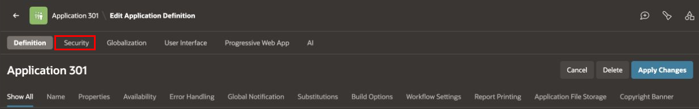

4. Click **Session Management**.

    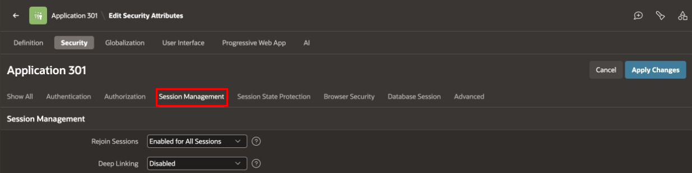

5. Set **Rejoin Sessions** to **Enabled for All Sessions**.

    If this value is rejected, ask your facilitator to complete the instance prerequisite before continuing.

    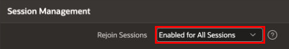

6. Set **Deep Linking** to **Enabled**.

    

7. Click **Browser Security**.

8. Set **Embed in Frames** to **Deny**.

9. Click **Apply Changes**.

10. Click the **Shared Components** icon.

    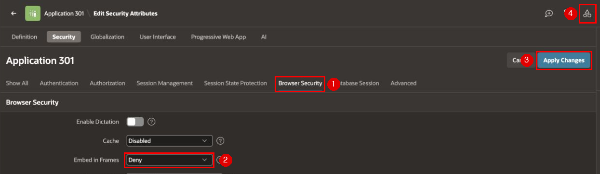

11. Under **User Interface**, click **Progressive Web App**.

12. Click **Installability**.

13. Under **Installability**, locate **Shortcuts**.

    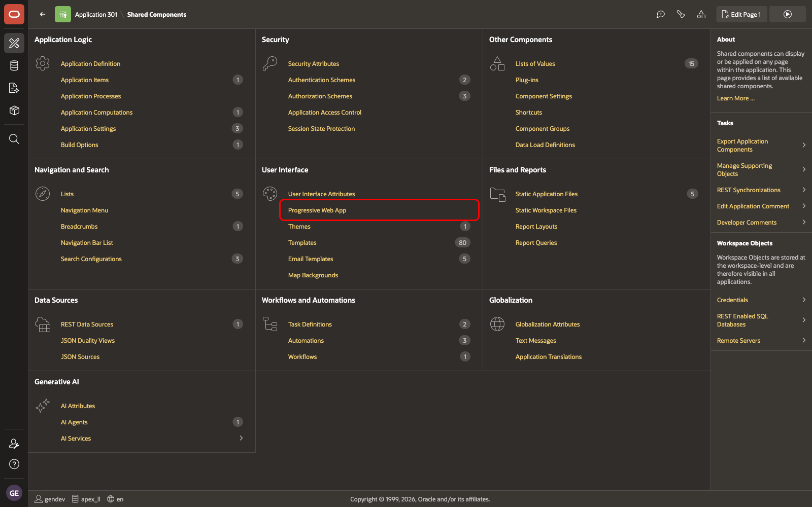

    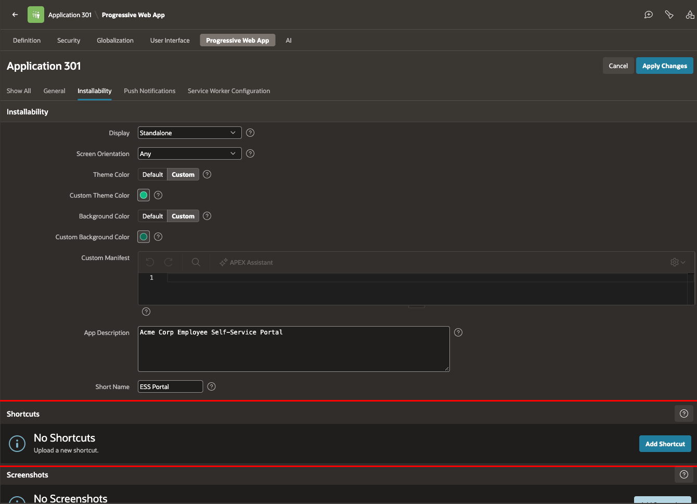

## Task 2: Add the My Tasks Shortcut

> **Note:** The page numbers shown in Tasks 2 through 4 can differ between workspaces. In each **Target URL** dialog, select the page with the specified name.

1. Click **Add Shortcut**.

    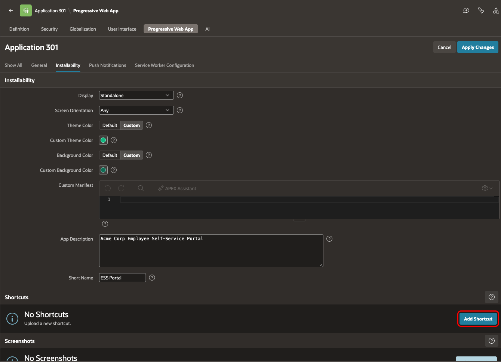

2. Enter:

    | Property | Value |
    | --- | --- |
    | Name | `My Tasks` |
    | Target URL | Select **My Onboarding Tasks** |
    | Sequence | `10` |
    | Description | `View my onboarding tasks` |

    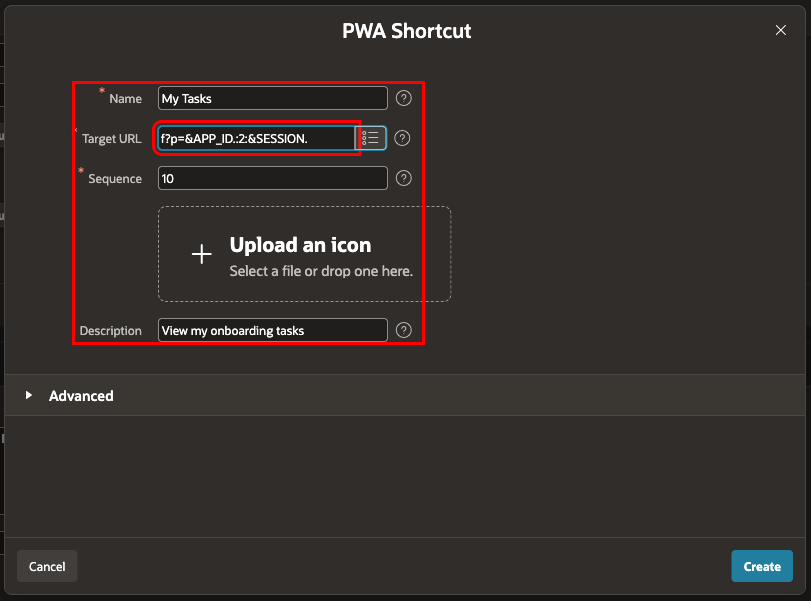

    For **Target URL**:

    - Click the selection button.
    - In the **Search** dialog, enter `My Onboarding Tasks`.
    - Click **Search**.
    - Select **My Onboarding Tasks**.

    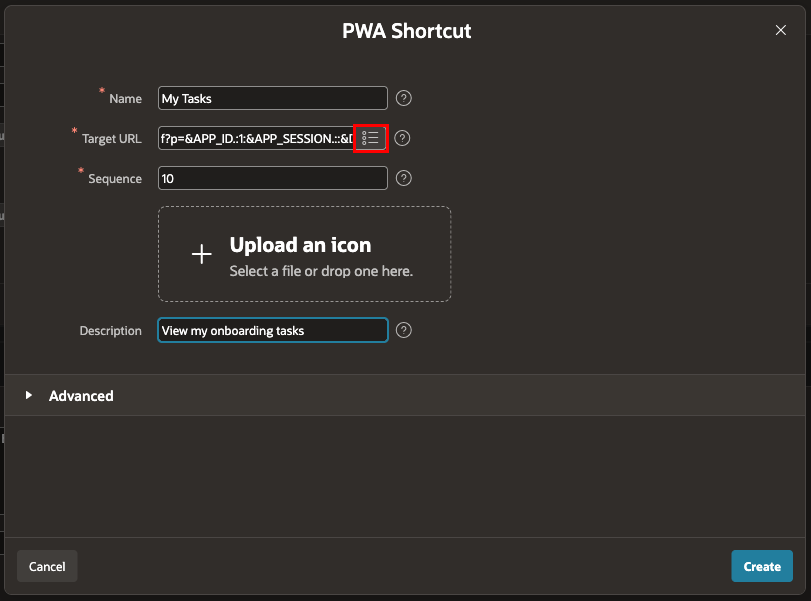

    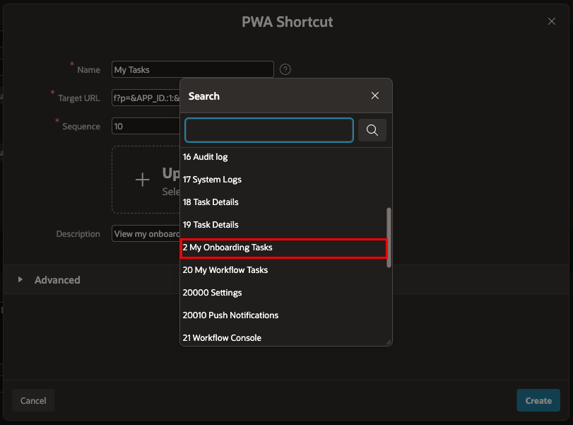

3. Click **Create**.

4. Verify that the shortcut appears in **Shortcuts**.

    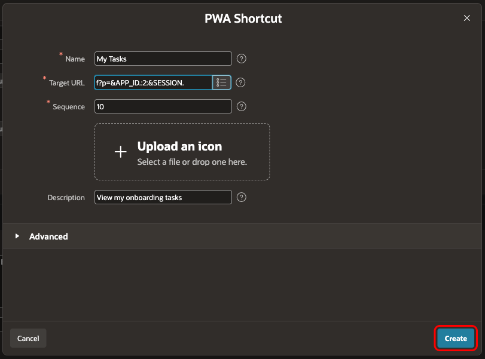

## Task 3: Add the Apply for Leave Shortcut

1. Click **Add Shortcut** again.

    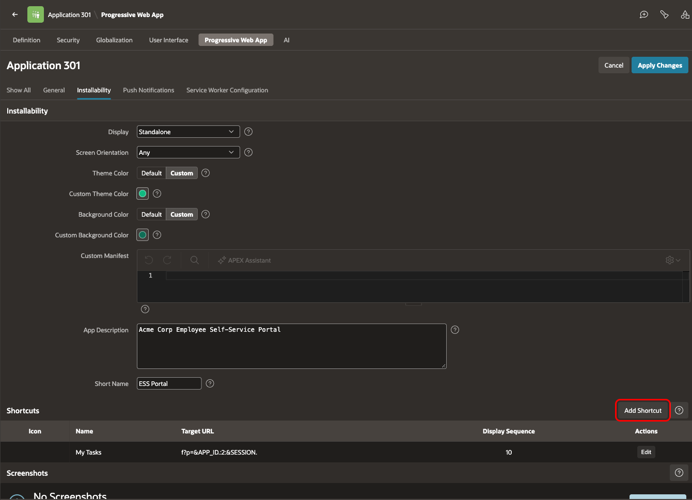

2. Configure:

    | Property | Value |
    | --- | --- |
    | Name | `Apply for Leave` |
    | Target URL | Select **Leave Request** |
    | Sequence | `20` |
    | Description | `Submit a leave request` |

    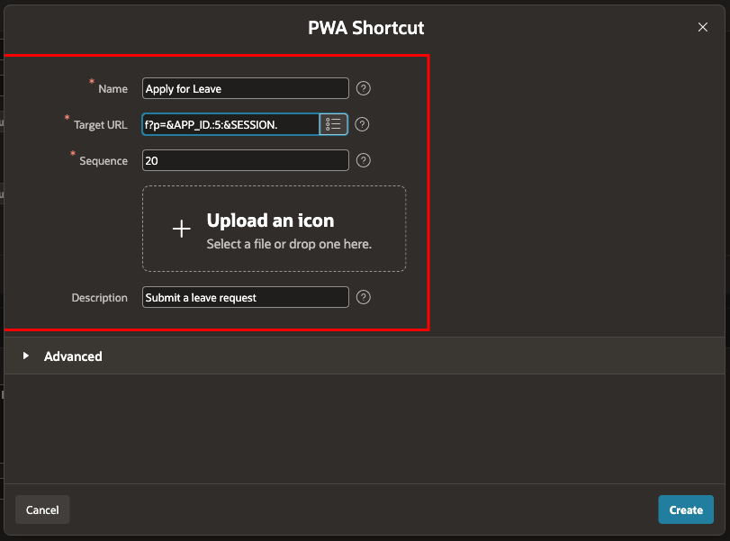

    For **Target URL**:

    - Click the selection button.
    - In the **Search** dialog, enter `Leave Request`.
    - Click **Search**.
    - Select **Leave Request**.

    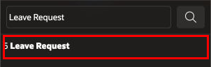

3. Click **Create**.

    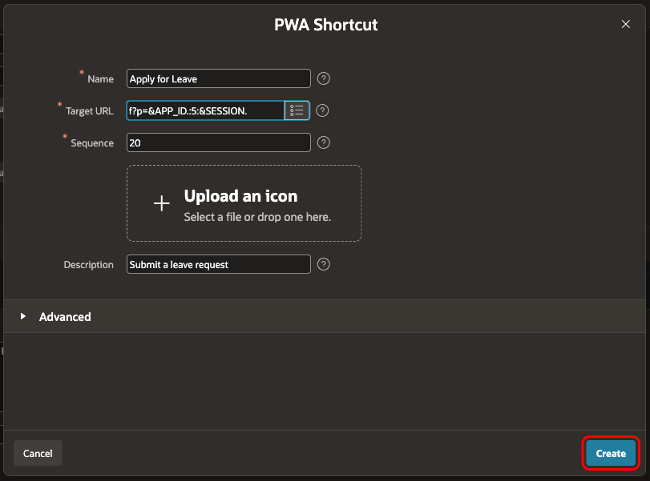

## Task 4: Add the My Payslip Shortcut

1. Click **Add Shortcut**.

    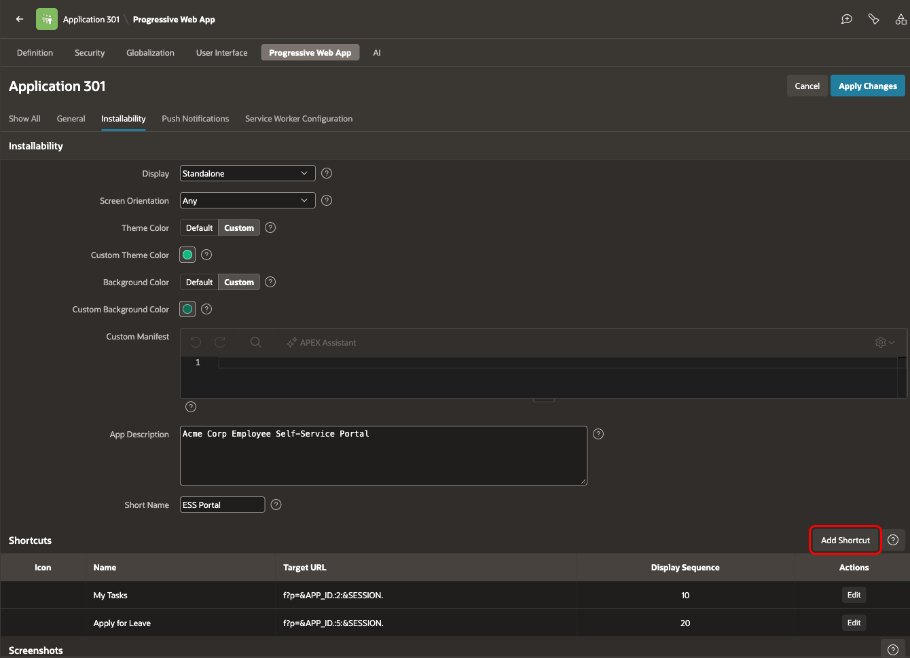

2. Configure:

    | Property | Value |
    | --- | --- |
    | Name | `My Payslip` |
    | Target URL | Select **My Payslip** |
    | Sequence | `30` |
    | Description | `View my payslip` |

    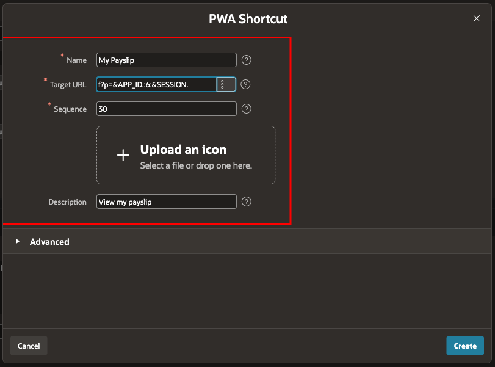

    For **Target URL**:

    - Click the selection button.
    - In the **Search** dialog, enter `My Payslip`.
    - Click **Search**.
    - Select **My Payslip**.

    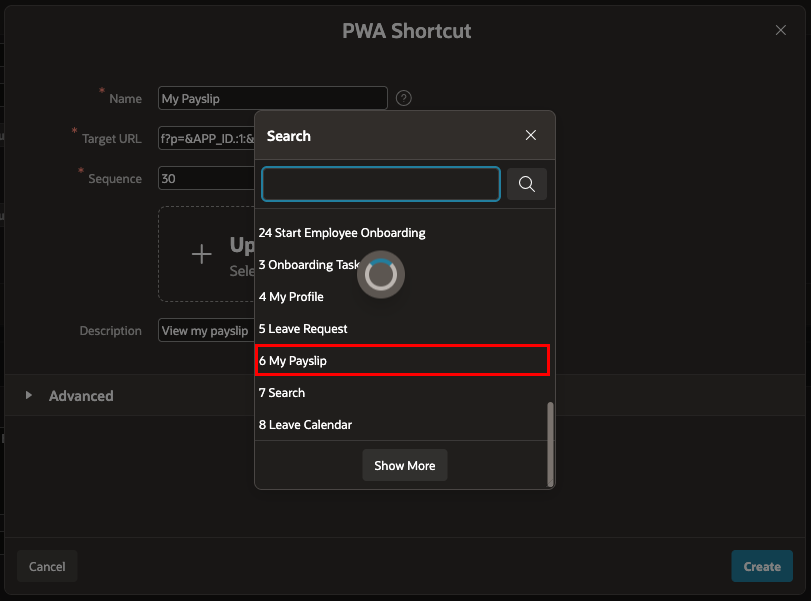

3. Click **Create**.

4. Verify that the shortcuts appear in this sequence: **My Tasks**, **Apply for Leave**, **My Payslip**.

    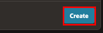

    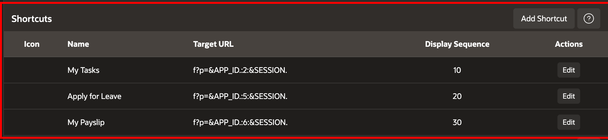

## Task 5: Add PWA Installation Screenshots

1. Run **Employee Self-Service Portal** from App Builder. Sign in as the employee user and open **Home**.

    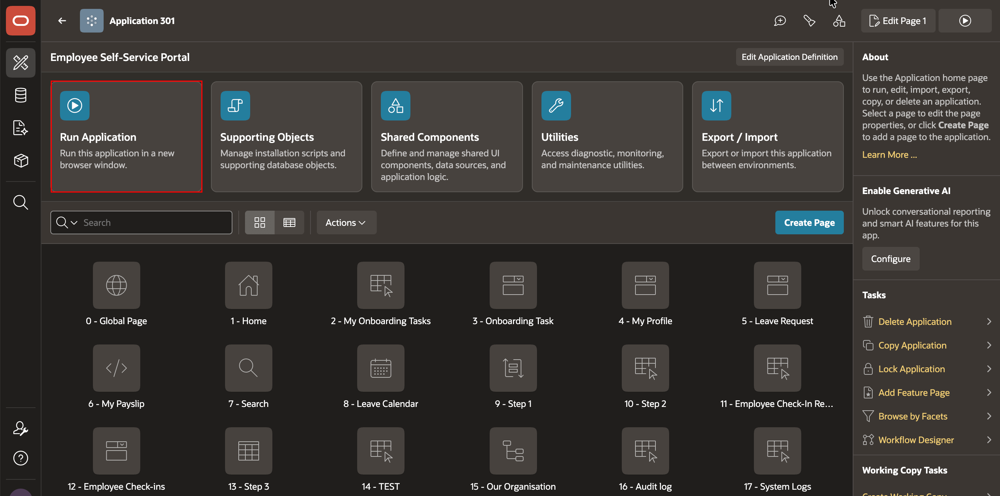

2. In Chrome, right-click the application and click **Inspect**.

3. In Developer Tools, click **Toggle device toolbar**. Select **Responsive**, then set the width to **390** and the height to **844**.

    

4. On the device toolbar, open **More options**. Select **Add device pixel ratio**, then set **DPR** to **1**. This makes the screenshot dimensions match the viewport dimensions.

    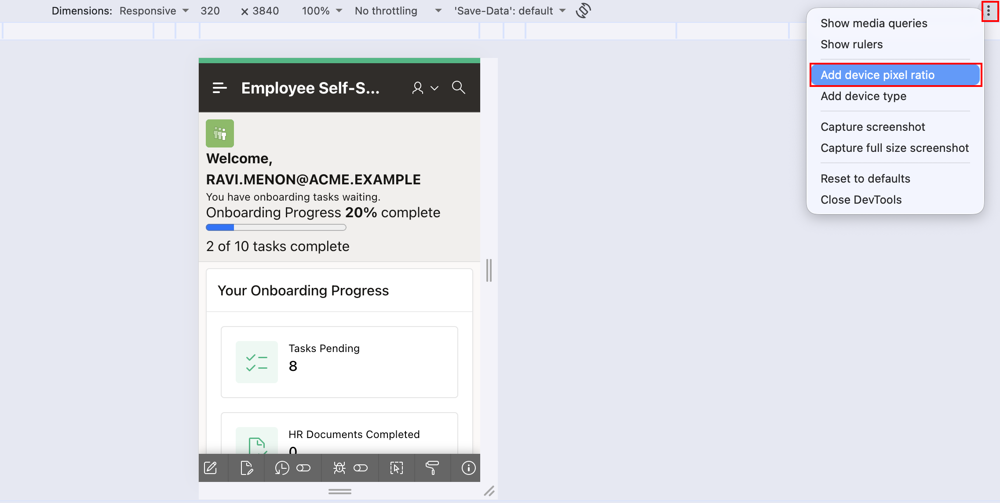

5. With **Home** open, select **More options**, then select **Capture screenshot**. Rename the downloaded PNG to `ess-home-narrow.png`.

    Use **Capture screenshot**, which captures the current viewport, rather than **Capture full size screenshot**.

    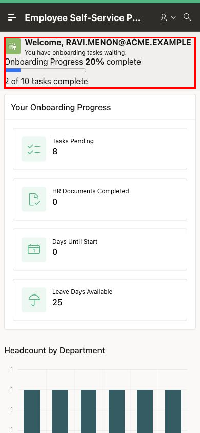

6. Open **Main Navigation**. Expand **My Work**, then click **My Onboarding Tasks**.

7. Keep the viewport at **390 × 844**. Select **More options**, then select **Capture screenshot**. Rename the downloaded PNG to `ess-my-tasks-narrow.png`.

    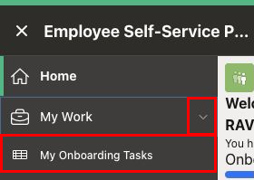

    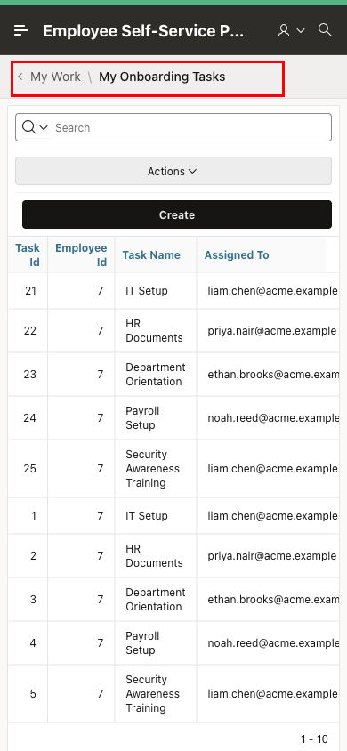

> **Note:** Both images must have the same aspect ratio. Each dimension must be between **320 and 3840 pixels**. PNG, JPG, and JPEG are supported. Exclude browser tabs, Developer Tools, desktop folders, and loading indicators from the uploaded images.

Prepared runtime screenshots are also available: [ESS Home screenshot](../0-introduction/files/ess-home-narrow.png) and [My Tasks screenshot](../0-introduction/files/ess-my-tasks-narrow.png). Save each file with its supplied filename. Both files are **390 × 844 pixels**. These runtime files are separate from the annotated App Builder screenshots in this lab.

8. Return to **Progressive Web App**. Under **Installability**, locate **Screenshots**.

    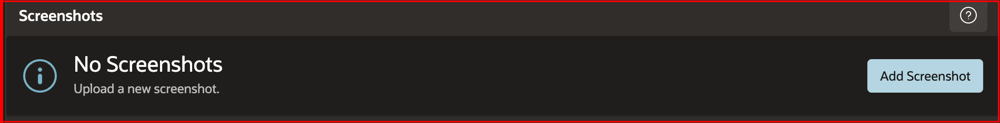

9. Click **Add Screenshot**. Enter/select the following:

    | Property | Value |
    | --- | --- |
    | Description | `ESS Home` |
    | Upload a Screenshot | `ess-home-narrow.png` |
    | Form Factor | Narrow |
    | Sequence | `10` |

    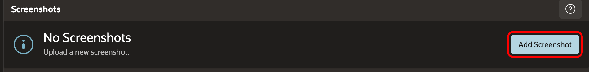

    

10. Click **Upload a Screenshot**. Select `ess-home-narrow.png`, then click **Open**.

11. Click **Create**.

12. Click **Add Screenshot**. Enter/select the following:

    | Property | Value |
    | --- | --- |
    | Description | `My Tasks` |
    | Upload a Screenshot | `ess-my-tasks-narrow.png` |
    | Form Factor | Narrow |
    | Sequence | `20` |

    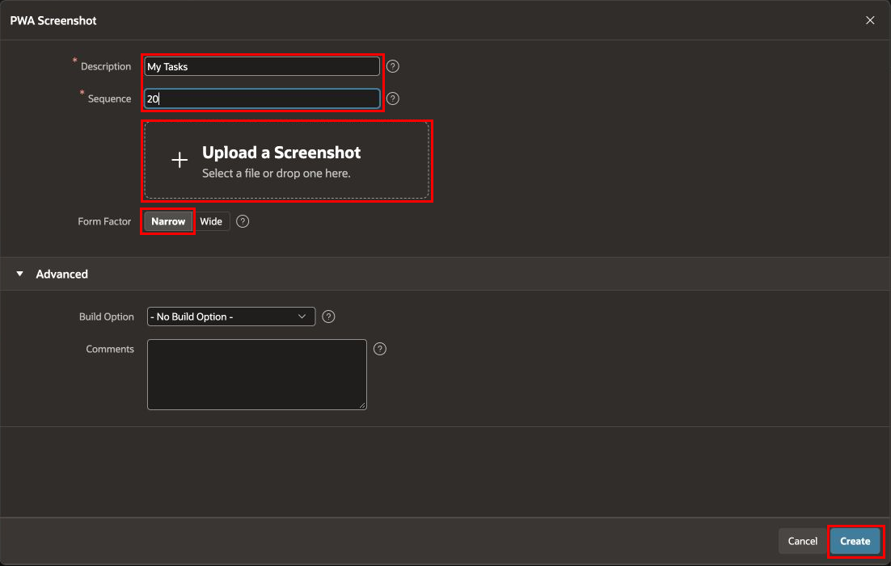

13. Click **Upload a Screenshot**. Select `ess-my-tasks-narrow.png`, then click **Open**.

14. Click **Create**.

15. Click **Apply Changes** to save the application settings.

    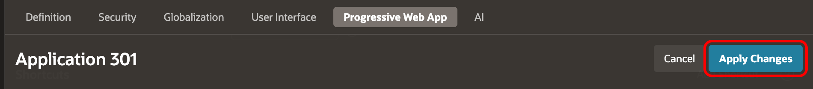

## Task 6: Test the Installed Shortcuts

1. Close and reopen the installed ESS application to allow its browser to refresh the application metadata.

    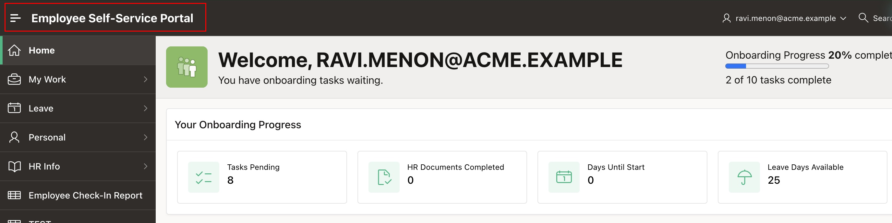

2. On a device that supports PWA shortcuts, open the installed application's shortcut menu:

    - On a mobile device, long-press the installed **Employee Self-Service Portal** icon.
    - On a desktop, right-click its icon in the taskbar or application launcher.

> **Note:** Use the installed application's shortcut menu, not a downloaded file's context menu. Shortcut support varies by browser and operating system. Use the supported test device supplied by your facilitator if the menu is unavailable.

3. Verify that **My Tasks**, **Apply for Leave**, and **My Payslip** appear in the shortcut menu.

4. Open **My Tasks**. Verify that **My Onboarding Tasks** appears.

    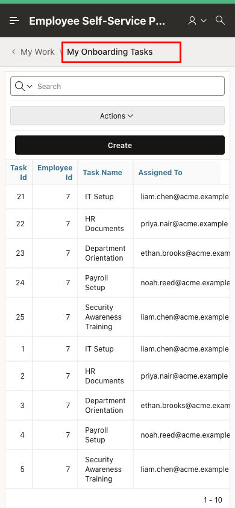

5. Open **Apply for Leave**. Verify that the **Leave Request** page appears.

    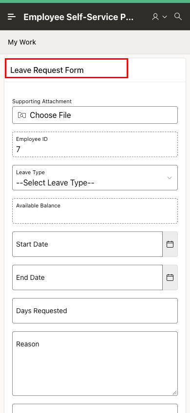

6. Open **My Payslip**. Verify that the **My Payslip** page appears.

    Sign in as the employee when prompted. Verify each destination page heading rather than accepting a return to **Home**.

    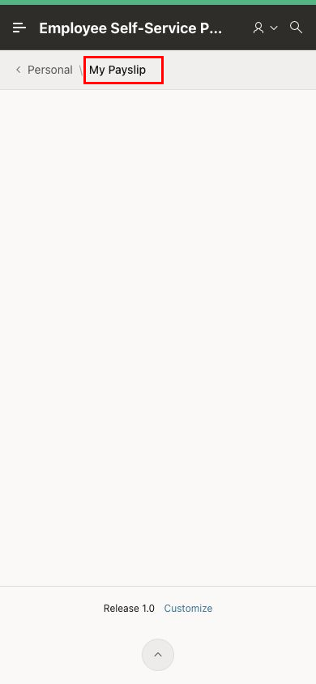

7. On a browser that displays PWA installation screenshots, open the installation prompt.

8. Verify the **ESS Home** and **My Tasks** images.

> **Note:** If ESS is already installed, use a separate supported test device or browser profile for this check. A browser that omits promotional screenshots cannot verify this part of the lab.

## Summary

In this lab, you configured session management for shortcut navigation, added three shortcuts to existing employee pages, and uploaded two Narrow screenshots with matching dimensions. You also checked shortcut destinations with an existing session and after employee sign-in.

## Learn More

- [Creating a Progressive Web App](https://docs.oracle.com/en/database/oracle/apex/26.1/htmdb/creating-a-progressive-web-app.html)
- [Configuring Security Attributes](https://docs.oracle.com/en/database/oracle/apex/26.1/htmdb/configuring-security-attributes.html)

## Acknowledgements

- **Author** - Shanmukh Kornana, Principal Product Manager; Roopesh Thokala, Principal Product Manager
- **Last Updated By/Date** - Roopesh Thokala, October 2026
