# Verify ESS on Mobile and Review APEX To Go

## Introduction

In this lab, you will inspect the existing ESS pages in mobile view and tour Oracle APEX To Go as an end user in mobile view.

Estimated Lab Time: 7 minutes

### Objectives

In this lab, you will:

- Inspect ESS using Chrome's device emulation.
- Check navigation, reports, forms, and the calendar in mobile view.
- Tour the Oracle APEX To Go welcome screens and application home page in mobile view.

### Prerequisites

- Complete Labs 1–3 and have an employee account for ESS.
- Use Chrome to inspect the existing Home, My Onboarding Tasks, Leave Request, and Leave Calendar pages.

## Task 1: Open ESS in Mobile View

1. In your workspace, open **Employee Self-Service Portal**.

2. Click **Run Application** to open ESS in Chrome.

    

3. Sign in as an employee user.

    

4. On the ESS Home page, right-click the **Your Onboarding Progress** heading. Select **Inspect**.

    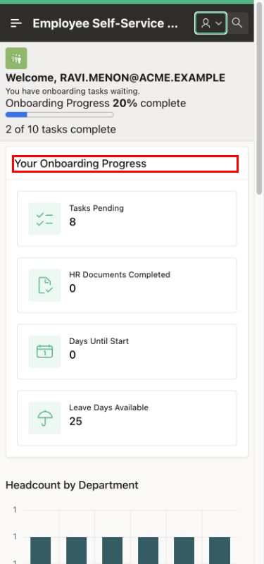

    

5. In Developer Tools, click **Toggle device toolbar**.

    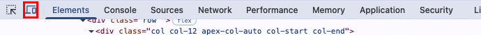

6. On the device toolbar, select **Dimensions**, then select **Responsive**.

7. Enter **390** for the width and **844** for the height. Press **Enter** after each value. Keep these dimensions for the remaining page checks.

    

## Task 2: Verify ESS Home

1. Click **Main Navigation**.

2. Click **Home**.

    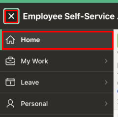

3. Verify the ESS Home layout:

    - The onboarding cards stack vertically.
    - The card text is readable.
    - Regions do not overlap.
    - The application title and welcome heading are not clipped.
    - The page does not require horizontal scrolling.

    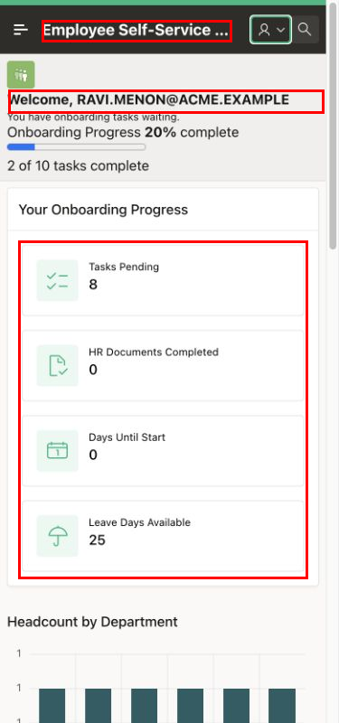

4. Click the **user account** icon in the application header. Then click **Settings**.

    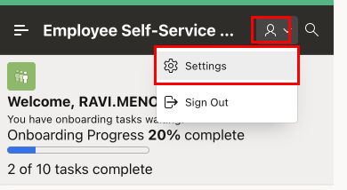

5. Verify that the Settings dialog fits the mobile view and that its controls are accessible. Click **Close** to return to ESS Home.

    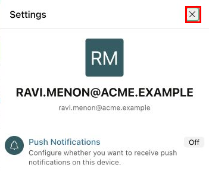

## Task 3: Verify My Onboarding Tasks

1. Click **Main Navigation**.

2. Click the arrow beside **My Work** to expand it.

3. Click **My Onboarding Tasks**.

    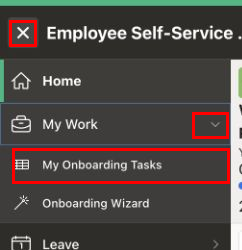

4. Read the **Task Name** column.

    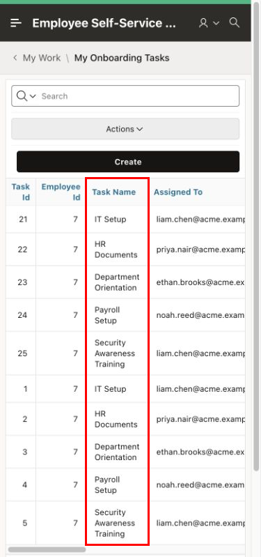

5. Swipe left inside the report, or move its horizontal scrollbar to the right, to reveal **Due Date** and **Status**.

6. Verify that the values are readable and that the application header remains visible while the report scrolls.

    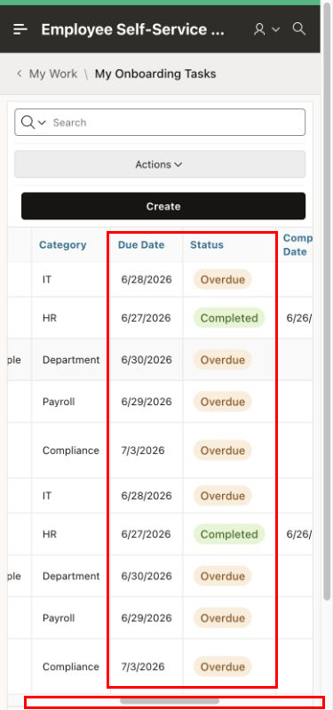

7. Click **Create** to open the **Onboarding Task** dialog.

    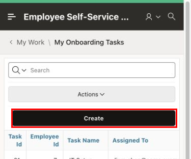

8. Verify that the dialog fields stack vertically and that its action buttons are accessible. Click **Cancel** to return to the report.

    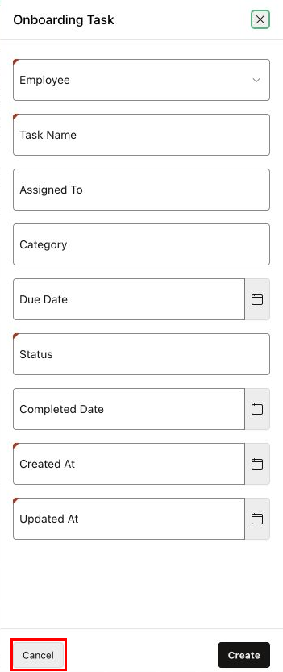

## Task 4: Verify Leave Request

1. Click **Main Navigation**.

2. Expand **Leave**.

3. Click **Leave Request**.

    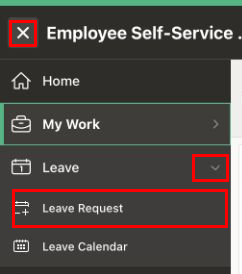

> **Note:** If a load error appears, click **OK** and record it as **Needs Fix**. Continue with the layout checks if the form is accessible. Verify the complete form again after the error is resolved.

4. Click the calendar icon beside **Start Date**. Verify that the date picker fits the mobile view, then press **Escape** to close it.

    

5. Scroll to reach the lower fields and buttons. Verify the following:

    | Field or control | What to check |
    | --- | --- |
    | Leave Type | The list opens and its options are readable. |
    | Start Date and End Date | The inputs and calendar icons are accessible. |
    | Reason | The text area fits the available space. |
    | Submit Leave | The button is visible when you scroll to the bottom of the form. |

    

6. Enter **Mobile layout check** in **Reason**.

7. Verify that the text remains inside the field and that **Cancel** and **Submit Leave** are visible. Click **Cancel** to return to ESS Home.

    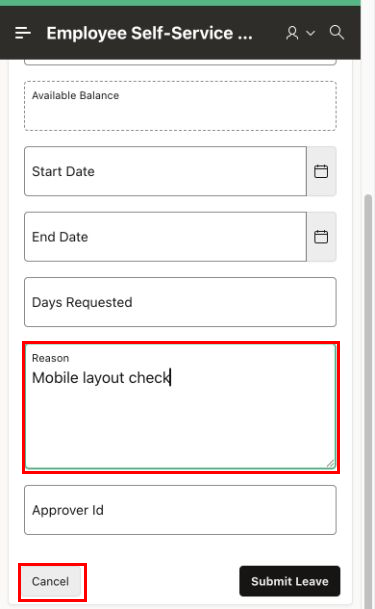

## Task 5: Verify Leave Calendar

1. Click **Main Navigation**.

2. Expand **Leave**.

3. Click **Leave Calendar**.

    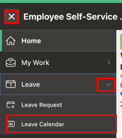

2. In **month** view, check that the month heading, weekday labels, date cells, and navigation buttons fit the mobile view.

    

4. Click **Previous** to move to the previous month.

    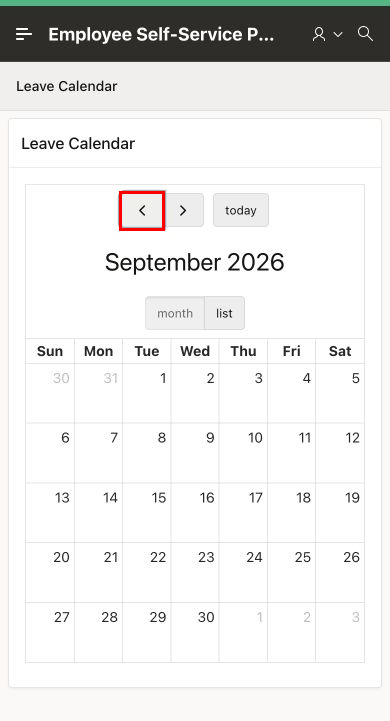

5. Click **Next** to move to the next month. Verify that the month heading changes.

    

6. Click **today** to return to the current month.

7. Click **list**. Compare the list with **month** view.

8. If leave events are present, verify that their dates and labels are readable. If the calendar shows **No events to display**, record event visibility as **Not Tested**. Repeat this check later for a period containing an employee leave event.

9. Click **month** to return to the calendar grid.

    

## Task 6: Tour Oracle APEX To Go in Mobile View

1. Open [Oracle APEX To Go](https://apex.oracle.com/go/apextogo) in a new tab.

2. In the device toolbar, select **Responsive**. Set the width to **390** and the height to **844**.

3. On the **Welcome** screen, click **Next** to continue the tour.

    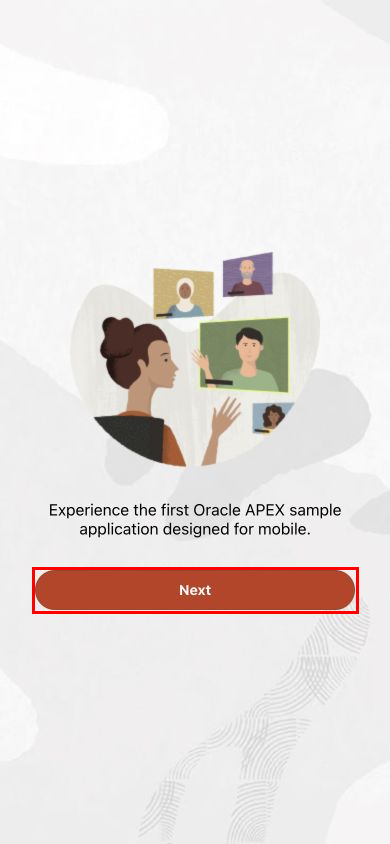

2. On **Discover**, read the introduction to the mobile patterns available in the sample application. Click **Next** to continue.

    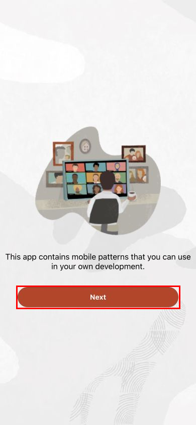

3. On **Get Started**, click **Go!** to continue to the application. Sign in if prompted.

    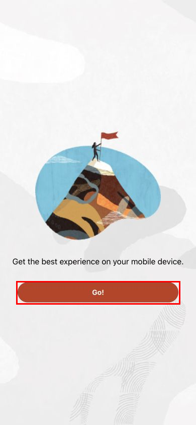

4. Explore the **APEXToGo** home screen in mobile view.

    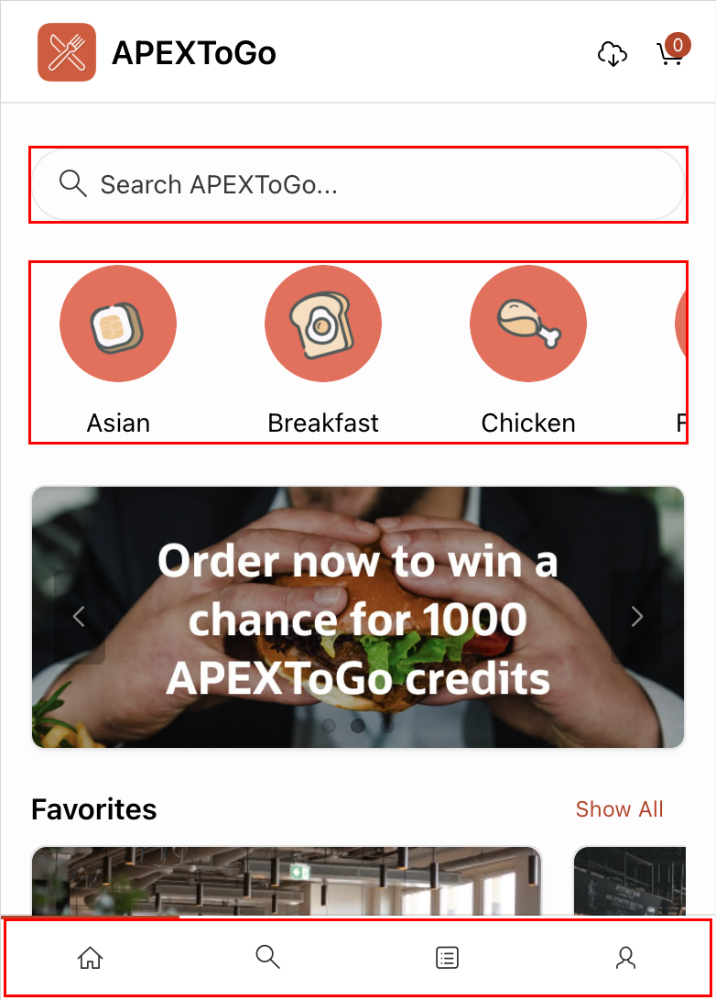

## Summary

You reviewed ESS navigation, cards, report scrolling, form controls, and calendar views in mobile view. You also toured the Oracle APEX To Go welcome screens and application home page in mobile view.

## Learn More

- [Creating Applications for Mobile Devices](https://docs.oracle.com/en/database/oracle/apex/26.1/htmdb/creating-applications-for-mobile-devices.html)
- [Oracle APEX To Go](https://apex.oracle.com/go/apextogo)
- [Simulate Mobile Devices with Device Mode](https://developer.chrome.com/docs/devtools/device-mode)

## Acknowledgements

- **Author** - Shanmukh Kornana
- **Last Updated By/Date** - Shanmukh Kornana, October 2026
