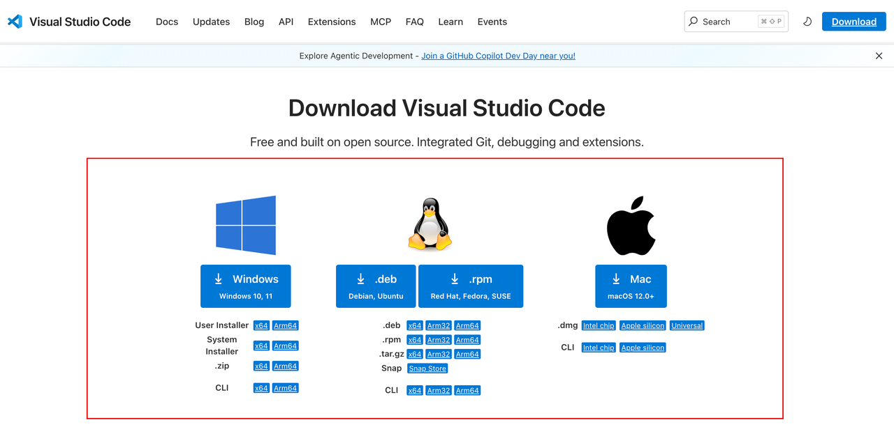
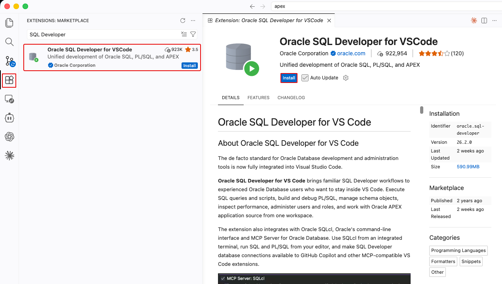
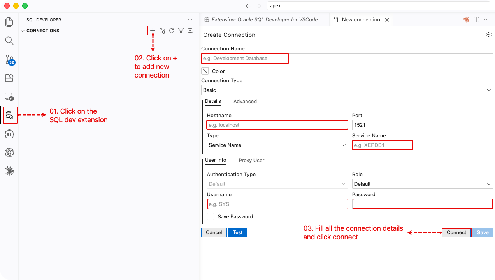
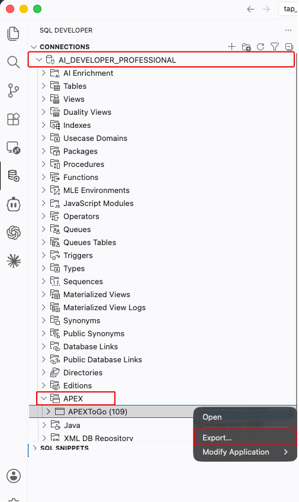
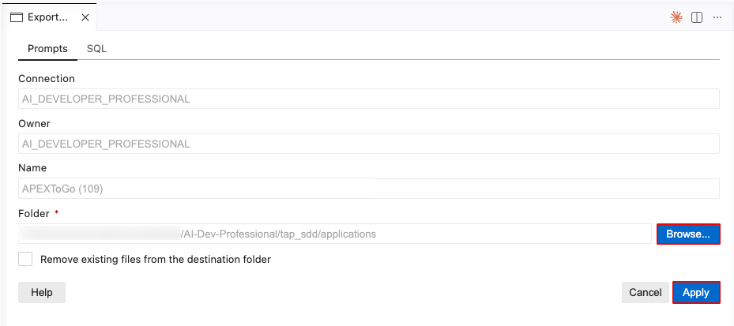
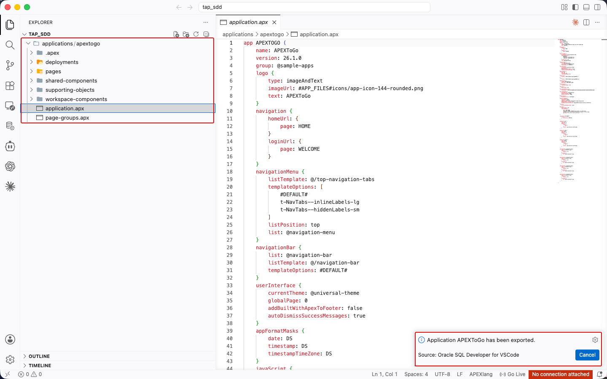
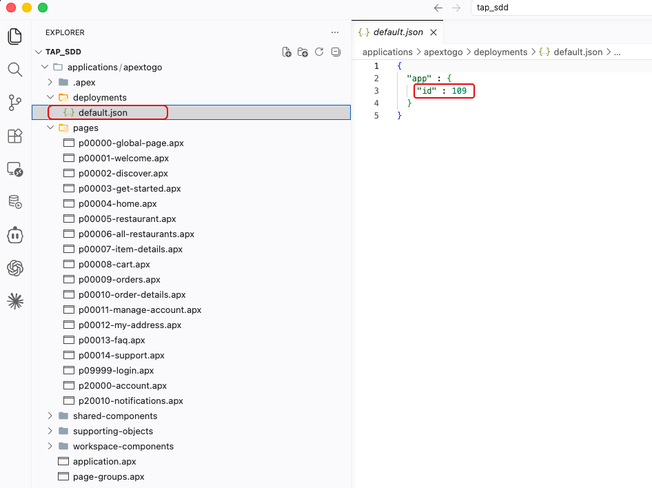
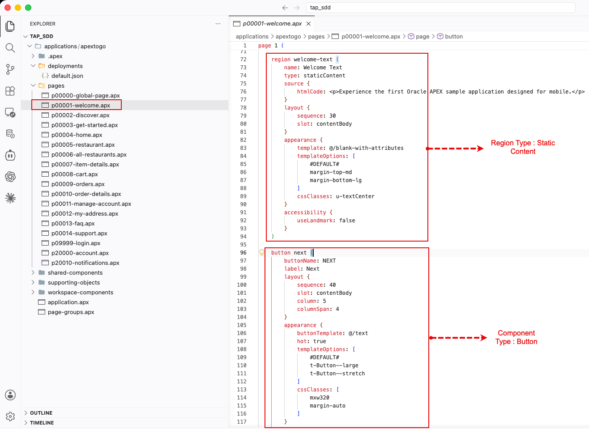

# Export and Inspect an Application with APEXlang

## Introduction

APEXlang stores an Oracle APEX application in readable `.apx` source files. In this lab, you export the APEXToGo sample application from Module 3 and inspect its project files before scaffolding TAP.

Estimated Lab Time: 15 minutes

### Objectives

In this lab, you will learn how to:

- Export an existing APEX application in APEXlang format.
- Find the application, page, and shared-component source files.
- Inspect APEXlang component definitions in Visual Studio Code.

### Prerequisites

- Access to a database that supports direct connections from Oracle SQL Developer for VS Code.
- Complete **Task 3: Install and Explore a Gallery Sample Application** in [Module 3: APEX Components Overview](https://roopeshthokala.github.io/livelabs_qa/apex-ai-hol3/workshops/tenancy/index.html) to install **APEXToGo**.

## Task 1: Set Up Visual Studio Code

> **Free Developer Tier:** Direct database connections from Oracle SQL Developer for VS Code are not supported for Oracle APEX Free Developer Tier workspaces. If you use this tier, you can skip this lab.

1. Open the [Visual Studio Code download page](https://code.visualstudio.com/Download) in a web browser.

    

2. Download the installer for your operating system: Windows, macOS, or Linux.

3. Run the installer and follow the installation steps.

    

4. In **Visual Studio Code**, open **Extensions**.

5. Search for **Oracle SQL Developer for VS Code**.

6. Select **Install**.

    

7. In **Oracle SQL Developer for VS Code**, open the **Connections** navigator.

8. Create a database connection for a schema associated with your APEX workspace.

    

## Task 2: Export the Application Using Oracle SQL Developer for VS Code

1. In the **Connections** navigator, expand your database connection.

2. Expand the **APEX** application node.

3. Right-click **APEXToGo**.

4. Select **Export…**.

    

5. Create a local folder named `applications` for the exported source files.

6. In the export dialog, select **Browse…**.

7. Select the `applications` folder as the destination.

8. Select **Apply**.

    

9. Wait for the export to complete.

10. Confirm that the exported application folder appears under `applications`.

    

## Task 3: Review the Exported Project

1. In **Visual Studio Code**, expand the exported application folder.

2. Expand the **deployments** folder.

3. Open **default.json**.

4. Review the exported application's **Application ID**.

    > **Note:** To import the project as a new application, change the Application ID and save the file. Importing with the existing Application ID replaces that application.

    

5. Expand the **pages** folder.

6. Open **p00001-welcome.apx**.

7. Inspect the regions, buttons, and other APEX components in the page definition.

8. Explore the other folders and pages to review the application structure.

    

9. Keep the exported project for reference. In later modules, you export the TAP application built with the **Create App Wizard** to this format.

## Summary

You exported APEXToGo in APEXlang format and reviewed its application configuration and page source files.

### Acknowledgements

- **Author** - Aravind Madhavan, Senior Product Manager; Roopesh Thokala, Principal Product Manager
- **Last Updated By/Date** - Roopesh Thokala, Principal Product Manager, October 2026
