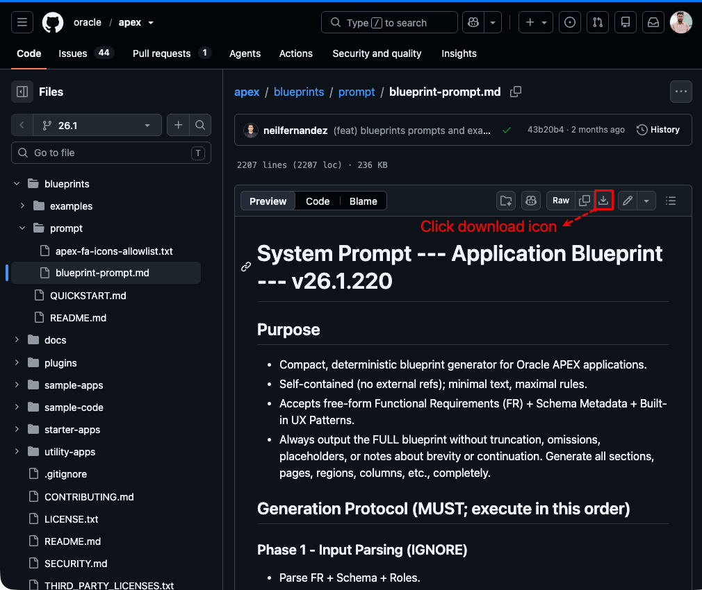
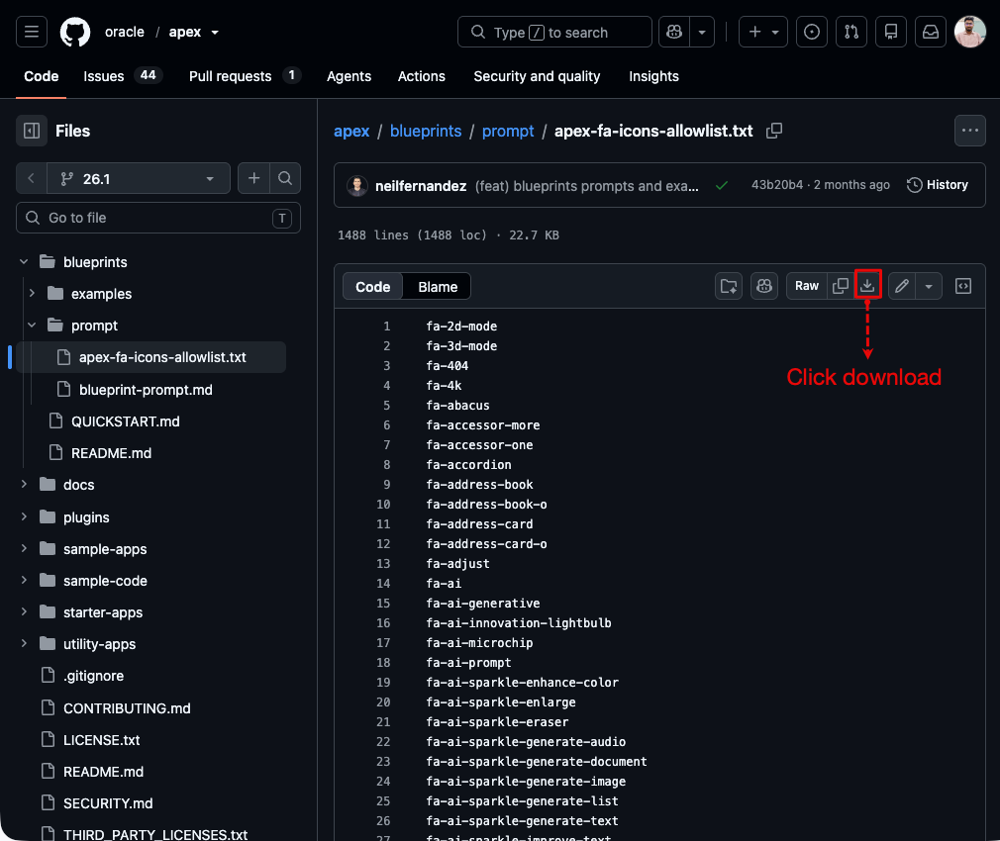
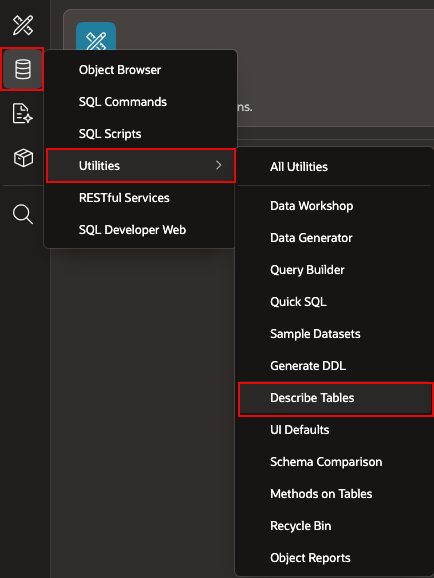
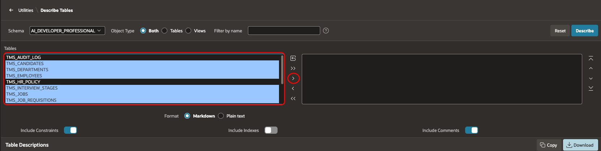
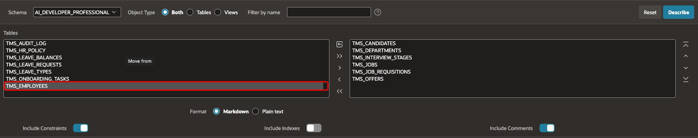
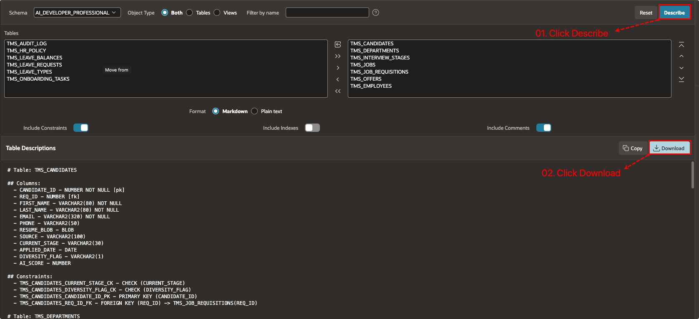
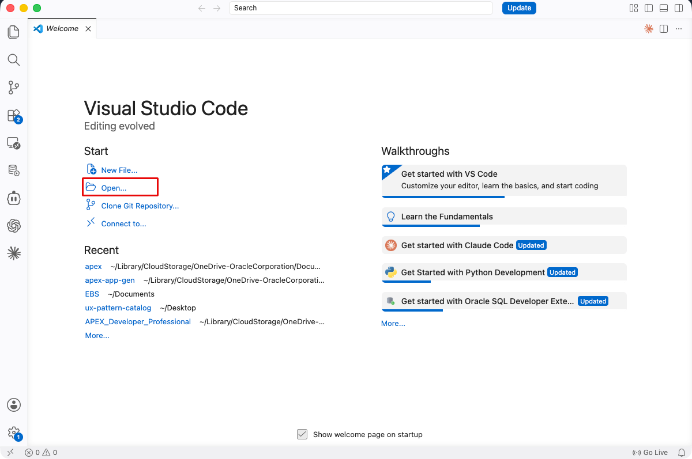
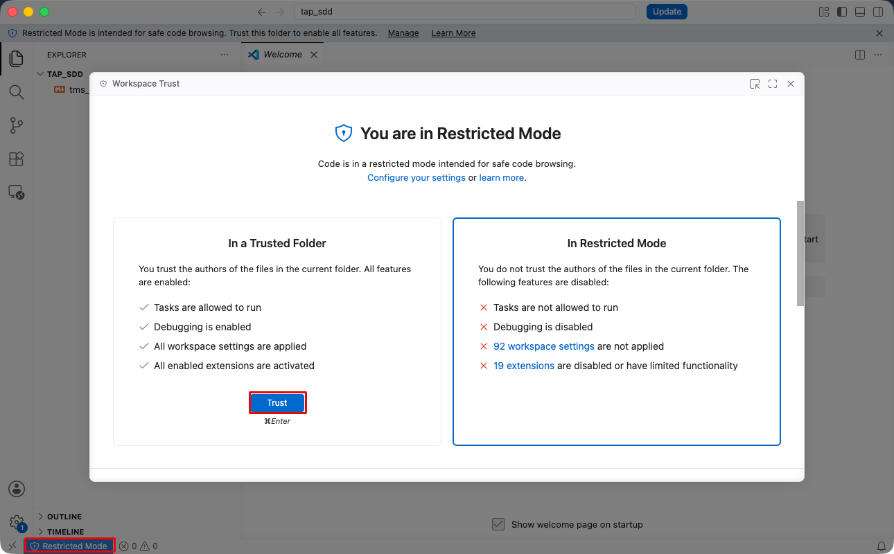
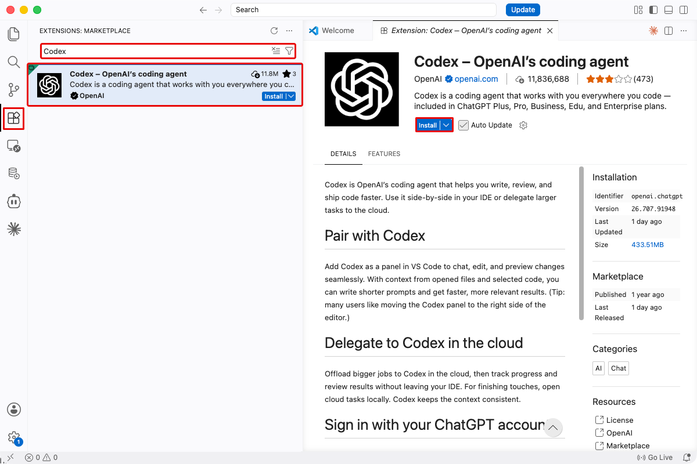
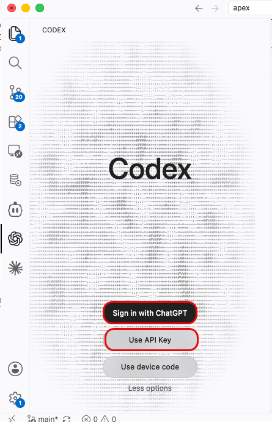

# Set Up the Artifacts for Spec-Driven Development

## Introduction

A spec-driven development (SDD) workflow uses a functional specification, schema metadata, and rules for the generated application. In this lab, you create a TAP project folder, collect these files, and prepare a coding agent to use them.

Estimated Lab Time: 20 minutes

### Objectives

In this lab, you will learn how to:

- Prepare a local folder for the TAP SDD artifacts.
- Download the Blueprint Prompt and allowed-icons list.
- Describe the TAP and shared TMS tables to create schema metadata.
- Prepare a coding agent to generate the blueprint.

### Prerequisites

- Complete Lab 1.
- Complete [Module 2: Using SQL Workshop to Build a TMS Schema](https://roopeshthokala.github.io/livelabs_qa/apex-ai-hol2/workshops/tenancy/index.html). This lab uses that schema to generate metadata.

## Task 1: Create the TAP SDD Project Folder

1. Create a local folder named **tap_sdd**.

2. Review the filenames that you use for the files collected in Tasks 2 and 3:

    - `tms_module_04_functional_spec.md`
    - `blueprint_prompt.md`
    - `apex-fa-icons-allowlist.txt`
    - `tap_schema_metadata.md`

## Task 2: Download the Blueprint Artifacts

1. Download the [Oracle APEX Blueprint Prompt](https://github.com/oracle/apex/blob/26.1/blueprints/prompt/blueprint-prompt.md) and save it as `blueprint_prompt.md` in the **tap_sdd** folder.

    

2. Download the [APEX allowed-icons list](https://github.com/oracle/apex/blob/26.1/blueprints/prompt/apex-fa-icons-allowlist.txt) and save it as `apex-fa-icons-allowlist.txt` in the **tap_sdd** folder.

    

3. Download the Module 4 <a href="tms_module_04_functional_spec.md" download="tms_module_04_functional_spec.md">TMS functional specification</a> and save it as **tms_module_04_functional_spec.md** in the **tap_sdd** folder.

4. Confirm that all three files are present before you continue.

## Task 3: Generate TAP Schema Metadata

1. In your APEX workspace, select **SQL Workshop**, select **Utilities**, and then select **Describe Tables**.

    

2. In the **Tables** shuttle, select the following tables and move them to the right:

    - **TMS\_DEPARTMENTS**
    - **TMS\_JOBS**
    - **TMS\_JOB_REQUISITIONS**
    - **TMS\_CANDIDATES**
    - **TMS\_INTERVIEW\_STAGES**
    - **TMS\_OFFERS**

    

3. Move **TMS_EMPLOYEES** to the right side of the shuttle to include the shared employee table.

    

4. For **Format**, select **Markdown**, and then select **Describe**.

5. Under **Table Descriptions**, select **Download** and save the file as **tap_schema_metadata.md** in the **tap_sdd** folder.

    

## Task 4: Set Up Your Coding Agent

1. In **Visual Studio Code**, open the **tap_sdd** folder created in Task 1.

    

2. If Visual Studio Code opens the folder in **Restricted Mode**, select **Restricted Mode** in the lower-left corner, select **Trust**, and close the workspace trust window.

    

3. In the Visual Studio Code sidebar, select **Extensions**, search for the **Codex IDE extension**, and select **Install**.

    

4. In the Visual Studio Code sidebar, select **Codex**.

    Select **Sign in with ChatGPT** and complete the sign-in steps in your browser. Alternatively, select **Use API key** and enter an OpenAI API key.

    

    > **Note:** Access to any AI Coding agent is required for the for the remaining labs in this module. We are using Codex access for the remaining labs in this module. Availability depends on your account.

## Summary

You assembled the functional specification, Blueprint Prompt, icon list, and schema metadata required to generate a TAP Application Blueprint.

### Acknowledgements

- **Author** - Aravind Madhavan, Senior Product Manager; Roopesh Thokala, Principal Product Manager
- **Last Updated By/Date** - Roopesh Thokala, Principal Product Manager, October 2026
