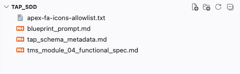
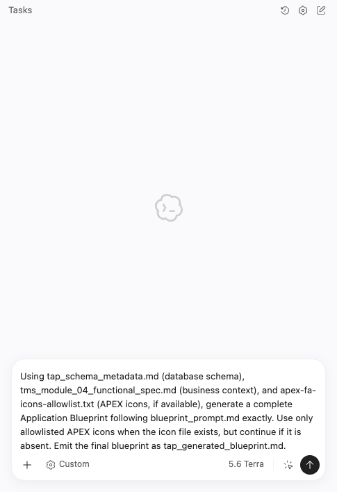
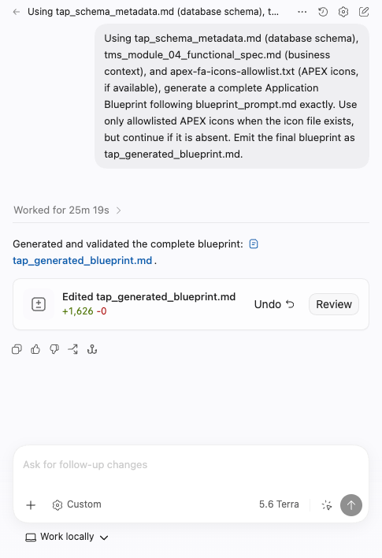
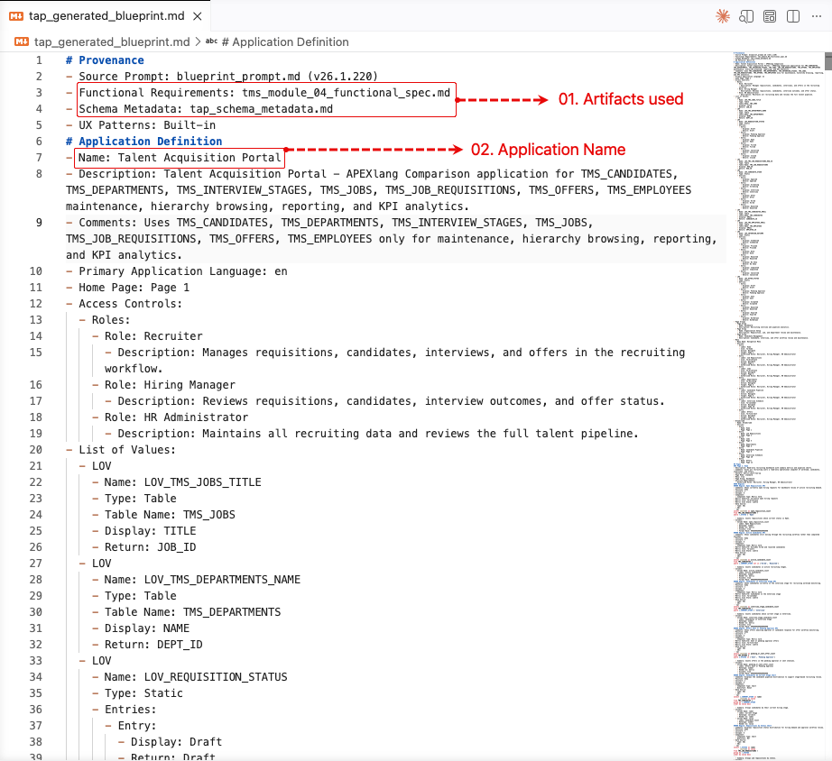
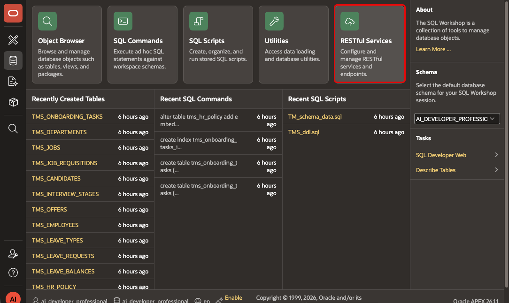
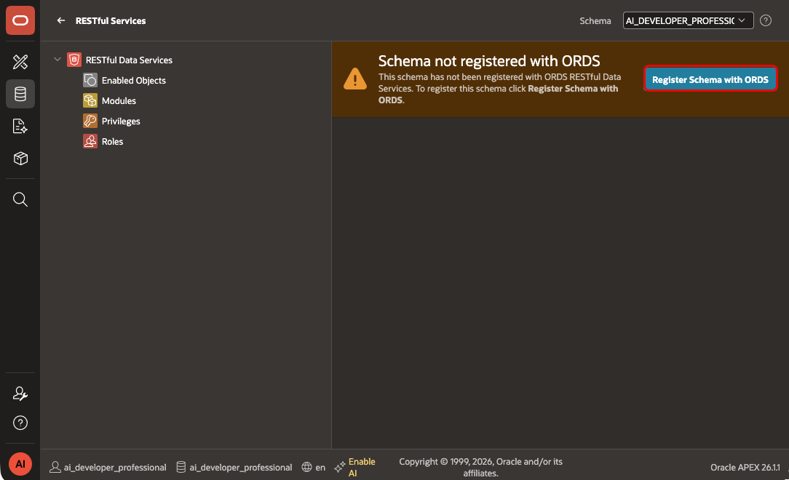
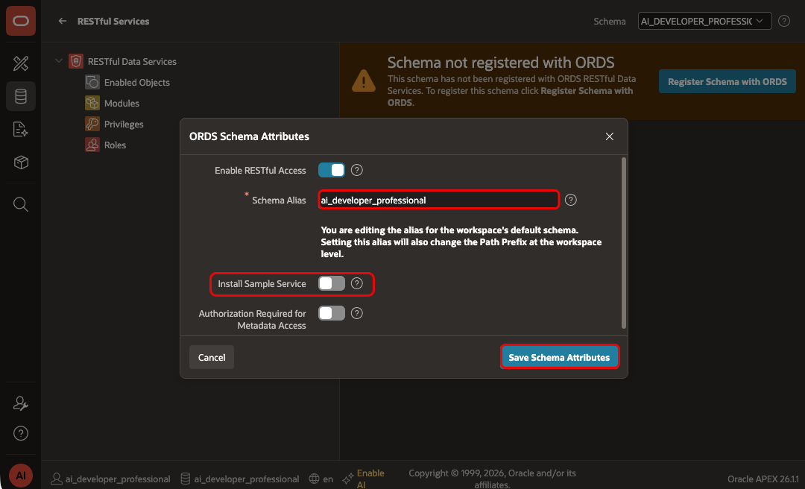

# Generate a TAP Application Blueprint with Scaffolding

## Introduction

In Lab 2, you collected the business requirements, schema metadata, and generation rules in one folder. In this lab, you use those files to generate a blueprint for the TAP comparison application.

Estimated Lab Time: 25 minutes

### Objectives

In this lab, you will learn how to:

- Review the TAP source files before you generate the blueprint.
- Prompt a coding agent to generate a blueprint from the supplied files.
- Compare the generated pages and components with the TAP requirements.

### Prerequisites

- Complete Lab 2 and sign in to Codex.

## Task 1: Review the Inputs Before Generation

1. In the `tap_sdd` folder, verify that the following files are present:

    - `tms_module_04_functional_spec.md`
    - `tap_schema_metadata.md`
    - `blueprint_prompt.md`
    - `apex-fa-icons-allowlist.txt`

    

2. Open `tms_module_04_functional_spec.md` and review the Talent Acquisition Portal requirements.

3. Open `tap_schema_metadata.md` and confirm that it contains the tables and columns referenced in the functional specification.

## Task 2: Generate the Application Blueprint

1. Give all four source files to your coding agent.

2. Submit the following prompt:

    ```text
    <copy>
    Use tap_schema_metadata.md for the database schema, tms_module_04_functional_spec.md for business context, and apex-fa-icons-allowlist.txt for icon choices. Generate a complete Application Blueprint that follows blueprint_prompt.md exactly. Use only allowlisted APEX icons. Save the final blueprint as tap_generated_blueprint.md.
    </copy>
    ```

    

3. Review each file-write request and approve it only when the agent creates or updates `tap_generated_blueprint.md` in `tap_sdd`.

4. Wait for the agent to finish writing the blueprint.

    

## Task 3: Inspect the Generated Blueprint

1. Open `tap_generated_blueprint.md`.

2. Confirm that the application name matches the functional specification: **Talent Acquisition Portal - APEXlang Comparison**. Review the pages and components to confirm that they match the TAP requirements.

    

## Task 4: Enable REST for Your Schema

Register the schema with ORDS before importing the blueprint in Lab 4.

1. In your APEX workspace, select **SQL Workshop** and then select **RESTful Services**.

    

2. Select **Register Schema with ORDS**.

    

3. In the **ORDS Schema Attributes** dialog, enter/select the following:

    - **Schema Alias:** Keep the value generated by APEX, unless your environment requires a different alias.
    - **Install Sample Service:** Set to **Off**.

4. Select **Save Schema Attributes**.

    

## Summary

You generated the TAP Application Blueprint from the supplied SDD artifacts and registered the schema with ORDS.

### Acknowledgements

- **Author** - Aravind Madhavan, Senior Product Manager; Roopesh Thokala, Principal Product Manager
- **Last Updated By/Date** - Roopesh Thokala, Principal Product Manager, October 2026
