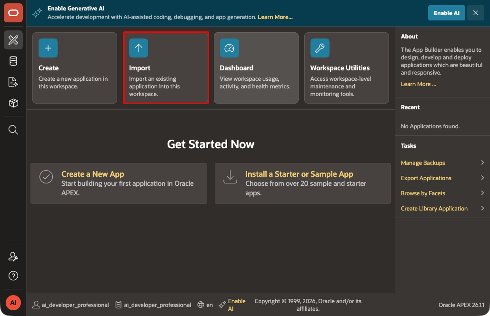
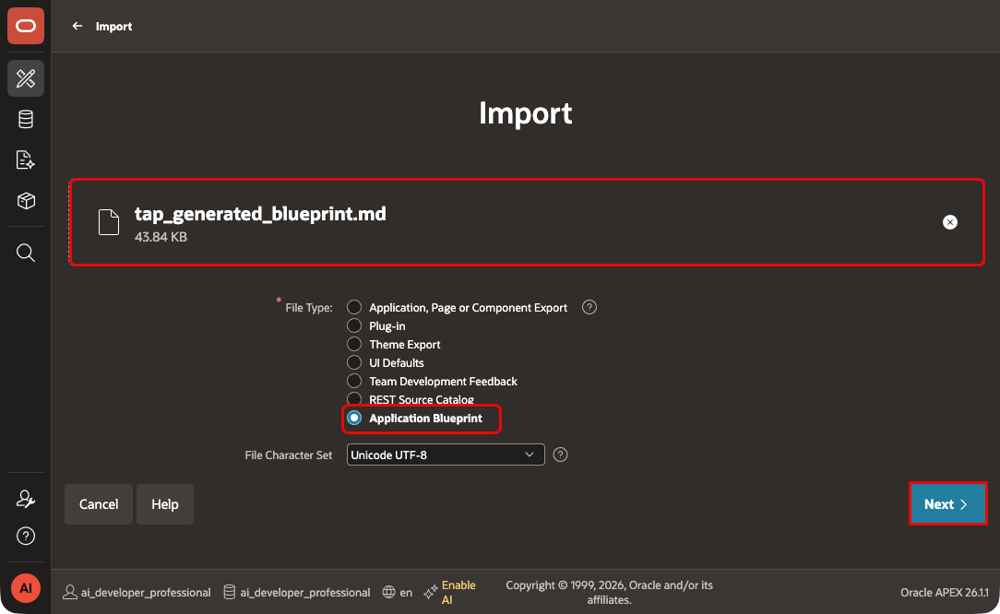
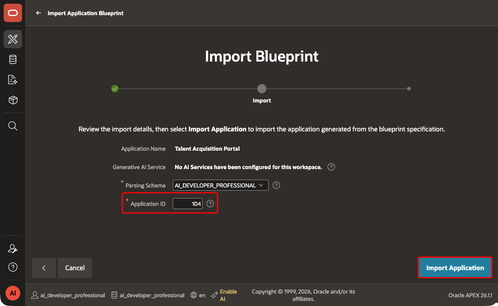
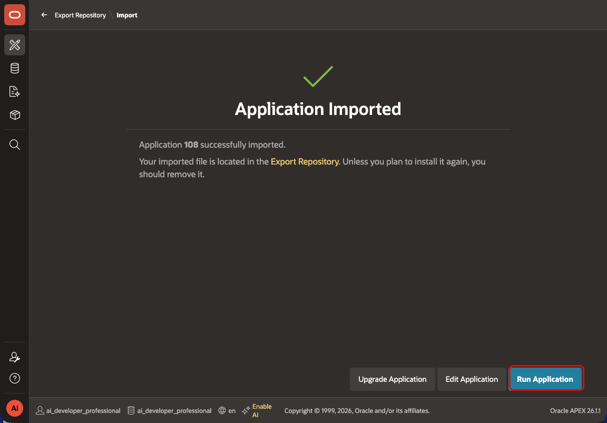
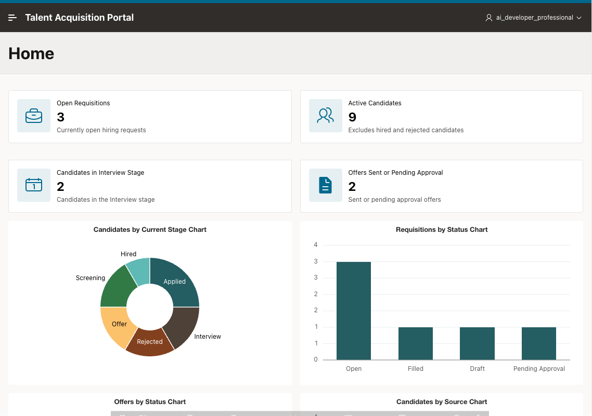

# Import and Compare the Generated TAP Blueprint

## Introduction

In this lab, you import the generated blueprint into APEX and run the TAP comparison application. You review its pages and navigation before creating the course TAP application with the **Create App Wizard** in Module 5.

Estimated Lab Time: 30 minutes

### Objectives

In this lab, you will learn how to:

- Import the generated TAP blueprint.
- Run the comparison application and inspect its pages.
- Identify the TAP application to use in later modules.

### Prerequisites

- Complete Lab 3 to generate the Application Blueprint and register the schema with ORDS.

### Downloads

- **<a href="files/tap_generated_blueprint.md" download="tap_generated_blueprint.md">TAP Application Blueprint</a>**

Save it as `tap_generated_blueprint.md` in your `tap_sdd` folder.

## Task 1: Import the Application Blueprint

1. In your APEX workspace, open **App Builder**.

2. Select **Import**.

    

3. Upload **<a href="files/tap_generated_blueprint.md" download="tap_generated_blueprint.md">TAP Application Blueprint</a>** from your `tap_sdd` folder.

4. For **File Type**, select **Application Blueprint**.

5. Verify **File Character Set**.

6. Select **Next**.

    

7. On the **Import Blueprint** page, enter/select the following:

    - **Generative AI Service:** Select the default service, if one is configured in your workspace.
    - **Parsing Schema:** Select the schema associated with your APEX workspace.
    - **Application ID:** Enter a new, unique ID outside the reserved range `3000` through `9000`.

8. Select **Import Application**.

    

9. If APEX reports blueprint errors, copy the full error log.

10. Provide the error log, generated blueprint, and four source files to the coding agent.

11. Correct the blueprint and repeat this task.

## Task 2: Run the TAP Application

1. In **App Builder**, open the imported application.

2. Select **Run Application**.

    

3. Review the generated navigation, reports, forms, and page names.

    

4. Verify that the application is focused on recruitment work: jobs, requisitions, candidates, interviews, and offers.

## Task 3: Continue with Module 5

1. Keep the imported application as a comparison reference.

2. In Module 5, create TAP with the **Create App Wizard**.

3. Use that application for the remaining modules.

4. Keep the `tap_sdd` project folder for Modules 23 and 24, where you export the TAP application and manage its source files.

## Summary

You imported and reviewed the generated TAP comparison application. Use the application created in Module 5 for the remaining modules.

### Acknowledgements

- **Author** - Aravind Madhavan, Senior Product Manager; Roopesh Thokala, Principal Product Manager
- **Last Updated By/Date** - Roopesh Thokala, Principal Product Manager, October 2026
