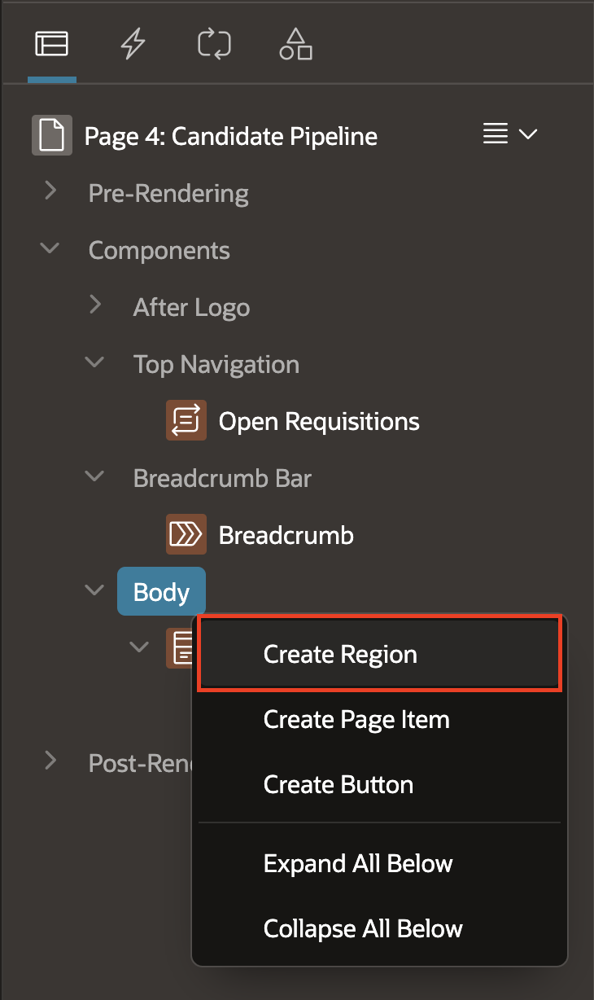

# Upgrade the Candidate Pipeline Page and Add an Interactive Report

## Introduction

Recruiters need more than a visual snapshot when they review a busy candidate pipeline. In this lab, you will add an Interactive Report alongside the existing Cards view, giving the team a dependable place to scan candidate details and export the list when needed.

Estimated Lab Time: 10 minutes

### Objectives

In this lab, you will:

- Add an Interactive Report to Candidate Pipeline.
- Populate the report from the candidate data set.
- Enable CSV, Excel, and PDF downloads.

### Downloads

Stuck or missed out on completing the previous labs? Don't worry! You can download the following application:

- **<a href="../introduction/files/tap-export2.sql" download="tap-export2.sql">Talent Acquisition Portal</a>**

Import it into your workspace. In **App Builder**, select **Import**, upload `tap-export2.sql`, and follow the steps in the **Import Application** wizard.

> **Note:**
>
> - **APEX Version:** The supplied application export was created with Oracle APEX 26.2 and cannot be imported into earlier APEX releases.
> - **Supporting Objects:** Supporting objects are already loaded in the workspace.
> - **AI Configuration:** Configure a Generative AI Service from **App Builder > Workspace Utilities > Generative AI**. See **Module 1, Lab 2: Configure Generative AI Service**.

## Task 1: Create the Candidates Interactive Report

Add the report alongside the existing Cards region.

1. In the **Talent Acquisition Portal** application, open the **Candidate Pipeline** page in Page Designer.

    > **Note:** The page number might differ. Open the page named **Candidate Pipeline**.

    

2. In the Rendering tab, right-click **Body** and select **Create Region**.

    

3. With the new region selected, enter or select the following in the Property Editor:

    - Under **Identification**:
        - **Name:** **Candidates**
        - **Type:** **Interactive Report**

    - Under **Source**:
        - **Type:** **SQL Query**
        - For **SQL Query**, enter the following:

            ```sql
            <copy>
            SELECT
                CANDIDATE_ID,
                REQ_ID,
                FIRST_NAME,
                LAST_NAME,
                FIRST_NAME || ' ' || LAST_NAME AS CANDIDATE_NAME,
                EMAIL,
                PHONE,
                SOURCE,
                CURRENT_STAGE AS STAGE,
                APPLIED_DATE,
                TRUNC(SYSDATE - APPLIED_DATE) AS DAYS_SINCE_APPLIED,
                DIVERSITY_FLAG,
                AI_SCORE,
                CREATED_BY,
                CREATED,
                UPDATED_BY,
                UPDATED
            FROM
                TMS_CANDIDATES
            </copy>
            ```

    

4. In the Rendering tab, expand **Candidates**, expand **Columns**, and select **CANDIDATE_ID**.

5. In the Property Editor, under **Identification**, set **Type** to **Plain Text**.

    

## Task 2: Enable Downloads and Verify the Report

1. With **Candidates** selected in the Rendering tab, select **Attributes** in the Property Editor.

2. Under **Download**, enable **CSV**, **Excel**, and **PDF**.

    

3. Click **Save and Run**.

    

4. Verify that the **Candidates** Interactive Report appears with the candidate data.

    

5. From the report toolbar, select **Actions**.

6. Select **Download**.

7. Verify that **CSV**, **Excel**, and **PDF** are available.

    

## Summary

You now have a Candidate Pipeline report that complements the Cards view. Recruiters can review candidate details in a tabular format and download the results in the format that works for them.

## Acknowledgements

- **Author** - Roopesh Thokala, Principal Product Manager
- **Last Updated By/Date** - Roopesh Thokala, July 29, 2026
