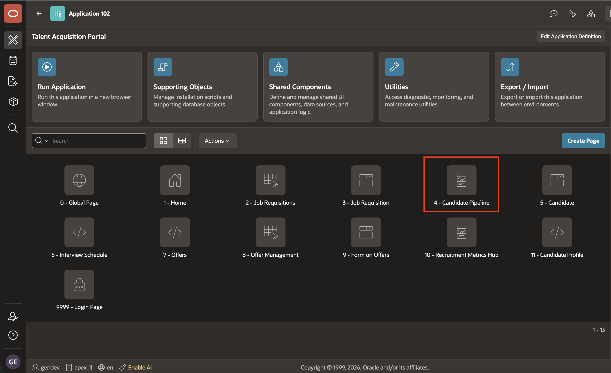
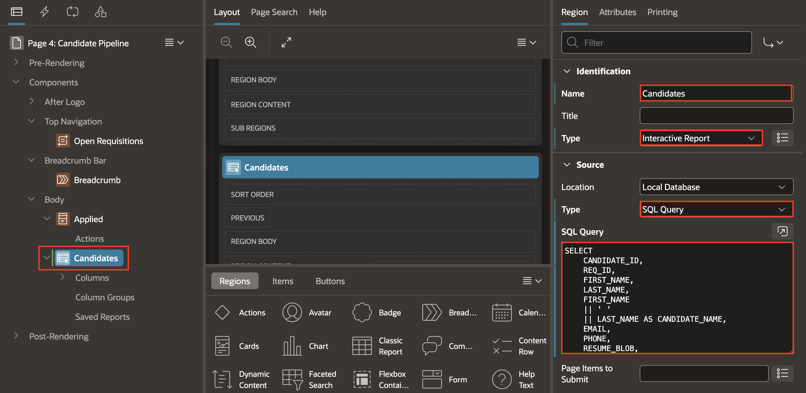
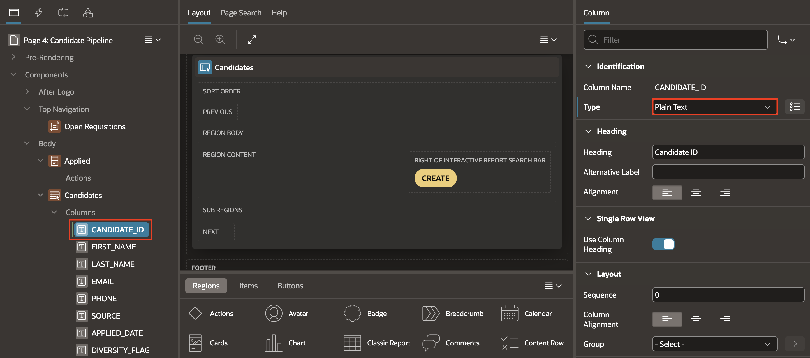
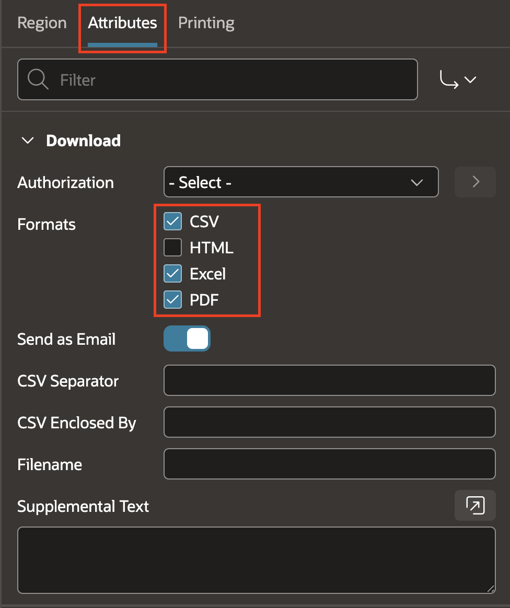
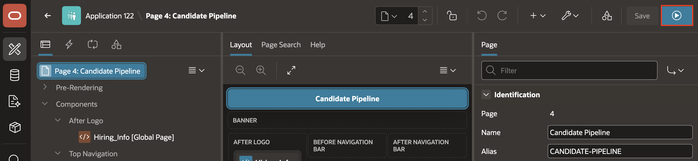
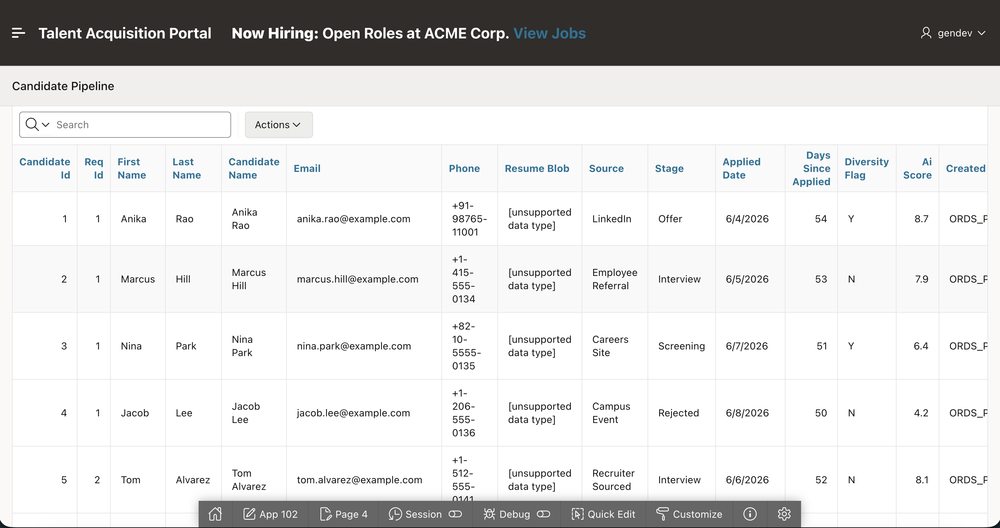
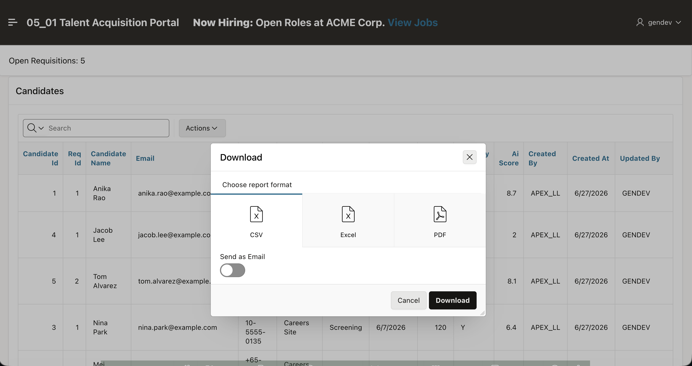

# Upgrade the Candidate Pipeline Page and add an Interactive Report

## Introduction

Recruiters need more than a visual snapshot when they review a busy candidate pipeline. In this lab, you will add an Interactive Report alongside the existing Cards view, giving the team a dependable place to scan candidate details and export the list when needed.

Estimated Time: 10 minutes

### Objectives

In this lab, you will:

- Add an Interactive Report to Candidate Pipeline.
- Populate the report from the candidate data set.
- Enable CSV, Excel, and PDF downloads.

### Downloads

Stuck or Missed out on completing the previous labs? Don't worry! You can download the following application:

- **<a href="../introduction/files/tap-export2.sql" download="tap-export2.sql">Talent Acquisition Portal</a>**

Import it into your workspace. In **App Builder**, select **Import**, upload `tap-export2.sql`, and follow the steps in the **Import Application** wizard.

> **Note:** Supporting objects are already loaded in the workspace.
>
> **AI Configuration:** Configure a Generative AI Service in the workspace and select it under **Shared Components > AI Attributes** for the application. See **Module 1, Lab 2: Configure Generative AI Service**.

## Task 1: Update the Candidates Interactive Report

Add the report alongside the existing Cards region.

1. In the Talent Acquisition Portal Application, open **Candidate Pipeline** in Page Designer.

    

2. In the Rendering Tree, under **Body**, select the existing **Candidates** region.

3. In the Rendering Tree, select the **New** region. In the Property Editor, enter or select the following properties:

    - Under Source:
        - Type: **SQL Query**
        - SQL Query: **Replace the existing query with the following query**
            ```sql
            <copy>
                SELECT
                    CANDIDATE_ID,
                    REQ_ID,
                    FIRST_NAME,
                    LAST_NAME,
                    FIRST_NAME
                    || ' '
                    || LAST_NAME AS CANDIDATE_NAME,
                    EMAIL,
                    PHONE,
                    SOURCE,
                    CURRENT_STAGE AS STAGE,
                    APPLIED_DATE,
                    TRUNC(SYSDATE - APPLIED_DATE) AS DAYS_SINCE_APPLIED,
                    DIVERSITY_FLAG,
                    AI_SCORE,
                    CREATED_BY,
                    CREATED,
                    UPDATED_BY,
                    UPDATED
                FROM
                    TMS_CANDIDATES
            </copy>
            ```

    

4. In the Rendering Tree, under **Columns**, select **CANDIDATE_ID**. Then, in the property Editor, set Identification Type as **Plain Text**.

    

## Task 2: Enable downloads and verify the report

1. In the Property Editor, click **Attributes**. Under **Download**, enable **CSV**, **Excel**, and **PDF**.

    

2. **Save and Run** the page. Verify the report and download choices.

    

3. Verify the report and download choices.

    

    

## Summary

You now have a Candidate Pipeline report that complements the Cards view. Recruiters can review candidate details in a tabular format and download the results in the format that works for them.

## Acknowledgements

* **Author** - Roopesh Thokala, Principal Product Manager
* **Last Updated By/Date** - Roopesh Thokala, July 29, 2026
