# Enable Natural Language Support for Job Requisitions

## Introduction

Recruiters often start with a question, not a set of filters. In this lab, you will make the Job Requisitions report understand the language of the hiring team, so a plain-English request can become a useful report filter.

Estimated Lab Time: 5 minutes

### Objectives

In this lab, you will:

- Enable Natural Language Support on Job Requisitions.
- Give the department and status columns clear business context.
- Test a recruiter-style natural-language request.

## Task 1: Enable Natural Language Support

1. From the **Candidate Pipeline** page, open **Page Finder**.

2. Select the **Job Requisitions** page.

    > **Note:** The page number might differ. Open the page named **Job Requisitions**.

    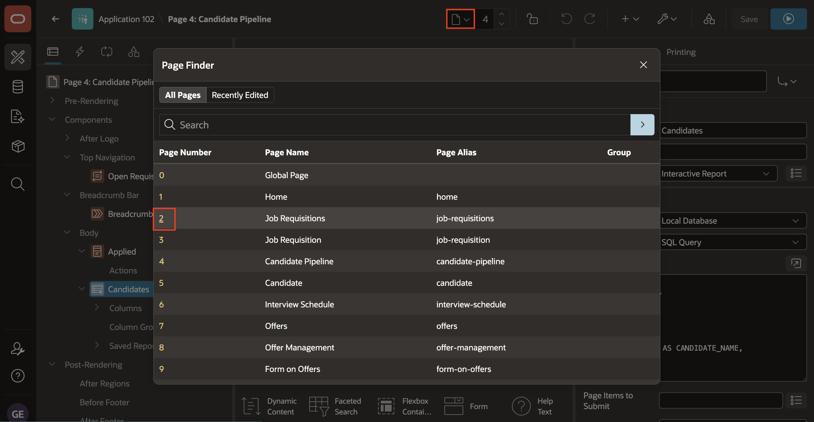

3. In the Rendering tab, select the **Job Requisitions** region.

    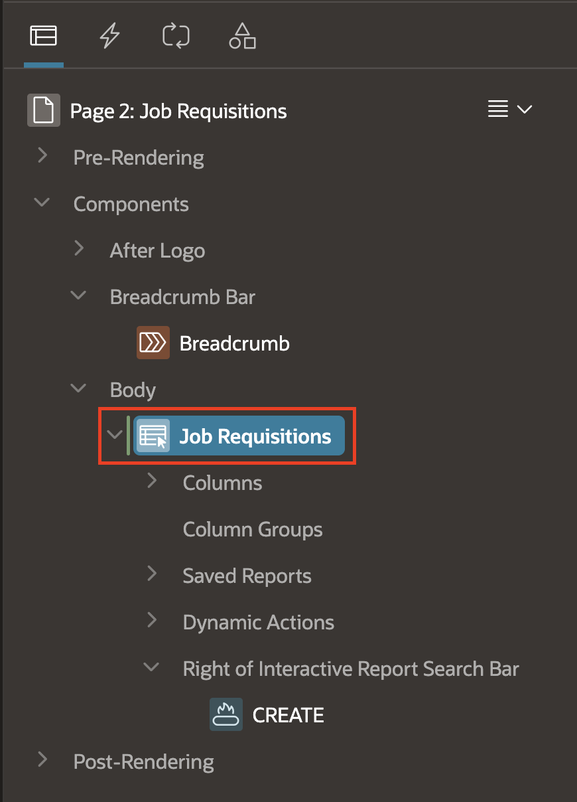

4. In the Property Editor, select **Attributes**.

5. Under **Generative AI**, turn on **Natural Language Support**.

    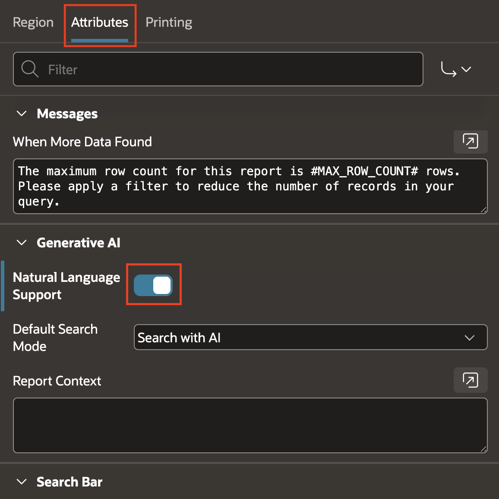

## Task 2: Add Column Context

Column context helps the AI interpret business terms in a prompt.

1. In the Rendering tab, expand **Job Requisitions**, then expand **Columns**.

    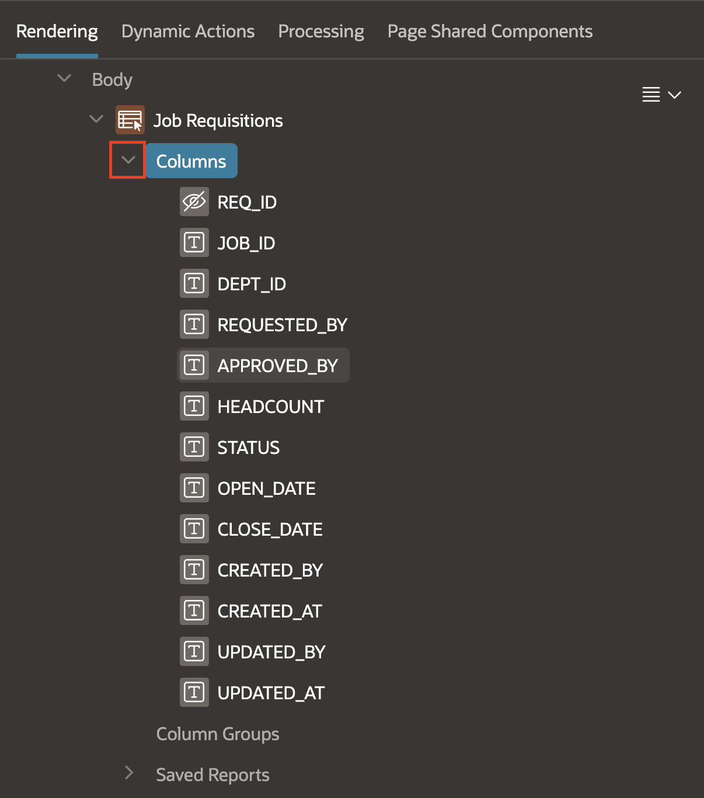

2. Select **DEPT\_ID**.

    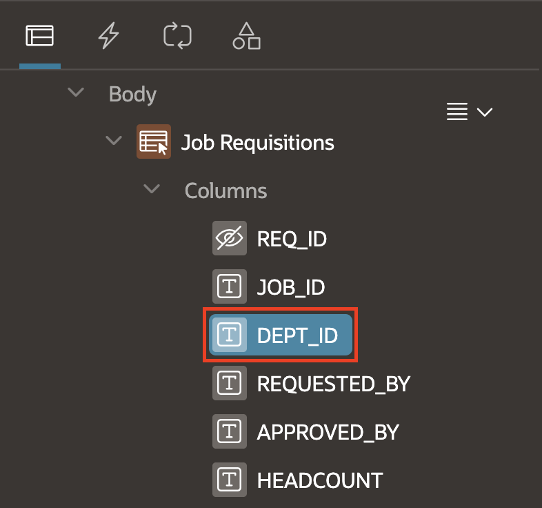

3. In the Property Editor, expand **Generative AI** if necessary.

    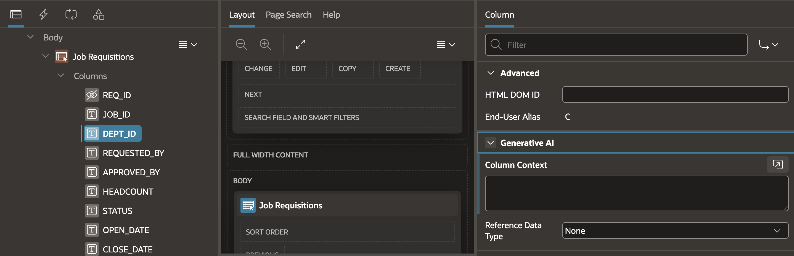

4. For **Column Context**, enter `Organizational department name (e.g., Sales, Engineering, HR)`.

    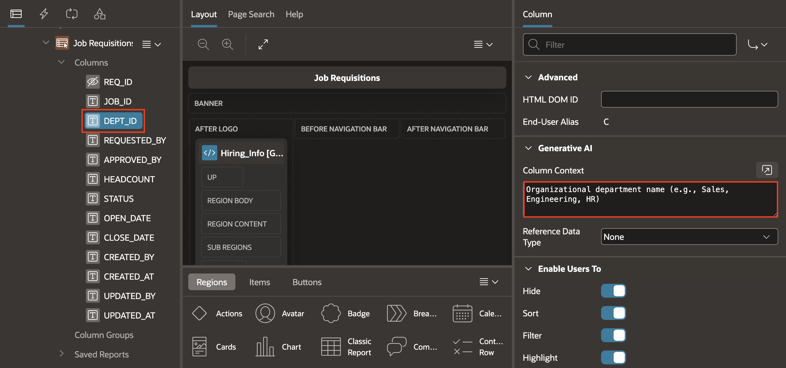

5. In the Rendering tab, select **STATUS**.

    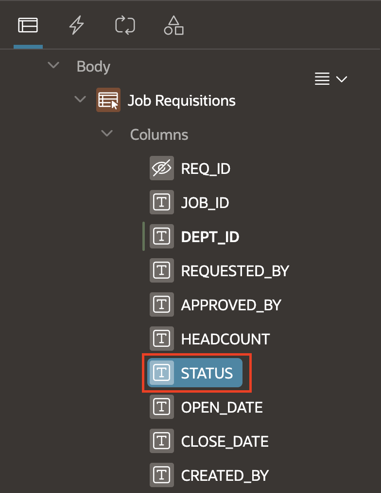

6. In the Property Editor, under **Generative AI**, enter `Requisition status; values include Open, Filled, Pending Approval, Draft` for **Column Context**.

    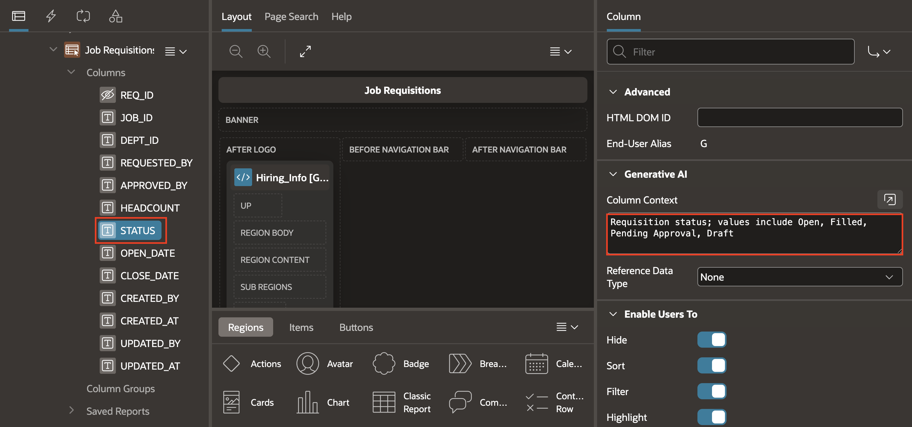

## Task 3: Test a Natural-Language Filter

1. Click **Save and Run**.

    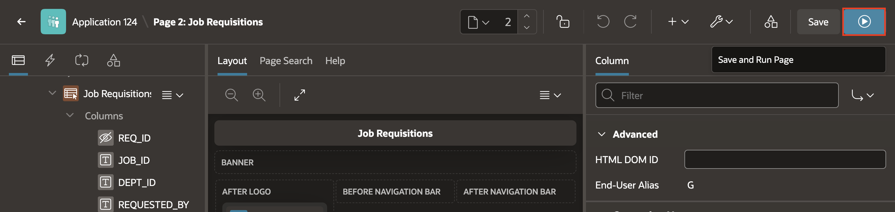

2. In the **Search or ask a question** field, enter **Show me Engineering requisitions open for more than 30 days**.

    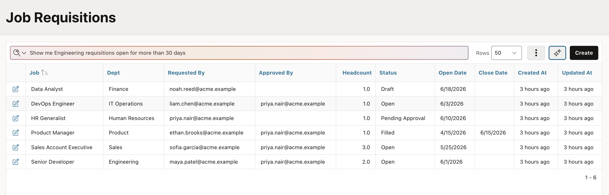

3. Press **Enter**. The Assistant opens and processes the request.

    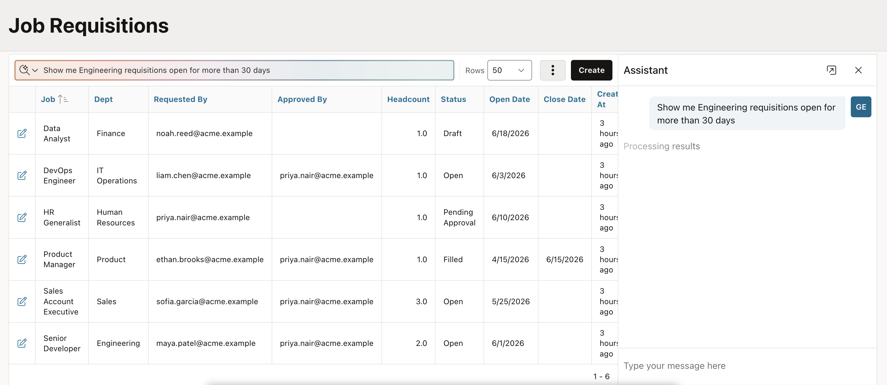

4. Verify that APEX applies filters for department, status, and open date, and shows the matching requisition.

    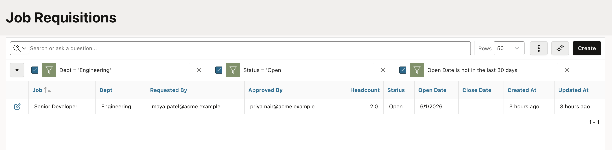

    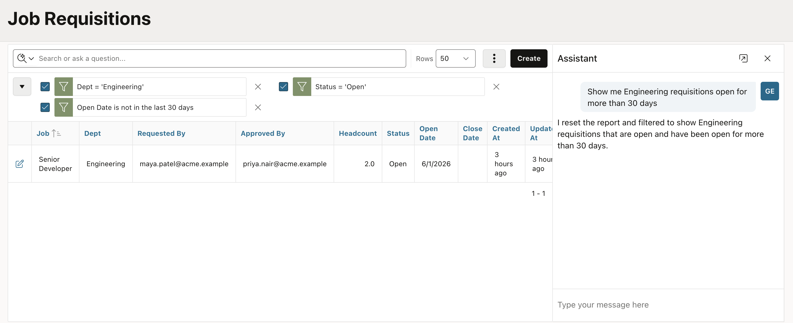

## Summary

You enabled Natural Language Support and explained the meaning of the department and status fields. Recruiters can now start with a natural-language question and quickly focus the Job Requisitions report.

## Acknowledgements

- **Author** - Roopesh Thokala, Principal Product Manager
- **Last Updated By/Date** - Roopesh Thokala, July 29, 2026
