# Build the Interview Schedule as an Interactive Grid

## Introduction

An interview schedule changes quickly, and recruiters should not have to leave the page to keep it accurate. In this lab, you will build an editable grid that puts each interview stage and its working details in one place.

Estimated Lab Time: 10 minutes

### Objectives

In this lab, you will:

- Create an Interactive Grid from the `TMS_INTERVIEW_STAGES` table.
- Keep candidate and requisition identifiers visible but protected from edits.
- Hide audit fields and save a change from the grid.

## Task 1: Add the Interactive Grid

1. In the **Talent Acquisition Portal** application, open the **Interview Schedule** page in Page Designer.

    > **Note:** The page number might differ. Open the page named **Interview Schedule**.

    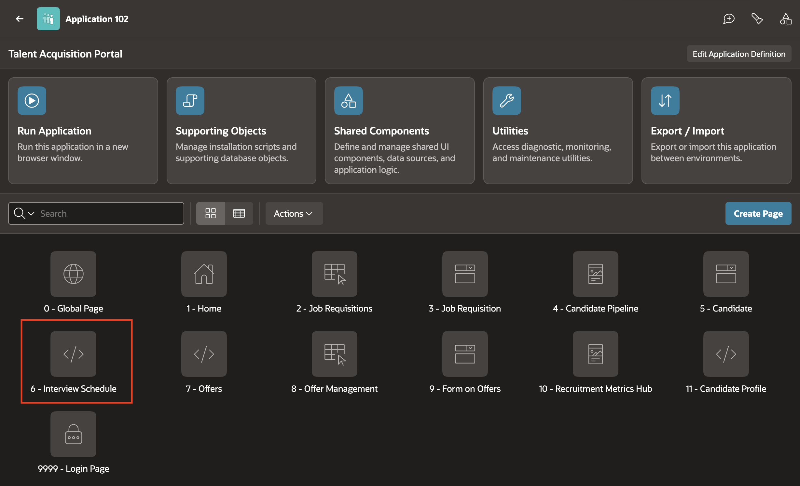

2. In the Rendering tab, right-click **Body** and select **Create Region**.

    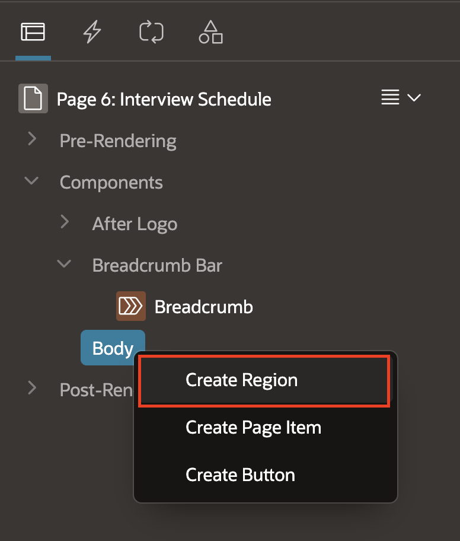

3. With the new region selected, enter or select the following in the Property Editor:

    - Under **Identification**:
        - **Name:** **Interview Stages**
        - **Type:** **Interactive Grid**
    - Under **Source**:
        - **Type:** **Table / View**
        - **Table Owner:** **Parsing Schema**
        - **Table Name:** **TMS\_INTERVIEW\_STAGES**

    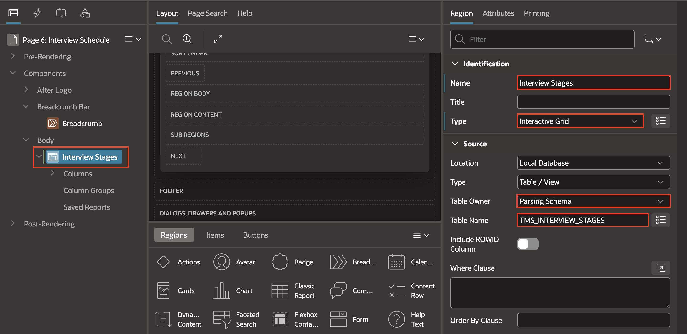

4. In the Property Editor, select **Attributes**.

5. Under **Edit**, turn on **Enabled**.

    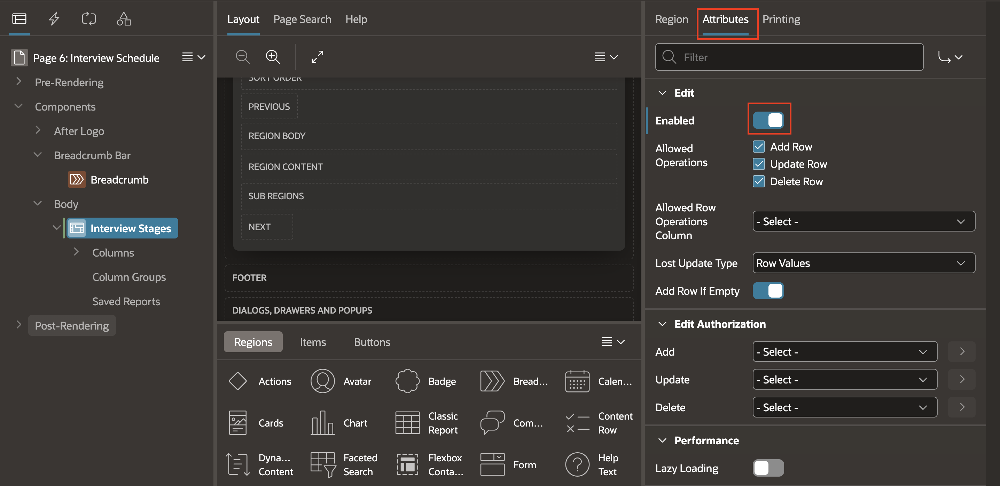

## Task 2: Configure Editable Columns

1. In the Rendering tab, expand **Interview Stages**, then expand **Columns**.

    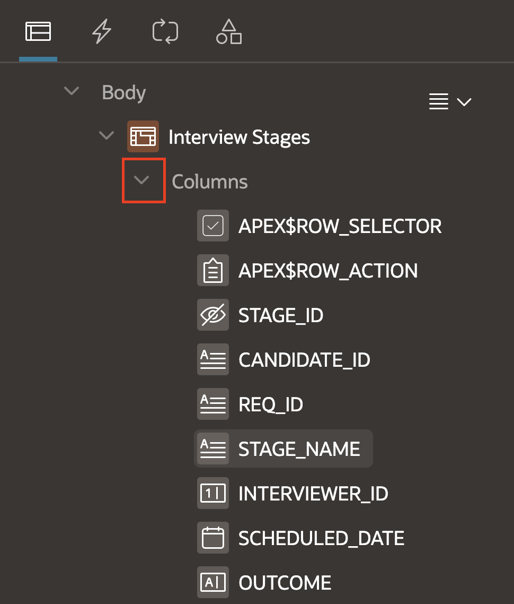

2. Select **CANDIDATE\_ID**.

    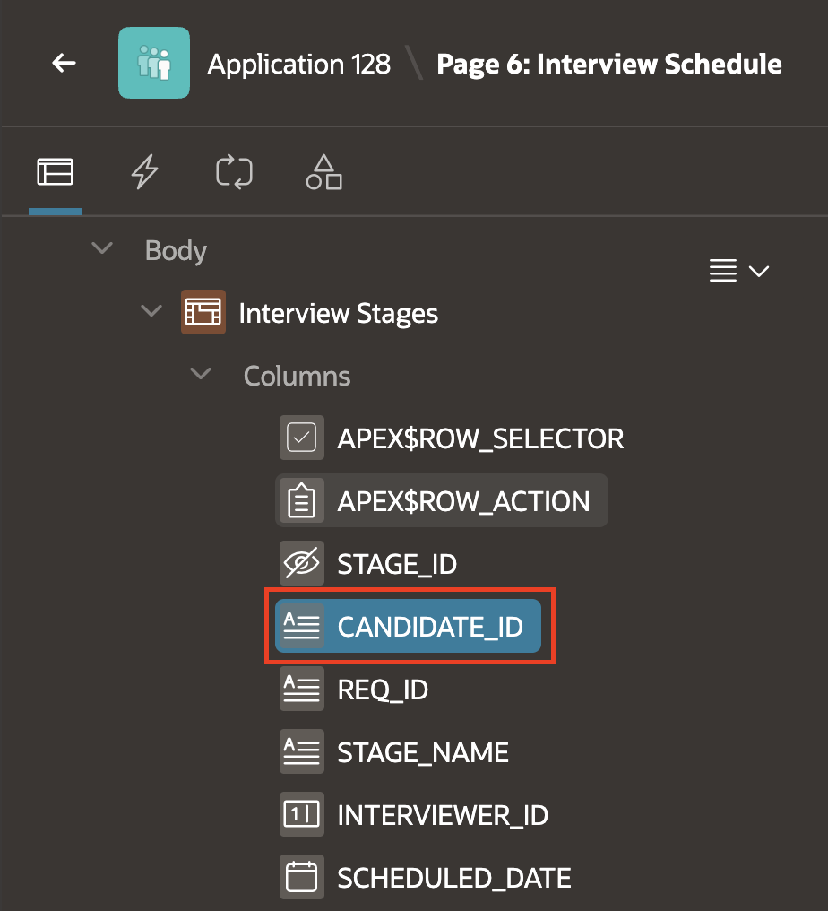

3. In the Property Editor, under **Identification**, set **Type** to **Display Only**.

    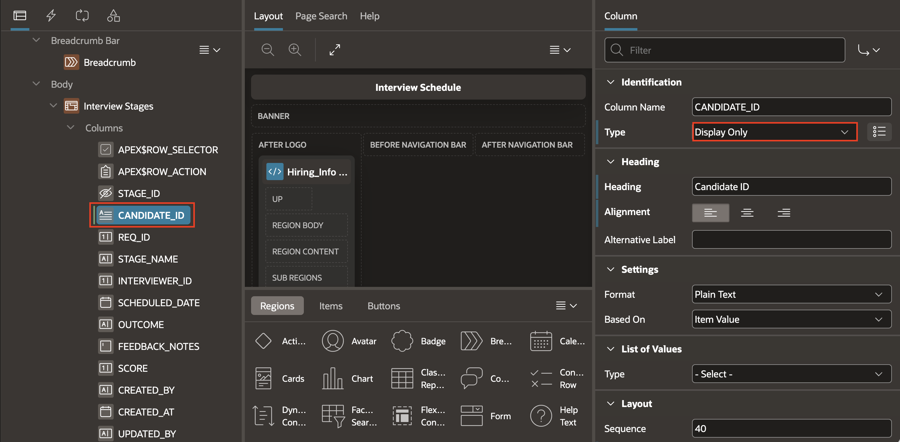

4. Set **Identification > Type** to **Display Only** for the following columns:

    | Column | Identification > Type |
    | --- | --- |
    | **REQ\_ID** | **Display Only** |
    | **STAGE\_NAME** | **Display Only** |

    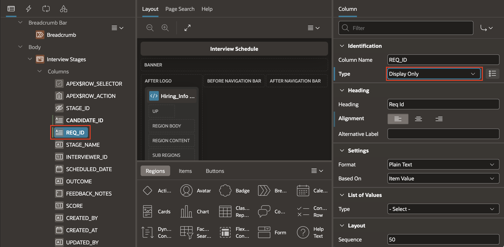

    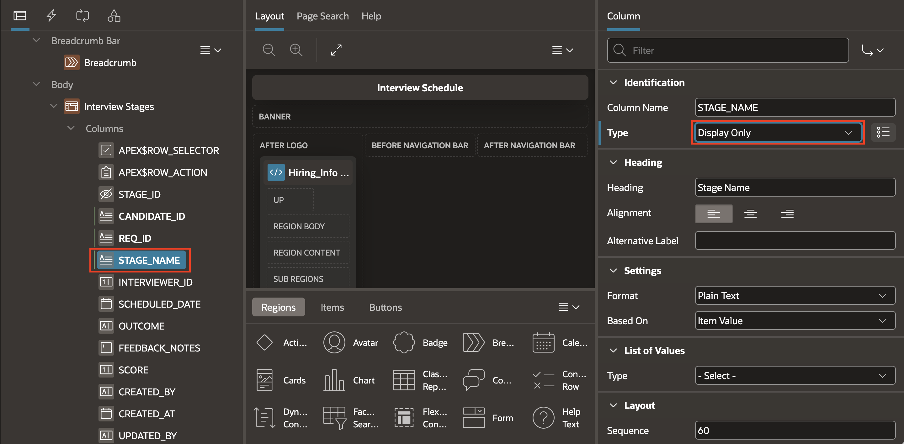

5. In the Rendering tab, select **CREATED\_BY**. Hold **Shift** and select **UPDATED** to select all four audit columns.

6. In the Property Editor, under **Identification**, set **Type** to **Hidden**.

    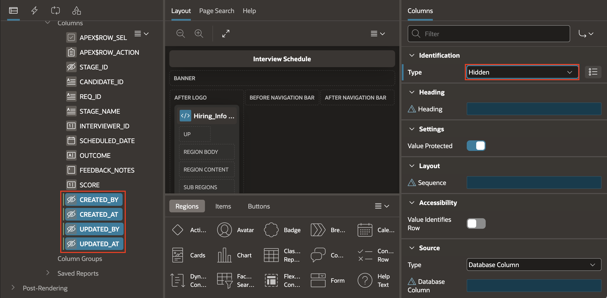

7. Click **Save and Run**.

    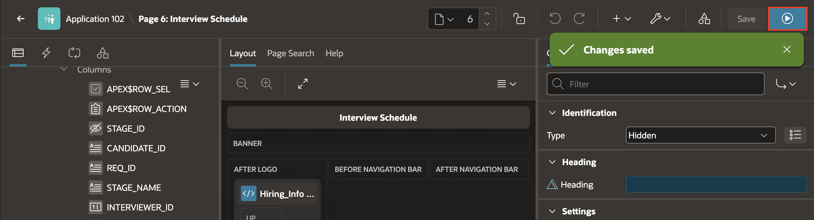

8. Verify that the Interview Schedule Interactive Grid appears.

    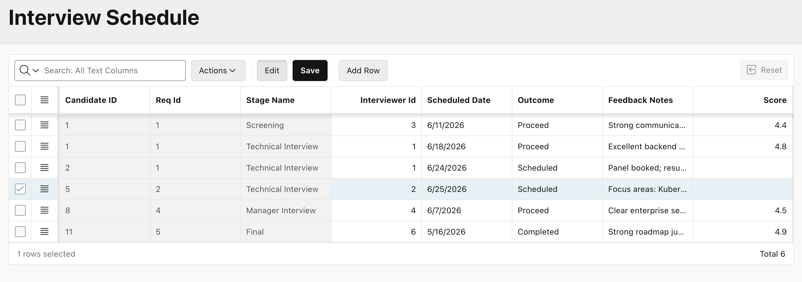

9. Select a row.

10. Click **Edit**.

11. In the **Interviewer Id** column, enter `4` for the selected row.

    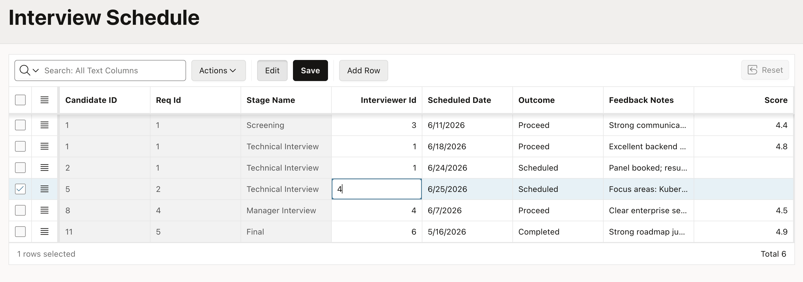

12. Click **Save**.

13. Confirm that the change is committed.

    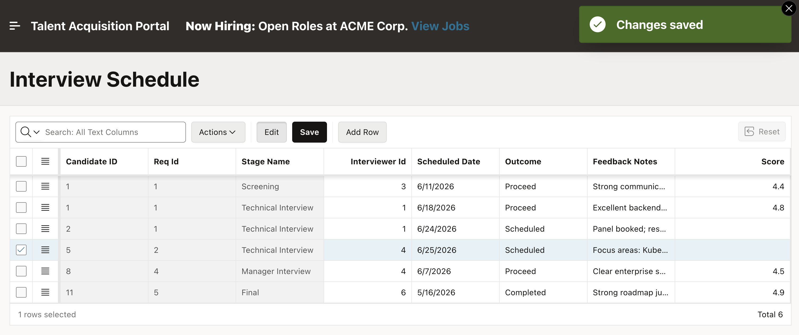

## Summary

You created an editable Interview Schedule grid with the right balance of visibility and control. Recruiters can see the interview context, keep audit data out of the way, and save schedule changes directly in the grid.

## Acknowledgements

- **Author** - Roopesh Thokala, Principal Product Manager
- **Last Updated By/Date** - Roopesh Thokala, July 2026
