# Create a Job Openings Cards Page

## Introduction

When a hiring manager asks what roles are open, the answer should be easy to browse. In this lab, you will turn open requisitions into a clean job board where each card shows the essentials and Smart Filters help the recruitment team find the right openings quickly.

Estimated Lab Time: 5 minutes

### Objectives

In this lab, you will:

- Create a Cards page from open job requisitions.
- Present each opening with department, headcount, opening date, and an icon.
- Add department and headcount filters to narrow the job board.

## Task 1: Create the Job Openings Page

1. In the **Talent Acquisition Portal** application, click **Create Page**.

    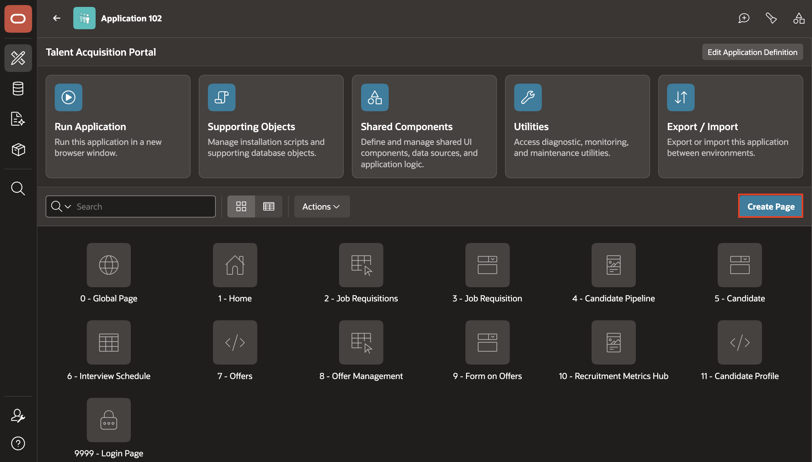

2. In the Create Page wizard, select **Cards** and click **Next**.

    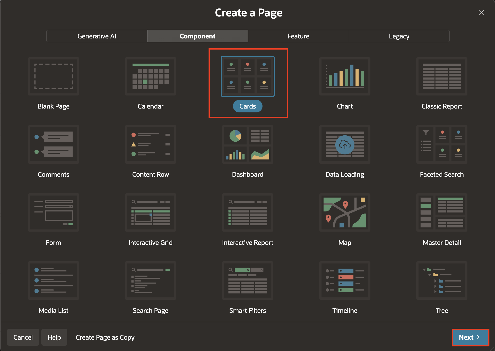

3. In the Create Cards wizard, enter or select the following:

    - Under **Page Definition**, for **Name**, enter **Job Openings**.
    - Under **Data Source**:
        - **Data Source:** **Local Database**
        - **Source Type:** **SQL Query**
        - For **Enter a SQL SELECT statement**, enter the following:

            ```sql
            <copy>
            SELECT
                R.REQ_ID,
                J.TITLE,
                D.NAME AS DEPARTMENT,
                R.HEADCOUNT AS HEADCOUNT,
                TO_CHAR(R.OPEN_DATE, 'DD-Mon-YYYY') AS OPEN_DATE
            FROM
                TMS_JOB_REQUISITIONS R
                JOIN TMS_JOBS J
                    ON R.JOB_ID = J.JOB_ID
                JOIN TMS_DEPARTMENTS D
                    ON R.DEPT_ID = D.DEPT_ID
            WHERE
                R.STATUS = 'Open'
            </copy>
            ```

4. Click **Next**.

    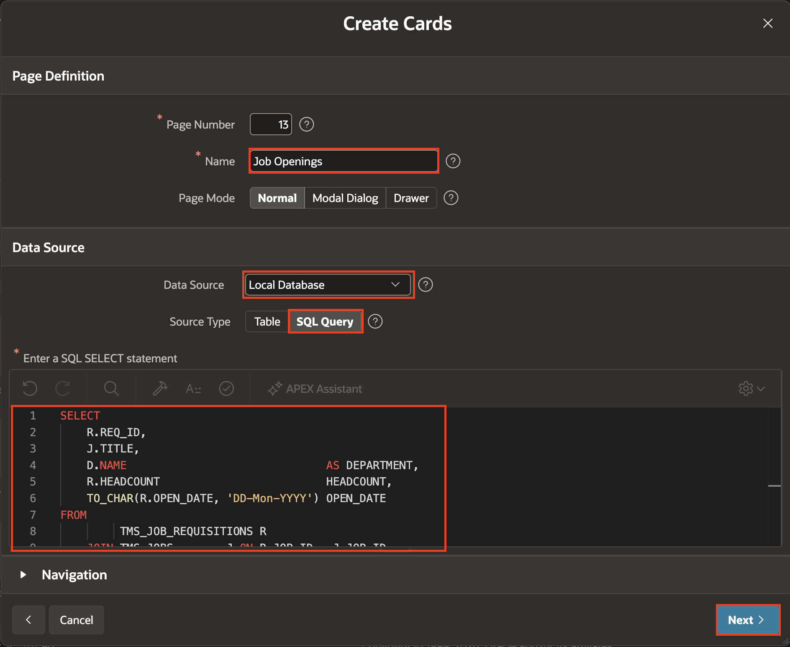

5. Under **Cards Attributes**, set **Title Column** to **TITLE**.

6. Click **Create Page**.

    > **Note:** The generated page number might differ. In later steps, use the item with the same suffix on the **Job Openings** page.

    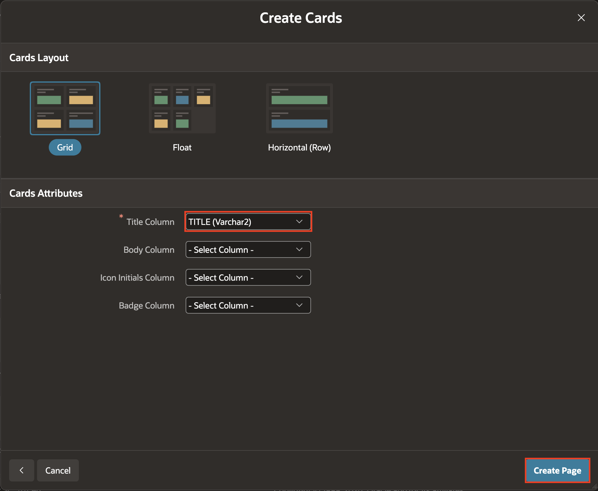

## Task 2: Configure the Cards Region

1. In the Rendering tab, select the **Job Openings** region.

    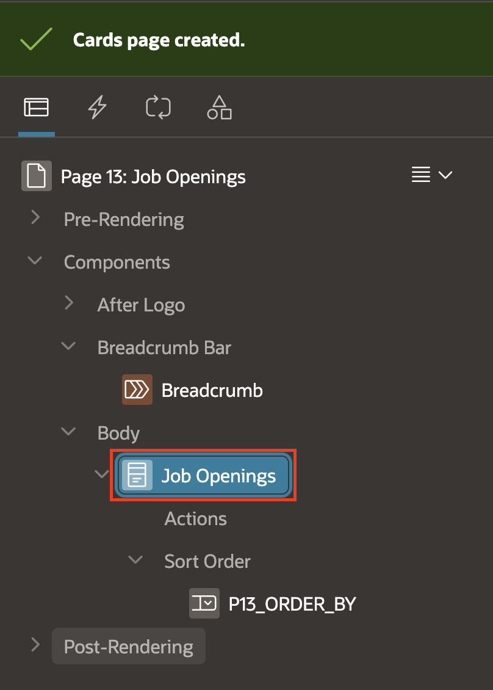

2. In the Property Editor, under **Order By**, set **Type** to **None**.

    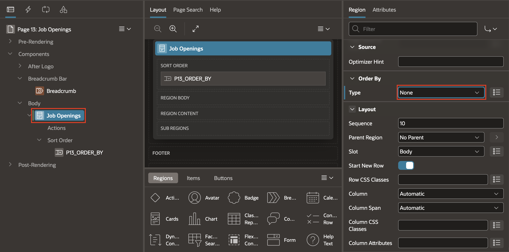

3. In the Property Editor, select **Attributes**. Enter or select the following:

    - Under **Subtitle**, set **Column** to **DEPARTMENT**.
    - Under **Body**:
        - Turn on **Advanced Formatting**.
        - For **HTML Expression**, enter the following:

            ```html
            <copy>
            <strong>Headcount:</strong> &HEADCOUNT.
            <br>
            <strong>Open since:</strong> &OPEN_DATE.
            </copy>
            ```

    - Under **Icon and Badge**:
        - **Icon Source:** **Icon Class**
        - **Icon CSS Classes:** `fa-briefcase`

    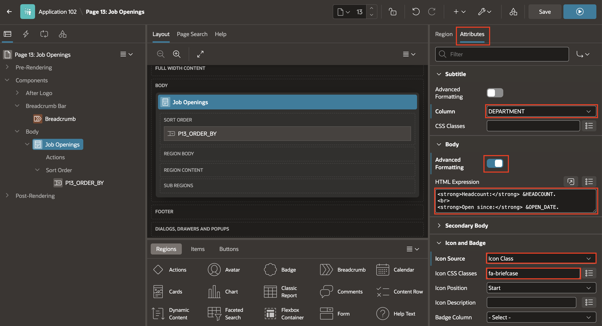

4. In the Rendering tab, expand **Job Openings**, then expand **Sort Order**.

5. Right-click **P13\_ORDER\_BY** and select **Delete**.

    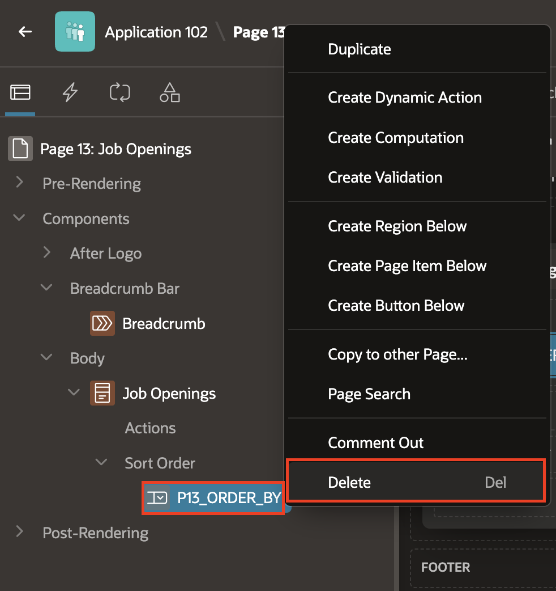

## Task 3: Add Smart Filters

1. In the Rendering tab, right-click **Body** and select **Create Region**.

    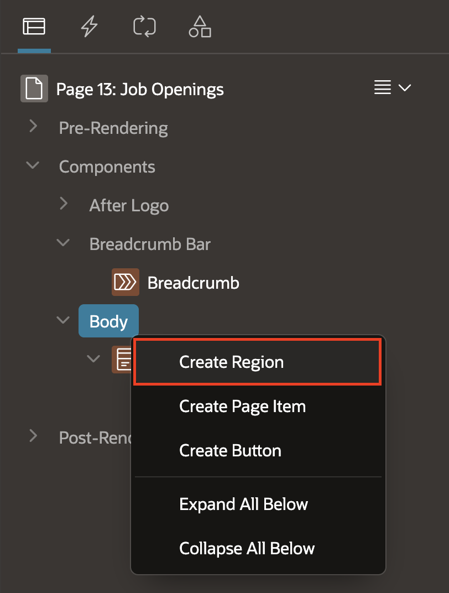

2. Drag the new region above **Job Openings**.

    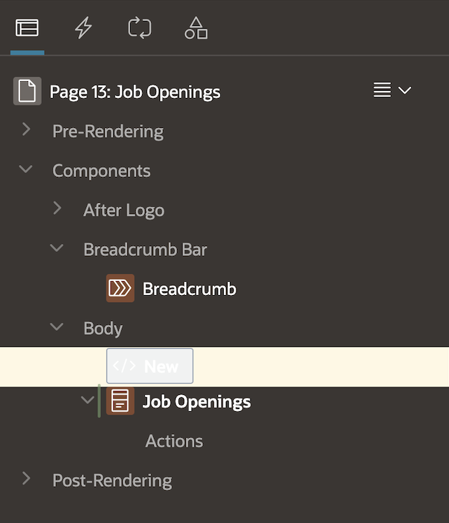

3. With the new region selected, enter or select the following in the Property Editor:

    - Under **Identification**:
        - **Name:** **Smart Filters**
        - **Type:** **Smart Filters**
    - Under **Source**, set **Filtered Region** to **Job Openings**.

    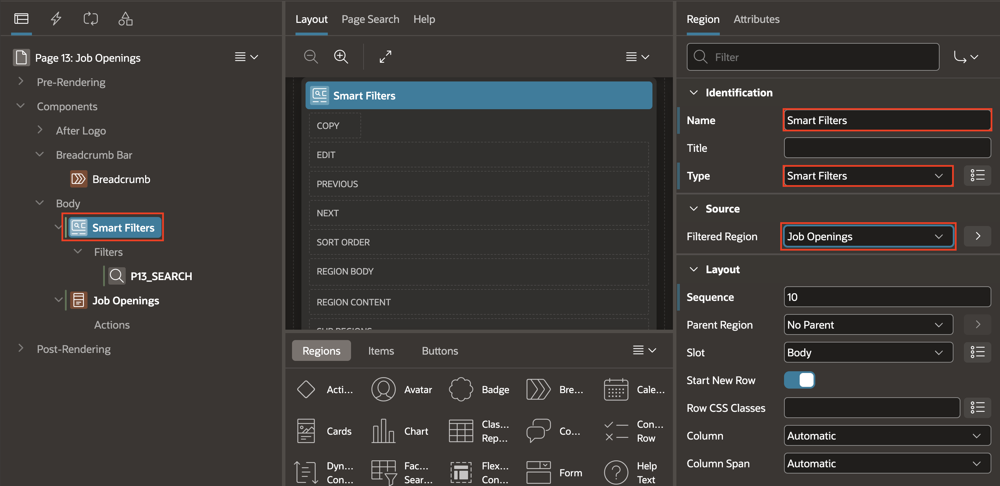

4. In the Rendering tab, expand **Smart Filters**. Right-click **Filters** and select **Create Filter**.

    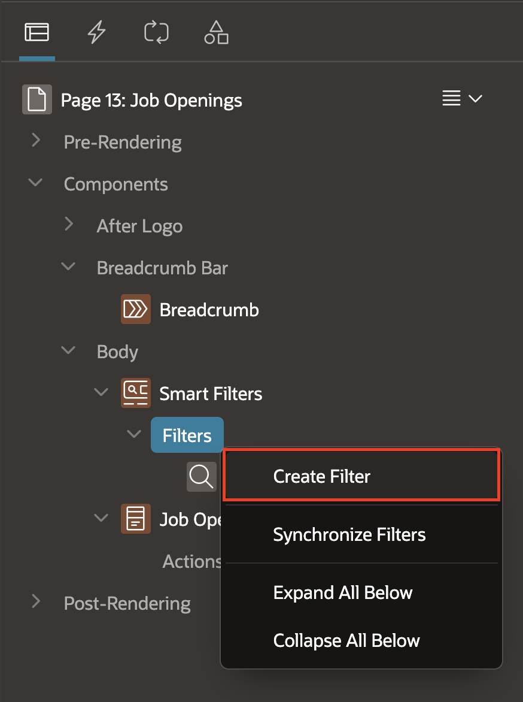

5. With the new filter selected, enter or select the following in the Property Editor:

    - Under **Identification**:
        - **Name:** **P13\_DEPARTMENT**
        - **Type:** **Checkbox Group**
    - Under **Label**, set **Label** to **Department**.
    - Under **List of Values**, set **Type** to **Distinct Values**.
    - Under **Source**:
        - **Database Column:** **DEPARTMENT**
        - **Data Type:** **VARCHAR2**

    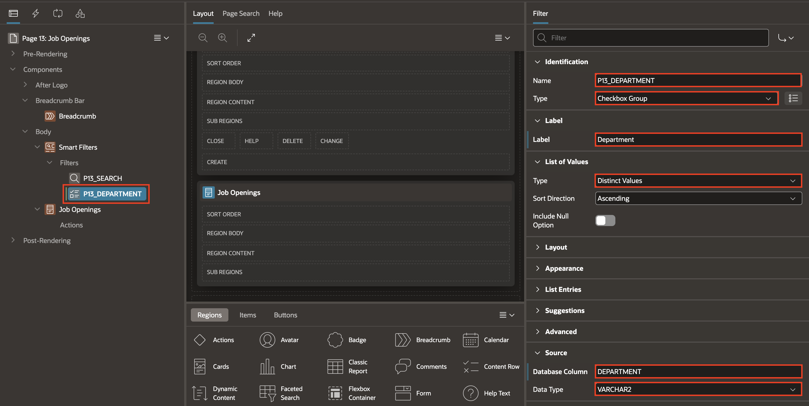

6. In the Rendering tab, right-click **Filters** and select **Create Filter**.

7. With the new filter selected, enter or select the following in the Property Editor:

    - Under **Identification**:
        - **Name:** **P13\_HEADCOUNT**
        - **Type:** **Range**
    - Under **Label**, set **Label** to **Headcount Range**.
    - Under **Source**:
        - **Database Column:** **HEADCOUNT**
        - **Data Type:** **NUMBER**

    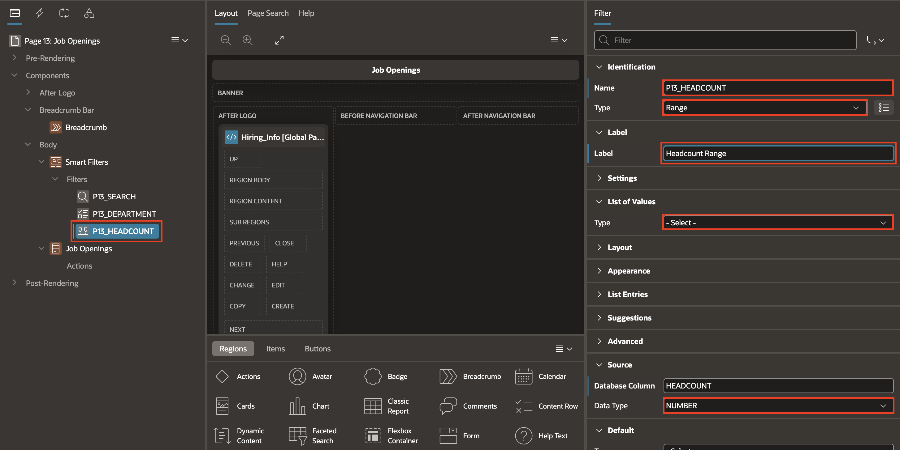

8. Click **Save and Run**.

    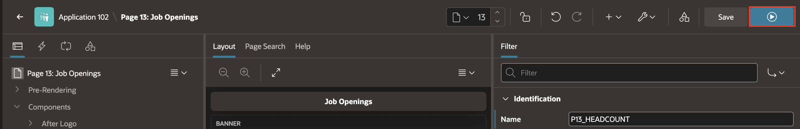

9. Verify that the Cards page displays the **Department** and **Headcount Range** filters.

    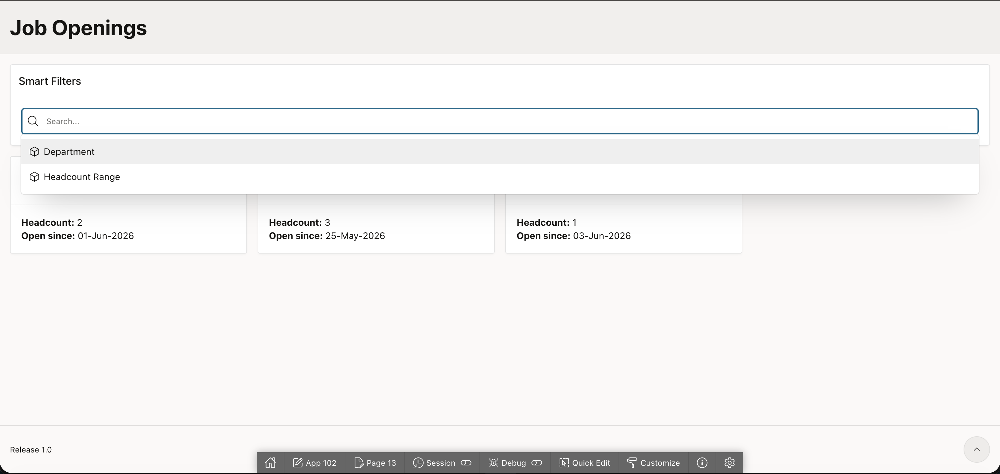

10. In the **Department** filter, select **Engineering** and **IT Operations**.

11. Verify that the displayed cards are narrowed to those departments.

    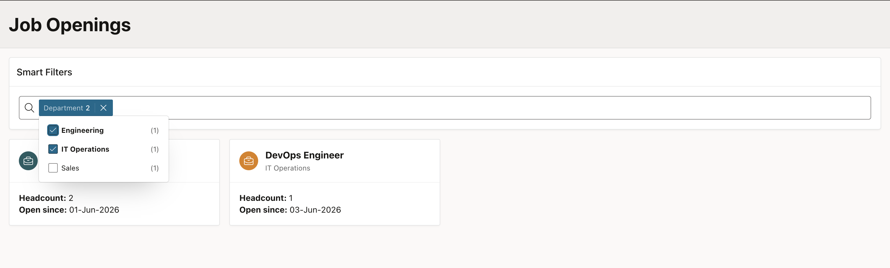

## Summary

You created a browsable Job Openings page that shows the details recruiters need at a glance. With department and headcount filters in place, the team can move from a broad list of roles to the openings that matter most.

## Acknowledgements

- **Author** - Roopesh Thokala, Principal Product Manager
- **Last Updated By/Date** - Roopesh Thokala, July 29, 2026
