# Upgrade My Onboarding Tasks to an Interactive Grid

## Introduction

Onboarding works best when employees can see what is due and keep their own progress current. In this lab, you will transform My Onboarding Tasks into an editable grid that keeps the task list focused on the signed-in employee.

Estimated Lab Time: 5 minutes

### Objectives

In this lab, you will:

- Change My Onboarding Tasks from a report to an Interactive Grid.
- Configure a clear status list and protect task details from edits.
- Hide audit fields for a cleaner employee view.

### Downloads

Stuck or missed out on completing the previous labs? Don't worry! You can download the following application:

- **<a href="../introduction/files/ess-export2.sql" download="ess-export2.sql">Employee Self-Service Portal</a>**

Import it into your workspace. In **App Builder**, select **Import**, upload `ess-export2.sql`, and follow the steps in the **Import Application** wizard.

> **Note:**
>
> - **APEX Version:** The supplied application export was created with Oracle APEX 26.2 and cannot be imported into earlier APEX releases.
> - **Supporting Objects:** Supporting objects are already loaded in the workspace.
> - **AI Configuration:** Configure a Generative AI Service from **App Builder > Workspace Utilities > Generative AI**. See **Module 1, Lab 2: Configure Generative AI Service**.

## Task 1: Replace the Report with an Interactive Grid

1. In the **Employee Self-Service Portal** application, open the **My Onboarding Tasks** page in Page Designer.

    > **Note:** The page number might differ. Open the page named **My Onboarding Tasks**.

    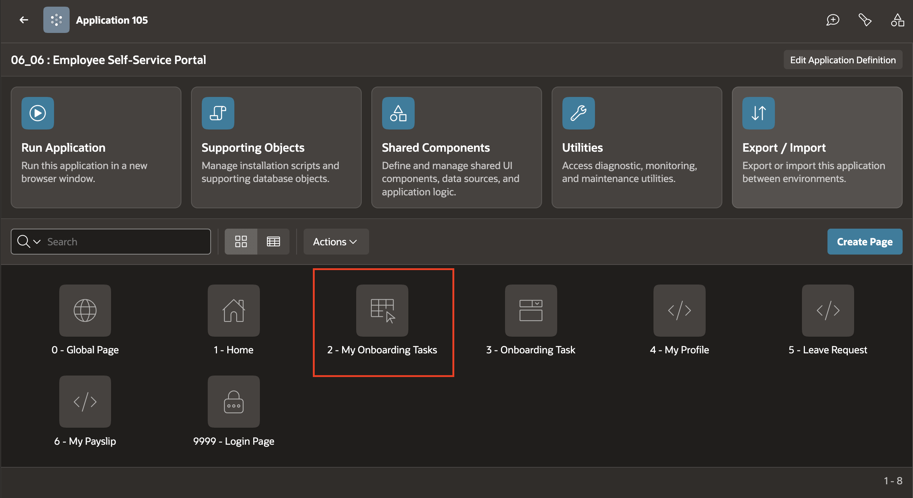

2. In the Rendering tab, select the **Onboarding Tasks** region.

    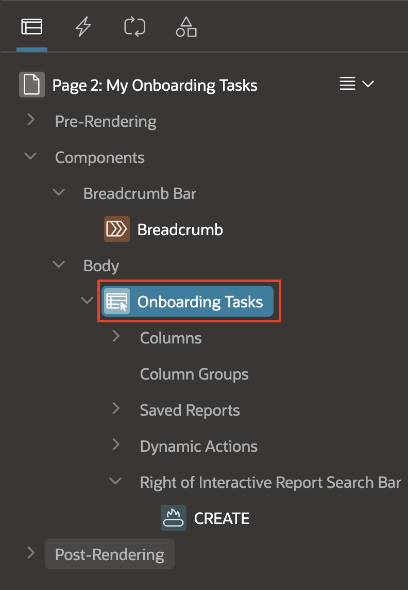

3. In the Property Editor, enter or select the following:

    - Under **Identification**, set **Type** to **Interactive Grid**.
    - Under **Source**:
        - **Type:** **SQL Query**
        - For **SQL Query**, enter the following:

            ```sql
            <copy>
            SELECT
                T.*, E.Email
            FROM
                TMS_ONBOARDING_TASKS T
                JOIN TMS_EMPLOYEES E ON E.EMPLOYEE_ID = T.EMPLOYEE_ID
            WHERE
                lower(T.ASSIGNED_TO) = LOWER(:APP_USER)
            </copy>
            ```

    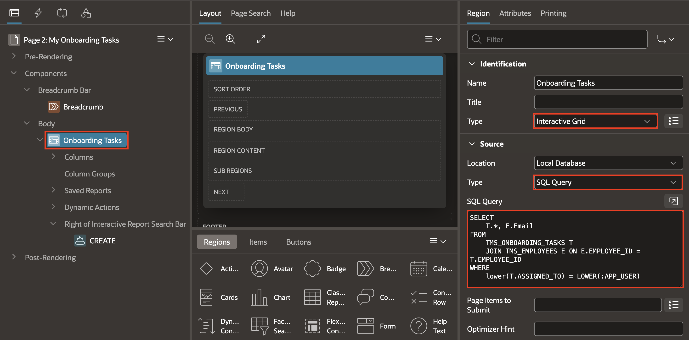

4. In the Property Editor, select **Attributes**.

5. Under **Edit**, turn on **Enabled**.

    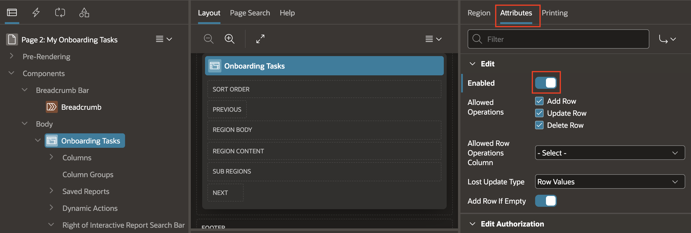

## Task 2: Configure Editable Columns

1. In the Rendering tab, expand **Onboarding Tasks**, then expand **Columns**.

    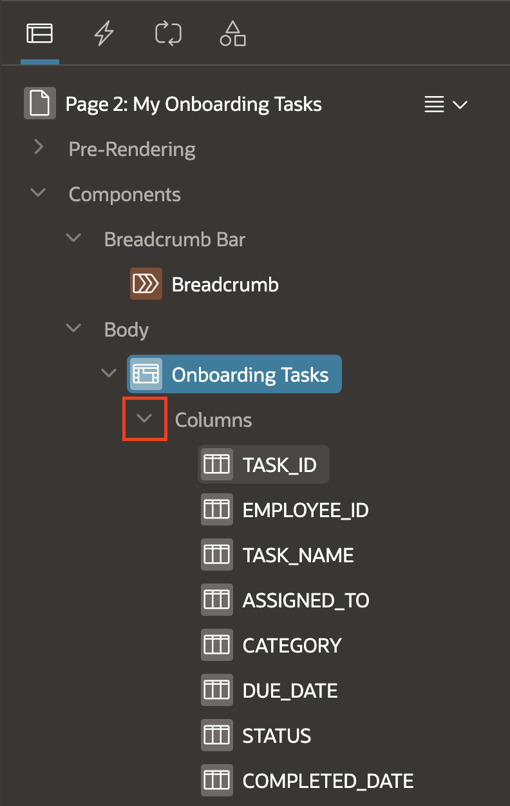

2. Select **TASK\_ID**.

3. In the Property Editor, under **Source**, make sure **Query Only** and **Primary Key** are turned **On**.

    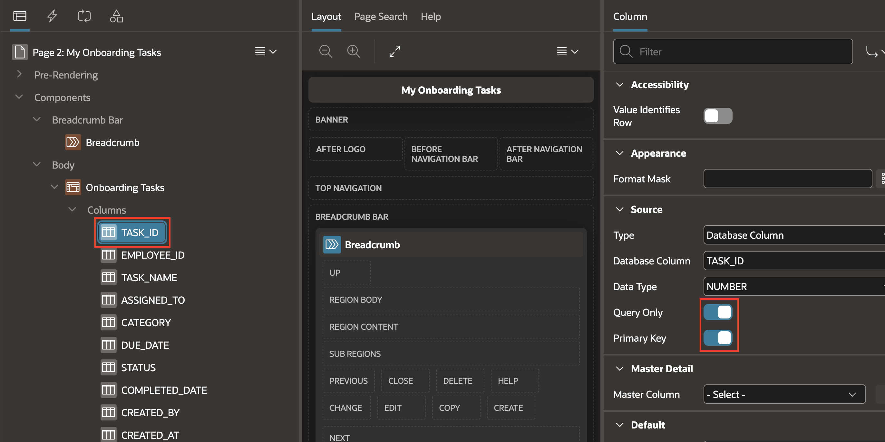

4. In the Rendering tab, select **STATUS**.

    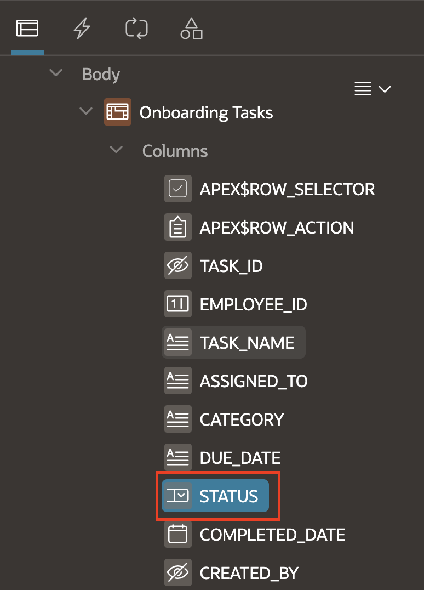

5. In the Property Editor, enter or select the following:

    - Under **Identification**, set **Type** to **Select List**.
    - Under **List of Values**:
        - **Type:** **Static Values**
        - For **Static Values**, enter the following values:

            | Display Value | Return Value |
            | --- | --- |
            | Pending | Pending |
            | In Progress | In Progress |
            | Done | Done |
            | Blocked | Blocked |

        - Turn on **Display Null Value**.
        - **Null Display Value:** `--Select Status--`

    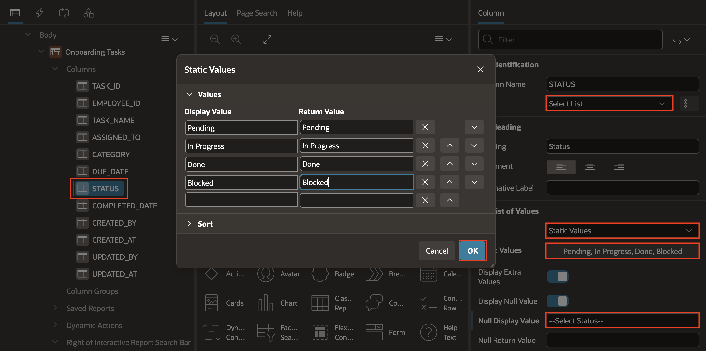

6. In the Rendering tab, select **TASK\_NAME**.

7. In the Property Editor, under **Identification**, set **Type** to **Display Only**.

    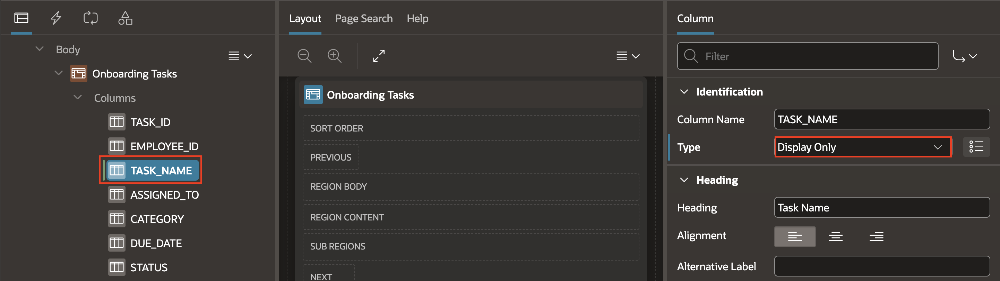

8. In the Rendering tab, select **ASSIGNED\_TO**. Hold **Shift** and select **DUE\_DATE** to select the following columns:

    | Column |
    | --- |
    | **ASSIGNED\_TO** |
    | **CATEGORY** |
    | **DUE\_DATE** |

9. In the Property Editor, under **Identification**, set **Type** to **Display Only**.

    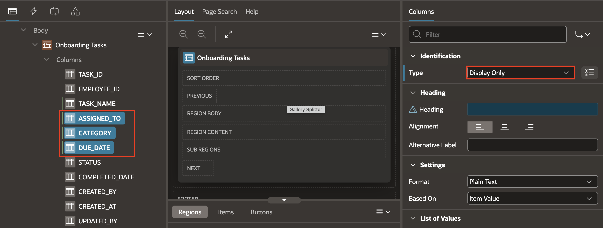

10. In the Rendering tab, select **CREATED**. Hold **Shift** and select **UPDATED\_BY** to select the audit columns.

11. In the Property Editor, enter or select the following:

    - Under **Identification**, set **Type** to **Hidden**.
    - Under **Settings**, turn off **Value Protected**.

    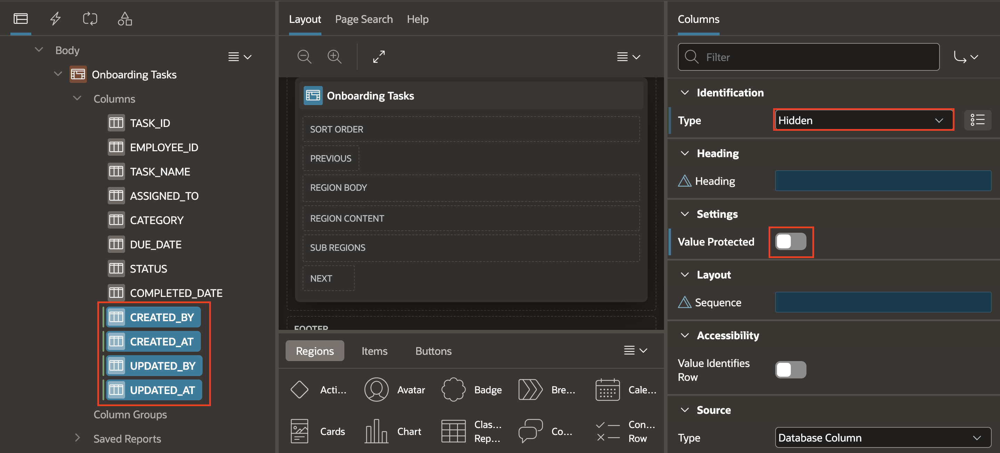

12. Click **Save and Run**.

13. If prompted, sign in to the application.

14. Verify that the grid shows the onboarding tasks assigned to the signed-in user.

    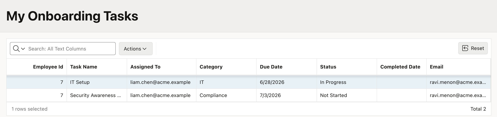

## Summary

You transformed My Onboarding Tasks into a focused Interactive Grid. Employees can select a clear status for their work, while the task details and audit information remain protected and uncluttered.

## Acknowledgements

- **Author** - Roopesh Thokala, Principal Product Manager
- **Last Updated By/Date** - Roopesh Thokala, July 29, 2026
