# Customize the Candidate Pipeline Report

## Introduction

The Candidate Pipeline page contains an Interactive Report that users can customize at run time. In this lab, you highlight important candidate stages, configure the report layout, and save an Active Candidates report.

Estimated Lab Time: 10 minutes

### Objectives

In this lab, you will learn how to:

- Highlight report values.
- Configure report columns, sorting, and control breaks.
- Create and save a named report.

## Task 1: Configure the Primary Report

1. Run the **Talent Acquisition Portal** application.

2. From the navigation menu, select **Candidate Pipeline**.

3. On the **Candidates** report, select **Actions**.

4. Select **Format** and then select **Highlight**.

    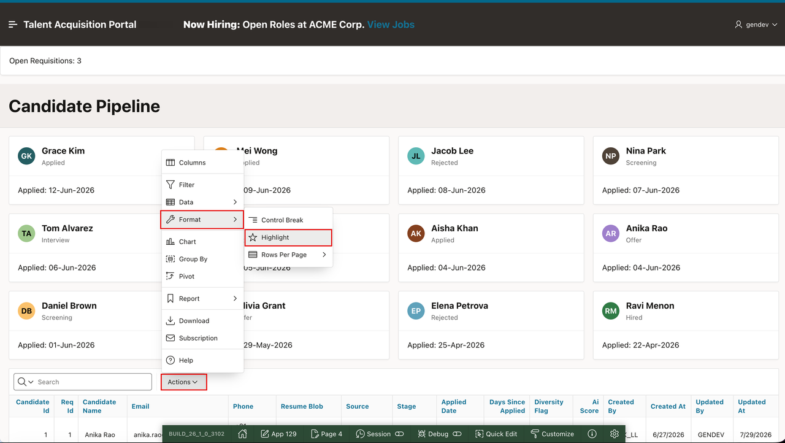

5. In the **Highlight** dialog, enter/select the following:

    - **Column:** **Stage**
    - **Operator:** **=**
    - **Expression:** **Rejected**
    - **Background Color:** **#FFD6D2**

6. Select **Apply**.

    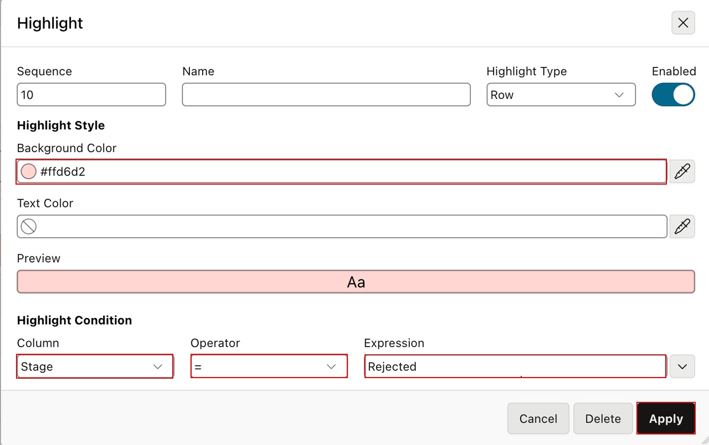

7. Repeat steps 3 through 6 to add a highlight for candidates in the **Hired** stage.

8. In the **Highlight** dialog, enter/select the following for the **Hired** stage:

    - **Column:** **Stage**
    - **Operator:** **=**
    - **Expression:** **Hired**
    - **Background Color:** **#D0F1CC**

9. Select **Apply**.

    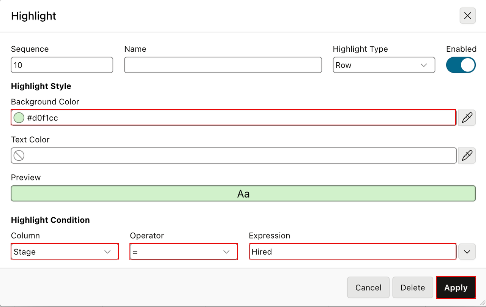

10. Select **Actions**.

11. Select **Columns**.

    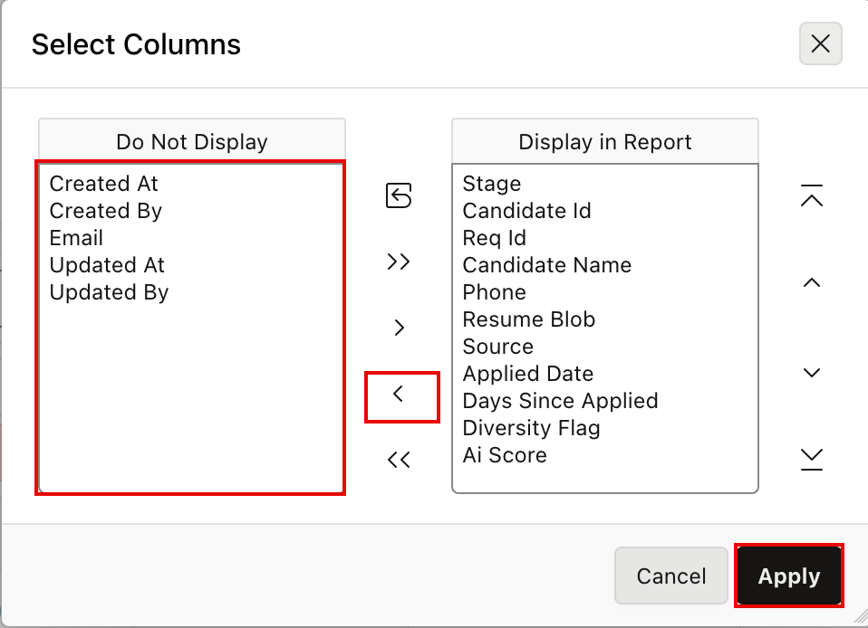

12. In the **Columns** dialog, move **Email** and the audit columns to **Do Not Display**.

13. Select **Apply**.

    

14. Select **Actions**.

15. Select **Data** and then select **Sort**.

    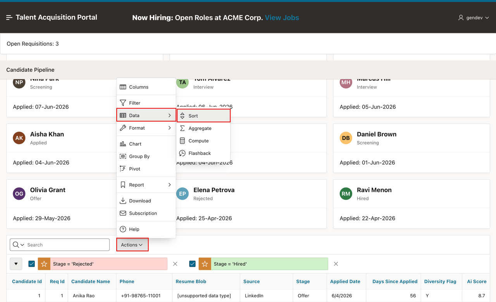

16. In the **Sort** dialog, enter/select the following:

    - **Column:** **Applied Date**
    - **Direction:** **Descending**

17. Select **Apply**.

    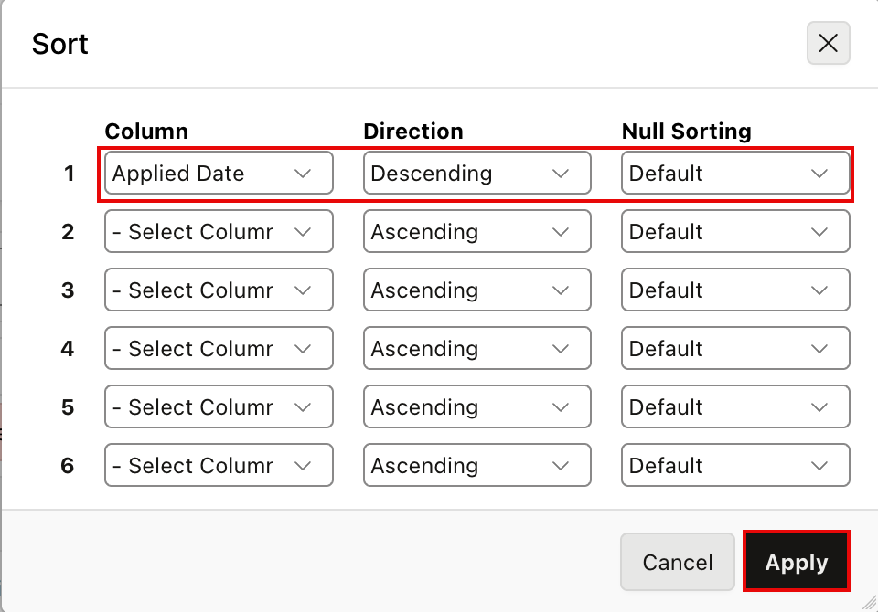

18. Select **Actions**.

19. Select **Format** and then select **Control Break**.

    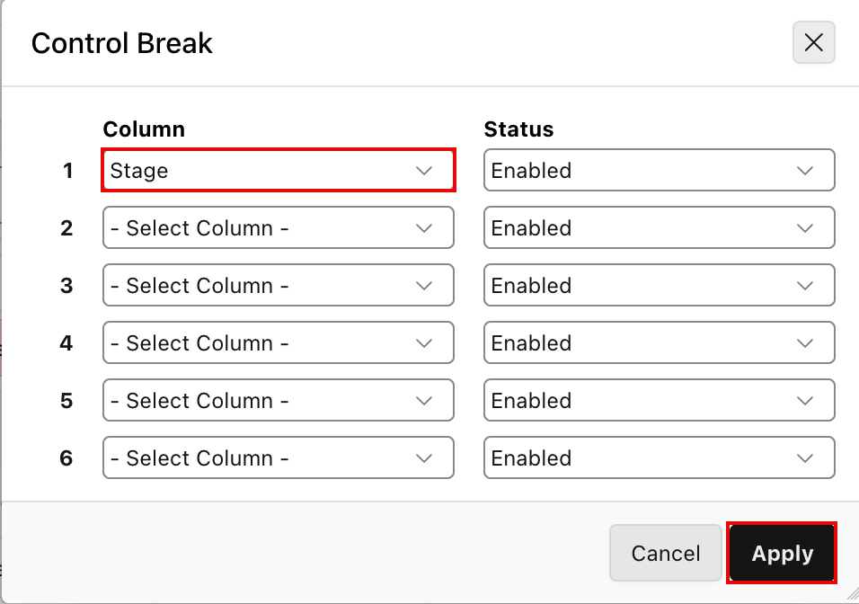

20. In the **Control Break** dialog, enter/select the following:

    - **Column:** **Stage**
    - **Direction:** **Ascending**

21. Select **Apply**.

    

22. Select **Actions**.

23. Select **Report** and then select **Save Report**.

    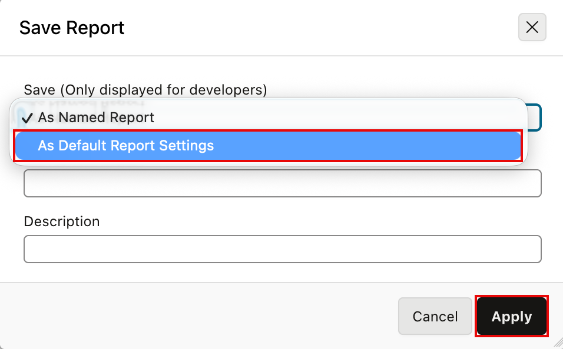

24. In the **Save Report** dialog, select **As Default Report Settings**.

25. Select **Apply**.

    

26. In the confirmation dialog, select **Primary**.

27. Select **Apply**.

    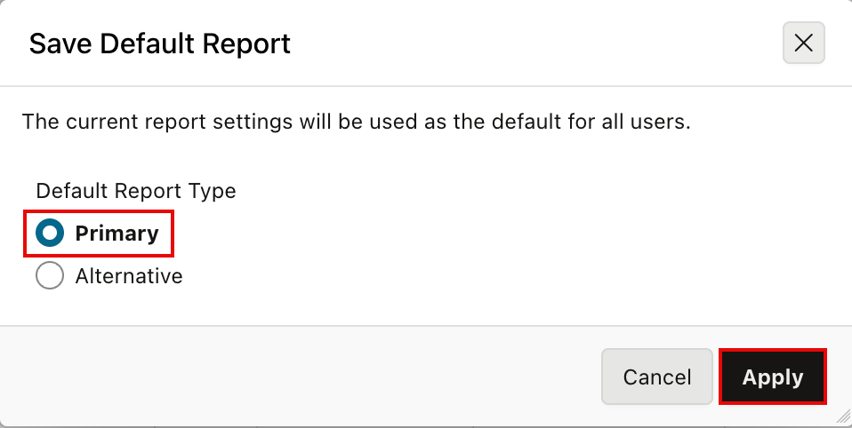

## Task 2: Create the Active Candidates Report

1. On the **Candidates** report, select **Actions**.

2. Select select **Filter**.

    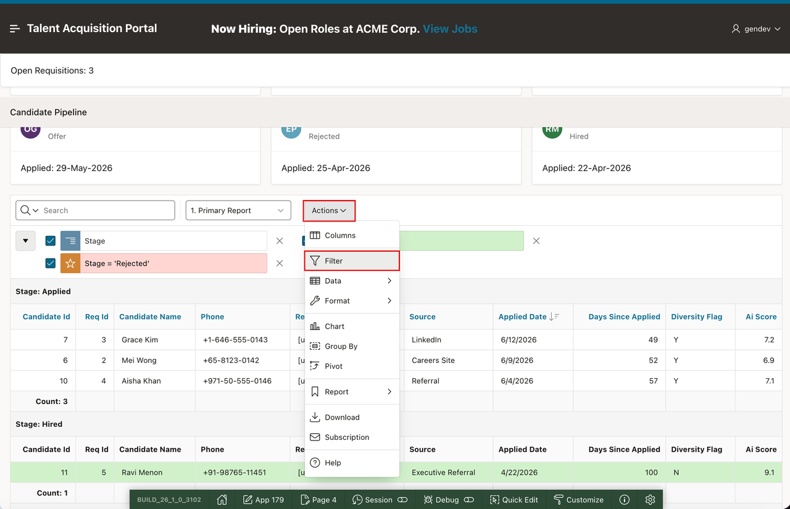

3. In the **Filter** dialog, enter/select the following:

    - **Column:** **Stage**
    - **Operator:** **Not in**
    - **Expression:** **Hired,Rejected**

4. Select **Apply**.

    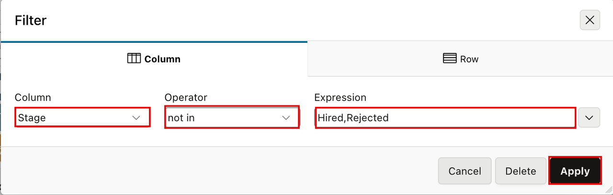

5. Select **Actions**.

6. Select **Report** and then select **Save Report**.

    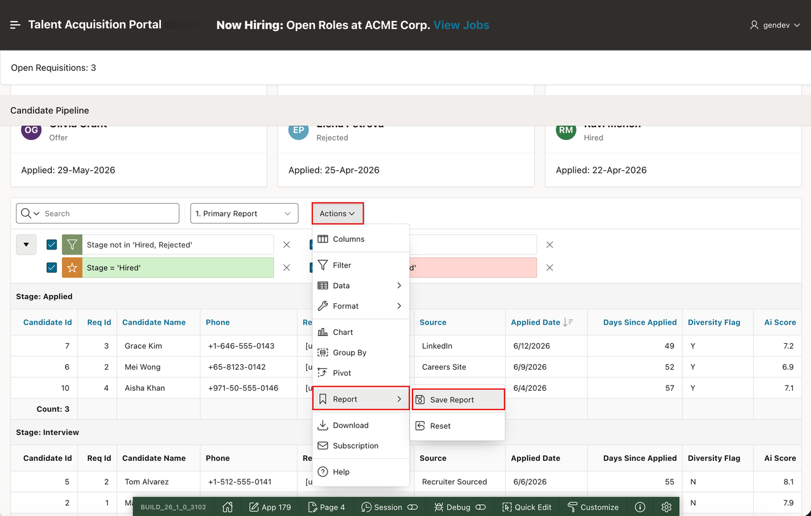

7. In the **Save Report** dialog, enter/select the following:

    - **Save:** **As Named Report**
    - **Name:** **Active Candidates**

8. Select **Apply**.

    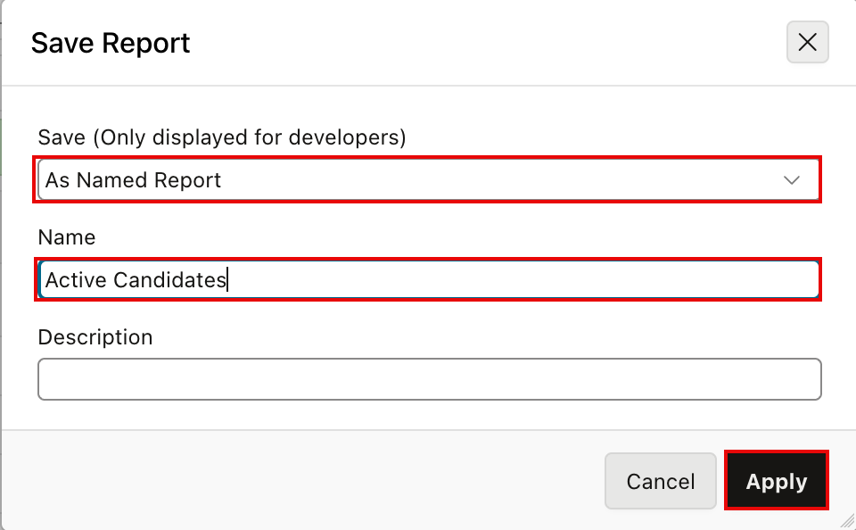

    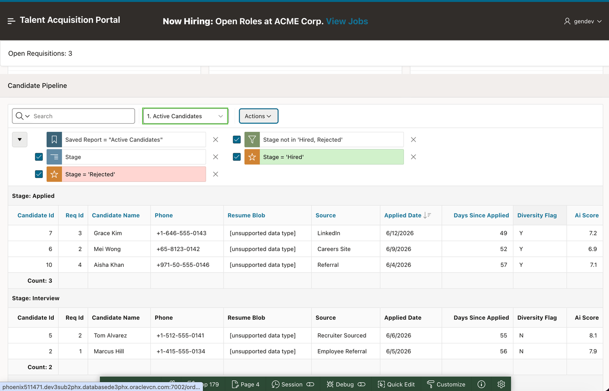

## Summary

You customized the Candidate Pipeline Interactive Report, saved the layout as the primary default report, and created the **Active Candidates** named report.

### Acknowledgements

- **Author** - Apoorva Srinivas, Principal Product Manager; Roopesh Thokala, Principal Product Manager
- **Last Updated By/Date** - Roopesh Thokala, Principal Product Manager, October 2026
