# Link Job Cards to a Filtered Candidate List

## Introduction

Pass a requisition ID from each Job Openings card to Candidate Pipeline. The report query reads the page item and displays applicants only for the selected requisition.

Estimated Lab Time: 5 minutes

### Objectives

In this lab, you will learn how to:

- Add a requisition ID page item to Candidate Pipeline.
- Filter an Interactive Report with a bind variable.
- Link Job Openings cards to the filtered report.

## Task 1: Filter Candidate Pipeline by Requisition

1. Run the application.

2. On the **Candidate Pipeline** page, select **Edit Page** in the Developer Toolbar.

    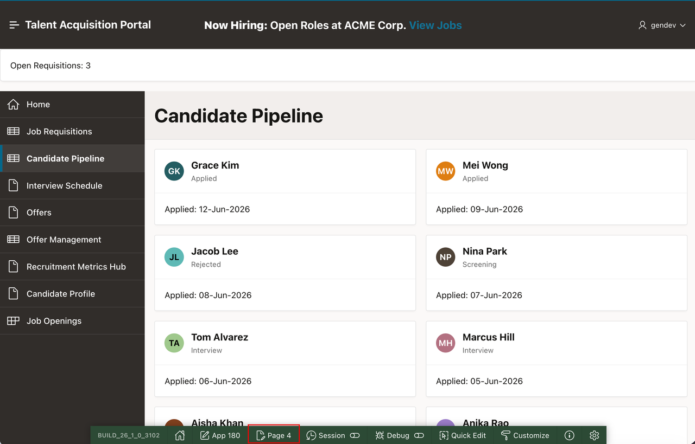

3. In the Rendering tab, right-click **Body**.

4. Select **Create Page Item**.

    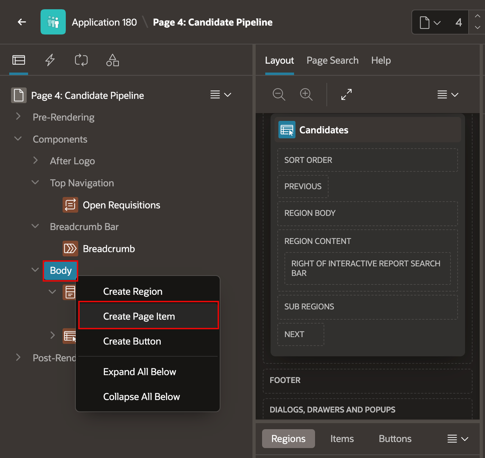

5. In the Property Editor, enter/select the following:

    - **Identification > Name:** **P4\_REQ\_ID**
    - **Identification > Type:** **Hidden**

    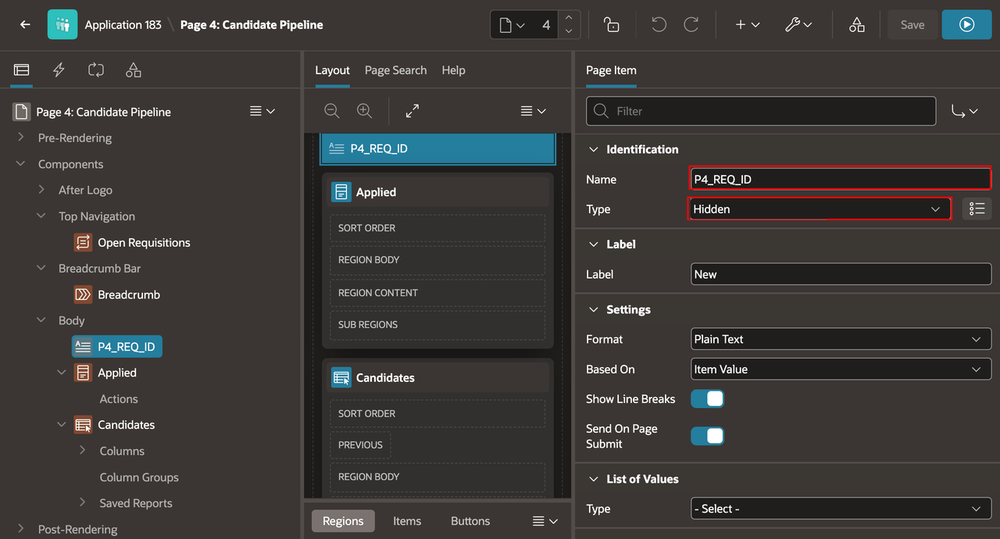

6. In the Rendering tab, select the **Candidates** region.

7. In the Property Editor, under **Source**, select **SQL Query**.

    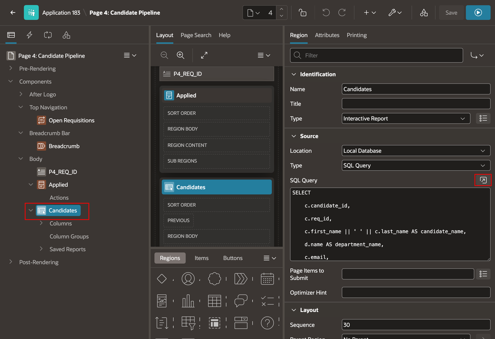

8. Replace the query with the following:

    ```sql
    SELECT c.candidate_id,
           c.req_id,
           c.first_name || ' ' || c.last_name AS candidate_name,
           d.name AS department_name,
           c.email,
           c.phone,
           c.resume_blob,
           c.source,
           c.current_stage AS stage,
           c.applied_date,
           TRUNC(SYSDATE - c.applied_date) AS days_since_applied,
           c.diversity_flag,
           c.ai_score,
           c.created_by,
           c.created,
           c.updated_by,
           c.updated
      FROM tms_candidates c
      LEFT JOIN tms_job_requisitions r
        ON c.req_id = r.req_id
      LEFT JOIN tms_departments d
        ON r.dept_id = d.dept_id
     WHERE :P4_REQ_ID IS NULL
        OR c.req_id = :P4_REQ_ID
    ```

    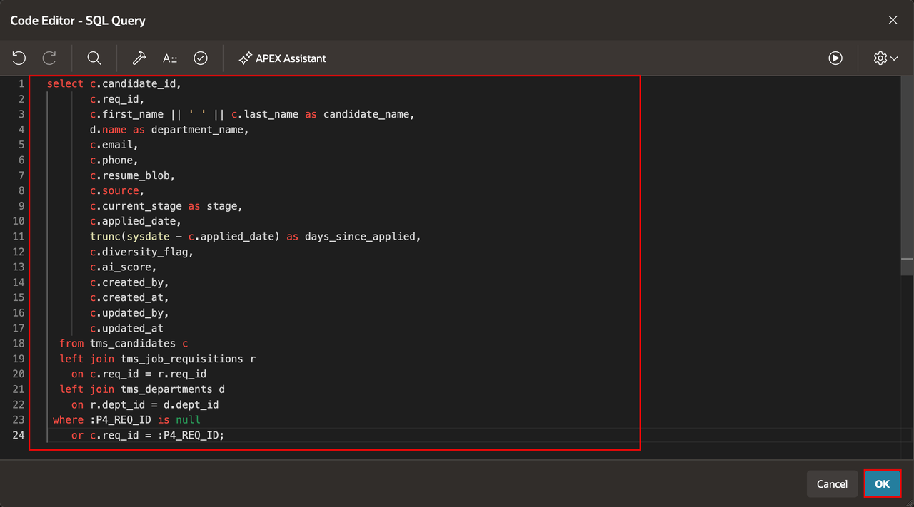

9. Select **Save**.

## Task 2: Link the Job Openings Card

1. Open the page named **Job Openings** in Page Designer.

    > **Note:** The page number can differ between applications. Select the page by its name, **Job Openings**.

    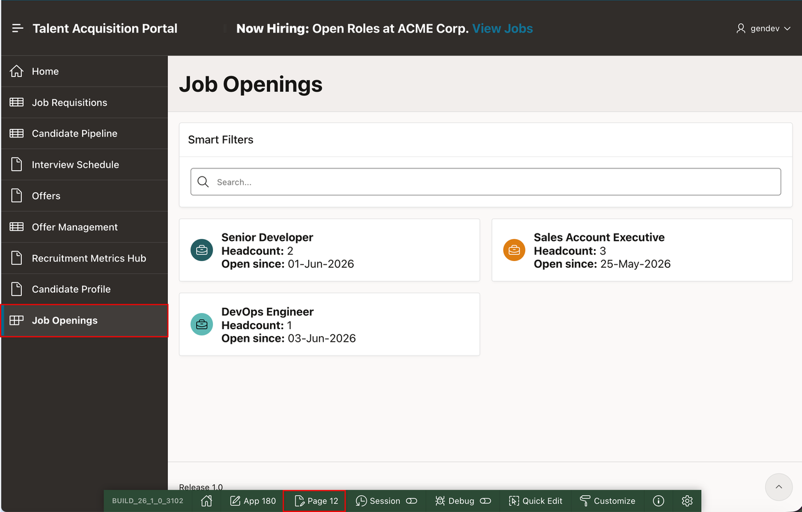

2. In the Rendering tab, expand the **Job Openings** region.

3. Right-click **Actions**.

4. Select **Create Action**.

    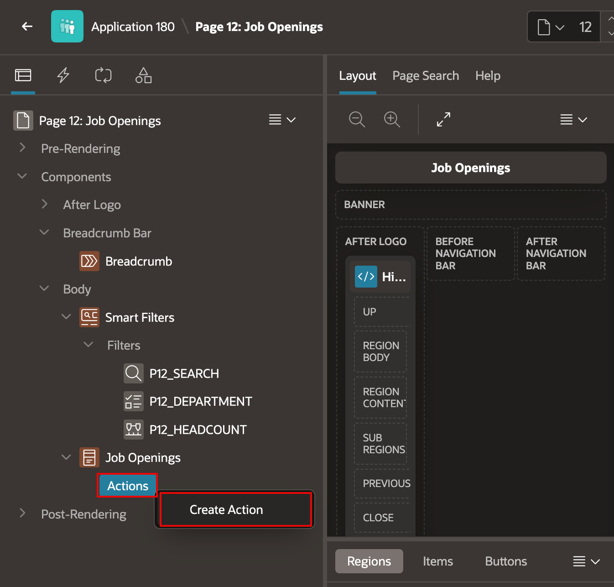

5. In the Property Editor, under **Identification**, enter/select the following:

    - **Type:** **Button**
    - **Label:** **View Applicants**

    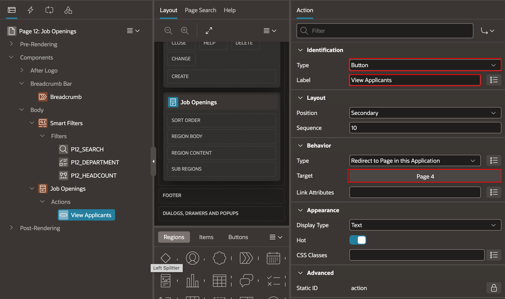

6. Under **Behavior**, select the target picker.

7. In the Link Builder, enter/select the following:

    - **Page:** **4**
    - Under **Set Items**:
        - **Name:** **P\_REQ\_ID**
        - **Value:** **&REQ_ID.**

8. Select **OK**.

    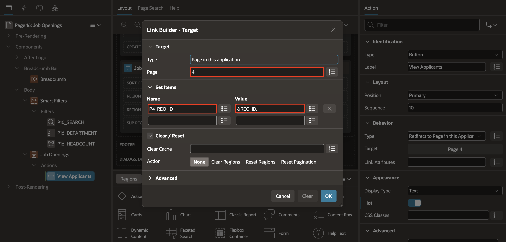

9. In the Property Editor, under **Appearance**, set **Hot** to **On**.

    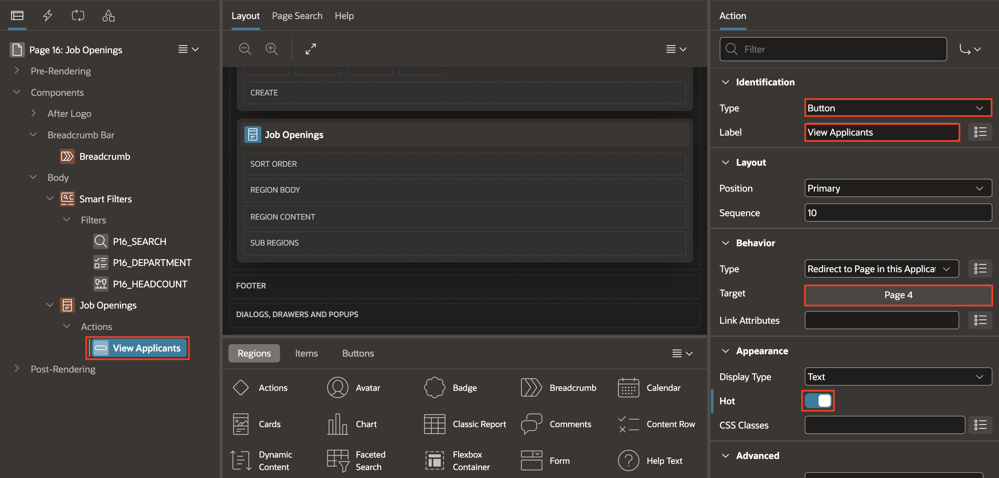

10. Select **Save and Run Page**.

11. Select **View Applicants** for a job opening.

12. Confirm that Candidate Pipeline lists candidates only for that requisition.

    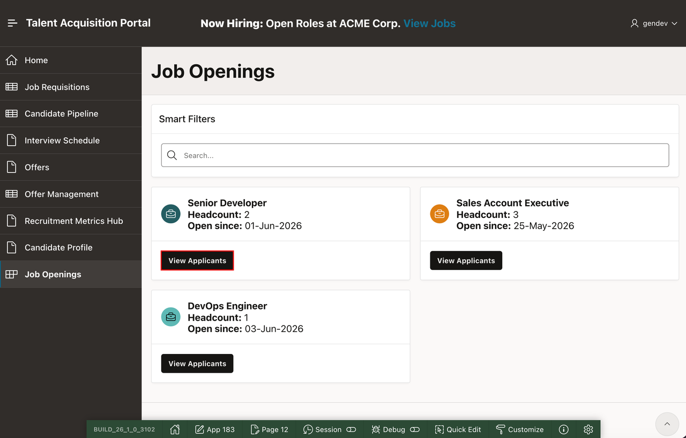

    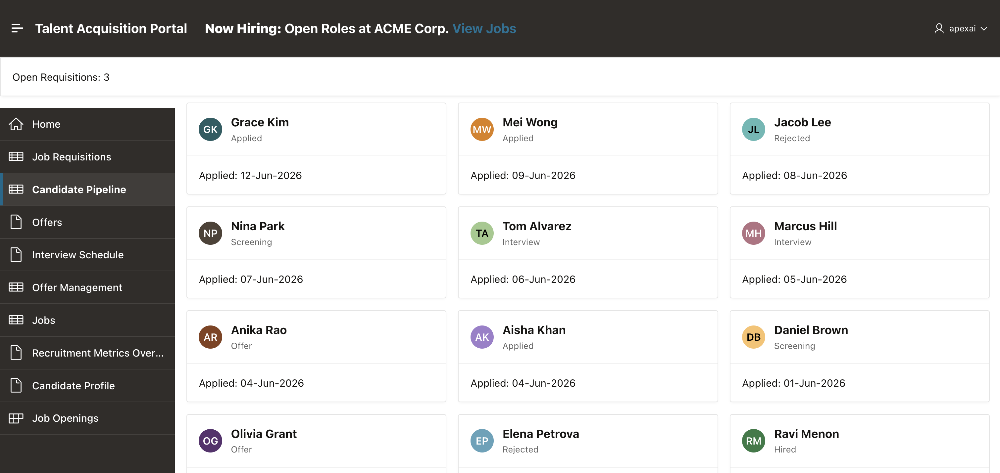

## Summary

You added a requisition ID page item and used it to filter Candidate Pipeline from a **View Applicants** action on Job Openings cards.

### Acknowledgements

- **Author** - Apoorva Srinivas, Principal Product Manager; Roopesh Thokala, Principal Product Manager
- **Last Updated By/Date** - Roopesh Thokala, Principal Product Manager, October 2026
