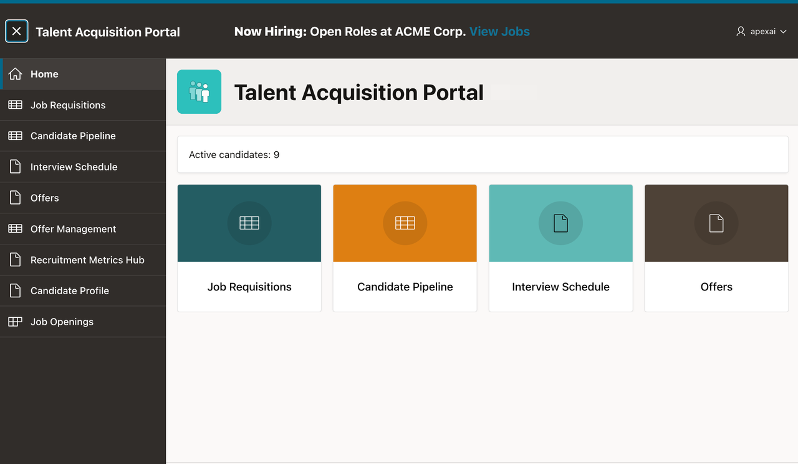

# Managing Interactive Reports and Grids

The Talent Acquisition Portal (TAP) application includes a Candidate Pipeline Interactive Report and an Interview Schedule Interactive Grid. In this workshop, you customize these components so that users can find and work with candidate information more effectively.

Estimated Workshop Time: 30 minutes

### Objectives

In this workshop, you will learn how to:

- Customize an Interactive Report.
- Save report customizations.
- Create a detail page and link it from an Interactive Report.
- Filter report data from a Cards region.
- Create a master-detail page.

### Prerequisites

This workshop requires:

- An Oracle APEX 26.2 workspace.
- Completion of the previous workshops in this series.

> **Note:** Screenshots were captured with Oracle APEX 26.1. Minor user interface differences may appear in Oracle APEX 26.2.

### Downloads

Stuck or missed out on completing the previous labs? Don't worry! You can download the following file:

- **<a href="files/tap-export3.sql" download="tap-export3.sql">Talent Acquisition Portal</a>**

Import it into your workspace. In **App Builder**, select **Import**, upload `tap-export3.sql`, and follow the steps in the **Import Application** wizard.

> **Note:**
>
> - **APEX Version:** The supplied application export was created with Oracle APEX 26.2 and cannot be imported into earlier APEX releases.
> - **Supporting Objects:** Supporting objects are already loaded in the workspace.
> - **AI Configuration:** Configure a Generative AI Service from **App Builder > Workspace Utilities > Generative AI**. See **Module 1, Lab 2: Configure Generative AI Service**.

### Acknowledgements

- **Author** - Roopesh Thokala, Principal Product Manager, Oracle APEX
- **Last Updated By/Date** - Roopesh Thokala, Principal Product Manager, October 2026
