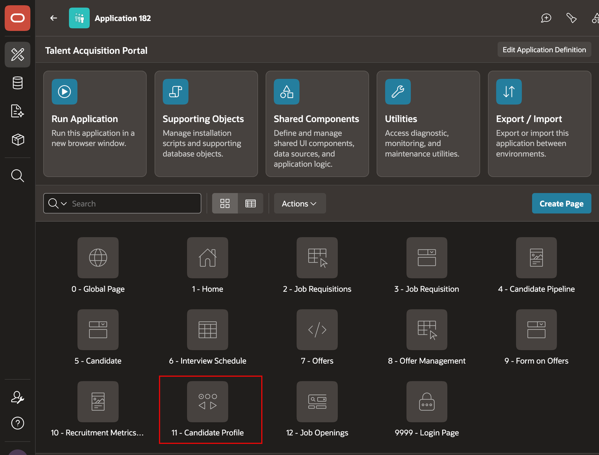
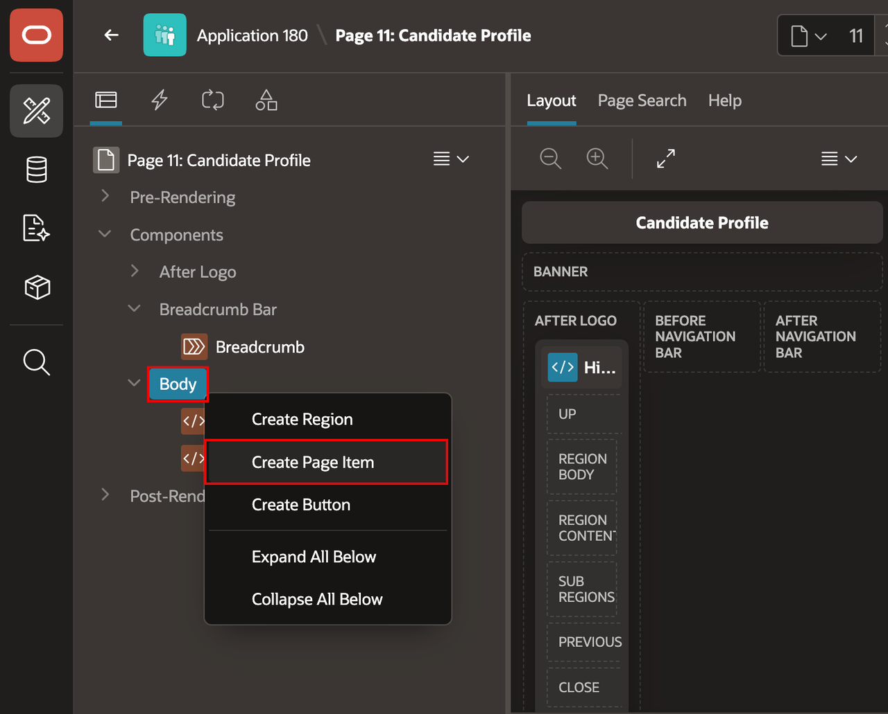
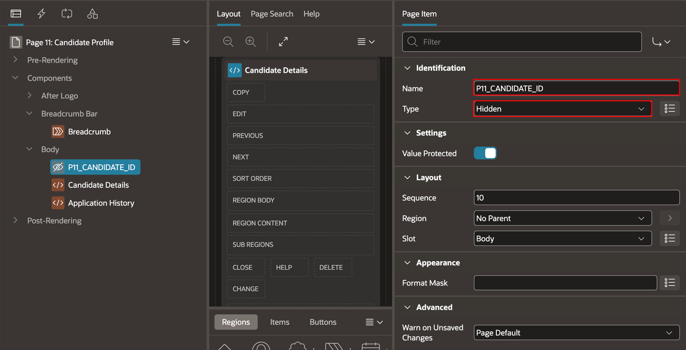
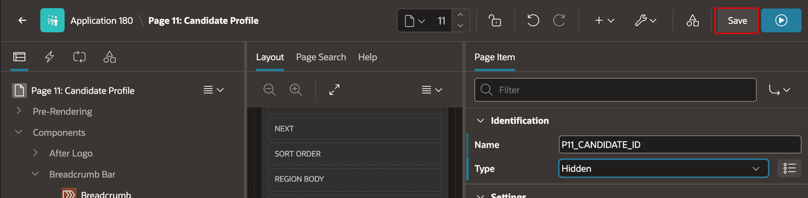
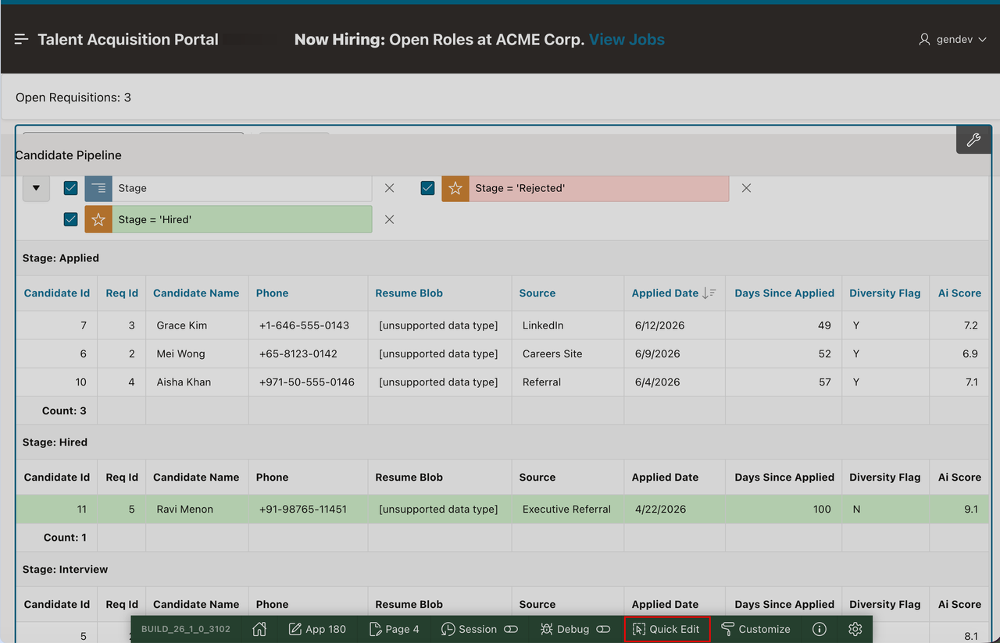
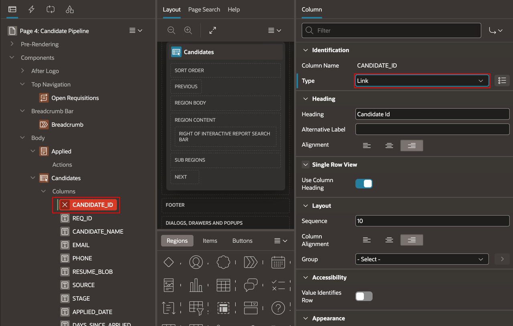
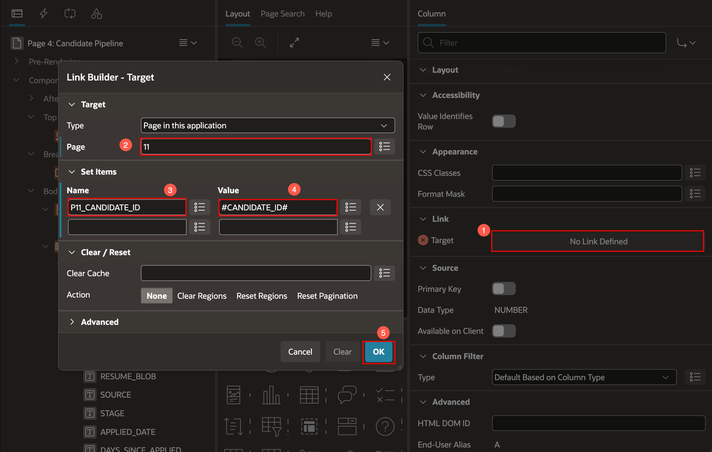
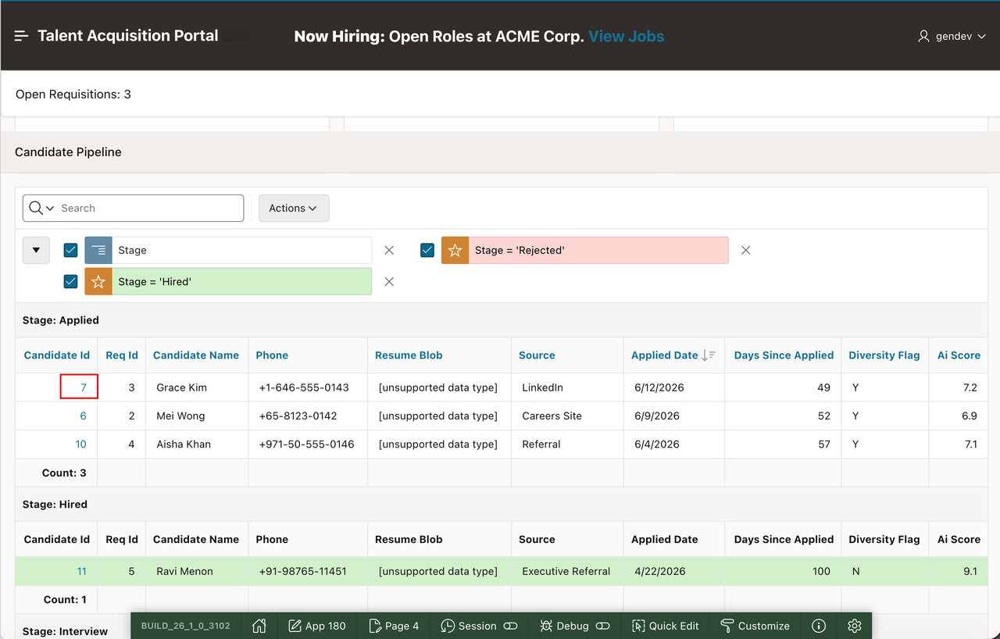
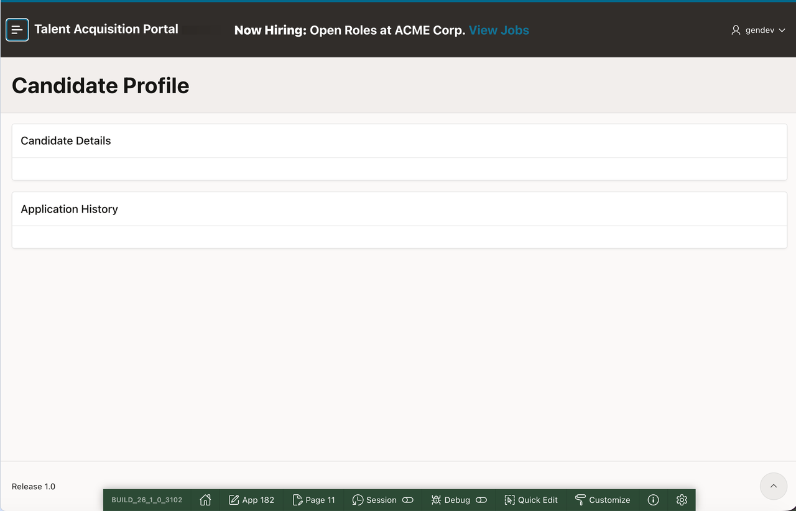

# Link Candidate Pipeline to Candidate Profile

## Introduction

Link each candidate ID in Candidate Pipeline to the Candidate Profile page. The profile page is intentionally blank at this point; a later module builds its content.

Estimated Lab Time: 10 minutes

### Objectives

In this lab, you will learn how to:

- Add a hidden candidate ID item to Candidate Profile.
- Configure the Candidate Pipeline candidate ID column as a link.
- Pass the selected candidate ID to Candidate Profile.

## Task 1: Add the Target Page Item

1. Open the page named **Candidate Profile** in Page Designer.

    > **Note:** The page number can differ between applications. Select the page by its name, **Candidate Profile**.

    

2. In the Rendering tab, right-click **Body**.

3. Select **Create Page Item**.

    

4. In the Property Editor, enter/select the following:

    - **Identification > Name:** **P11\_CANDIDATE\_ID**
    - **Identification > Type:** **Hidden**

    

5. Select **Save**.

    

## Task 2: Configure the Candidate Pipeline Link

1. Run the application.

2. Open the **Candidate Pipeline** page.

3. In the Developer Toolbar, select **Quick Edit** for the **Candidates** report.

    

4. In the Rendering tab, expand **Columns** under the **Candidates** region.

5. Select **CANDIDATE\_ID**.

6. In the Property Editor, set **Identification > Type** to **Link**.

    

7. Under **Link**, select the target picker.

8. In the Link Builder, enter/select the following:

    - **Page:** **11**
    - Under **Set Items**:
        - **Name:** **P11\_CANDIDATE\_ID**
        - **Value:** **#CANDIDATE_ID#**

    > **Note:** The page number can differ between applications. Select the page named **Candidate Profile**.

9. Select **OK**.

    

10. Select **Save and Run Page**.

11. Select a candidate ID.

12. Confirm that the **Candidate Profile** page opens.

    

    

## Summary

You added a hidden candidate ID item to Candidate Profile and linked each Candidate Pipeline candidate ID to that page.

### Acknowledgements

- **Author** - Apoorva Srinivas, Principal Product Manager; Roopesh Thokala, Principal Product Manager
- **Last Updated By/Date** - Roopesh Thokala, Principal Product Manager, October 2026
