# Demonstrate User Report Customization

## Introduction

Use a separate end-user account to personalize Candidate Pipeline. This demonstrates that end-user report customizations are private, whereas developer-saved reports can be shared.

Estimated Lab Time: 5 minutes

### Objectives

In this lab, you will learn how to:

- Update the Candidate Pipeline query to include department information.
- Create a private report as an end user.
- Compare the primary report with a private report.

## Task 1: Prepare the Report Query

1. Run the application.

2. On the **Candidate Pipeline** page, select **Edit Page** in the Developer Toolbar.

    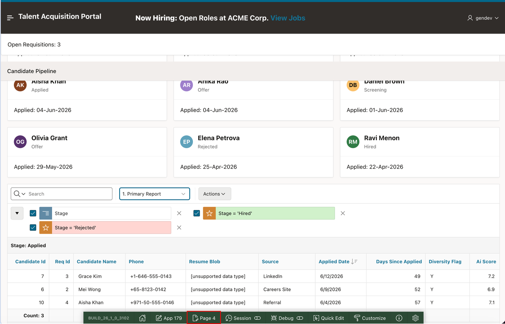

3. In the Rendering tab, select the **Candidates** region.

4. In the Property Editor, under **Source**, select **SQL Query**.

    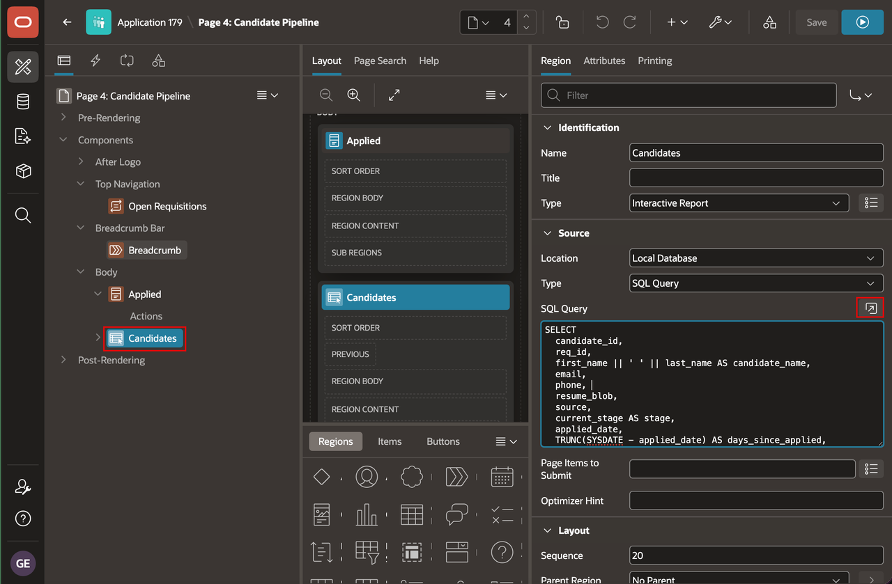

5. Replace the query with the following:

    ```sql
    SELECT c.candidate_id,
           c.req_id,
           c.first_name || ' ' || c.last_name AS candidate_name,
           d.name AS department_name,
           c.email,
           c.phone,
           c.resume_blob,
           c.source,
           c.current_stage AS stage,
           c.applied_date,
           TRUNC(SYSDATE - c.applied_date) AS days_since_applied,
           c.diversity_flag,
           c.ai_score,
           c.created_by,
           c.created,
           c.updated_by,
           c.updated
      FROM tms_candidates c
      LEFT JOIN tms_job_requisitions r
        ON c.req_id = r.req_id
      LEFT JOIN tms_departments d
        ON r.dept_id = d.dept_id
    ```

    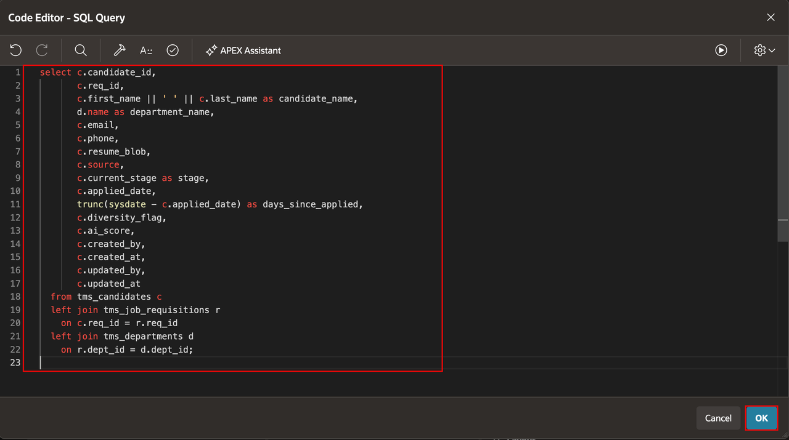

6. Select **Save and Run Page**.

    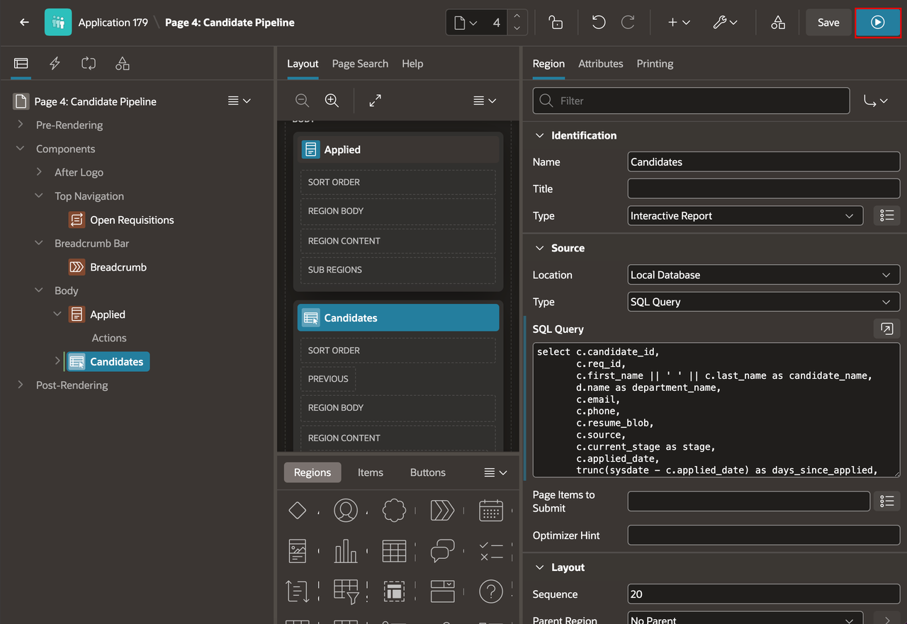

## Task 2: Create an End-User Account

1. In your APEX workspace, select **Administration**.

2. Select **Manage Users and Groups**.

    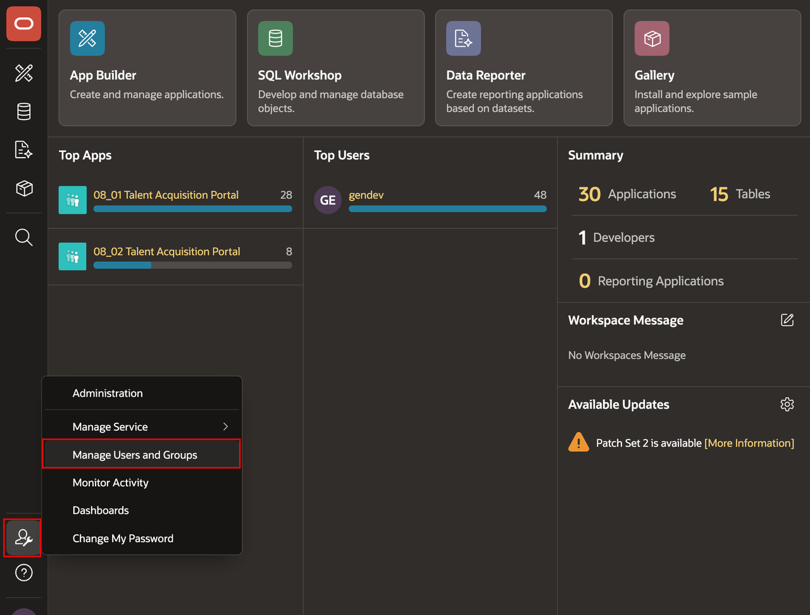

3. Select **Create User**.

    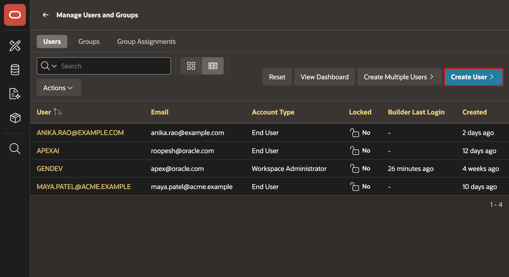

4. Enter/select the following:

    - **Username:** **APEXAI**
    - **Email Address:** **apexai@example.com**
    - **Password:** Enter a password of your choice.
    - **Confirm Password:** Enter the password again.

5. Select **Create User**.

    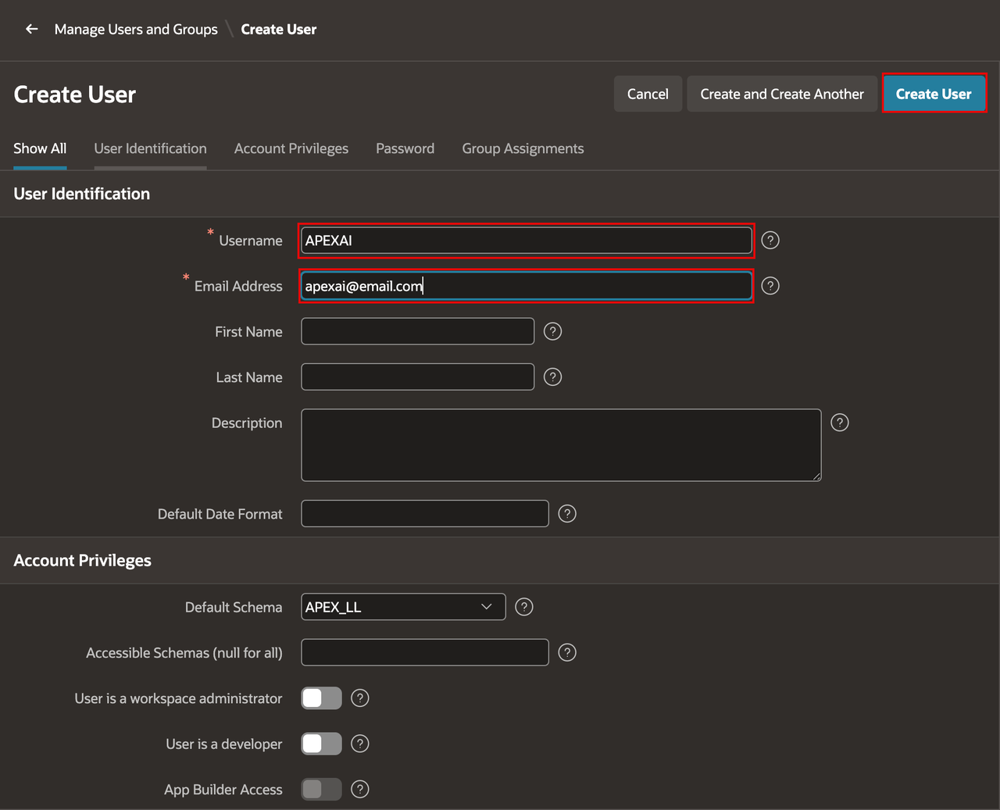

## Task 3: Create a Private User Report

1. Run the application.

2. Sign out of the developer account.

3. Sign in as **APEXAI**.

    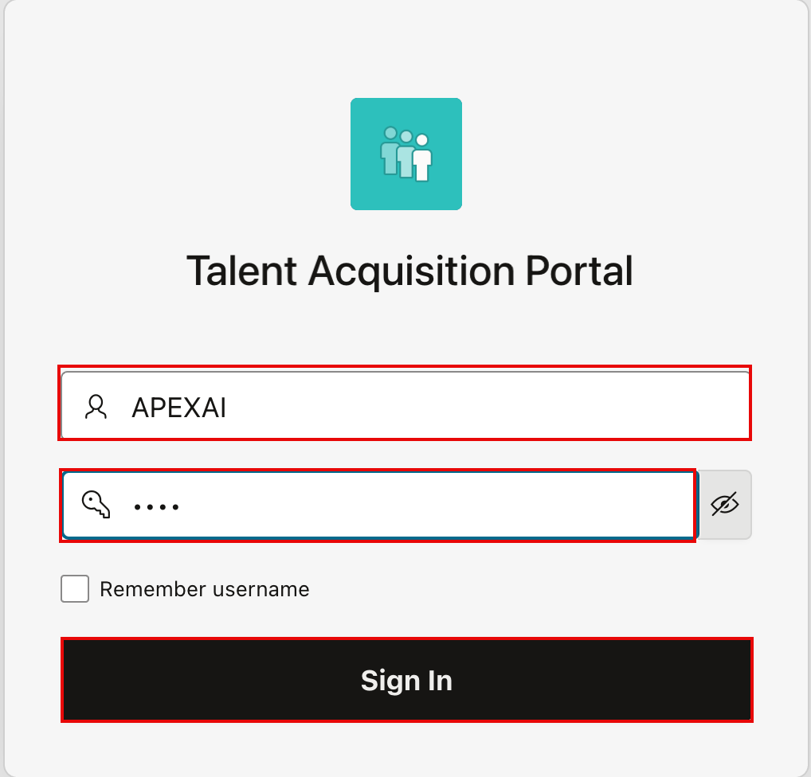

4. On the **Candidate Pipeline** page, select **Actions**.

5. Select **Columns**.

6. In the **Columns** dialog, move **Department Name** to the displayed columns.

7. Select **Apply**.

    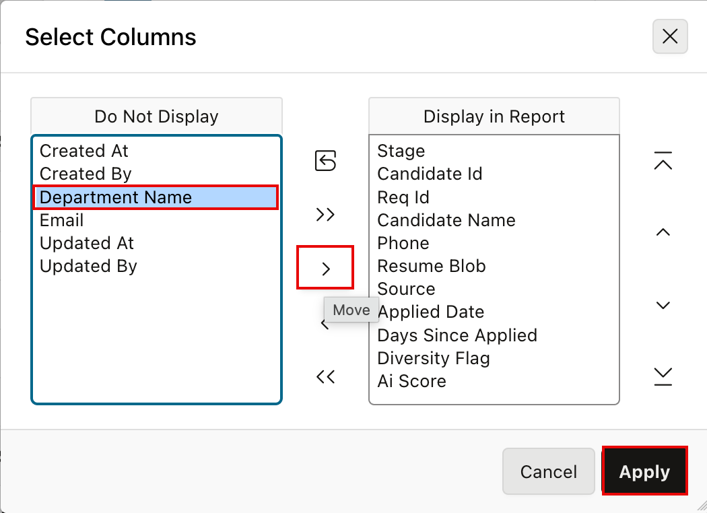

8. Select **Actions**.

9. Select **Filter**.

10. In the **Filter** dialog, enter/select the following:

    - **Column:** **Department Name**
    - **Operator:** **in**
    - **Expression:** **Sales,Engineering**

11. Select **Apply**.

    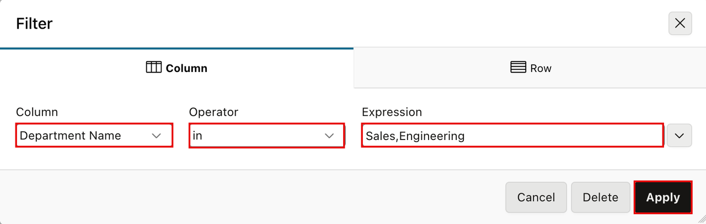

12. Select **Actions**.

13. Then, select **Group By**.

14. In the **Group By** dialog, enter/select the following:

    - **Group By:** **Stage**
    - **Function:** **Count**
    - **Column:** **Candidate Name**
    - **Format Mask:** **5,234**

15. Select **Apply**.

    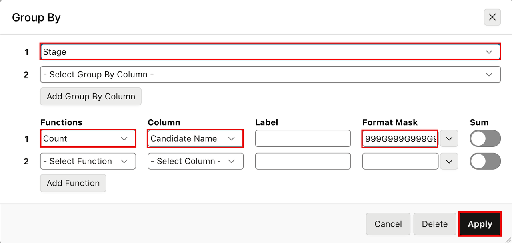

16. Select **Actions**.

17. Select **Report** and then select **Save Report**.

18. In the **Save Report** dialog, enter/select the following:

    - **Save:** **As Named Report**
    - **Name:** **My Dashboard**

19. Select **Apply**.

    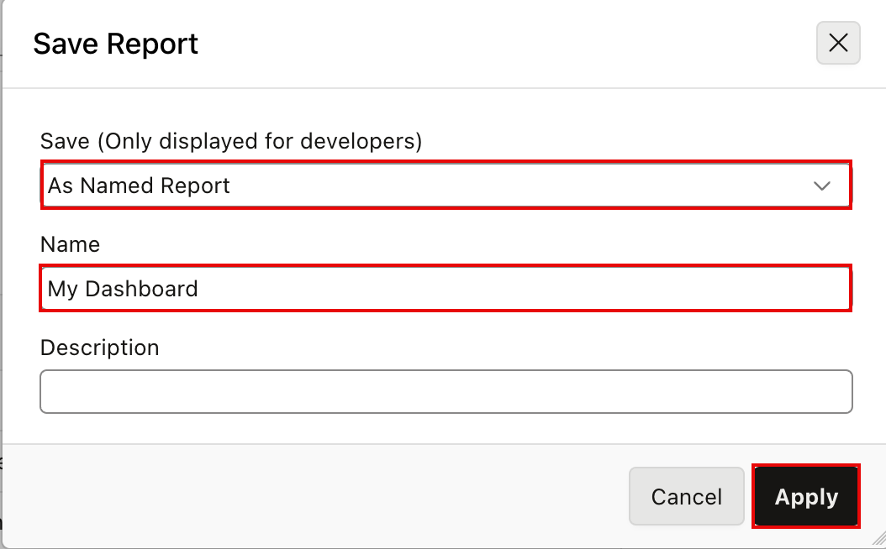

20. Select the report selector and select **Primary Report**.

21. Select **Actions**.

22. Select **Report** and then select **Reset**.

23. Compare the primary report with **My Dashboard**. Confirm that **My Dashboard** is available only to the signed-in user.

    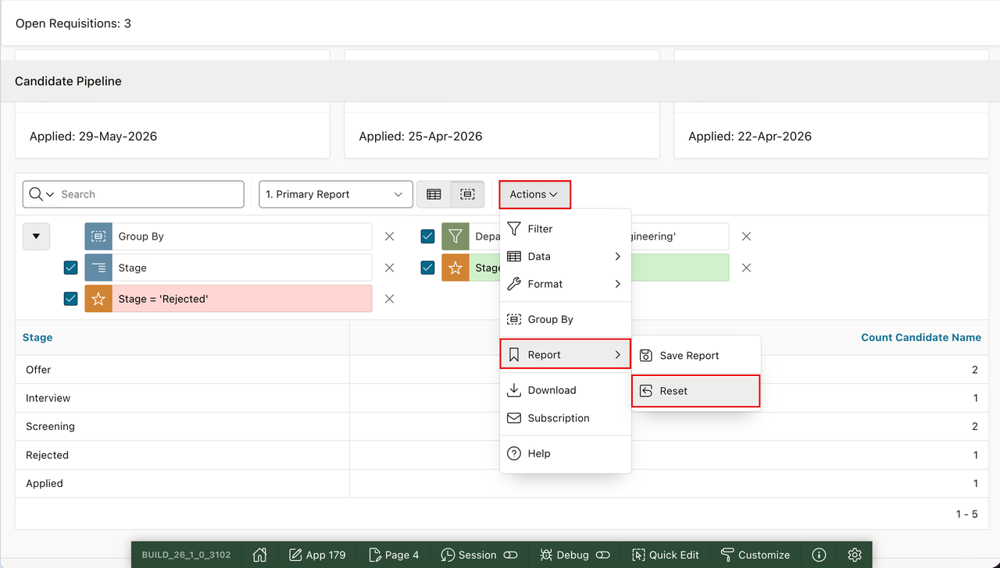

## Summary

You updated Candidate Pipeline to display department information and created the private **My Dashboard** report for the **APEXAI** user.

### Acknowledgements

- **Author** - Apoorva Srinivas, Principal Product Manager; Roopesh Thokala, Principal Product Manager
- **Last Updated By/Date** - Roopesh Thokala, Principal Product Manager, October 2026
